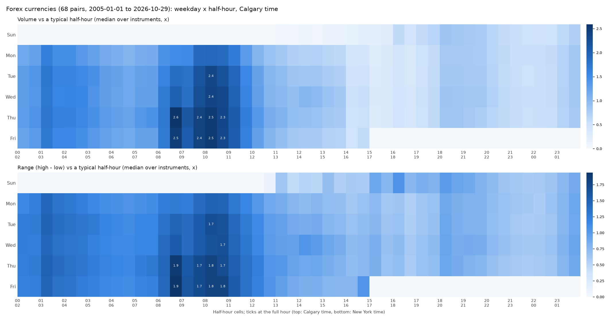
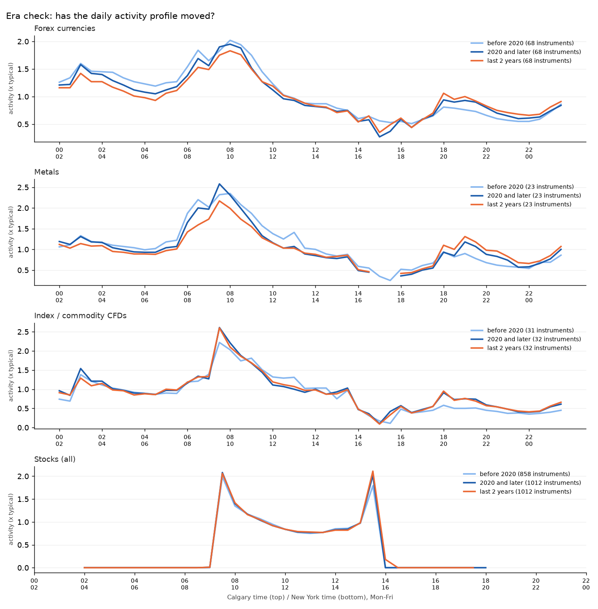

# Market hours: when does each market move? (Calgary time)

Generated 2026-10-29 12:20 UTC by `tools/research/market_hours/deep.py` + `report.py` (workflow `market-hours.yml`). Coverage: **123 forex / metal / CFD instruments** (OANDA M30, 2005-01-01 to 2026-10-29, median 21.8 years each) and **1012 US stocks / ETFs** (Alpaca 30-minute, feed sip, median 10.8 years). Stocks have their own file: [Market_Hours_Stocks.md](Market_Hours_Stocks.md); every symbol is searchable in the app (Market hours page). All times are **Calgary (America/Edmonton)**; New York is always 2 h ahead. Descriptive statistics only - no trading signal, no profit claim.

## In plain words

- **Forex currencies (68 pairs, median 21.8 years):** the strongest half-hours start at 08:00 (1.98x), 06:30 (1.81x), 01:00 (1.60x) Calgary. 06:30 (US data) 1.81x, 07:30 (NYSE open) 1.89x, 08:00 1.98x, London open 01:00 1.60x; quietest around 15:00 (rollover) 0.49x.
- **Each pair's own best half-hour:** 08:00 for 54 pairs, 08:30 for 8 pairs, 09:00 for 2 pairs, 01:00 for 2 pairs. 97.1% of pairs have reliable best times (both halves of the history agree).
- **Metals (23):** peaks at 07:30 (2.37x), 06:30 (2.13x), 01:00 (1.32x).
- **Index / commodity CFDs (32):** peaks at 07:30 (2.37x), 01:00 (1.40x), 12:00 (1.05x) - the cash-market opens dominate.
- **Weekdays, forex currencies:** day activity Mon 0.91x / Tue 0.99x / Wed 1.02x / Thu 1.05x / Fri 1.02x - only 15% between the busiest and the quietest weekday. Best weekday reliable for 66.2% of instruments (mostly Thu 39, Fri 6).
- **NFP Fridays:** the 06:30 Calgary half-hour moves 2.35x as far as on other Fridays (median pair, IQR 2.21-2.76, 259 NFP days). **FOMC days:** 12:00 Calgary 3.32x, press conference 12:30 2.62x vs a normal day.
- **Era check:** last 2 years vs whole history: median rho 0.95 (forex), 0.99 (stocks); 13.2% of pairs and 8.5% of stocks shifted.
- Stocks in short: strongest half-hours 07:30 (2.06x), 13:30 (1.95x) Calgary (details in Market_Hours_Stocks.md).

## When to open the charts (group profiles, Mon-Fri)

Activity = sqrt(volume x range) of a half-hour relative to a typical half-hour of the same instrument and month (1.0x = typical), median over the group's instruments, whole history. The window around each peak keeps at least 2/3 of the peak.

| Calgary window | Market | Peak | Peak NY | Activity | Volume | Range | Big-move days | What happens then |
|---|---|---|---|---|---|---|---|---|
| 00:00-05:00 | Forex currencies | **01:00** | 03:00 ET | 1.60x | 1.72x | 1.49x | 23.9% | London open 08:00 (normal weeks) |
| 00:00-05:00 | Metals | **01:00** | 03:00 ET | 1.32x | 1.42x | 1.25x | 14.4% | London open 08:00 (normal weeks) |
| 01:00-03:30 | Index / commodity CFDs | **01:00** | 03:00 ET | 1.40x | 1.46x | 1.29x | 15.9% | London open 08:00 (normal weeks) |
| 05:30-07:00 | Forex currencies | **06:30** | 08:30 ET | 1.81x | 2.04x | 1.58x | 32.3% | US data 08:30 ET (NFP, CPI, retail sales, claims) |
| 06:00-07:00 | Metals | **06:30** | 08:30 ET | 2.13x | 2.36x | 1.99x | 49.4% | US data 08:30 ET (NFP, CPI, retail sales, claims) |
| 07:00-10:00 | Forex currencies | **08:00** | 10:00 ET | 1.98x | 2.33x | 1.67x | 34.5% | 10:00 ET data (ISM, JOLTS, sentiment) |
| 07:00-09:30 | Metals | **07:30** | 09:30 ET | 2.37x | 2.72x | 2.08x | 53.6% | NYSE open 09:30 ET |
| 07:30-09:30 | Index / commodity CFDs | **07:30** | 09:30 ET | 2.37x | 3.18x | 1.75x | 36.9% | NYSE open 09:30 ET |
| 07:30-08:30 | US stocks | **07:30** | 09:30 ET | 2.06x | 1.62x | 2.63x | 75.6% | NYSE open 09:30 ET |
| 10:30-13:00 | Metals | **11:00** | 13:00 ET | 1.28x | 1.29x | 1.30x | 19.8% |  |
| 13:30-14:00 | US stocks | **13:30** | 15:30 ET | 1.95x | 3.63x | 1.05x | 6.4% | last regular stock half-hour |

## Era check: has the pattern drifted?

For every instrument the Mon-Fri half-hour profile of the last 2 years is compared with its whole history, and before 2020 with 2020 and later (Spearman rank correlation of the 48 half-hours; 1.0 = same shape). "Shifted" = rho below 0.8, or the peak half-hour moved by more than 30 minutes and the old peak is now more than 10% below the new one (a swap between two near-equal peaks does not count).

| Group | Instruments | Median rho last 2 y vs all | Median rho pre vs post 2020 | Shifted | Group peak before 2020 | Group peak since 2020 |
|---|---|---|---|---|---|---|
| Forex currencies | 68 | 0.95 | 0.97 | 13.2% | 08:00 | 08:00 |
| Majors | 7 | 0.97 | 0.97 | 0.0% | 08:00 | 08:00 |
| Crosses | 21 | 0.94 | 0.97 | 9.5% | 08:00 | 08:00 |
| Exotics | 40 | 0.94 | 0.97 | 17.5% | 08:00 | 08:00 |
| Metals | 23 | 0.89 | 0.92 | 8.7% | 08:00 | 07:30 |
| Index / commodity CFDs | 32 | 0.97 | 0.94 | 18.8% | 07:30 | 07:30 |
| Stocks (all) | 1012 | 0.99 | 0.99 | 8.5% | 07:30 | 07:30 |
| Sector: Communication Services | 33 | 0.99 | 0.98 | 3.0% | 07:30 | 07:30 |
| Sector: Consumer Discretionary | 68 | 0.98 | 0.98 | 11.8% | 07:30 | 07:30 |
| Sector: Consumer Staples | 41 | 0.98 | 0.98 | 7.3% | 07:30 | 13:30 |
| Sector: ETF | 4 | 0.98 | 0.97 | 0.0% | 07:30 | 07:30 |
| Sector: Energy | 45 | 0.98 | 0.96 | 2.2% | 07:30 | 07:30 |
| Sector: Financials | 108 | 0.99 | 0.99 | 5.6% | 07:30 | 13:30 |
| Sector: Health Care | 74 | 0.99 | 0.99 | 10.8% | 07:30 | 07:30 |
| Sector: Industrials | 99 | 1.00 | 1.00 | 8.1% | 07:30 | 13:30 |
| Sector: Information Technology | 100 | 0.96 | 0.97 | 8.0% | 07:30 | 07:30 |
| Sector: Materials | 69 | 0.98 | 0.97 | 2.9% | 07:30 | 07:30 |
| Sector: Other (top liquid) | 300 | 0.99 | 0.99 | 10.0% | 07:30 | 13:30 |
| Sector: Real Estate | 33 | 1.00 | 1.00 | 18.2% | 13:30 | 13:30 |
| Sector: Utilities | 38 | 1.00 | 0.99 | 13.2% | 13:30 | 13:30 |

## Daylight saving: what moves on the Calgary clock

New York events never move on the Calgary clock (both follow US DST dates). London does: the London open (08:00 London) is 01:00 Calgary most of the year but 02:00 in the US/UK mismatch weeks (2nd Sunday of March -> last Sunday of March; last Sunday of October -> 1st Sunday of November). Measured volume (forex currencies, median):

| Calgary | Normal weeks | Mismatch weeks |
|---|---|---|
| 01:00 | 1.75x | 1.29x |
| 02:00 | 1.54x | 1.73x |

Asian evening (Sun-Thu) by Calgary season: Calgary on MST (Nov-Mar) vs MDT (Mar-Nov):

| Calgary | MST (winter) | MDT (summer) |
|---|---|---|
| 17:00 | 0.77x | 0.42x |
| 18:00 | 0.86x | 0.83x |

## NFP and FOMC dates

- FOMC statement dates: 182 (federalreserve.gov statement links; includes the unscheduled statements of 2008 and 2020).
- NFP (Employment Situation) release dates: 273 (BLS release rule (third Friday after the week containing the 12th) + known 2025-26 moves (bls.gov not reachable)).
- Ratio = median range of the event half-hour on event days / the same half-hour on control days (NFP: other Fridays; FOMC: other days of the same weekday). Group medians:

| Group | Event | Median range ratio | IQR over instruments | Instruments | Event days (median) |
|---|---|---|---|---|---|
| Forex currencies | NFP | 2.35x | 2.21x-2.76x | 68 | 259 |
| Forex currencies | FOMC 12:00 | 3.32x | 2.97x-4.60x | 68 | 182 |
| Forex currencies | FOMC 12:30 | 2.62x | 2.38x-3.63x | 68 | 182 |
| Majors | NFP | 2.90x | 2.70x-3.00x | 7 | 259 |
| Majors | FOMC 12:00 | 4.81x | 4.64x-5.22x | 7 | 182 |
| Majors | FOMC 12:30 | 3.73x | 3.51x-3.99x | 7 | 182 |
| Crosses | NFP | 2.28x | 2.22x-2.34x | 21 | 259 |
| Crosses | FOMC 12:00 | 3.07x | 2.92x-3.15x | 21 | 182 |
| Crosses | FOMC 12:30 | 2.36x | 2.16x-2.47x | 21 | 182 |
| Exotics | NFP | 2.50x | 2.17x-2.84x | 40 | 259 |
| Exotics | FOMC 12:00 | 3.95x | 3.05x-4.77x | 40 | 182 |
| Exotics | FOMC 12:30 | 3.09x | 2.48x-3.88x | 40 | 182 |
| Metals | NFP | 2.15x | 2.01x-2.25x | 23 | 240 |
| Metals | FOMC 12:00 | 3.41x | 3.30x-3.72x | 23 | 173 |
| Metals | FOMC 12:30 | 3.12x | 2.77x-3.43x | 23 | 173 |
| Index / commodity CFDs | NFP | 2.37x | 1.86x-2.83x | 32 | 250 |
| Index / commodity CFDs | FOMC 12:00 | 2.64x | 1.98x-2.84x | 31 | 177 |
| Index / commodity CFDs | FOMC 12:30 | 2.44x | 2.31x-3.29x | 31 | 165 |
| Stocks (all) | NFP | 1.08x | 1.03x-1.13x | 1009 | 123 |
| Stocks (all) | FOMC 12:00 | 1.84x | 1.69x-2.02x | 1008 | 92 |
| Stocks (all) | FOMC 12:30 | 1.95x | 1.79x-2.17x | 1008 | 92 |
| Sector: Communication Services | NFP | 1.07x | 1.03x-1.10x | 32 | 123 |
| Sector: Communication Services | FOMC 12:00 | 1.79x | 1.68x-1.87x | 32 | 92 |
| Sector: Communication Services | FOMC 12:30 | 1.86x | 1.76x-1.99x | 32 | 92 |
| Sector: Consumer Discretionary | NFP | 1.09x | 1.04x-1.14x | 68 | 123 |
| Sector: Consumer Discretionary | FOMC 12:00 | 1.83x | 1.72x-2.02x | 68 | 92 |
| Sector: Consumer Discretionary | FOMC 12:30 | 1.94x | 1.83x-2.11x | 68 | 92 |
| Sector: Consumer Staples | NFP | 1.05x | 1.02x-1.09x | 41 | 123 |
| Sector: Consumer Staples | FOMC 12:00 | 1.77x | 1.68x-1.89x | 41 | 92 |
| Sector: Consumer Staples | FOMC 12:30 | 1.76x | 1.63x-1.90x | 41 | 92 |
| Sector: ETF | NFP | 1.15x | 1.14x-1.19x | 4 | 123 |
| Sector: ETF | FOMC 12:00 | 2.62x | 2.59x-2.64x | 4 | 92 |
| Sector: ETF | FOMC 12:30 | 2.83x | 2.80x-2.89x | 4 | 92 |
| Sector: Energy | NFP | 1.13x | 1.06x-1.17x | 45 | 123 |
| Sector: Energy | FOMC 12:00 | 1.69x | 1.57x-1.77x | 45 | 92 |
| Sector: Energy | FOMC 12:30 | 1.78x | 1.69x-1.97x | 45 | 92 |
| Sector: Financials | NFP | 1.07x | 1.04x-1.11x | 108 | 123 |
| Sector: Financials | FOMC 12:00 | 2.04x | 1.81x-2.26x | 108 | 92 |
| Sector: Financials | FOMC 12:30 | 2.14x | 1.87x-2.35x | 108 | 92 |
| Sector: Health Care | NFP | 1.07x | 1.03x-1.11x | 74 | 123 |
| Sector: Health Care | FOMC 12:00 | 1.72x | 1.58x-1.82x | 74 | 92 |
| Sector: Health Care | FOMC 12:30 | 1.79x | 1.72x-1.95x | 74 | 92 |
| Sector: Industrials | NFP | 1.06x | 1.01x-1.11x | 99 | 123 |
| Sector: Industrials | FOMC 12:00 | 1.95x | 1.79x-2.03x | 99 | 92 |
| Sector: Industrials | FOMC 12:30 | 2.01x | 1.87x-2.15x | 99 | 92 |
| Sector: Information Technology | NFP | 1.08x | 1.02x-1.13x | 100 | 123 |
| Sector: Information Technology | FOMC 12:00 | 1.89x | 1.75x-2.03x | 100 | 92 |
| Sector: Information Technology | FOMC 12:30 | 2.01x | 1.87x-2.15x | 100 | 92 |
| Sector: Materials | NFP | 1.09x | 1.04x-1.12x | 69 | 123 |
| Sector: Materials | FOMC 12:00 | 2.06x | 1.83x-2.68x | 68 | 92 |
| Sector: Materials | FOMC 12:30 | 2.46x | 1.89x-2.94x | 68 | 92 |
| Sector: Other (top liquid) | NFP | 1.09x | 1.04x-1.15x | 298 | 123 |
| Sector: Other (top liquid) | FOMC 12:00 | 1.74x | 1.59x-1.90x | 298 | 92 |
| Sector: Other (top liquid) | FOMC 12:30 | 1.92x | 1.74x-2.17x | 298 | 92 |
| Sector: Real Estate | NFP | 1.10x | 1.07x-1.14x | 33 | 123 |
| Sector: Real Estate | FOMC 12:00 | 2.02x | 1.90x-2.14x | 33 | 92 |
| Sector: Real Estate | FOMC 12:30 | 1.99x | 1.90x-2.05x | 33 | 92 |
| Sector: Utilities | NFP | 1.08x | 1.05x-1.12x | 38 | 123 |
| Sector: Utilities | FOMC 12:00 | 1.95x | 1.83x-2.03x | 38 | 92 |
| Sector: Utilities | FOMC 12:30 | 1.88x | 1.83x-1.95x | 38 | 92 |

## Every forex pair, metal and CFD

One table per instrument (watchlist first). "reliable" = the first and second half of the instrument's history agree; "weak" = the difference is within noise, do not lean on it.

### AUDUSD (AUD_USD) - Majors - watchlist

2005-01-02 to 2026-10-29 (21.8 years, 275,176 half-hours). Best times: **reliable** (first vs second half rho 0.95).

|  | Calgary | Peak NY | Activity | Volume | Range | Big-move days | What happens then |
|---|---|---|---|---|---|---|---|
| Best window 1 | 07:00-09:30 (peak **08:00**) | 10:00 ET | 1.94x | 2.26x | 1.67x | 33.3% | 10:00 ET data (ISM, JOLTS, sentiment) |
| Best window 2 | 06:00-07:00 (peak **06:30**) | 08:30 ET | 1.67x | 1.84x | 1.51x | 28.9% | US data 08:30 ET (NFP, CPI, retail sales, claims) |
| Best window 3 | 00:00-04:30 (peak **01:00**) | 03:00 ET | 1.47x | 1.60x | 1.36x | 15.6% | London open 08:00 (normal weeks) |

|  |  |
|---|---|
| Best weekday | **Thu**: 1.21x the quietest (Mon), 95% CI 1.18-1.24, 5661 days - **weak** |
| Day activity Mon-Fri | Mon 0.88x / Tue 1.00x / Wed 1.04x / Thu 1.06x / Fri 1.01x |
| NFP 08:30 ET (06:30 Calgary) | range 2.9x other Fridays (259 NFP days; big moves 93.1% vs 34.9%) |
| FOMC 14:00 ET (12:00 Calgary) | range 4.81x a normal Wednesday (182 FOMC days; big moves 88.5% vs 5.3%) |
| FOMC 14:30 ET press conf. (12:30) | range 4.08x a normal Wednesday (182 FOMC days; big moves 80.2% vs 3.9%) |
| Era check | last 2 y vs all rho 0.98; before vs since 2020 rho 0.97; peak 08:00 -> 08:00 (last 2 y 08:00) - **stable** |

### EURUSD (EUR_USD) - Majors - watchlist

2005-01-02 to 2026-10-29 (21.8 years, 275,451 half-hours). Best times: **reliable** (first vs second half rho 0.98).

|  | Calgary | Peak NY | Activity | Volume | Range | Big-move days | What happens then |
|---|---|---|---|---|---|---|---|
| Best window 1 | 07:00-09:30 (peak **08:00**) | 10:00 ET | 2.27x | 2.62x | 1.96x | 47.8% | 10:00 ET data (ISM, JOLTS, sentiment) |
| Best window 2 | 06:00-07:00 (peak **06:30**) | 08:30 ET | 2.04x | 2.25x | 1.85x | 44.5% | US data 08:30 ET (NFP, CPI, retail sales, claims) |
| Best window 3 | 00:00-05:00 (peak **01:00**) | 03:00 ET | 1.78x | 1.93x | 1.64x | 31.3% | London open 08:00 (normal weeks) |

|  |  |
|---|---|
| Best weekday | **Thu**: 1.2x the quietest (Mon), 95% CI 1.17-1.24, 5659 days - **reliable** |
| Day activity Mon-Fri | Mon 0.89x / Tue 0.98x / Wed 1.02x / Thu 1.07x / Fri 1.03x |
| NFP 08:30 ET (06:30 Calgary) | range 2.94x other Fridays (259 NFP days; big moves 95.4% vs 49.5%) |
| FOMC 14:00 ET (12:00 Calgary) | range 5.55x a normal Wednesday (182 FOMC days; big moves 91.8% vs 6.7%) |
| FOMC 14:30 ET press conf. (12:30) | range 4.22x a normal Wednesday (182 FOMC days; big moves 81.9% vs 5.0%) |
| Era check | last 2 y vs all rho 0.99; before vs since 2020 rho 0.99; peak 08:00 -> 08:00 (last 2 y 08:00) - **stable** |

### GBPUSD (GBP_USD) - Majors - watchlist

2005-01-02 to 2026-10-29 (21.8 years, 275,130 half-hours). Best times: **reliable** (first vs second half rho 0.98).

|  | Calgary | Peak NY | Activity | Volume | Range | Big-move days | What happens then |
|---|---|---|---|---|---|---|---|
| Best window 1 | 07:00-10:00 (peak **08:00**) | 10:00 ET | 2.12x | 2.41x | 1.87x | 43.2% | 10:00 ET data (ISM, JOLTS, sentiment) |
| Best window 2 | 03:30-07:00 (peak **06:30**) | 08:30 ET | 1.93x | 2.12x | 1.75x | 39.8% | US data 08:30 ET (NFP, CPI, retail sales, claims) |
| Best window 3 | 00:00-03:30 (peak **01:00**) | 03:00 ET | 1.77x | 1.89x | 1.66x | 31.9% | London open 08:00 (normal weeks) |

|  |  |
|---|---|
| Best weekday | **Thu**: 1.15x the quietest (Mon), 95% CI 1.12-1.17, 5660 days - **weak** |
| Day activity Mon-Fri | Mon 0.90x / Tue 0.99x / Wed 1.03x / Thu 1.03x / Fri 1.02x |
| NFP 08:30 ET (06:30 Calgary) | range 2.52x other Fridays (259 NFP days; big moves 93.4% vs 44.3%) |
| FOMC 14:00 ET (12:00 Calgary) | range 4.58x a normal Wednesday (182 FOMC days; big moves 88.5% vs 5.2%) |
| FOMC 14:30 ET press conf. (12:30) | range 3.4x a normal Wednesday (182 FOMC days; big moves 72.0% vs 3.5%) |
| Era check | last 2 y vs all rho 0.97; before vs since 2020 rho 0.97; peak 08:00 -> 08:00 (last 2 y 08:00) - **stable** |

### NZDUSD (NZD_USD) - Majors - watchlist

2005-01-02 to 2026-10-29 (21.8 years, 274,929 half-hours). Best times: **reliable** (first vs second half rho 0.93).

|  | Calgary | Peak NY | Activity | Volume | Range | Big-move days | What happens then |
|---|---|---|---|---|---|---|---|
| Best window 1 | 07:00-09:30 (peak **08:00**) | 10:00 ET | 1.89x | 2.19x | 1.63x | 30.7% | 10:00 ET data (ISM, JOLTS, sentiment) |
| Best window 2 | 06:00-07:00 (peak **06:30**) | 08:30 ET | 1.62x | 1.80x | 1.47x | 28.1% | US data 08:30 ET (NFP, CPI, retail sales, claims) |
| Best window 3 | 00:00-05:00 (peak **01:00**) | 03:00 ET | 1.44x | 1.56x | 1.34x | 14.0% | London open 08:00 (normal weeks) |

|  |  |
|---|---|
| Best weekday | **Thu**: 1.22x the quietest (Mon), 95% CI 1.18-1.24, 5660 days - **weak** |
| Day activity Mon-Fri | Mon 0.88x / Tue 1.00x / Wed 1.06x / Thu 1.07x / Fri 1.00x |
| NFP 08:30 ET (06:30 Calgary) | range 2.88x other Fridays (259 NFP days; big moves 93.1% vs 33.9%) |
| FOMC 14:00 ET (12:00 Calgary) | range 4.7x a normal Wednesday (182 FOMC days; big moves 83.0% vs 5.3%) |
| FOMC 14:30 ET press conf. (12:30) | range 3.62x a normal Wednesday (182 FOMC days; big moves 74.7% vs 4.3%) |
| Era check | last 2 y vs all rho 0.96; before vs since 2020 rho 0.96; peak 08:00 -> 08:00 (last 2 y 08:00) - **stable** |

### USDCAD (USD_CAD) - Majors - watchlist

2005-01-02 to 2026-10-29 (21.8 years, 274,905 half-hours). Best times: **reliable** (first vs second half rho 0.94).

|  | Calgary | Peak NY | Activity | Volume | Range | Big-move days | What happens then |
|---|---|---|---|---|---|---|---|
| Best window 1 | 07:00-10:00 (peak **08:00**) | 10:00 ET | 2.35x | 2.69x | 2.05x | 52.2% | 10:00 ET data (ISM, JOLTS, sentiment) |
| Best window 2 | 06:00-07:00 (peak **06:30**) | 08:30 ET | 2.15x | 2.35x | 1.97x | 48.8% | US data 08:30 ET (NFP, CPI, retail sales, claims) |
| Best window 3 | 00:00-05:00 (peak **01:00**) | 03:00 ET | 1.41x | 1.48x | 1.33x | 15.6% | London open 08:00 (normal weeks) |

|  |  |
|---|---|
| Best weekday | **Fri**: 1.19x the quietest (Mon), 95% CI 1.16-1.23, 5660 days - **reliable** |
| Day activity Mon-Fri | Mon 0.89x / Tue 1.00x / Wed 1.03x / Thu 1.03x / Fri 1.06x |
| NFP 08:30 ET (06:30 Calgary) | range 2.2x other Fridays (259 NFP days; big moves 93.8% vs 62.3%) |
| FOMC 14:00 ET (12:00 Calgary) | range 3.79x a normal Wednesday (182 FOMC days; big moves 88.5% vs 8.9%) |
| FOMC 14:30 ET press conf. (12:30) | range 2.91x a normal Wednesday (182 FOMC days; big moves 76.4% vs 7.3%) |
| Era check | last 2 y vs all rho 0.97; before vs since 2020 rho 0.95; peak 08:00 -> 07:30 (last 2 y 07:30) - **stable** |

### USDCHF (USD_CHF) - Majors - watchlist

2005-01-02 to 2026-10-29 (21.8 years, 275,194 half-hours). Best times: **reliable** (first vs second half rho 0.97).

|  | Calgary | Peak NY | Activity | Volume | Range | Big-move days | What happens then |
|---|---|---|---|---|---|---|---|
| Best window 1 | 07:00-09:30 (peak **08:00**) | 10:00 ET | 2.21x | 2.52x | 1.93x | 47.0% | 10:00 ET data (ISM, JOLTS, sentiment) |
| Best window 2 | 06:00-07:00 (peak **06:30**) | 08:30 ET | 2.00x | 2.20x | 1.82x | 43.6% | US data 08:30 ET (NFP, CPI, retail sales, claims) |
| Best window 3 | 00:00-06:00 (peak **01:00**) | 03:00 ET | 1.75x | 1.89x | 1.63x | 30.6% | London open 08:00 (normal weeks) |

|  |  |
|---|---|
| Best weekday | **Thu**: 1.19x the quietest (Mon), 95% CI 1.16-1.22, 5660 days - **reliable** |
| Day activity Mon-Fri | Mon 0.90x / Tue 0.98x / Wed 1.02x / Thu 1.08x / Fri 1.04x |
| NFP 08:30 ET (06:30 Calgary) | range 3.06x other Fridays (259 NFP days; big moves 94.2% vs 47.7%) |
| FOMC 14:00 ET (12:00 Calgary) | range 5.04x a normal Wednesday (182 FOMC days; big moves 90.7% vs 6.5%) |
| FOMC 14:30 ET press conf. (12:30) | range 3.89x a normal Wednesday (182 FOMC days; big moves 78.6% vs 5.2%) |
| Era check | last 2 y vs all rho 0.97; before vs since 2020 rho 0.97; peak 08:00 -> 08:00 (last 2 y 08:00) - **stable** |

### USDJPY (USD_JPY) - Majors - watchlist

2005-01-02 to 2026-10-29 (21.8 years, 275,326 half-hours). Best times: **reliable** (first vs second half rho 0.97).

|  | Calgary | Peak NY | Activity | Volume | Range | Big-move days | What happens then |
|---|---|---|---|---|---|---|---|
| Best window 1 | 07:00-09:30 (peak **08:00**) | 10:00 ET | 1.91x | 2.16x | 1.69x | 36.3% | 10:00 ET data (ISM, JOLTS, sentiment) |
| Best window 2 | 06:00-07:00 (peak **06:30**) | 08:30 ET | 1.74x | 1.85x | 1.64x | 37.4% | US data 08:30 ET (NFP, CPI, retail sales, claims) |
| Best window 3 | 00:00-04:30 (peak **01:00**) | 03:00 ET | 1.47x | 1.59x | 1.36x | 18.1% | London open 08:00 (normal weeks) |

|  |  |
|---|---|
| Best weekday | **Thu**: 1.15x the quietest (Mon), 95% CI 1.13-1.18, 5660 days - **reliable** |
| Day activity Mon-Fri | Mon 0.91x / Tue 0.98x / Wed 1.03x / Thu 1.04x / Fri 1.03x |
| NFP 08:30 ET (06:30 Calgary) | range 3.31x other Fridays (259 NFP days; big moves 93.4% vs 43.1%) |
| FOMC 14:00 ET (12:00 Calgary) | range 5.4x a normal Wednesday (182 FOMC days; big moves 86.8% vs 7.0%) |
| FOMC 14:30 ET press conf. (12:30) | range 3.73x a normal Wednesday (182 FOMC days; big moves 74.2% vs 4.9%) |
| Era check | last 2 y vs all rho 0.98; before vs since 2020 rho 0.98; peak 08:00 -> 08:00 (last 2 y 08:00) - **stable** |

### AUDCAD (AUD_CAD) - Crosses - watchlist

2005-01-02 to 2026-10-29 (21.8 years, 275,072 half-hours). Best times: **reliable** (first vs second half rho 0.90).

|  | Calgary | Peak NY | Activity | Volume | Range | Big-move days | What happens then |
|---|---|---|---|---|---|---|---|
| Best window 1 | 07:00-10:00 (peak **08:30**) | 10:30 ET | 1.88x | 2.19x | 1.62x | 29.4% | first stock hour |
| Best window 2 | 06:00-07:00 (peak **06:30**) | 08:30 ET | 1.73x | 1.96x | 1.52x | 29.2% | US data 08:30 ET (NFP, CPI, retail sales, claims) |
| Best window 3 | 00:00-05:00 (peak **01:00**) | 03:00 ET | 1.33x | 1.48x | 1.20x | 8.4% | London open 08:00 (normal weeks) |

|  |  |
|---|---|
| Best weekday | **Thu**: 1.2x the quietest (Mon), 95% CI 1.18-1.22, 5658 days - **reliable** |
| Day activity Mon-Fri | Mon 0.88x / Tue 0.99x / Wed 1.04x / Thu 1.05x / Fri 1.03x |
| NFP 08:30 ET (06:30 Calgary) | range 2.25x other Fridays (259 NFP days; big moves 90.0% vs 42.3%) |
| FOMC 14:00 ET (12:00 Calgary) | range 3.32x a normal Wednesday (182 FOMC days; big moves 74.2% vs 3.0%) |
| FOMC 14:30 ET press conf. (12:30) | range 2.51x a normal Wednesday (182 FOMC days; big moves 58.8% vs 2.7%) |
| Era check | last 2 y vs all rho 0.80; before vs since 2020 rho 0.89; peak 08:30 -> 08:00 (last 2 y 08:00) - **shifted** |

### AUDCHF (AUD_CHF) - Crosses - watchlist

2005-01-02 to 2026-10-29 (21.8 years, 275,418 half-hours). Best times: **reliable** (first vs second half rho 0.93).

|  | Calgary | Peak NY | Activity | Volume | Range | Big-move days | What happens then |
|---|---|---|---|---|---|---|---|
| Best window 1 | 07:00-10:00 (peak **08:00**) | 10:00 ET | 1.91x | 2.36x | 1.54x | 26.1% | 10:00 ET data (ISM, JOLTS, sentiment) |
| Best window 2 | 05:30-07:00 (peak **06:30**) | 08:30 ET | 1.66x | 2.00x | 1.38x | 22.5% | US data 08:30 ET (NFP, CPI, retail sales, claims) |
| Best window 3 | 00:00-05:00 (peak **01:00**) | 03:00 ET | 1.54x | 1.72x | 1.37x | 16.4% | London open 08:00 (normal weeks) |

|  |  |
|---|---|
| Best weekday | **Thu**: 1.19x the quietest (Mon), 95% CI 1.16-1.21, 5661 days - **reliable** |
| Day activity Mon-Fri | Mon 0.90x / Tue 1.00x / Wed 1.03x / Thu 1.07x / Fri 1.01x |
| NFP 08:30 ET (06:30 Calgary) | range 2.41x other Fridays (259 NFP days; big moves 88.0% vs 25.9%) |
| FOMC 14:00 ET (12:00 Calgary) | range 3.13x a normal Wednesday (182 FOMC days; big moves 68.1% vs 3.7%) |
| FOMC 14:30 ET press conf. (12:30) | range 2.55x a normal Wednesday (182 FOMC days; big moves 54.9% vs 3.3%) |
| Era check | last 2 y vs all rho 0.92; before vs since 2020 rho 0.95; peak 08:00 -> 08:00 (last 2 y 08:00) - **stable** |

### AUDJPY (AUD_JPY) - Crosses - watchlist

2005-01-02 to 2026-10-29 (21.8 years, 275,245 half-hours). Best times: **reliable** (first vs second half rho 0.95).

|  | Calgary | Peak NY | Activity | Volume | Range | Big-move days | What happens then |
|---|---|---|---|---|---|---|---|
| Best window 1 | 07:00-09:30 (peak **08:00**) | 10:00 ET | 1.79x | 2.06x | 1.55x | 27.0% | 10:00 ET data (ISM, JOLTS, sentiment) |
| Best window 2 | 06:00-07:00 (peak **06:30**) | 08:30 ET | 1.50x | 1.68x | 1.34x | 21.9% | US data 08:30 ET (NFP, CPI, retail sales, claims) |
| Best window 3 | 00:00-04:30 (peak **01:00**) | 03:00 ET | 1.44x | 1.55x | 1.33x | 16.1% | London open 08:00 (normal weeks) |

|  |  |
|---|---|
| Best weekday | **Thu**: 1.16x the quietest (Mon), 95% CI 1.14-1.19, 5660 days - **reliable** |
| Day activity Mon-Fri | Mon 0.90x / Tue 1.01x / Wed 1.02x / Thu 1.05x / Fri 1.01x |
| NFP 08:30 ET (06:30 Calgary) | range 2.46x other Fridays (259 NFP days; big moves 88.8% vs 24.3%) |
| FOMC 14:00 ET (12:00 Calgary) | range 3.32x a normal Wednesday (182 FOMC days; big moves 68.1% vs 5.2%) |
| FOMC 14:30 ET press conf. (12:30) | range 2.44x a normal Wednesday (182 FOMC days; big moves 56.0% vs 3.7%) |
| Era check | last 2 y vs all rho 0.96; before vs since 2020 rho 0.97; peak 08:00 -> 07:30 (last 2 y 08:00) - **stable** |

### AUDNZD (AUD_NZD) - Crosses - watchlist

2005-01-01 to 2026-10-29 (21.8 years, 275,031 half-hours). Best times: **reliable** (first vs second half rho 0.87).

|  | Calgary | Peak NY | Activity | Volume | Range | Big-move days | What happens then |
|---|---|---|---|---|---|---|---|
| Best window 1 | 07:00-10:00 (peak **08:00**) | 10:00 ET | 1.63x | 2.00x | 1.32x | 13.6% | 10:00 ET data (ISM, JOLTS, sentiment) |
| Best window 2 | 03:30-07:00 (peak **06:30**) | 08:30 ET | 1.41x | 1.64x | 1.20x | 13.2% | US data 08:30 ET (NFP, CPI, retail sales, claims) |
| Best window 3 | 00:00-03:30 (peak **01:00**) | 03:00 ET | 1.34x | 1.50x | 1.20x | 8.3% | London open 08:00 (normal weeks) |

|  |  |
|---|---|
| Best weekday | **Thu**: 1.17x the quietest (Mon), 95% CI 1.14-1.19, 5659 days - **weak** |
| Day activity Mon-Fri | Mon 0.91x / Tue 0.99x / Wed 1.06x / Thu 1.06x / Fri 0.99x |
| NFP 08:30 ET (06:30 Calgary) | range 2.33x other Fridays (259 NFP days; big moves 78.8% vs 13.8%) |
| FOMC 14:00 ET (12:00 Calgary) | range 2.77x a normal Wednesday (182 FOMC days; big moves 55.5% vs 1.9%) |
| FOMC 14:30 ET press conf. (12:30) | range 2.05x a normal Wednesday (182 FOMC days; big moves 40.7% vs 2.5%) |
| Era check | last 2 y vs all rho 0.94; before vs since 2020 rho 0.92; peak 08:00 -> 07:30 (last 2 y 08:30) - **stable** |

### CADCHF (CAD_CHF) - Crosses - watchlist

2005-01-02 to 2026-10-29 (21.8 years, 275,300 half-hours). Best times: **reliable** (first vs second half rho 0.97).

|  | Calgary | Peak NY | Activity | Volume | Range | Big-move days | What happens then |
|---|---|---|---|---|---|---|---|
| Best window 1 | 07:00-10:00 (peak **08:00**) | 10:00 ET | 2.18x | 2.54x | 1.86x | 42.7% | 10:00 ET data (ISM, JOLTS, sentiment) |
| Best window 2 | 06:00-07:00 (peak **06:30**) | 08:30 ET | 2.03x | 2.27x | 1.81x | 42.3% | US data 08:30 ET (NFP, CPI, retail sales, claims) |
| Best window 3 | 00:00-05:00 (peak **01:00**) | 03:00 ET | 1.52x | 1.63x | 1.42x | 19.7% | London open 08:00 (normal weeks) |

|  |  |
|---|---|
| Best weekday | **Fri**: 1.16x the quietest (Mon), 95% CI 1.13-1.18, 5660 days - **weak** |
| Day activity Mon-Fri | Mon 0.91x / Tue 0.98x / Wed 1.02x / Thu 1.04x / Fri 1.05x |
| NFP 08:30 ET (06:30 Calgary) | range 2.22x other Fridays (259 NFP days; big moves 92.3% vs 55.9%) |
| FOMC 14:00 ET (12:00 Calgary) | range 2.84x a normal Wednesday (182 FOMC days; big moves 73.6% vs 5.6%) |
| FOMC 14:30 ET press conf. (12:30) | range 2.08x a normal Wednesday (182 FOMC days; big moves 50.5% vs 4.3%) |
| Era check | last 2 y vs all rho 0.95; before vs since 2020 rho 0.96; peak 08:00 -> 08:00 (last 2 y 08:00) - **stable** |

### CADJPY (CAD_JPY) - Crosses - watchlist

2005-01-02 to 2026-10-29 (21.8 years, 275,333 half-hours). Best times: **reliable** (first vs second half rho 0.94).

|  | Calgary | Peak NY | Activity | Volume | Range | Big-move days | What happens then |
|---|---|---|---|---|---|---|---|
| Best window 1 | 07:00-10:00 (peak **08:00**) | 10:00 ET | 2.05x | 2.37x | 1.78x | 38.9% | 10:00 ET data (ISM, JOLTS, sentiment) |
| Best window 2 | 06:00-07:00 (peak **06:30**) | 08:30 ET | 1.84x | 2.00x | 1.69x | 37.1% | US data 08:30 ET (NFP, CPI, retail sales, claims) |
| Best window 3 | 00:00-05:00 (peak **01:00**) | 03:00 ET | 1.42x | 1.53x | 1.32x | 14.9% | London open 08:00 (normal weeks) |

|  |  |
|---|---|
| Best weekday | **Fri**: 1.18x the quietest (Mon), 95% CI 1.15-1.21, 5660 days - **reliable** |
| Day activity Mon-Fri | Mon 0.90x / Tue 0.99x / Wed 1.02x / Thu 1.04x / Fri 1.06x |
| NFP 08:30 ET (06:30 Calgary) | range 2.27x other Fridays (259 NFP days; big moves 92.7% vs 49.7%) |
| FOMC 14:00 ET (12:00 Calgary) | range 2.94x a normal Wednesday (182 FOMC days; big moves 73.6% vs 6.5%) |
| FOMC 14:30 ET press conf. (12:30) | range 2.16x a normal Wednesday (182 FOMC days; big moves 53.8% vs 4.7%) |
| Era check | last 2 y vs all rho 0.90; before vs since 2020 rho 0.95; peak 08:00 -> 07:30 (last 2 y 08:00) - **stable** |

### CHFJPY (CHF_JPY) - Crosses - watchlist

2005-01-02 to 2026-10-29 (21.8 years, 275,189 half-hours). Best times: **reliable** (first vs second half rho 0.98).

|  | Calgary | Peak NY | Activity | Volume | Range | Big-move days | What happens then |
|---|---|---|---|---|---|---|---|
| Best window 1 | 07:00-10:00 (peak **08:00**) | 10:00 ET | 1.85x | 2.20x | 1.56x | 28.0% | 10:00 ET data (ISM, JOLTS, sentiment) |
| Best window 2 | 05:00-07:00 (peak **06:30**) | 08:30 ET | 1.68x | 1.91x | 1.47x | 27.2% | US data 08:30 ET (NFP, CPI, retail sales, claims) |
| Best window 3 | 00:00-05:00 (peak **01:00**) | 03:00 ET | 1.59x | 1.68x | 1.50x | 24.1% | London open 08:00 (normal weeks) |

|  |  |
|---|---|
| Best weekday | **Thu**: 1.14x the quietest (Mon), 95% CI 1.11-1.16, 5660 days - **reliable** |
| Day activity Mon-Fri | Mon 0.93x / Tue 1.00x / Wed 1.01x / Thu 1.05x / Fri 1.02x |
| NFP 08:30 ET (06:30 Calgary) | range 2.28x other Fridays (259 NFP days; big moves 86.1% vs 29.6%) |
| FOMC 14:00 ET (12:00 Calgary) | range 3.19x a normal Wednesday (182 FOMC days; big moves 67.0% vs 3.4%) |
| FOMC 14:30 ET press conf. (12:30) | range 2.24x a normal Wednesday (182 FOMC days; big moves 44.0% vs 2.6%) |
| Era check | last 2 y vs all rho 0.94; before vs since 2020 rho 0.98; peak 08:00 -> 08:00 (last 2 y 08:30) - **stable** |

### EURAUD (EUR_AUD) - Crosses - watchlist

2005-01-02 to 2026-10-29 (21.8 years, 275,209 half-hours). Best times: **reliable** (first vs second half rho 0.96).

|  | Calgary | Peak NY | Activity | Volume | Range | Big-move days | What happens then |
|---|---|---|---|---|---|---|---|
| Best window 1 | 07:00-10:00 (peak **08:00**) | 10:00 ET | 1.81x | 2.16x | 1.52x | 24.7% | 10:00 ET data (ISM, JOLTS, sentiment) |
| Best window 2 | 05:00-07:00 (peak **06:30**) | 08:30 ET | 1.59x | 1.82x | 1.39x | 23.0% | US data 08:30 ET (NFP, CPI, retail sales, claims) |
| Best window 3 | 00:00-05:00 (peak **01:00**) | 03:00 ET | 1.48x | 1.65x | 1.32x | 15.0% | London open 08:00 (normal weeks) |

|  |  |
|---|---|
| Best weekday | **Thu**: 1.17x the quietest (Mon), 95% CI 1.15-1.2, 5660 days - **reliable** |
| Day activity Mon-Fri | Mon 0.91x / Tue 1.00x / Wed 1.02x / Thu 1.06x / Fri 1.00x |
| NFP 08:30 ET (06:30 Calgary) | range 2.37x other Fridays (259 NFP days; big moves 87.3% vs 25.6%) |
| FOMC 14:00 ET (12:00 Calgary) | range 3.07x a normal Wednesday (182 FOMC days; big moves 71.4% vs 3.2%) |
| FOMC 14:30 ET press conf. (12:30) | range 2.46x a normal Wednesday (182 FOMC days; big moves 51.6% vs 3.0%) |
| Era check | last 2 y vs all rho 0.94; before vs since 2020 rho 0.96; peak 08:00 -> 07:30 (last 2 y 08:30) - **stable** |

### EURCAD (EUR_CAD) - Crosses - watchlist

2005-01-02 to 2026-10-29 (21.8 years, 275,358 half-hours). Best times: **reliable** (first vs second half rho 0.98).

|  | Calgary | Peak NY | Activity | Volume | Range | Big-move days | What happens then |
|---|---|---|---|---|---|---|---|
| Best window 1 | 07:00-10:00 (peak **08:00**) | 10:00 ET | 2.14x | 2.46x | 1.86x | 42.3% | 10:00 ET data (ISM, JOLTS, sentiment) |
| Best window 2 | 06:00-07:00 (peak **06:30**) | 08:30 ET | 1.99x | 2.14x | 1.85x | 43.6% | US data 08:30 ET (NFP, CPI, retail sales, claims) |
| Best window 3 | 00:00-05:00 (peak **01:00**) | 03:00 ET | 1.53x | 1.66x | 1.41x | 18.0% | London open 08:00 (normal weeks) |

|  |  |
|---|---|
| Best weekday | **Thu**: 1.14x the quietest (Mon), 95% CI 1.11-1.16, 5661 days - **weak** |
| Day activity Mon-Fri | Mon 0.91x / Tue 0.99x / Wed 1.02x / Thu 1.04x / Fri 1.04x |
| NFP 08:30 ET (06:30 Calgary) | range 2.21x other Fridays (259 NFP days; big moves 94.2% vs 57.3%) |
| FOMC 14:00 ET (12:00 Calgary) | range 2.94x a normal Wednesday (182 FOMC days; big moves 81.9% vs 5.4%) |
| FOMC 14:30 ET press conf. (12:30) | range 2.22x a normal Wednesday (182 FOMC days; big moves 57.1% vs 4.2%) |
| Era check | last 2 y vs all rho 0.98; before vs since 2020 rho 0.98; peak 08:00 -> 07:30 (last 2 y 08:00) - **stable** |

### EURCHF (EUR_CHF) - Crosses - watchlist

2005-01-02 to 2026-10-29 (21.8 years, 275,051 half-hours). Best times: **reliable** (first vs second half rho 0.97).

|  | Calgary | Peak NY | Activity | Volume | Range | Big-move days | What happens then |
|---|---|---|---|---|---|---|---|
| Best window 1 | 07:00-10:00 (peak **08:00**) | 10:00 ET | 1.99x | 2.38x | 1.67x | 34.0% | 10:00 ET data (ISM, JOLTS, sentiment) |
| Best window 2 | 04:30-07:00 (peak **06:30**) | 08:30 ET | 1.78x | 2.06x | 1.55x | 29.9% | US data 08:30 ET (NFP, CPI, retail sales, claims) |
| Best window 3 | 00:00-04:30 (peak **01:00**) | 03:00 ET | 1.74x | 1.89x | 1.61x | 31.3% | London open 08:00 (normal weeks) |

|  |  |
|---|---|
| Best weekday | **Thu**: 1.14x the quietest (Mon), 95% CI 1.11-1.17, 5660 days - **reliable** |
| Day activity Mon-Fri | Mon 0.93x / Tue 0.98x / Wed 1.01x / Thu 1.06x / Fri 1.02x |
| NFP 08:30 ET (06:30 Calgary) | range 2.01x other Fridays (259 NFP days; big moves 86.1% vs 30.0%) |
| FOMC 14:00 ET (12:00 Calgary) | range 2.89x a normal Wednesday (182 FOMC days; big moves 67.0% vs 5.3%) |
| FOMC 14:30 ET press conf. (12:30) | range 2.16x a normal Wednesday (182 FOMC days; big moves 47.8% vs 5.1%) |
| Era check | last 2 y vs all rho 0.98; before vs since 2020 rho 0.97; peak 08:00 -> 08:30 (last 2 y 08:30) - **stable** |

### EURGBP (EUR_GBP) - Crosses - watchlist

2005-01-02 to 2026-10-29 (21.8 years, 275,276 half-hours). Best times: **reliable** (first vs second half rho 0.97).

|  | Calgary | Peak NY | Activity | Volume | Range | Big-move days | What happens then |
|---|---|---|---|---|---|---|---|
| Best window 1 | 07:00-10:00 (peak **08:30**) | 10:30 ET | 1.98x | 2.19x | 1.79x | 38.1% | first stock hour |
| Best window 2 | 03:30-07:00 (peak **06:30**) | 08:30 ET | 1.82x | 2.05x | 1.61x | 32.8% | US data 08:30 ET (NFP, CPI, retail sales, claims) |
| Best window 3 | 00:00-03:30 (peak **01:00**) | 03:00 ET | 1.80x | 1.93x | 1.68x | 32.4% | London open 08:00 (normal weeks) |

|  |  |
|---|---|
| Best weekday | **Thu**: 1.15x the quietest (Mon), 95% CI 1.12-1.17, 5660 days - **reliable** |
| Day activity Mon-Fri | Mon 0.91x / Tue 0.99x / Wed 1.01x / Thu 1.05x / Fri 1.01x |
| NFP 08:30 ET (06:30 Calgary) | range 1.95x other Fridays (259 NFP days; big moves 89.2% vs 35.4%) |
| FOMC 14:00 ET (12:00 Calgary) | range 2.92x a normal Wednesday (182 FOMC days; big moves 67.0% vs 3.2%) |
| FOMC 14:30 ET press conf. (12:30) | range 2.1x a normal Wednesday (182 FOMC days; big moves 36.3% vs 2.6%) |
| Era check | last 2 y vs all rho 0.97; before vs since 2020 rho 0.97; peak 08:00 -> 08:30 (last 2 y 08:30) - **stable** |

### EURJPY (EUR_JPY) - Crosses - watchlist

2005-01-02 to 2026-10-29 (21.8 years, 275,354 half-hours). Best times: **reliable** (first vs second half rho 0.98).

|  | Calgary | Peak NY | Activity | Volume | Range | Big-move days | What happens then |
|---|---|---|---|---|---|---|---|
| Best window 1 | 07:00-10:00 (peak **08:00**) | 10:00 ET | 1.84x | 2.12x | 1.60x | 31.3% | 10:00 ET data (ISM, JOLTS, sentiment) |
| Best window 2 | 05:30-07:00 (peak **06:30**) | 08:30 ET | 1.67x | 1.84x | 1.51x | 30.8% | US data 08:30 ET (NFP, CPI, retail sales, claims) |
| Best window 3 | 00:00-04:30 (peak **01:00**) | 03:00 ET | 1.62x | 1.70x | 1.54x | 26.5% | London open 08:00 (normal weeks) |

|  |  |
|---|---|
| Best weekday | **Thu**: 1.13x the quietest (Mon), 95% CI 1.1-1.16, 5661 days - **reliable** |
| Day activity Mon-Fri | Mon 0.93x / Tue 0.99x / Wed 1.00x / Thu 1.06x / Fri 1.02x |
| NFP 08:30 ET (06:30 Calgary) | range 2.3x other Fridays (259 NFP days; big moves 88.0% vs 34.5%) |
| FOMC 14:00 ET (12:00 Calgary) | range 3.3x a normal Wednesday (182 FOMC days; big moves 71.4% vs 4.0%) |
| FOMC 14:30 ET press conf. (12:30) | range 2.38x a normal Wednesday (182 FOMC days; big moves 47.3% vs 3.1%) |
| Era check | last 2 y vs all rho 0.98; before vs since 2020 rho 0.98; peak 08:00 -> 08:00 (last 2 y 08:00) - **stable** |

### EURNZD (EUR_NZD) - Crosses - watchlist

2005-01-02 to 2026-10-29 (21.8 years, 275,192 half-hours). Best times: **reliable** (first vs second half rho 0.94).

|  | Calgary | Peak NY | Activity | Volume | Range | Big-move days | What happens then |
|---|---|---|---|---|---|---|---|
| Best window 1 | 07:00-10:00 (peak **08:00**) | 10:00 ET | 1.83x | 2.24x | 1.49x | 22.8% | 10:00 ET data (ISM, JOLTS, sentiment) |
| Best window 2 | 05:00-07:00 (peak **06:30**) | 08:30 ET | 1.62x | 1.92x | 1.37x | 22.4% | US data 08:30 ET (NFP, CPI, retail sales, claims) |
| Best window 3 | 00:00-05:00 (peak **01:00**) | 03:00 ET | 1.49x | 1.69x | 1.32x | 14.6% | London open 08:00 (normal weeks) |

|  |  |
|---|---|
| Best weekday | **Thu**: 1.19x the quietest (Mon), 95% CI 1.17-1.22, 5657 days - **reliable** |
| Day activity Mon-Fri | Mon 0.90x / Tue 0.99x / Wed 1.04x / Thu 1.07x / Fri 1.00x |
| NFP 08:30 ET (06:30 Calgary) | range 2.41x other Fridays (259 NFP days; big moves 86.5% vs 25.3%) |
| FOMC 14:00 ET (12:00 Calgary) | range 3.13x a normal Wednesday (182 FOMC days; big moves 67.0% vs 3.1%) |
| FOMC 14:30 ET press conf. (12:30) | range 2.56x a normal Wednesday (182 FOMC days; big moves 58.2% vs 3.1%) |
| Era check | last 2 y vs all rho 0.89; before vs since 2020 rho 0.95; peak 08:00 -> 08:00 (last 2 y 08:00) - **stable** |

### GBPAUD (GBP_AUD) - Crosses - watchlist

2005-01-02 to 2026-10-29 (21.8 years, 275,424 half-hours). Best times: **reliable** (first vs second half rho 0.96).

|  | Calgary | Peak NY | Activity | Volume | Range | Big-move days | What happens then |
|---|---|---|---|---|---|---|---|
| Best window 1 | 07:00-10:00 (peak **08:30**) | 10:30 ET | 1.80x | 2.08x | 1.56x | 26.8% | first stock hour |
| Best window 2 | 03:30-07:00 (peak **06:30**) | 08:30 ET | 1.59x | 1.84x | 1.38x | 21.4% | US data 08:30 ET (NFP, CPI, retail sales, claims) |
| Best window 3 | 00:00-03:30 (peak **01:00**) | 03:00 ET | 1.50x | 1.67x | 1.35x | 14.8% | London open 08:00 (normal weeks) |

|  |  |
|---|---|
| Best weekday | **Wed**: 1.16x the quietest (Mon), 95% CI 1.13-1.18, 5661 days - **weak** |
| Day activity Mon-Fri | Mon 0.90x / Tue 1.00x / Wed 1.05x / Thu 1.05x / Fri 0.98x |
| NFP 08:30 ET (06:30 Calgary) | range 2.22x other Fridays (259 NFP days; big moves 84.2% vs 22.4%) |
| FOMC 14:00 ET (12:00 Calgary) | range 3.12x a normal Wednesday (182 FOMC days; big moves 63.2% vs 2.7%) |
| FOMC 14:30 ET press conf. (12:30) | range 2.36x a normal Wednesday (182 FOMC days; big moves 48.4% vs 2.6%) |
| Era check | last 2 y vs all rho 0.94; before vs since 2020 rho 0.97; peak 08:00 -> 08:30 (last 2 y 08:30) - **stable** |

### GBPCAD (GBP_CAD) - Crosses - watchlist

2005-01-02 to 2026-10-29 (21.8 years, 275,054 half-hours). Best times: **reliable** (first vs second half rho 0.98).

|  | Calgary | Peak NY | Activity | Volume | Range | Big-move days | What happens then |
|---|---|---|---|---|---|---|---|
| Best window 1 | 07:00-10:00 (peak **08:30**) | 10:30 ET | 2.11x | 2.33x | 1.92x | 45.4% | first stock hour |
| Best window 2 | 05:00-07:00 (peak **06:30**) | 08:30 ET | 1.95x | 2.09x | 1.81x | 42.0% | US data 08:30 ET (NFP, CPI, retail sales, claims) |
| Best window 3 | 00:00-05:00 (peak **01:00**) | 03:00 ET | 1.54x | 1.65x | 1.43x | 19.4% | London open 08:00 (normal weeks) |

|  |  |
|---|---|
| Best weekday | **Thu**: 1.14x the quietest (Mon), 95% CI 1.12-1.16, 5657 days - **weak** |
| Day activity Mon-Fri | Mon 0.91x / Tue 1.00x / Wed 1.03x / Thu 1.03x / Fri 1.03x |
| NFP 08:30 ET (06:30 Calgary) | range 1.9x other Fridays (259 NFP days; big moves 90.3% vs 55.8%) |
| FOMC 14:00 ET (12:00 Calgary) | range 2.47x a normal Wednesday (182 FOMC days; big moves 67.0% vs 4.1%) |
| FOMC 14:30 ET press conf. (12:30) | range 1.96x a normal Wednesday (182 FOMC days; big moves 44.0% vs 3.3%) |
| Era check | last 2 y vs all rho 0.97; before vs since 2020 rho 0.98; peak 08:30 -> 08:30 (last 2 y 08:30) - **stable** |

### GBPCHF (GBP_CHF) - Crosses - watchlist

2005-01-02 to 2026-10-29 (21.8 years, 275,199 half-hours). Best times: **reliable** (first vs second half rho 0.98).

|  | Calgary | Peak NY | Activity | Volume | Range | Big-move days | What happens then |
|---|---|---|---|---|---|---|---|
| Best window 1 | 07:00-10:00 (peak **08:30**) | 10:30 ET | 2.01x | 2.28x | 1.76x | 37.5% | first stock hour |
| Best window 2 | 03:30-07:00 (peak **06:30**) | 08:30 ET | 1.81x | 2.07x | 1.59x | 31.0% | US data 08:30 ET (NFP, CPI, retail sales, claims) |
| Best window 3 | 00:00-03:30 (peak **01:00**) | 03:00 ET | 1.75x | 1.85x | 1.65x | 32.4% | London open 08:00 (normal weeks) |

|  |  |
|---|---|
| Best weekday | **Thu**: 1.13x the quietest (Mon), 95% CI 1.11-1.15, 5660 days - **reliable** |
| Day activity Mon-Fri | Mon 0.92x / Tue 1.00x / Wed 1.02x / Thu 1.04x / Fri 1.00x |
| NFP 08:30 ET (06:30 Calgary) | range 2.1x other Fridays (259 NFP days; big moves 86.9% vs 33.5%) |
| FOMC 14:00 ET (12:00 Calgary) | range 2.76x a normal Wednesday (182 FOMC days; big moves 62.1% vs 3.5%) |
| FOMC 14:30 ET press conf. (12:30) | range 1.98x a normal Wednesday (182 FOMC days; big moves 34.1% vs 2.9%) |
| Era check | last 2 y vs all rho 0.97; before vs since 2020 rho 0.98; peak 08:00 -> 08:30 (last 2 y 08:30) - **stable** |

### GBPJPY (GBP_JPY) - Crosses - watchlist

2005-01-02 to 2026-10-29 (21.8 years, 275,280 half-hours). Best times: **reliable** (first vs second half rho 0.99).

|  | Calgary | Peak NY | Activity | Volume | Range | Big-move days | What happens then |
|---|---|---|---|---|---|---|---|
| Best window 1 | 07:00-10:00 (peak **08:00**) | 10:00 ET | 1.86x | 2.17x | 1.59x | 29.7% | 10:00 ET data (ISM, JOLTS, sentiment) |
| Best window 2 | 03:30-07:00 (peak **06:30**) | 08:30 ET | 1.66x | 1.88x | 1.47x | 26.6% | US data 08:30 ET (NFP, CPI, retail sales, claims) |
| Best window 3 | 00:00-03:30 (peak **01:00**) | 03:00 ET | 1.62x | 1.72x | 1.52x | 25.6% | London open 08:00 (normal weeks) |

|  |  |
|---|---|
| Best weekday | **Thu**: 1.13x the quietest (Mon), 95% CI 1.11-1.16, 5660 days - **reliable** |
| Day activity Mon-Fri | Mon 0.92x / Tue 1.00x / Wed 1.02x / Thu 1.04x / Fri 1.02x |
| NFP 08:30 ET (06:30 Calgary) | range 2.29x other Fridays (259 NFP days; big moves 84.9% vs 31.0%) |
| FOMC 14:00 ET (12:00 Calgary) | range 2.93x a normal Wednesday (182 FOMC days; big moves 65.4% vs 3.8%) |
| FOMC 14:30 ET press conf. (12:30) | range 2.16x a normal Wednesday (182 FOMC days; big moves 40.7% vs 2.8%) |
| Era check | last 2 y vs all rho 0.98; before vs since 2020 rho 0.99; peak 08:00 -> 08:00 (last 2 y 08:00) - **stable** |

### GBPNZD (GBP_NZD) - Crosses - watchlist

2005-01-02 to 2026-10-29 (21.8 years, 275,280 half-hours). Best times: **reliable** (first vs second half rho 0.94).

|  | Calgary | Peak NY | Activity | Volume | Range | Big-move days | What happens then |
|---|---|---|---|---|---|---|---|
| Best window 1 | 07:00-10:00 (peak **08:00**) | 10:00 ET | 1.81x | 2.23x | 1.48x | 21.8% | 10:00 ET data (ISM, JOLTS, sentiment) |
| Best window 2 | 03:30-07:00 (peak **06:30**) | 08:30 ET | 1.63x | 1.93x | 1.37x | 21.4% | US data 08:30 ET (NFP, CPI, retail sales, claims) |
| Best window 3 | 00:00-03:30 (peak **01:00**) | 03:00 ET | 1.52x | 1.71x | 1.35x | 14.3% | London open 08:00 (normal weeks) |

|  |  |
|---|---|
| Best weekday | **Thu**: 1.17x the quietest (Mon), 95% CI 1.14-1.2, 5660 days - **weak** |
| Day activity Mon-Fri | Mon 0.90x / Tue 0.99x / Wed 1.05x / Thu 1.05x / Fri 0.99x |
| NFP 08:30 ET (06:30 Calgary) | range 2.24x other Fridays (259 NFP days; big moves 85.7% vs 23.9%) |
| FOMC 14:00 ET (12:00 Calgary) | range 3.06x a normal Wednesday (182 FOMC days; big moves 61.5% vs 3.1%) |
| FOMC 14:30 ET press conf. (12:30) | range 2.4x a normal Wednesday (182 FOMC days; big moves 50.5% vs 2.9%) |
| Era check | last 2 y vs all rho 0.81; before vs since 2020 rho 0.95; peak 08:00 -> 08:30 (last 2 y 08:30) - **stable** |

### NZDCAD (NZD_CAD) - Crosses - watchlist

2005-01-02 to 2026-10-29 (21.8 years, 274,971 half-hours). Best times: **reliable** (first vs second half rho 0.91).

|  | Calgary | Peak NY | Activity | Volume | Range | Big-move days | What happens then |
|---|---|---|---|---|---|---|---|
| Best window 1 | 07:00-10:00 (peak **08:00**) | 10:00 ET | 1.92x | 2.38x | 1.54x | 24.9% | 10:00 ET data (ISM, JOLTS, sentiment) |
| Best window 2 | 06:00-07:00 (peak **06:30**) | 08:30 ET | 1.75x | 2.04x | 1.51x | 28.2% | US data 08:30 ET (NFP, CPI, retail sales, claims) |
| Best window 3 | 00:00-05:00 (peak **01:00**) | 03:00 ET | 1.35x | 1.50x | 1.21x | 8.4% | London open 08:00 (normal weeks) |

|  |  |
|---|---|
| Best weekday | **Wed**: 1.18x the quietest (Mon), 95% CI 1.16-1.21, 5657 days - **weak** |
| Day activity Mon-Fri | Mon 0.89x / Tue 0.99x / Wed 1.05x / Thu 1.04x / Fri 1.02x |
| NFP 08:30 ET (06:30 Calgary) | range 2.3x other Fridays (259 NFP days; big moves 88.8% vs 39.4%) |
| FOMC 14:00 ET (12:00 Calgary) | range 3.15x a normal Wednesday (182 FOMC days; big moves 67.6% vs 3.2%) |
| FOMC 14:30 ET press conf. (12:30) | range 2.52x a normal Wednesday (182 FOMC days; big moves 58.2% vs 3.1%) |
| Era check | last 2 y vs all rho 0.78; before vs since 2020 rho 0.89; peak 08:00 -> 08:00 (last 2 y 08:00) - **shifted** |

### NZDCHF (NZD_CHF) - Crosses - watchlist

2005-01-02 to 2026-10-29 (21.8 years, 275,268 half-hours). Best times: **reliable** (first vs second half rho 0.89).

|  | Calgary | Peak NY | Activity | Volume | Range | Big-move days | What happens then |
|---|---|---|---|---|---|---|---|
| Best window 1 | 07:00-10:00 (peak **08:00**) | 10:00 ET | 1.88x | 2.31x | 1.52x | 23.5% | 10:00 ET data (ISM, JOLTS, sentiment) |
| Best window 2 | 05:30-07:00 (peak **06:30**) | 08:30 ET | 1.64x | 1.97x | 1.37x | 22.1% | US data 08:30 ET (NFP, CPI, retail sales, claims) |
| Best window 3 | 00:00-05:30 (peak **01:00**) | 03:00 ET | 1.50x | 1.67x | 1.36x | 15.1% | London open 08:00 (normal weeks) |

|  |  |
|---|---|
| Best weekday | **Thu**: 1.19x the quietest (Mon), 95% CI 1.16-1.21, 5660 days - **reliable** |
| Day activity Mon-Fri | Mon 0.90x / Tue 0.99x / Wed 1.04x / Thu 1.07x / Fri 1.00x |
| NFP 08:30 ET (06:30 Calgary) | range 2.34x other Fridays (259 NFP days; big moves 87.6% vs 24.8%) |
| FOMC 14:00 ET (12:00 Calgary) | range 3.11x a normal Wednesday (182 FOMC days; big moves 63.2% vs 3.7%) |
| FOMC 14:30 ET press conf. (12:30) | range 2.47x a normal Wednesday (182 FOMC days; big moves 54.4% vs 3.3%) |
| Era check | last 2 y vs all rho 0.84; before vs since 2020 rho 0.93; peak 08:00 -> 08:00 (last 2 y 08:00) - **stable** |

### NZDJPY (NZD_JPY) - Crosses - watchlist

2005-01-02 to 2026-10-29 (21.8 years, 275,182 half-hours). Best times: **reliable** (first vs second half rho 0.93).

|  | Calgary | Peak NY | Activity | Volume | Range | Big-move days | What happens then |
|---|---|---|---|---|---|---|---|
| Best window 1 | 07:00-10:00 (peak **08:00**) | 10:00 ET | 1.79x | 2.12x | 1.51x | 25.4% | 10:00 ET data (ISM, JOLTS, sentiment) |
| Best window 2 | 06:00-07:00 (peak **06:30**) | 08:30 ET | 1.54x | 1.77x | 1.33x | 20.9% | US data 08:30 ET (NFP, CPI, retail sales, claims) |
| Best window 3 | 00:00-04:30 (peak **01:00**) | 03:00 ET | 1.45x | 1.58x | 1.33x | 15.1% | London open 08:00 (normal weeks) |

|  |  |
|---|---|
| Best weekday | **Thu**: 1.18x the quietest (Mon), 95% CI 1.15-1.21, 5657 days - **reliable** |
| Day activity Mon-Fri | Mon 0.90x / Tue 1.00x / Wed 1.03x / Thu 1.05x / Fri 1.01x |
| NFP 08:30 ET (06:30 Calgary) | range 2.56x other Fridays (259 NFP days; big moves 87.6% vs 23.9%) |
| FOMC 14:00 ET (12:00 Calgary) | range 3.2x a normal Wednesday (182 FOMC days; big moves 69.8% vs 4.2%) |
| FOMC 14:30 ET press conf. (12:30) | range 2.59x a normal Wednesday (182 FOMC days; big moves 56.6% vs 3.7%) |
| Era check | last 2 y vs all rho 0.97; before vs since 2020 rho 0.97; peak 08:00 -> 08:00 (last 2 y 08:00) - **stable** |

### AUDSGD (AUD_SGD) - Exotics - watchlist

2005-01-02 to 2026-10-29 (21.8 years, 275,184 half-hours). Best times: **reliable** (first vs second half rho 0.95).

|  | Calgary | Peak NY | Activity | Volume | Range | Big-move days | What happens then |
|---|---|---|---|---|---|---|---|
| Best window 1 | 07:00-10:00 (peak **08:00**) | 10:00 ET | 1.77x | 2.08x | 1.51x | 24.6% | 10:00 ET data (ISM, JOLTS, sentiment) |
| Best window 2 | 06:00-07:00 (peak **06:30**) | 08:30 ET | 1.55x | 1.78x | 1.36x | 22.2% | US data 08:30 ET (NFP, CPI, retail sales, claims) |
| Best window 3 | 00:00-05:00 (peak **01:00**) | 03:00 ET | 1.40x | 1.56x | 1.25x | 10.7% | London open 08:00 (normal weeks) |

|  |  |
|---|---|
| Best weekday | **Thu**: 1.18x the quietest (Mon), 95% CI 1.16-1.21, 5661 days - **reliable** |
| Day activity Mon-Fri | Mon 0.89x / Tue 0.99x / Wed 1.04x / Thu 1.06x / Fri 1.01x |
| NFP 08:30 ET (06:30 Calgary) | range 2.65x other Fridays (259 NFP days; big moves 91.1% vs 27.2%) |
| FOMC 14:00 ET (12:00 Calgary) | range 4.32x a normal Wednesday (182 FOMC days; big moves 84.1% vs 4.0%) |
| FOMC 14:30 ET press conf. (12:30) | range 3.2x a normal Wednesday (182 FOMC days; big moves 68.7% vs 2.9%) |
| Era check | last 2 y vs all rho 0.86; before vs since 2020 rho 0.95; peak 08:00 -> 08:00 (last 2 y 08:00) - **stable** |

### EURCZK (EUR_CZK) - Exotics - watchlist

2005-01-02 to 2026-10-29 (21.8 years, 265,020 half-hours). Best times: **reliable** (first vs second half rho 0.93).

|  | Calgary | Peak NY | Activity | Volume | Range | Big-move days | What happens then |
|---|---|---|---|---|---|---|---|
| Best window 1 | 07:00-10:00 (peak **08:30**) | 10:30 ET | 2.37x | 2.56x | 2.19x | 55.7% | first stock hour |
| Best window 2 | 00:30-06:00 (peak **01:00**) | 03:00 ET | 2.32x | 2.28x | 2.36x | 60.1% | London open 08:00 (normal weeks) |
| Best window 3 | 06:00-07:00 (peak **06:30**) | 08:30 ET | 2.24x | 2.50x | 2.01x | 50.2% | US data 08:30 ET (NFP, CPI, retail sales, claims) |

|  |  |
|---|---|
| Best weekday | **Thu**: 1.08x the quietest (Tue), 95% CI 1.05-1.11, 5658 days - **reliable** |
| Day activity Mon-Fri | Mon 0.97x / Tue 0.97x / Wed 1.01x / Thu 1.04x / Fri 1.00x |
| NFP 08:30 ET (06:30 Calgary) | range 1.57x other Fridays (259 NFP days; big moves 77.6% vs 48.5%) |
| FOMC 14:00 ET (12:00 Calgary) | range 2.92x a normal Wednesday (182 FOMC days; big moves 37.4% vs 9.7%) |
| FOMC 14:30 ET press conf. (12:30) | range 2.49x a normal Wednesday (182 FOMC days; big moves 34.1% vs 8.7%) |
| Era check | last 2 y vs all rho 0.72; before vs since 2020 rho 0.92; peak 08:30 -> 01:00 (last 2 y 07:30) - **shifted** |

### EURHUF (EUR_HUF) - Exotics - watchlist

2005-01-02 to 2026-10-29 (21.8 years, 266,665 half-hours). Best times: **reliable** (first vs second half rho 0.95).

|  | Calgary | Peak NY | Activity | Volume | Range | Big-move days | What happens then |
|---|---|---|---|---|---|---|---|
| Best window 1 | 05:00-10:00 (peak **08:00**) | 10:00 ET | 2.40x | 2.74x | 2.09x | 53.3% | 10:00 ET data (ISM, JOLTS, sentiment) |
| Best window 2 | 00:00-05:00 (peak **01:00**) | 03:00 ET | 2.34x | 2.31x | 2.37x | 61.2% | London open 08:00 (normal weeks) |

|  |  |
|---|---|
| Best weekday | **Thu**: 1.1x the quietest (Mon), 95% CI 1.07-1.13, 5642 days - **reliable** |
| Day activity Mon-Fri | Mon 0.95x / Tue 1.00x / Wed 1.00x / Thu 1.04x / Fri 1.00x |
| NFP 08:30 ET (06:30 Calgary) | range 1.93x other Fridays (258 NFP days; big moves 86.8% vs 49.0%) |
| FOMC 14:00 ET (12:00 Calgary) | range 3.2x a normal Wednesday (181 FOMC days; big moves 48.1% vs 9.1%) |
| FOMC 14:30 ET press conf. (12:30) | range 2.86x a normal Wednesday (181 FOMC days; big moves 43.1% vs 7.7%) |
| Era check | last 2 y vs all rho 0.90; before vs since 2020 rho 0.94; peak 08:00 -> 08:00 (last 2 y 08:30) - **stable** |

### EURNOK (EUR_NOK) - Exotics - watchlist

2005-01-02 to 2026-10-29 (21.8 years, 273,323 half-hours). Best times: **reliable** (first vs second half rho 0.95).

|  | Calgary | Peak NY | Activity | Volume | Range | Big-move days | What happens then |
|---|---|---|---|---|---|---|---|
| Best window 1 | 06:00-10:00 (peak **08:00**) | 10:00 ET | 2.13x | 2.48x | 1.84x | 42.0% | 10:00 ET data (ISM, JOLTS, sentiment) |
| Best window 2 | 00:00-06:00 (peak **01:00**) | 03:00 ET | 1.87x | 1.92x | 1.82x | 42.4% | London open 08:00 (normal weeks) |

|  |  |
|---|---|
| Best weekday | **Thu**: 1.08x the quietest (Mon), 95% CI 1.05-1.1, 5659 days - **weak** |
| Day activity Mon-Fri | Mon 0.96x / Tue 0.99x / Wed 1.02x / Thu 1.03x / Fri 1.00x |
| NFP 08:30 ET (06:30 Calgary) | range 1.67x other Fridays (259 NFP days; big moves 76.1% vs 33.1%) |
| FOMC 14:00 ET (12:00 Calgary) | range 2.5x a normal Wednesday (182 FOMC days; big moves 52.7% vs 6.5%) |
| FOMC 14:30 ET press conf. (12:30) | range 2.18x a normal Wednesday (182 FOMC days; big moves 39.6% vs 5.6%) |
| Era check | last 2 y vs all rho 0.92; before vs since 2020 rho 0.93; peak 08:30 -> 08:00 (last 2 y 08:00) - **stable** |

### EURPLN (EUR_PLN) - Exotics - watchlist

2005-01-02 to 2026-10-29 (21.8 years, 269,606 half-hours). Best times: **reliable** (first vs second half rho 0.95).

|  | Calgary | Peak NY | Activity | Volume | Range | Big-move days | What happens then |
|---|---|---|---|---|---|---|---|
| Best window 1 | 03:30-10:00 (peak **08:00**) | 10:00 ET | 2.32x | 2.81x | 1.92x | 47.0% | 10:00 ET data (ISM, JOLTS, sentiment) |
| Best window 2 | 00:00-03:30 (peak **01:00**) | 03:00 ET | 2.31x | 2.41x | 2.22x | 58.2% | London open 08:00 (normal weeks) |

|  |  |
|---|---|
| Best weekday | **Thu**: 1.07x the quietest (Mon), 95% CI 1.05-1.11, 5660 days - **reliable** |
| Day activity Mon-Fri | Mon 0.97x / Tue 0.98x / Wed 1.01x / Thu 1.03x / Fri 1.00x |
| NFP 08:30 ET (06:30 Calgary) | range 1.82x other Fridays (259 NFP days; big moves 83.4% vs 44.6%) |
| FOMC 14:00 ET (12:00 Calgary) | range 3.03x a normal Wednesday (182 FOMC days; big moves 48.9% vs 7.5%) |
| FOMC 14:30 ET press conf. (12:30) | range 2.96x a normal Wednesday (182 FOMC days; big moves 44.5% vs 6.9%) |
| Era check | last 2 y vs all rho 0.96; before vs since 2020 rho 0.97; peak 08:00 -> 01:00 (last 2 y 08:30) - **stable** |

### EURSEK (EUR_SEK) - Exotics - watchlist

2005-01-02 to 2026-10-29 (21.8 years, 273,585 half-hours). Best times: **reliable** (first vs second half rho 0.96).

|  | Calgary | Peak NY | Activity | Volume | Range | Big-move days | What happens then |
|---|---|---|---|---|---|---|---|
| Best window 1 | 06:00-09:30 (peak **08:30**) | 10:30 ET | 2.18x | 2.44x | 1.95x | 47.6% | first stock hour |
| Best window 2 | 00:00-06:00 (peak **01:00**) | 03:00 ET | 1.96x | 2.04x | 1.89x | 45.1% | London open 08:00 (normal weeks) |

|  |  |
|---|---|
| Best weekday | **Thu**: 1.08x the quietest (Mon), 95% CI 1.07-1.11, 5660 days - **reliable** |
| Day activity Mon-Fri | Mon 0.95x / Tue 1.00x / Wed 1.01x / Thu 1.03x / Fri 1.01x |
| NFP 08:30 ET (06:30 Calgary) | range 1.7x other Fridays (259 NFP days; big moves 71.8% vs 32.6%) |
| FOMC 14:00 ET (12:00 Calgary) | range 2.38x a normal Wednesday (182 FOMC days; big moves 48.4% vs 5.1%) |
| FOMC 14:30 ET press conf. (12:30) | range 2.34x a normal Wednesday (182 FOMC days; big moves 45.1% vs 4.6%) |
| Era check | last 2 y vs all rho 0.96; before vs since 2020 rho 0.97; peak 08:30 -> 08:30 (last 2 y 08:00) - **stable** |

### EURSGD (EUR_SGD) - Exotics - watchlist

2005-01-02 to 2026-10-29 (21.8 years, 275,494 half-hours). Best times: **reliable** (first vs second half rho 0.98).

|  | Calgary | Peak NY | Activity | Volume | Range | Big-move days | What happens then |
|---|---|---|---|---|---|---|---|
| Best window 1 | 07:00-10:00 (peak **08:00**) | 10:00 ET | 1.93x | 2.28x | 1.63x | 32.2% | 10:00 ET data (ISM, JOLTS, sentiment) |
| Best window 2 | 05:30-07:00 (peak **06:30**) | 08:30 ET | 1.77x | 2.00x | 1.57x | 33.0% | US data 08:30 ET (NFP, CPI, retail sales, claims) |
| Best window 3 | 00:00-05:30 (peak **01:00**) | 03:00 ET | 1.58x | 1.75x | 1.43x | 19.5% | London open 08:00 (normal weeks) |

|  |  |
|---|---|
| Best weekday | **Thu**: 1.17x the quietest (Mon), 95% CI 1.14-1.19, 5660 days - **reliable** |
| Day activity Mon-Fri | Mon 0.91x / Tue 0.98x / Wed 1.00x / Thu 1.06x / Fri 1.04x |
| NFP 08:30 ET (06:30 Calgary) | range 2.76x other Fridays (259 NFP days; big moves 93.4% vs 35.9%) |
| FOMC 14:00 ET (12:00 Calgary) | range 4.82x a normal Wednesday (182 FOMC days; big moves 87.9% vs 4.4%) |
| FOMC 14:30 ET press conf. (12:30) | range 3.05x a normal Wednesday (182 FOMC days; big moves 66.5% vs 3.1%) |
| Era check | last 2 y vs all rho 0.89; before vs since 2020 rho 0.98; peak 08:00 -> 08:00 (last 2 y 08:00) - **stable** |

### EURTRY (EUR_TRY) - Exotics - watchlist

2007-02-12 to 2026-10-29 (19.7 years, 237,679 half-hours). Best times: **reliable** (first vs second half rho 0.99).

|  | Calgary | Peak NY | Activity | Volume | Range | Big-move days | What happens then |
|---|---|---|---|---|---|---|---|
| Best window 1 | 07:00-10:00 (peak **08:00**) | 10:00 ET | 2.11x | 2.80x | 1.60x | 31.2% | 10:00 ET data (ISM, JOLTS, sentiment) |
| Best window 2 | 03:30-07:00 (peak **06:30**) | 08:30 ET | 1.96x | 2.54x | 1.51x | 29.5% | US data 08:30 ET (NFP, CPI, retail sales, claims) |
| Best window 3 | 00:00-03:30 (peak **01:00**) | 03:00 ET | 1.89x | 2.36x | 1.51x | 27.1% | London open 08:00 (normal weeks) |

|  |  |
|---|---|
| Best weekday | **Thu**: 1.12x the quietest (Mon), 95% CI 1.09-1.16, 4787 days - **reliable** |
| Day activity Mon-Fri | Mon 0.94x / Tue 1.00x / Wed 1.00x / Thu 1.05x / Fri 1.00x |
| NFP 08:30 ET (06:30 Calgary) | range 2.41x other Fridays (232 NFP days; big moves 88.8% vs 30.6%) |
| FOMC 14:00 ET (12:00 Calgary) | range 3.61x a normal Wednesday (154 FOMC days; big moves 80.5% vs 8.1%) |
| FOMC 14:30 ET press conf. (12:30) | range 2.83x a normal Wednesday (154 FOMC days; big moves 64.9% vs 5.8%) |
| Era check | last 2 y vs all rho 0.95; before vs since 2020 rho 0.98; peak 08:00 -> 08:00 (last 2 y 09:00) - **stable** |

### EURZAR (EUR_ZAR) - Exotics - watchlist

2005-01-02 to 2026-10-29 (21.8 years, 275,523 half-hours). Best times: **reliable** (first vs second half rho 0.98).

|  | Calgary | Peak NY | Activity | Volume | Range | Big-move days | What happens then |
|---|---|---|---|---|---|---|---|
| Best window 1 | 07:00-10:00 (peak **08:00**) | 10:00 ET | 2.02x | 2.44x | 1.66x | 32.0% | 10:00 ET data (ISM, JOLTS, sentiment) |
| Best window 2 | 03:30-07:00 (peak **06:30**) | 08:30 ET | 1.90x | 2.24x | 1.61x | 33.4% | US data 08:30 ET (NFP, CPI, retail sales, claims) |
| Best window 3 | 00:00-03:30 (peak **01:00**) | 03:00 ET | 1.75x | 1.91x | 1.61x | 30.2% | London open 08:00 (normal weeks) |

|  |  |
|---|---|
| Best weekday | **Thu**: 1.14x the quietest (Mon), 95% CI 1.11-1.16, 5660 days - **reliable** |
| Day activity Mon-Fri | Mon 0.93x / Tue 0.98x / Wed 1.01x / Thu 1.05x / Fri 1.02x |
| NFP 08:30 ET (06:30 Calgary) | range 2.22x other Fridays (259 NFP days; big moves 90.7% vs 36.8%) |
| FOMC 14:00 ET (12:00 Calgary) | range 3.24x a normal Wednesday (182 FOMC days; big moves 72.0% vs 6.2%) |
| FOMC 14:30 ET press conf. (12:30) | range 2.43x a normal Wednesday (182 FOMC days; big moves 55.5% vs 5.0%) |
| Era check | last 2 y vs all rho 0.97; before vs since 2020 rho 0.97; peak 08:00 -> 07:30 (last 2 y 07:30) - **stable** |

### GBPSGD (GBP_SGD) - Exotics - watchlist

2005-01-02 to 2026-10-29 (21.8 years, 275,020 half-hours). Best times: **reliable** (first vs second half rho 0.98).

|  | Calgary | Peak NY | Activity | Volume | Range | Big-move days | What happens then |
|---|---|---|---|---|---|---|---|
| Best window 1 | 07:00-10:00 (peak **08:00**) | 10:00 ET | 1.86x | 2.16x | 1.61x | 29.6% | 10:00 ET data (ISM, JOLTS, sentiment) |
| Best window 2 | 03:30-07:00 (peak **06:30**) | 08:30 ET | 1.73x | 1.95x | 1.54x | 28.7% | US data 08:30 ET (NFP, CPI, retail sales, claims) |
| Best window 3 | 00:00-03:30 (peak **01:00**) | 03:00 ET | 1.61x | 1.74x | 1.50x | 22.4% | London open 08:00 (normal weeks) |

|  |  |
|---|---|
| Best weekday | **Thu**: 1.12x the quietest (Mon), 95% CI 1.09-1.15, 5660 days - **weak** |
| Day activity Mon-Fri | Mon 0.92x / Tue 0.99x / Wed 1.03x / Thu 1.03x / Fri 1.02x |
| NFP 08:30 ET (06:30 Calgary) | range 2.26x other Fridays (259 NFP days; big moves 89.2% vs 32.3%) |
| FOMC 14:00 ET (12:00 Calgary) | range 3.71x a normal Wednesday (182 FOMC days; big moves 77.5% vs 3.1%) |
| FOMC 14:30 ET press conf. (12:30) | range 2.43x a normal Wednesday (182 FOMC days; big moves 47.8% vs 2.1%) |
| Era check | last 2 y vs all rho 0.89; before vs since 2020 rho 0.98; peak 08:00 -> 08:00 (last 2 y 08:00) - **stable** |

### SGDJPY (SGD_JPY) - Exotics - watchlist

2005-01-02 to 2026-10-29 (21.8 years, 275,235 half-hours). Best times: **reliable** (first vs second half rho 0.97).

|  | Calgary | Peak NY | Activity | Volume | Range | Big-move days | What happens then |
|---|---|---|---|---|---|---|---|
| Best window 1 | 07:00-09:30 (peak **08:00**) | 10:00 ET | 1.76x | 2.06x | 1.51x | 27.2% | 10:00 ET data (ISM, JOLTS, sentiment) |
| Best window 2 | 06:00-07:00 (peak **06:30**) | 08:30 ET | 1.61x | 1.80x | 1.43x | 27.9% | US data 08:30 ET (NFP, CPI, retail sales, claims) |
| Best window 3 | 00:00-04:30 (peak **01:00**) | 03:00 ET | 1.45x | 1.59x | 1.32x | 16.0% | London open 08:00 (normal weeks) |

|  |  |
|---|---|
| Best weekday | **Fri**: 1.14x the quietest (Mon), 95% CI 1.11-1.17, 5660 days - **weak** |
| Day activity Mon-Fri | Mon 0.91x / Tue 0.98x / Wed 1.02x / Thu 1.04x / Fri 1.04x |
| NFP 08:30 ET (06:30 Calgary) | range 2.87x other Fridays (259 NFP days; big moves 92.3% vs 32.1%) |
| FOMC 14:00 ET (12:00 Calgary) | range 4.04x a normal Wednesday (182 FOMC days; big moves 81.3% vs 4.9%) |
| FOMC 14:30 ET press conf. (12:30) | range 2.59x a normal Wednesday (182 FOMC days; big moves 54.9% vs 3.7%) |
| Era check | last 2 y vs all rho 0.95; before vs since 2020 rho 0.98; peak 08:00 -> 08:00 (last 2 y 08:00) - **stable** |

### USDCNH (USD_CNH) - Exotics - watchlist

2011-02-06 to 2026-10-29 (15.7 years, 179,961 half-hours). Best times: **reliable** (first vs second half rho 0.90).

|  | Calgary | Peak NY | Activity | Volume | Range | Big-move days | What happens then |
|---|---|---|---|---|---|---|---|
| Best window 1 | 18:00-20:30 (peak **19:30**) | 21:30 ET | 1.74x | 1.80x | 1.69x | 37.4% |  |
| Best window 2 | 00:00-03:30 (peak **01:00**) | 03:00 ET | 1.55x | 1.71x | 1.40x | 23.8% | London open 08:00 (normal weeks) |
| Best window 3 | 06:00-10:00 (peak **07:30**) | 09:30 ET | 1.47x | 1.68x | 1.28x | 18.6% | NYSE open 09:30 ET |

|  |  |
|---|---|
| Best weekday | **Wed**: 1.11x the quietest (Mon), 95% CI 1.07-1.15, 3741 days - **weak** |
| Day activity Mon-Fri | Mon 0.93x / Tue 0.98x / Wed 1.03x / Thu 1.03x / Fri 1.03x |
| NFP 08:30 ET (06:30 Calgary) | range 2.87x other Fridays (149 NFP days; big moves 81.9% vs 25.1%) |
| FOMC 14:00 ET (12:00 Calgary) | range 3.8x a normal Wednesday (128 FOMC days; big moves 68.0% vs 8.6%) |
| FOMC 14:30 ET press conf. (12:30) | range 4.07x a normal Wednesday (129 FOMC days; big moves 62.0% vs 5.0%) |
| Era check | last 2 y vs all rho 0.99; before vs since 2020 rho 0.91; peak 19:30 -> 19:30 (last 2 y 19:30) - **stable** |

### USDCZK (USD_CZK) - Exotics - watchlist

2005-01-02 to 2026-10-29 (21.8 years, 274,592 half-hours). Best times: **reliable** (first vs second half rho 0.99).

|  | Calgary | Peak NY | Activity | Volume | Range | Big-move days | What happens then |
|---|---|---|---|---|---|---|---|
| Best window 1 | 07:00-10:00 (peak **08:00**) | 10:00 ET | 2.29x | 2.65x | 1.98x | 49.2% | 10:00 ET data (ISM, JOLTS, sentiment) |
| Best window 2 | 05:30-07:00 (peak **06:30**) | 08:30 ET | 2.10x | 2.34x | 1.89x | 45.8% | US data 08:30 ET (NFP, CPI, retail sales, claims) |
| Best window 3 | 00:00-05:30 (peak **01:00**) | 03:00 ET | 1.90x | 1.95x | 1.85x | 43.2% | London open 08:00 (normal weeks) |

|  |  |
|---|---|
| Best weekday | **Thu**: 1.16x the quietest (Mon), 95% CI 1.13-1.2, 5654 days - **reliable** |
| Day activity Mon-Fri | Mon 0.91x / Tue 0.99x / Wed 1.02x / Thu 1.06x / Fri 1.02x |
| NFP 08:30 ET (06:30 Calgary) | range 2.67x other Fridays (259 NFP days; big moves 95.0% vs 47.9%) |
| FOMC 14:00 ET (12:00 Calgary) | range 4.94x a normal Wednesday (182 FOMC days; big moves 89.0% vs 6.4%) |
| FOMC 14:30 ET press conf. (12:30) | range 3.91x a normal Wednesday (182 FOMC days; big moves 79.1% vs 5.0%) |
| Era check | last 2 y vs all rho 0.97; before vs since 2020 rho 0.99; peak 08:00 -> 08:00 (last 2 y 08:00) - **stable** |

### USDHKD (USD_HKD) - Exotics - watchlist

2005-01-02 to 2026-10-29 (21.8 years, 268,634 half-hours). Best times: **weak** (first vs second half rho 0.75).

|  | Calgary | Peak NY | Activity | Volume | Range | Big-move days | What happens then |
|---|---|---|---|---|---|---|---|
| Best window 1 | 08:00-10:00 (peak **09:00**) | 11:00 ET | 1.69x | 1.83x | 1.57x | 35.5% | London 16:00 close / WM-R fix (normal weeks) |
| Best window 2 | 00:00-04:30 (peak **02:00**) | 04:00 ET | 1.44x | 1.65x | 1.25x | 23.5% | London 2nd hour / London open in DST-mismatch weeks |
| Best window 3 | 17:30-21:00 (peak **19:00**) | 21:00 ET | 1.43x | 1.43x | 1.43x | 32.9% |  |

|  |  |
|---|---|
| Best weekday | **Fri**: 1.11x the quietest (Mon), 95% CI 1.07-1.14, 5620 days - **reliable** |
| Day activity Mon-Fri | Mon 0.96x / Tue 0.97x / Wed 0.99x / Thu 1.03x / Fri 1.06x |
| NFP 08:30 ET (06:30 Calgary) | range 1.45x other Fridays (258 NFP days; big moves 34.1% vs 19.0%) |
| FOMC 14:00 ET (12:00 Calgary) | range 1.69x a normal Wednesday (181 FOMC days; big moves 26.5% vs 11.4%) |
| FOMC 14:30 ET press conf. (12:30) | range 1.61x a normal Wednesday (180 FOMC days; big moves 24.4% vs 12.4%) |
| Era check | last 2 y vs all rho 0.87; before vs since 2020 rho 0.78; peak 09:00 -> 19:00 (last 2 y 19:00) - **shifted** |

### USDHUF (USD_HUF) - Exotics - watchlist

2005-01-02 to 2026-10-29 (21.8 years, 274,629 half-hours). Best times: **reliable** (first vs second half rho 0.99).

|  | Calgary | Peak NY | Activity | Volume | Range | Big-move days | What happens then |
|---|---|---|---|---|---|---|---|
| Best window 1 | 07:00-10:00 (peak **08:00**) | 10:00 ET | 2.32x | 2.61x | 2.05x | 52.3% | 10:00 ET data (ISM, JOLTS, sentiment) |
| Best window 2 | 05:30-07:00 (peak **06:30**) | 08:30 ET | 2.16x | 2.37x | 1.98x | 49.2% | US data 08:30 ET (NFP, CPI, retail sales, claims) |
| Best window 3 | 00:00-05:30 (peak **01:00**) | 03:00 ET | 1.99x | 2.00x | 1.98x | 49.1% | London open 08:00 (normal weeks) |

|  |  |
|---|---|
| Best weekday | **Thu**: 1.16x the quietest (Mon), 95% CI 1.13-1.19, 5654 days - **reliable** |
| Day activity Mon-Fri | Mon 0.91x / Tue 0.99x / Wed 1.01x / Thu 1.06x / Fri 1.02x |
| NFP 08:30 ET (06:30 Calgary) | range 2.51x other Fridays (258 NFP days; big moves 95.0% vs 53.6%) |
| FOMC 14:00 ET (12:00 Calgary) | range 4.88x a normal Wednesday (182 FOMC days; big moves 87.4% vs 6.1%) |
| FOMC 14:30 ET press conf. (12:30) | range 3.98x a normal Wednesday (182 FOMC days; big moves 75.8% vs 5.0%) |
| Era check | last 2 y vs all rho 0.94; before vs since 2020 rho 0.98; peak 08:00 -> 08:00 (last 2 y 08:30) - **stable** |

### USDMXN (USD_MXN) - Exotics - watchlist

2005-01-02 to 2026-10-29 (21.8 years, 263,011 half-hours). Best times: **reliable** (first vs second half rho 0.93).

|  | Calgary | Peak NY | Activity | Volume | Range | Big-move days | What happens then |
|---|---|---|---|---|---|---|---|
| Best window 1 | 07:00-10:30 (peak **07:30**) | 09:30 ET | 2.53x | 3.17x | 2.02x | 51.2% | NYSE open 09:30 ET |
| Best window 2 | 06:00-07:00 (peak **06:30**) | 08:30 ET | 2.41x | 2.76x | 2.11x | 54.4% | US data 08:30 ET (NFP, CPI, retail sales, claims) |
| Best window 3 | 10:30-14:00 (peak **12:00**) | 14:00 ET | 1.57x | 1.81x | 1.37x | 23.8% | US 14:00 ET (FOMC days; oil settles 14:30 ET) |

|  |  |
|---|---|
| Best weekday | **Thu**: 1.15x the quietest (Mon), 95% CI 1.12-1.17, 5657 days - **reliable** |
| Day activity Mon-Fri | Mon 0.92x / Tue 0.99x / Wed 1.03x / Thu 1.05x / Fri 1.01x |
| NFP 08:30 ET (06:30 Calgary) | range 2.31x other Fridays (259 NFP days; big moves 93.8% vs 58.3%) |
| FOMC 14:00 ET (12:00 Calgary) | range 2.75x a normal Wednesday (182 FOMC days; big moves 85.2% vs 21.8%) |
| FOMC 14:30 ET press conf. (12:30) | range 2.55x a normal Wednesday (182 FOMC days; big moves 81.9% vs 19.5%) |
| Era check | last 2 y vs all rho 0.96; before vs since 2020 rho 0.96; peak 08:00 -> 07:30 (last 2 y 07:30) - **stable** |

### USDNOK (USD_NOK) - Exotics - watchlist

2005-01-02 to 2026-10-29 (21.8 years, 274,550 half-hours). Best times: **reliable** (first vs second half rho 0.98).

|  | Calgary | Peak NY | Activity | Volume | Range | Big-move days | What happens then |
|---|---|---|---|---|---|---|---|
| Best window 1 | 07:00-10:00 (peak **08:00**) | 10:00 ET | 2.13x | 2.40x | 1.88x | 44.5% | 10:00 ET data (ISM, JOLTS, sentiment) |
| Best window 2 | 05:00-07:00 (peak **06:30**) | 08:30 ET | 1.90x | 2.10x | 1.71x | 38.1% | US data 08:30 ET (NFP, CPI, retail sales, claims) |
| Best window 3 | 00:00-05:00 (peak **01:00**) | 03:00 ET | 1.80x | 1.87x | 1.74x | 36.9% | London open 08:00 (normal weeks) |

|  |  |
|---|---|
| Best weekday | **Thu**: 1.13x the quietest (Mon), 95% CI 1.11-1.16, 5660 days - **weak** |
| Day activity Mon-Fri | Mon 0.92x / Tue 1.00x / Wed 1.03x / Thu 1.04x / Fri 1.02x |
| NFP 08:30 ET (06:30 Calgary) | range 2.51x other Fridays (259 NFP days; big moves 93.4% vs 41.6%) |
| FOMC 14:00 ET (12:00 Calgary) | range 4.13x a normal Wednesday (182 FOMC days; big moves 86.8% vs 5.9%) |
| FOMC 14:30 ET press conf. (12:30) | range 3.52x a normal Wednesday (182 FOMC days; big moves 75.3% vs 3.9%) |
| Era check | last 2 y vs all rho 0.92; before vs since 2020 rho 0.96; peak 08:00 -> 08:00 (last 2 y 08:00) - **stable** |

### USDPLN (USD_PLN) - Exotics - watchlist

2005-01-02 to 2026-10-29 (21.8 years, 275,146 half-hours). Best times: **reliable** (first vs second half rho 0.99).

|  | Calgary | Peak NY | Activity | Volume | Range | Big-move days | What happens then |
|---|---|---|---|---|---|---|---|
| Best window 1 | 07:00-09:30 (peak **08:00**) | 10:00 ET | 2.37x | 2.79x | 2.02x | 50.6% | 10:00 ET data (ISM, JOLTS, sentiment) |
| Best window 2 | 05:30-07:00 (peak **06:30**) | 08:30 ET | 2.18x | 2.51x | 1.89x | 45.8% | US data 08:30 ET (NFP, CPI, retail sales, claims) |
| Best window 3 | 00:00-05:30 (peak **01:00**) | 03:00 ET | 2.03x | 2.14x | 1.92x | 45.8% | London open 08:00 (normal weeks) |

|  |  |
|---|---|
| Best weekday | **Thu**: 1.14x the quietest (Mon), 95% CI 1.12-1.17, 5660 days - **reliable** |
| Day activity Mon-Fri | Mon 0.92x / Tue 0.99x / Wed 1.02x / Thu 1.05x / Fri 1.02x |
| NFP 08:30 ET (06:30 Calgary) | range 2.5x other Fridays (259 NFP days; big moves 93.8% vs 51.0%) |
| FOMC 14:00 ET (12:00 Calgary) | range 5.14x a normal Wednesday (182 FOMC days; big moves 88.5% vs 6.2%) |
| FOMC 14:30 ET press conf. (12:30) | range 4.09x a normal Wednesday (182 FOMC days; big moves 77.5% vs 4.9%) |
| Era check | last 2 y vs all rho 0.98; before vs since 2020 rho 0.99; peak 08:00 -> 08:00 (last 2 y 08:00) - **stable** |

### USDSEK (USD_SEK) - Exotics - watchlist

2005-01-02 to 2026-10-29 (21.8 years, 274,705 half-hours). Best times: **reliable** (first vs second half rho 0.99).

|  | Calgary | Peak NY | Activity | Volume | Range | Big-move days | What happens then |
|---|---|---|---|---|---|---|---|
| Best window 1 | 07:00-10:00 (peak **08:00**) | 10:00 ET | 2.14x | 2.40x | 1.90x | 45.1% | 10:00 ET data (ISM, JOLTS, sentiment) |
| Best window 2 | 05:00-07:00 (peak **06:30**) | 08:30 ET | 1.92x | 2.11x | 1.74x | 39.4% | US data 08:30 ET (NFP, CPI, retail sales, claims) |
| Best window 3 | 00:00-05:00 (peak **01:00**) | 03:00 ET | 1.84x | 1.93x | 1.75x | 36.5% | London open 08:00 (normal weeks) |

|  |  |
|---|---|
| Best weekday | **Thu**: 1.14x the quietest (Mon), 95% CI 1.12-1.17, 5657 days - **reliable** |
| Day activity Mon-Fri | Mon 0.92x / Tue 1.00x / Wed 1.02x / Thu 1.04x / Fri 1.02x |
| NFP 08:30 ET (06:30 Calgary) | range 2.66x other Fridays (259 NFP days; big moves 94.6% vs 42.0%) |
| FOMC 14:00 ET (12:00 Calgary) | range 4.52x a normal Wednesday (182 FOMC days; big moves 88.5% vs 5.5%) |
| FOMC 14:30 ET press conf. (12:30) | range 3.72x a normal Wednesday (182 FOMC days; big moves 74.7% vs 3.7%) |
| Era check | last 2 y vs all rho 0.98; before vs since 2020 rho 0.98; peak 08:00 -> 08:00 (last 2 y 08:00) - **stable** |

### USDSGD (USD_SGD) - Exotics - watchlist

2005-01-02 to 2026-10-29 (21.8 years, 273,477 half-hours). Best times: **reliable** (first vs second half rho 0.95).

|  | Calgary | Peak NY | Activity | Volume | Range | Big-move days | What happens then |
|---|---|---|---|---|---|---|---|
| Best window 1 | 07:00-10:00 (peak **08:00**) | 10:00 ET | 1.67x | 1.86x | 1.49x | 26.0% | 10:00 ET data (ISM, JOLTS, sentiment) |
| Best window 2 | 05:00-07:00 (peak **06:30**) | 08:30 ET | 1.51x | 1.64x | 1.38x | 26.6% | US data 08:30 ET (NFP, CPI, retail sales, claims) |
| Best window 3 | 00:00-04:30 (peak **01:00**) | 03:00 ET | 1.49x | 1.62x | 1.37x | 17.7% | London open 08:00 (normal weeks) |

|  |  |
|---|---|
| Best weekday | **Thu**: 1.14x the quietest (Mon), 95% CI 1.12-1.17, 5657 days - **weak** |
| Day activity Mon-Fri | Mon 0.91x / Tue 0.98x / Wed 1.03x / Thu 1.04x / Fri 1.03x |
| NFP 08:30 ET (06:30 Calgary) | range 2.99x other Fridays (259 NFP days; big moves 88.4% vs 29.5%) |
| FOMC 14:00 ET (12:00 Calgary) | range 4.67x a normal Wednesday (182 FOMC days; big moves 76.9% vs 4.9%) |
| FOMC 14:30 ET press conf. (12:30) | range 4.0x a normal Wednesday (182 FOMC days; big moves 67.0% vs 4.3%) |
| Era check | last 2 y vs all rho 0.95; before vs since 2020 rho 0.95; peak 08:00 -> 08:00 (last 2 y 08:00) - **stable** |

### USDTHB (USD_THB) - Exotics - watchlist

2005-01-02 to 2026-10-29 (21.8 years, 245,739 half-hours). Best times: **reliable** (first vs second half rho 0.87).

|  | Calgary | Peak NY | Activity | Volume | Range | Big-move days | What happens then |
|---|---|---|---|---|---|---|---|
| Best window 1 | 00:00-04:00 (peak **01:00**) | 03:00 ET | 1.71x | 1.94x | 1.50x | 29.3% | London open 08:00 (normal weeks) |
| Best window 2 | 18:00-21:30 (peak **19:00**) | 21:00 ET | 1.66x | 1.66x | 1.67x | 36.8% |  |
| Best window 3 | 07:00-09:30 (peak **08:00**) | 10:00 ET | 1.39x | 1.50x | 1.29x | 23.5% | 10:00 ET data (ISM, JOLTS, sentiment) |

|  |  |
|---|---|
| Best weekday | **Wed**: 1.12x the quietest (Mon), 95% CI 1.09-1.15, 5426 days - **weak** |
| Day activity Mon-Fri | Mon 0.92x / Tue 0.98x / Wed 1.03x / Thu 1.02x / Fri 1.02x |
| NFP 08:30 ET (06:30 Calgary) | range 2.77x other Fridays (251 NFP days; big moves 71.7% vs 24.8%) |
| FOMC 14:00 ET (12:00 Calgary) | range 4.77x a normal Wednesday (172 FOMC days; big moves 51.2% vs 5.2%) |
| FOMC 14:30 ET press conf. (12:30) | range 5.41x a normal Wednesday (156 FOMC days; big moves 55.1% vs 4.2%) |
| Era check | last 2 y vs all rho 0.83; before vs since 2020 rho 0.85; peak 18:30 -> 07:30 (last 2 y 07:30) - **shifted** |

### USDTRY (USD_TRY) - Exotics - watchlist

2007-02-15 to 2026-10-29 (19.7 years, 230,166 half-hours). Best times: **weak** (first vs second half rho 0.94).

|  | Calgary | Peak NY | Activity | Volume | Range | Big-move days | What happens then |
|---|---|---|---|---|---|---|---|
| Best window 1 | 00:00-05:00 (peak **01:00**) | 03:00 ET | 2.27x | 3.10x | 1.67x | 38.0% | London open 08:00 (normal weeks) |
| Best window 2 | 07:00-10:00 (peak **08:00**) | 10:00 ET | 2.25x | 3.09x | 1.64x | 36.4% | 10:00 ET data (ISM, JOLTS, sentiment) |
| Best window 3 | 05:00-07:00 (peak **06:30**) | 08:30 ET | 2.17x | 3.00x | 1.56x | 33.3% | US data 08:30 ET (NFP, CPI, retail sales, claims) |

|  |  |
|---|---|
| Best weekday | **Thu**: 1.09x the quietest (Mon), 95% CI 1.06-1.14, 4778 days - **weak** |
| Day activity Mon-Fri | Mon 0.95x / Tue 1.00x / Wed 1.01x / Thu 1.04x / Fri 1.01x |
| NFP 08:30 ET (06:30 Calgary) | range 2.18x other Fridays (232 NFP days; big moves 81.5% vs 34.6%) |
| FOMC 14:00 ET (12:00 Calgary) | range 3.88x a normal Wednesday (154 FOMC days; big moves 64.9% vs 10.5%) |
| FOMC 14:30 ET press conf. (12:30) | range 3.15x a normal Wednesday (153 FOMC days; big moves 57.5% vs 8.8%) |
| Era check | last 2 y vs all rho 0.75; before vs since 2020 rho 0.90; peak 08:00 -> 00:00 (last 2 y 00:00) - **shifted** |

### USDZAR (USD_ZAR) - Exotics - watchlist

2005-01-02 to 2026-10-29 (21.8 years, 271,927 half-hours). Best times: **reliable** (first vs second half rho 0.97).

|  | Calgary | Peak NY | Activity | Volume | Range | Big-move days | What happens then |
|---|---|---|---|---|---|---|---|
| Best window 1 | 07:00-10:00 (peak **08:00**) | 10:00 ET | 2.22x | 2.67x | 1.85x | 42.5% | 10:00 ET data (ISM, JOLTS, sentiment) |
| Best window 2 | 05:00-07:00 (peak **06:30**) | 08:30 ET | 2.10x | 2.50x | 1.77x | 41.1% | US data 08:30 ET (NFP, CPI, retail sales, claims) |
| Best window 3 | 00:00-05:00 (peak **01:00**) | 03:00 ET | 1.89x | 2.04x | 1.75x | 37.7% | London open 08:00 (normal weeks) |

|  |  |
|---|---|
| Best weekday | **Thu**: 1.16x the quietest (Mon), 95% CI 1.13-1.18, 5655 days - **reliable** |
| Day activity Mon-Fri | Mon 0.91x / Tue 0.99x / Wed 1.03x / Thu 1.06x / Fri 1.00x |
| NFP 08:30 ET (06:30 Calgary) | range 2.29x other Fridays (259 NFP days; big moves 93.4% vs 47.3%) |
| FOMC 14:00 ET (12:00 Calgary) | range 3.4x a normal Wednesday (182 FOMC days; big moves 69.2% vs 7.3%) |
| FOMC 14:30 ET press conf. (12:30) | range 3.53x a normal Wednesday (182 FOMC days; big moves 69.8% vs 6.5%) |
| Era check | last 2 y vs all rho 0.98; before vs since 2020 rho 0.97; peak 08:00 -> 07:30 (last 2 y 07:30) - **stable** |

### ZARJPY (ZAR_JPY) - Exotics - watchlist

2005-01-02 to 2026-10-29 (21.8 years, 274,554 half-hours). Best times: **reliable** (first vs second half rho 0.96).

|  | Calgary | Peak NY | Activity | Volume | Range | Big-move days | What happens then |
|---|---|---|---|---|---|---|---|
| Best window 1 | 07:00-10:00 (peak **08:00**) | 10:00 ET | 1.97x | 2.24x | 1.73x | 35.5% | 10:00 ET data (ISM, JOLTS, sentiment) |
| Best window 2 | 05:30-07:00 (peak **06:30**) | 08:30 ET | 1.82x | 2.04x | 1.63x | 33.8% | US data 08:30 ET (NFP, CPI, retail sales, claims) |
| Best window 3 | 00:00-05:30 (peak **01:00**) | 03:00 ET | 1.70x | 1.74x | 1.66x | 31.3% | London open 08:00 (normal weeks) |

|  |  |
|---|---|
| Best weekday | **Thu**: 1.18x the quietest (Mon), 95% CI 1.14-1.21, 5660 days - **weak** |
| Day activity Mon-Fri | Mon 0.90x / Tue 0.99x / Wed 1.01x / Thu 1.06x / Fri 1.03x |
| NFP 08:30 ET (06:30 Calgary) | range 2.47x other Fridays (259 NFP days; big moves 92.3% vs 37.2%) |
| FOMC 14:00 ET (12:00 Calgary) | range 3.25x a normal Wednesday (182 FOMC days; big moves 67.6% vs 6.0%) |
| FOMC 14:30 ET press conf. (12:30) | range 2.74x a normal Wednesday (182 FOMC days; big moves 56.6% vs 4.8%) |
| Era check | last 2 y vs all rho 0.91; before vs since 2020 rho 0.94; peak 08:00 -> 07:30 (last 2 y 08:00) - **stable** |

### XAGAUD (XAG_AUD) - Metals - watchlist

2006-03-18 to 2026-10-29 (20.6 years, 251,375 half-hours). Best times: **reliable** (first vs second half rho 0.90).

|  | Calgary | Peak NY | Activity | Volume | Range | Big-move days | What happens then |
|---|---|---|---|---|---|---|---|
| Best window 1 | 07:00-09:30 (peak **07:30**) | 09:30 ET | 2.38x | 2.66x | 2.12x | 55.2% | NYSE open 09:30 ET |
| Best window 2 | 06:00-07:00 (peak **06:30**) | 08:30 ET | 2.09x | 2.23x | 1.96x | 48.3% | US data 08:30 ET (NFP, CPI, retail sales, claims) |
| Best window 3 | 00:00-05:00 (peak **01:00**) | 03:00 ET | 1.33x | 1.44x | 1.22x | 13.4% | London open 08:00 (normal weeks) |

|  |  |
|---|---|
| Best weekday | **Thu**: 1.14x the quietest (Mon), 95% CI 1.11-1.18, 5330 days - **weak** |
| Day activity Mon-Fri | Mon 0.92x / Tue 0.99x / Wed 1.01x / Thu 1.05x / Fri 1.03x |
| NFP 08:30 ET (06:30 Calgary) | range 2.03x other Fridays (240 NFP days; big moves 90.8% vs 49.7%) |
| FOMC 14:00 ET (12:00 Calgary) | range 3.47x a normal Wednesday (173 FOMC days; big moves 73.4% vs 6.9%) |
| FOMC 14:30 ET press conf. (12:30) | range 2.94x a normal Wednesday (173 FOMC days; big moves 63.0% vs 5.1%) |
| Era check | last 2 y vs all rho 0.92; before vs since 2020 rho 0.91; peak 07:30 -> 07:30 (last 2 y 07:30) - **stable** |

### XAGEUR (XAG_EUR) - Metals - watchlist

2006-03-18 to 2026-10-29 (20.6 years, 251,510 half-hours). Best times: **reliable** (first vs second half rho 0.95).

|  | Calgary | Peak NY | Activity | Volume | Range | Big-move days | What happens then |
|---|---|---|---|---|---|---|---|
| Best window 1 | 07:00-09:30 (peak **07:30**) | 09:30 ET | 2.46x | 2.71x | 2.23x | 60.0% | NYSE open 09:30 ET |
| Best window 2 | 06:00-07:00 (peak **06:30**) | 08:30 ET | 2.21x | 2.36x | 2.07x | 52.6% | US data 08:30 ET (NFP, CPI, retail sales, claims) |
| Best window 3 | 00:00-05:00 (peak **01:00**) | 03:00 ET | 1.43x | 1.63x | 1.25x | 15.1% | London open 08:00 (normal weeks) |

|  |  |
|---|---|
| Best weekday | **Thu**: 1.16x the quietest (Mon), 95% CI 1.13-1.18, 5329 days - **weak** |
| Day activity Mon-Fri | Mon 0.92x / Tue 0.99x / Wed 1.00x / Thu 1.07x / Fri 1.04x |
| NFP 08:30 ET (06:30 Calgary) | range 2.0x other Fridays (240 NFP days; big moves 93.3% vs 55.3%) |
| FOMC 14:00 ET (12:00 Calgary) | range 3.46x a normal Wednesday (173 FOMC days; big moves 75.7% vs 8.1%) |
| FOMC 14:30 ET press conf. (12:30) | range 3.17x a normal Wednesday (173 FOMC days; big moves 65.3% vs 5.9%) |
| Era check | last 2 y vs all rho 0.90; before vs since 2020 rho 0.93; peak 08:00 -> 07:30 (last 2 y 07:30) - **stable** |

### XAGUSD (XAG_USD) - Metals - watchlist

2006-03-19 to 2026-10-29 (20.6 years, 247,483 half-hours). Best times: **reliable** (first vs second half rho 0.91).

|  | Calgary | Peak NY | Activity | Volume | Range | Big-move days | What happens then |
|---|---|---|---|---|---|---|---|
| Best window 1 | 06:00-09:30 (peak **07:30**) | 09:30 ET | 2.91x | 3.71x | 2.28x | 62.4% | NYSE open 09:30 ET |
| Best window 2 | 10:30-12:00 (peak **11:00**) | 13:00 ET | 1.50x | 1.67x | 1.34x | 22.3% |  |
| Best window 3 | 00:00-05:00 (peak **01:00**) | 03:00 ET | 1.31x | 1.36x | 1.27x | 16.3% | London open 08:00 (normal weeks) |

|  |  |
|---|---|
| Best weekday | **Thu**: 1.11x the quietest (Mon), 95% CI 1.08-1.16, 5322 days - **weak** |
| Day activity Mon-Fri | Mon 0.94x / Tue 0.98x / Wed 1.00x / Thu 1.04x / Fri 1.03x |
| NFP 08:30 ET (06:30 Calgary) | range 2.2x other Fridays (240 NFP days; big moves 93.8% vs 57.9%) |
| FOMC 14:00 ET (12:00 Calgary) | range 3.9x a normal Wednesday (173 FOMC days; big moves 79.2% vs 8.8%) |
| FOMC 14:30 ET press conf. (12:30) | range 3.91x a normal Wednesday (173 FOMC days; big moves 72.3% vs 6.5%) |
| Era check | last 2 y vs all rho 0.88; before vs since 2020 rho 0.87; peak 07:30 -> 07:30 (last 2 y 07:30) - **stable** |

### XAUAUD (XAU_AUD) - Metals - watchlist

2006-03-18 to 2026-10-29 (20.6 years, 251,434 half-hours). Best times: **reliable** (first vs second half rho 0.92).

|  | Calgary | Peak NY | Activity | Volume | Range | Big-move days | What happens then |
|---|---|---|---|---|---|---|---|
| Best window 1 | 07:00-09:30 (peak **07:30**) | 09:30 ET | 2.25x | 2.78x | 1.83x | 40.8% | NYSE open 09:30 ET |
| Best window 2 | 06:00-07:00 (peak **06:30**) | 08:30 ET | 2.00x | 2.36x | 1.69x | 36.8% | US data 08:30 ET (NFP, CPI, retail sales, claims) |
| Best window 3 | 00:00-05:00 (peak **01:00**) | 03:00 ET | 1.32x | 1.43x | 1.21x | 10.6% | London open 08:00 (normal weeks) |

|  |  |
|---|---|
| Best weekday | **Thu**: 1.16x the quietest (Mon), 95% CI 1.13-1.2, 5330 days - **reliable** |
| Day activity Mon-Fri | Mon 0.91x / Tue 1.00x / Wed 1.01x / Thu 1.05x / Fri 1.03x |
| NFP 08:30 ET (06:30 Calgary) | range 2.23x other Fridays (240 NFP days; big moves 91.7% vs 38.7%) |
| FOMC 14:00 ET (12:00 Calgary) | range 3.19x a normal Wednesday (173 FOMC days; big moves 73.4% vs 5.6%) |
| FOMC 14:30 ET press conf. (12:30) | range 2.6x a normal Wednesday (173 FOMC days; big moves 54.9% vs 4.5%) |
| Era check | last 2 y vs all rho 0.91; before vs since 2020 rho 0.94; peak 08:00 -> 07:30 (last 2 y 07:30) - **stable** |

### XAUCHF (XAU_CHF) - Metals - watchlist

2006-03-18 to 2026-10-29 (20.6 years, 251,425 half-hours). Best times: **reliable** (first vs second half rho 0.97).

|  | Calgary | Peak NY | Activity | Volume | Range | Big-move days | What happens then |
|---|---|---|---|---|---|---|---|
| Best window 1 | 07:00-09:30 (peak **07:30**) | 09:30 ET | 2.35x | 2.80x | 1.98x | 49.0% | NYSE open 09:30 ET |
| Best window 2 | 06:00-07:00 (peak **06:30**) | 08:30 ET | 2.12x | 2.46x | 1.84x | 43.1% | US data 08:30 ET (NFP, CPI, retail sales, claims) |
| Best window 3 | 00:00-05:00 (peak **01:00**) | 03:00 ET | 1.40x | 1.53x | 1.28x | 14.4% | London open 08:00 (normal weeks) |

|  |  |
|---|---|
| Best weekday | **Thu**: 1.15x the quietest (Mon), 95% CI 1.12-1.18, 5329 days - **weak** |
| Day activity Mon-Fri | Mon 0.92x / Tue 0.99x / Wed 0.99x / Thu 1.06x / Fri 1.03x |
| NFP 08:30 ET (06:30 Calgary) | range 2.2x other Fridays (240 NFP days; big moves 93.8% vs 48.5%) |
| FOMC 14:00 ET (12:00 Calgary) | range 3.32x a normal Wednesday (173 FOMC days; big moves 76.3% vs 7.1%) |
| FOMC 14:30 ET press conf. (12:30) | range 2.77x a normal Wednesday (173 FOMC days; big moves 63.0% vs 5.1%) |
| Era check | last 2 y vs all rho 0.88; before vs since 2020 rho 0.96; peak 08:00 -> 07:30 (last 2 y 07:30) - **stable** |

### XAUEUR (XAU_EUR) - Metals - watchlist

2006-03-18 to 2026-10-29 (20.6 years, 251,625 half-hours). Best times: **reliable** (first vs second half rho 0.97).

|  | Calgary | Peak NY | Activity | Volume | Range | Big-move days | What happens then |
|---|---|---|---|---|---|---|---|
| Best window 1 | 07:00-09:30 (peak **07:30**) | 09:30 ET | 2.37x | 2.79x | 2.02x | 51.2% | NYSE open 09:30 ET |
| Best window 2 | 06:00-07:00 (peak **06:30**) | 08:30 ET | 2.13x | 2.41x | 1.88x | 45.3% | US data 08:30 ET (NFP, CPI, retail sales, claims) |
| Best window 3 | 00:00-05:00 (peak **01:00**) | 03:00 ET | 1.40x | 1.55x | 1.26x | 14.1% | London open 08:00 (normal weeks) |

|  |  |
|---|---|
| Best weekday | **Thu**: 1.15x the quietest (Mon), 95% CI 1.12-1.17, 5329 days - **reliable** |
| Day activity Mon-Fri | Mon 0.92x / Tue 0.98x / Wed 0.99x / Thu 1.06x / Fri 1.03x |
| NFP 08:30 ET (06:30 Calgary) | range 2.27x other Fridays (240 NFP days; big moves 93.3% vs 47.7%) |
| FOMC 14:00 ET (12:00 Calgary) | range 3.36x a normal Wednesday (173 FOMC days; big moves 75.1% vs 7.4%) |
| FOMC 14:30 ET press conf. (12:30) | range 2.69x a normal Wednesday (173 FOMC days; big moves 61.8% vs 5.3%) |
| Era check | last 2 y vs all rho 0.90; before vs since 2020 rho 0.96; peak 08:00 -> 07:30 (last 2 y 07:30) - **stable** |

### XAUGBP (XAU_GBP) - Metals - watchlist

2006-03-18 to 2026-10-29 (20.6 years, 251,383 half-hours). Best times: **reliable** (first vs second half rho 0.97).

|  | Calgary | Peak NY | Activity | Volume | Range | Big-move days | What happens then |
|---|---|---|---|---|---|---|---|
| Best window 1 | 07:00-09:30 (peak **07:30**) | 09:30 ET | 2.31x | 2.68x | 1.99x | 49.3% | NYSE open 09:30 ET |
| Best window 2 | 06:00-07:00 (peak **06:30**) | 08:30 ET | 2.10x | 2.37x | 1.86x | 43.6% | US data 08:30 ET (NFP, CPI, retail sales, claims) |
| Best window 3 | 00:00-05:00 (peak **01:00**) | 03:00 ET | 1.43x | 1.56x | 1.31x | 15.7% | London open 08:00 (normal weeks) |

|  |  |
|---|---|
| Best weekday | **Thu**: 1.14x the quietest (Mon), 95% CI 1.12-1.17, 5330 days - **reliable** |
| Day activity Mon-Fri | Mon 0.91x / Tue 1.00x / Wed 1.01x / Thu 1.04x / Fri 1.02x |
| NFP 08:30 ET (06:30 Calgary) | range 2.17x other Fridays (240 NFP days; big moves 92.9% vs 45.5%) |
| FOMC 14:00 ET (12:00 Calgary) | range 3.21x a normal Wednesday (173 FOMC days; big moves 75.1% vs 6.8%) |
| FOMC 14:30 ET press conf. (12:30) | range 2.84x a normal Wednesday (173 FOMC days; big moves 61.3% vs 4.9%) |
| Era check | last 2 y vs all rho 0.88; before vs since 2020 rho 0.96; peak 08:00 -> 07:30 (last 2 y 07:30) - **stable** |

### XAUJPY (XAU_JPY) - Metals - watchlist

2006-03-18 to 2026-10-29 (20.6 years, 251,471 half-hours). Best times: **reliable** (first vs second half rho 0.93).

|  | Calgary | Peak NY | Activity | Volume | Range | Big-move days | What happens then |
|---|---|---|---|---|---|---|---|
| Best window 1 | 07:00-09:30 (peak **07:30**) | 09:30 ET | 2.25x | 2.59x | 1.95x | 47.7% | NYSE open 09:30 ET |
| Best window 2 | 06:00-07:00 (peak **06:30**) | 08:30 ET | 2.03x | 2.30x | 1.80x | 41.0% | US data 08:30 ET (NFP, CPI, retail sales, claims) |
| Best window 3 | 00:00-05:00 (peak **01:00**) | 03:00 ET | 1.34x | 1.44x | 1.24x | 12.9% | London open 08:00 (normal weeks) |

|  |  |
|---|---|
| Best weekday | **Thu**: 1.14x the quietest (Mon), 95% CI 1.11-1.16, 5329 days - **weak** |
| Day activity Mon-Fri | Mon 0.93x / Tue 0.98x / Wed 1.00x / Thu 1.05x / Fri 1.03x |
| NFP 08:30 ET (06:30 Calgary) | range 2.29x other Fridays (240 NFP days; big moves 92.1% vs 46.3%) |
| FOMC 14:00 ET (12:00 Calgary) | range 3.54x a normal Wednesday (173 FOMC days; big moves 79.2% vs 7.4%) |
| FOMC 14:30 ET press conf. (12:30) | range 3.12x a normal Wednesday (173 FOMC days; big moves 65.9% vs 5.0%) |
| Era check | last 2 y vs all rho 0.91; before vs since 2020 rho 0.92; peak 08:00 -> 07:30 (last 2 y 07:30) - **stable** |

### XAUUSD (XAU_USD) - Metals - watchlist

2006-03-19 to 2026-10-29 (20.6 years, 248,358 half-hours). Best times: **reliable** (first vs second half rho 0.93).

|  | Calgary | Peak NY | Activity | Volume | Range | Big-move days | What happens then |
|---|---|---|---|---|---|---|---|
| Best window 1 | 07:00-09:30 (peak **07:30**) | 09:30 ET | 2.70x | 3.32x | 2.20x | 59.1% | NYSE open 09:30 ET |
| Best window 2 | 06:00-07:00 (peak **06:30**) | 08:30 ET | 2.38x | 2.78x | 2.04x | 51.4% | US data 08:30 ET (NFP, CPI, retail sales, claims) |
| Best window 3 | 10:30-12:30 (peak **11:00**) | 13:00 ET | 1.41x | 1.54x | 1.29x | 19.3% |  |

|  |  |
|---|---|
| Best weekday | **Thu**: 1.16x the quietest (Mon), 95% CI 1.13-1.19, 5324 days - **weak** |
| Day activity Mon-Fri | Mon 0.91x / Tue 0.99x / Wed 1.01x / Thu 1.05x / Fri 1.04x |
| NFP 08:30 ET (06:30 Calgary) | range 2.54x other Fridays (240 NFP days; big moves 94.2% vs 57.2%) |
| FOMC 14:00 ET (12:00 Calgary) | range 4.72x a normal Wednesday (173 FOMC days; big moves 88.4% vs 10.1%) |
| FOMC 14:30 ET press conf. (12:30) | range 4.36x a normal Wednesday (173 FOMC days; big moves 76.3% vs 6.4%) |
| Era check | last 2 y vs all rho 0.87; before vs since 2020 rho 0.91; peak 08:00 -> 07:30 (last 2 y 07:30) - **stable** |

### XPDUSD (XPD_USD) - Metals - watchlist

2005-01-03 to 2026-10-29 (21.8 years, 233,984 half-hours). Best times: **weak** (first vs second half rho 0.79).

|  | Calgary | Peak NY | Activity | Volume | Range | Big-move days | What happens then |
|---|---|---|---|---|---|---|---|
| Best window 1 | 06:00-10:00 (peak **07:30**) | 09:30 ET | 2.28x | 2.67x | 1.94x | 45.5% | NYSE open 09:30 ET |
| Best window 2 | 10:00-11:30 (peak **10:30**) | 12:30 ET | 1.95x | 2.15x | 1.77x | 40.4% |  |
| Best window 3 | 00:00-02:30 (peak **01:00**) | 03:00 ET | 1.23x | 1.20x | 1.26x | 20.5% | London open 08:00 (normal weeks) |

|  |  |
|---|---|
| Best weekday | **Thu**: 1.1x the quietest (Mon), 95% CI 1.07-1.13, 5261 days - **reliable** |
| Day activity Mon-Fri | Mon 0.94x / Tue 1.00x / Wed 1.01x / Thu 1.03x / Fri 1.01x |
| NFP 08:30 ET (06:30 Calgary) | range 1.44x other Fridays (236 NFP days; big moves 70.8% vs 51.9%) |
| FOMC 14:00 ET (12:00 Calgary) | range 2.14x a normal Wednesday (174 FOMC days; big moves 50.0% vs 16.0%) |
| FOMC 14:30 ET press conf. (12:30) | range 2.1x a normal Wednesday (173 FOMC days; big moves 46.2% vs 14.3%) |
| Era check | last 2 y vs all rho 0.84; before vs since 2020 rho 0.87; peak 10:30 -> 07:30 (last 2 y 07:30) - **shifted** |

### XPTUSD (XPT_USD) - Metals - watchlist

2005-01-03 to 2026-10-29 (21.8 years, 244,554 half-hours). Best times: **weak** (first vs second half rho 0.73).

|  | Calgary | Peak NY | Activity | Volume | Range | Big-move days | What happens then |
|---|---|---|---|---|---|---|---|
| Best window 1 | 06:00-09:30 (peak **07:30**) | 09:30 ET | 2.25x | 2.72x | 1.85x | 43.5% | NYSE open 09:30 ET |
| Best window 2 | 10:00-12:00 (peak **11:00**) | 13:00 ET | 1.41x | 1.49x | 1.33x | 21.0% |  |
| Best window 3 | 00:00-05:00 (peak **01:00**) | 03:00 ET | 1.21x | 1.23x | 1.20x | 14.5% | London open 08:00 (normal weeks) |

|  |  |
|---|---|
| Best weekday | **Thu**: 1.12x the quietest (Mon), 95% CI 1.09-1.15, 5345 days - **weak** |
| Day activity Mon-Fri | Mon 0.92x / Tue 1.00x / Wed 1.02x / Thu 1.03x / Fri 1.02x |
| NFP 08:30 ET (06:30 Calgary) | range 1.65x other Fridays (246 NFP days; big moves 66.7% vs 42.8%) |
| FOMC 14:00 ET (12:00 Calgary) | range 2.52x a normal Wednesday (179 FOMC days; big moves 57.0% vs 14.7%) |
| FOMC 14:30 ET press conf. (12:30) | range 2.7x a normal Wednesday (177 FOMC days; big moves 57.1% vs 12.5%) |
| Era check | last 2 y vs all rho 0.91; before vs since 2020 rho 0.90; peak 06:30 -> 07:30 (last 2 y 07:30) - **shifted** |

### AUS200 (AU200_AUD) - Index / commodity CFDs - watchlist

2005-01-03 to 2026-10-29 (21.8 years, 205,041 half-hours). Best times: **reliable** (first vs second half rho 0.84).

|  | Calgary | Peak NY | Activity | Volume | Range | Big-move days | What happens then |
|---|---|---|---|---|---|---|---|
| Best window 1 | 16:00-16:30 (peak **16:00**) | 18:00 ET | 2.91x | 3.78x | 2.24x | 59.7% |  |
| Best window 2 | 18:00-19:00 (peak **18:00**) | 20:00 ET | 2.41x | 3.00x | 1.94x | 45.2% | Asia morning (Tokyo 09:00-10:00 JST, Tokyo fix 09:55) |
| Best window 3 | 16:30-18:00 (peak **17:00**) | 19:00 ET | 2.04x | 2.39x | 1.75x | 37.9% | Tokyo 09:00 (winter) |

|  |  |
|---|---|
| Best weekday | **Thu**: 1.15x the quietest (Mon), 95% CI 1.11-1.18, 4916 days - **reliable** |
| Day activity Mon-Fri | Mon 0.92x / Tue 1.00x / Wed 1.02x / Thu 1.05x / Fri 1.00x |
| NFP 08:30 ET (06:30 Calgary) | range 2.37x other Fridays (176 NFP days; big moves 58.0% vs 8.1%) |
| FOMC 14:00 ET (12:00 Calgary) | range 2.79x a normal Wednesday (148 FOMC days; big moves 56.1% vs 5.6%) |
| FOMC 14:30 ET press conf. (12:30) | range 2.72x a normal Wednesday (148 FOMC days; big moves 52.7% vs 5.3%) |
| Era check | last 2 y vs all rho 0.63; before vs since 2020 rho 0.65; peak 16:00 -> 07:30 (last 2 y 07:30) - **shifted** |

### CHINAH (CHINAH_HKD) - Index / commodity CFDs - watchlist

2021-11-01 to 2026-10-29 (5.0 years, 39,955 half-hours). Best times: **reliable** (first vs second half rho 0.97).

|  | Calgary | Peak NY | Activity | Volume | Range | Big-move days | What happens then |
|---|---|---|---|---|---|---|---|
| Best window 1 | 18:30-19:00 (peak **18:30**) | 20:30 ET | 5.27x | 8.40x | 3.31x | 94.0% |  |
| Best window 2 | 19:30-20:00 (peak **19:30**) | 21:30 ET | 4.57x | 7.10x | 2.95x | 81.4% |  |
| Best window 3 | 07:30-08:00 (peak **07:30**) | 09:30 ET | 2.74x | 3.44x | 2.18x | 59.4% | NYSE open 09:30 ET |

|  |  |
|---|---|
| Best weekday | **Thu**: 1.1x the quietest (Wed), 95% CI 1.04-1.15, 1211 days - **weak** |
| Day activity Mon-Fri | Mon 0.99x / Tue 1.00x / Wed 0.96x / Thu 1.05x / Fri 1.04x |
| NFP 08:30 ET (06:30 Calgary) | range 2.74x other Fridays (54 NFP days; big moves 51.9% vs 10.6%) |
| FOMC 14:00 ET (12:00 Calgary) | range 2.79x a normal Wednesday (27 FOMC days; big moves 33.3% vs 1.0%) |
| FOMC 14:30 ET press conf. (12:30) | range 3.49x a normal Wednesday (27 FOMC days; big moves 51.9% vs 1.0%) |
| Era check | last 2 y vs all rho 1.00; before vs since 2020 rho -; peak - -> 18:30 (last 2 y 18:30) - **stable** |

### CN50 (CN50_USD) - Index / commodity CFDs - watchlist

2011-08-29 to 2026-10-29 (15.2 years, 136,430 half-hours). Best times: **reliable** (first vs second half rho 0.90).

|  | Calgary | Peak NY | Activity | Volume | Range | Big-move days | What happens then |
|---|---|---|---|---|---|---|---|
| Best window 1 | 18:30-19:00 (peak **18:30**) | 20:30 ET | 8.45x | 14.60x | 4.89x | 94.4% |  |
| Best window 2 | 19:30-20:30 (peak **19:30**) | 21:30 ET | 7.37x | 12.75x | 4.25x | 89.9% |  |
| Best window 3 | 23:00-00:00 (peak **23:00**) | 01:00 ET | 4.42x | 6.65x | 2.94x | 74.1% |  |

|  |  |
|---|---|
| Best weekday | **Fri**: 1.07x the quietest (Wed), 95% CI 1.04-1.12, 3741 days - **weak** |
| Day activity Mon-Fri | Mon 1.01x / Tue 0.97x / Wed 0.96x / Thu 1.01x / Fri 1.03x |
| NFP 08:30 ET (06:30 Calgary) | range 2.21x other Fridays (163 NFP days; big moves 38.7% vs 6.5%) |
| FOMC 14:00 ET (12:00 Calgary) | range 2.78x a normal Wednesday (84 FOMC days; big moves 41.7% vs 2.4%) |
| FOMC 14:30 ET press conf. (12:30) | range 3.25x a normal Wednesday (83 FOMC days; big moves 47.0% vs 2.0%) |
| Era check | last 2 y vs all rho 0.98; before vs since 2020 rho 0.92; peak 18:30 -> 18:30 (last 2 y 18:30) - **stable** |

### COPPER (XCU_USD) - Index / commodity CFDs - watchlist

2005-01-03 to 2026-10-29 (21.8 years, 232,344 half-hours). Best times: **reliable** (first vs second half rho 0.95).

|  | Calgary | Peak NY | Activity | Volume | Range | Big-move days | What happens then |
|---|---|---|---|---|---|---|---|
| Best window 1 | 06:00-10:00 (peak **07:30**) | 09:30 ET | 2.44x | 3.22x | 1.84x | 43.1% | NYSE open 09:30 ET |
| Best window 2 | 00:00-02:00 (peak **01:00**) | 03:00 ET | 1.57x | 1.63x | 1.51x | 26.4% | London open 08:00 (normal weeks) |
| Best window 3 | 02:00-03:30 (peak **02:00**) | 04:00 ET | 1.44x | 1.44x | 1.43x | 24.4% | London 2nd hour / London open in DST-mismatch weeks |

|  |  |
|---|---|
| Best weekday | **Thu**: 1.11x the quietest (Mon), 95% CI 1.08-1.14, 5088 days - **reliable** |
| Day activity Mon-Fri | Mon 0.93x / Tue 1.00x / Wed 0.99x / Thu 1.03x / Fri 1.00x |
| NFP 08:30 ET (06:30 Calgary) | range 1.76x other Fridays (238 NFP days; big moves 80.7% vs 35.5%) |
| FOMC 14:00 ET (12:00 Calgary) | range 2.84x a normal Wednesday (168 FOMC days; big moves 51.2% vs 5.7%) |
| FOMC 14:30 ET press conf. (12:30) | range 3.2x a normal Wednesday (165 FOMC days; big moves 42.4% vs 2.6%) |
| Era check | last 2 y vs all rho 0.97; before vs since 2020 rho 0.96; peak 08:00 -> 07:30 (last 2 y 07:30) - **stable** |

### CORN (CORN_USD) - Index / commodity CFDs - watchlist

2005-01-03 to 2026-10-29 (21.8 years, 176,621 half-hours). Best times: **weak** (first vs second half rho 0.92).

|  | Calgary | Peak NY | Activity | Volume | Range | Big-move days | What happens then |
|---|---|---|---|---|---|---|---|
| Best window 1 | 07:30-08:00 (peak **07:30**) | 09:30 ET | 5.97x | 9.37x | 3.80x | 90.9% | NYSE open 09:30 ET |
| Best window 2 | 08:00-10:00 (peak **08:30**) | 10:30 ET | 4.69x | 6.84x | 3.22x | 78.4% | first stock hour |
| Best window 3 | 11:00-13:00 (peak **11:30**) | 13:30 ET | 2.87x | 4.12x | 2.00x | 47.0% |  |

|  |  |
|---|---|
| Best weekday | **Thu**: 1.04x the quietest (Fri), 95% CI 1.01-1.07, 5309 days - **weak** |
| Day activity Mon-Fri | Mon 1.01x / Tue 0.98x / Wed 0.99x / Thu 1.01x / Fri 0.97x |
| NFP 08:30 ET (06:30 Calgary) | range 1.29x other Fridays (160 NFP days; big moves 18.8% vs 11.2%) |
| FOMC 14:00 ET (12:00 Calgary) | range 1.0x a normal Wednesday (182 FOMC days; big moves 51.6% vs 51.0%) |
| FOMC 14:30 ET press conf. (12:30) | range 0.55x a normal Wednesday (5 FOMC days; big moves 0.0% vs 51.0%) |
| Era check | last 2 y vs all rho 0.96; before vs since 2020 rho 0.94; peak 07:30 -> 07:30 (last 2 y 07:30) - **stable** |

### EUSTX50 (EU50_EUR) - Index / commodity CFDs - watchlist

2005-01-03 to 2026-10-29 (21.8 years, 167,814 half-hours). Best times: **reliable** (first vs second half rho 0.97).

|  | Calgary | Peak NY | Activity | Volume | Range | Big-move days | What happens then |
|---|---|---|---|---|---|---|---|
| Best window 1 | 01:00-01:30 (peak **01:00**) | 03:00 ET | 2.64x | 3.28x | 2.12x | 52.9% | London open 08:00 (normal weeks) |
| Best window 2 | 07:30-09:30 (peak **07:30**) | 09:30 ET | 2.11x | 2.67x | 1.67x | 33.1% | NYSE open 09:30 ET |
| Best window 3 | 05:30-07:30 (peak **06:30**) | 08:30 ET | 1.25x | 1.34x | 1.18x | 18.9% | US data 08:30 ET (NFP, CPI, retail sales, claims) |

|  |  |
|---|---|
| Best weekday | **Thu**: 1.18x the quietest (Mon), 95% CI 1.13-1.22, 5543 days - **reliable** |
| Day activity Mon-Fri | Mon 0.91x / Tue 1.00x / Wed 1.01x / Thu 1.07x / Fri 1.03x |
| NFP 08:30 ET (06:30 Calgary) | range 2.22x other Fridays (252 NFP days; big moves 73.0% vs 17.8%) |
| FOMC 14:00 ET (12:00 Calgary) | range 3.0x a normal Wednesday (156 FOMC days; big moves 48.7% vs 4.8%) |
| FOMC 14:30 ET press conf. (12:30) | range 2.81x a normal Wednesday (150 FOMC days; big moves 39.3% vs 4.1%) |
| Era check | last 2 y vs all rho 0.96; before vs since 2020 rho 0.90; peak 01:00 -> 01:00 (last 2 y 01:00) - **stable** |

### FRA40 (FR40_EUR) - Index / commodity CFDs - watchlist

2005-01-03 to 2026-10-29 (21.8 years, 151,732 half-hours). Best times: **reliable** (first vs second half rho 0.98).

|  | Calgary | Peak NY | Activity | Volume | Range | Big-move days | What happens then |
|---|---|---|---|---|---|---|---|
| Best window 1 | 01:00-01:30 (peak **01:00**) | 03:00 ET | 2.37x | 2.99x | 1.88x | 43.5% | London open 08:00 (normal weeks) |
| Best window 2 | 07:30-09:30 (peak **07:30**) | 09:30 ET | 1.95x | 2.56x | 1.48x | 22.1% | NYSE open 09:30 ET |
| Best window 3 | 05:30-07:30 (peak **06:30**) | 08:30 ET | 1.12x | 1.16x | 1.07x | 13.7% | US data 08:30 ET (NFP, CPI, retail sales, claims) |

|  |  |
|---|---|
| Best weekday | **Thu**: 1.18x the quietest (Mon), 95% CI 1.14-1.22, 5548 days - **reliable** |
| Day activity Mon-Fri | Mon 0.90x / Tue 0.99x / Wed 1.00x / Thu 1.07x / Fri 1.04x |
| NFP 08:30 ET (06:30 Calgary) | range 2.18x other Fridays (252 NFP days; big moves 65.9% vs 12.2%) |
| FOMC 14:00 ET (12:00 Calgary) | range 2.71x a normal Wednesday (154 FOMC days; big moves 41.6% vs 2.2%) |
| FOMC 14:30 ET press conf. (12:30) | range 2.38x a normal Wednesday (154 FOMC days; big moves 35.7% vs 2.0%) |
| Era check | last 2 y vs all rho 0.99; before vs since 2020 rho 0.97; peak 01:00 -> 01:00 (last 2 y 01:00) - **stable** |

### GER40 (DE30_EUR) - Index / commodity CFDs - watchlist

2005-01-03 to 2026-10-29 (21.8 years, 179,212 half-hours). Best times: **reliable** (first vs second half rho 0.98).

|  | Calgary | Peak NY | Activity | Volume | Range | Big-move days | What happens then |
|---|---|---|---|---|---|---|---|
| Best window 1 | 01:00-02:30 (peak **01:00**) | 03:00 ET | 2.22x | 2.55x | 1.93x | 46.2% | London open 08:00 (normal weeks) |
| Best window 2 | 07:30-09:30 (peak **07:30**) | 09:30 ET | 2.10x | 2.68x | 1.64x | 31.6% | NYSE open 09:30 ET |
| Best window 3 | 05:30-07:30 (peak **06:30**) | 08:30 ET | 1.27x | 1.34x | 1.21x | 18.8% | US data 08:30 ET (NFP, CPI, retail sales, claims) |

|  |  |
|---|---|
| Best weekday | **Thu**: 1.13x the quietest (Mon), 95% CI 1.11-1.17, 5541 days - **reliable** |
| Day activity Mon-Fri | Mon 0.92x / Tue 1.01x / Wed 1.01x / Thu 1.05x / Fri 1.00x |
| NFP 08:30 ET (06:30 Calgary) | range 2.14x other Fridays (252 NFP days; big moves 75.0% vs 18.6%) |
| FOMC 14:00 ET (12:00 Calgary) | range 2.84x a normal Wednesday (172 FOMC days; big moves 51.2% vs 3.5%) |
| FOMC 14:30 ET press conf. (12:30) | range 2.44x a normal Wednesday (172 FOMC days; big moves 41.3% vs 3.1%) |
| Era check | last 2 y vs all rho 0.99; before vs since 2020 rho 0.98; peak 01:00 -> 01:00 (last 2 y 01:00) - **stable** |

### HK50 (HK33_HKD) - Index / commodity CFDs - watchlist

2005-01-03 to 2026-10-29 (21.8 years, 121,435 half-hours). Best times: **weak** (first vs second half rho 0.82).

|  | Calgary | Peak NY | Activity | Volume | Range | Big-move days | What happens then |
|---|---|---|---|---|---|---|---|
| Best window 1 | 18:30-19:00 (peak **18:30**) | 20:30 ET | 2.90x | 3.71x | 2.27x | 55.9% |  |
| Best window 2 | 19:00-20:30 (peak **19:30**) | 21:30 ET | 2.24x | 2.56x | 1.95x | 48.9% |  |
| Best window 3 | 07:30-08:30 (peak **07:30**) | 09:30 ET | 1.67x | 1.79x | 1.56x | 28.6% | NYSE open 09:30 ET |

|  |  |
|---|---|
| Best weekday | **Thu**: 1.05x the quietest (Wed), 95% CI 1.01-1.08, 3220 days - **weak** |
| Day activity Mon-Fri | Mon 0.98x / Tue 0.99x / Wed 0.98x / Thu 1.03x / Fri 1.02x |
| NFP 08:30 ET (06:30 Calgary) | range 2.46x other Fridays (144 NFP days; big moves 38.2% vs 5.1%) |
| FOMC 14:00 ET (12:00 Calgary) | range 2.53x a normal Wednesday (44 FOMC days; big moves 31.8% vs 1.4%) |
| FOMC 14:30 ET press conf. (12:30) | range 3.32x a normal Wednesday (41 FOMC days; big moves 51.2% vs 1.2%) |
| Era check | last 2 y vs all rho 0.94; before vs since 2020 rho 0.90; peak 18:30 -> 18:30 (last 2 y 18:30) - **stable** |

### JPN225 (JP225Y_JPY) - Index / commodity CFDs - watchlist

2005-01-03 to 2026-10-29 (21.8 years, 224,139 half-hours). Best times: **reliable** (first vs second half rho 0.89).

|  | Calgary | Peak NY | Activity | Volume | Range | Big-move days | What happens then |
|---|---|---|---|---|---|---|---|
| Best window 1 | 07:30-09:00 (peak **07:30**) | 09:30 ET | 2.27x | 3.10x | 1.67x | 32.1% | NYSE open 09:30 ET |
| Best window 2 | 18:00-19:00 (peak **18:00**) | 20:00 ET | 2.17x | 2.32x | 2.03x | 51.0% | Asia morning (Tokyo 09:00-10:00 JST, Tokyo fix 09:55) |
| Best window 3 | 10:30-14:00 (peak **13:30**) | 15:30 ET | 1.38x | 1.55x | 1.22x | 17.1% | last regular stock half-hour |

|  |  |
|---|---|
| Best weekday | **Thu**: 1.16x the quietest (Mon), 95% CI 1.13-1.2, 5385 days - **reliable** |
| Day activity Mon-Fri | Mon 0.91x / Tue 1.00x / Wed 1.01x / Thu 1.05x / Fri 1.04x |
| NFP 08:30 ET (06:30 Calgary) | range 2.82x other Fridays (249 NFP days; big moves 71.1% vs 12.3%) |
| FOMC 14:00 ET (12:00 Calgary) | range 2.49x a normal Wednesday (180 FOMC days; big moves 64.4% vs 9.3%) |
| FOMC 14:30 ET press conf. (12:30) | range 2.37x a normal Wednesday (181 FOMC days; big moves 61.3% vs 8.0%) |
| Era check | last 2 y vs all rho 0.90; before vs since 2020 rho 0.94; peak 07:30 -> 18:00 (last 2 y 07:30) - **stable** |

### NAS100 (NAS100_USD) - Index / commodity CFDs - watchlist

2005-01-02 to 2026-10-29 (21.8 years, 258,111 half-hours). Best times: **reliable** (first vs second half rho 0.97).

|  | Calgary | Peak NY | Activity | Volume | Range | Big-move days | What happens then |
|---|---|---|---|---|---|---|---|
| Best window 1 | 07:30-08:30 (peak **07:30**) | 09:30 ET | 6.82x | 12.68x | 3.67x | 92.3% | NYSE open 09:30 ET |
| Best window 2 | 10:30-14:00 (peak **13:30**) | 15:30 ET | 3.73x | 6.24x | 2.23x | 58.5% | last regular stock half-hour |
| Best window 3 | 06:00-07:30 (peak **06:30**) | 08:30 ET | 1.58x | 1.83x | 1.36x | 27.3% | US data 08:30 ET (NFP, CPI, retail sales, claims) |

|  |  |
|---|---|
| Best weekday | **Thu**: 1.14x the quietest (Mon), 95% CI 1.11-1.18, 5623 days - **reliable** |
| Day activity Mon-Fri | Mon 0.92x / Tue 0.99x / Wed 1.02x / Thu 1.05x / Fri 0.98x |
| NFP 08:30 ET (06:30 Calgary) | range 2.86x other Fridays (258 NFP days; big moves 91.1% vs 30.2%) |
| FOMC 14:00 ET (12:00 Calgary) | range 2.54x a normal Wednesday (182 FOMC days; big moves 89.6% vs 43.1%) |
| FOMC 14:30 ET press conf. (12:30) | range 2.34x a normal Wednesday (182 FOMC days; big moves 89.0% vs 41.4%) |
| Era check | last 2 y vs all rho 0.97; before vs since 2020 rho 0.97; peak 07:30 -> 07:30 (last 2 y 07:30) - **stable** |

### NATGAS (NATGAS_USD) - Index / commodity CFDs - watchlist

2005-01-03 to 2026-10-29 (21.8 years, 247,209 half-hours). Best times: **weak** (first vs second half rho 0.92).

|  | Calgary | Peak NY | Activity | Volume | Range | Big-move days | What happens then |
|---|---|---|---|---|---|---|---|
| Best window 1 | 06:00-08:30 (peak **07:00**) | 09:00 ET | 4.47x | 6.65x | 3.00x | 78.6% | US 09:00 ET |
| Best window 2 | 11:30-12:30 (peak **12:00**) | 14:00 ET | 4.29x | 7.15x | 2.57x | 69.5% | US 14:00 ET (FOMC days; oil settles 14:30 ET) |
| Best window 3 | 08:30-11:30 (peak **08:30**) | 10:30 ET | 4.00x | 6.31x | 2.54x | 65.3% | first stock hour |

|  |  |
|---|---|
| Best weekday | **Thu**: 1.22x the quietest (Fri), 95% CI 1.19-1.26, 5611 days - **reliable** |
| Day activity Mon-Fri | Mon 0.99x / Tue 0.99x / Wed 0.98x / Thu 1.14x / Fri 0.93x |
| NFP 08:30 ET (06:30 Calgary) | range 1.12x other Fridays (252 NFP days; big moves 72.2% vs 68.6%) |
| FOMC 14:00 ET (12:00 Calgary) | range 1.0x a normal Wednesday (182 FOMC days; big moves 74.2% vs 69.4%) |
| FOMC 14:30 ET press conf. (12:30) | range 1.07x a normal Wednesday (171 FOMC days; big moves 19.3% vs 13.3%) |
| Era check | last 2 y vs all rho 0.96; before vs since 2020 rho 0.93; peak 08:30 -> 07:00 (last 2 y 07:00) - **shifted** |

### NETH25 (NL25_EUR) - Index / commodity CFDs - watchlist

2008-01-18 to 2026-10-29 (18.8 years, 128,677 half-hours). Best times: **reliable** (first vs second half rho 0.97).

|  | Calgary | Peak NY | Activity | Volume | Range | Big-move days | What happens then |
|---|---|---|---|---|---|---|---|
| Best window 1 | 01:00-01:30 (peak **01:00**) | 03:00 ET | 2.41x | 2.90x | 2.00x | 49.2% | London open 08:00 (normal weeks) |
| Best window 2 | 07:30-09:30 (peak **07:30**) | 09:30 ET | 2.08x | 2.69x | 1.61x | 28.8% | NYSE open 09:30 ET |
| Best window 3 | 05:30-07:30 (peak **06:30**) | 08:30 ET | 1.07x | 1.09x | 1.04x | 12.8% | US data 08:30 ET (NFP, CPI, retail sales, claims) |

|  |  |
|---|---|
| Best weekday | **Thu**: 1.17x the quietest (Mon), 95% CI 1.14-1.21, 4768 days - **reliable** |
| Day activity Mon-Fri | Mon 0.90x / Tue 0.97x / Wed 1.02x / Thu 1.06x / Fri 1.04x |
| NFP 08:30 ET (06:30 Calgary) | range 2.42x other Fridays (216 NFP days; big moves 66.7% vs 10.1%) |
| FOMC 14:00 ET (12:00 Calgary) | range 2.64x a normal Wednesday (126 FOMC days; big moves 42.9% vs 2.7%) |
| FOMC 14:30 ET press conf. (12:30) | range 2.43x a normal Wednesday (126 FOMC days; big moves 39.7% vs 2.4%) |
| Era check | last 2 y vs all rho 0.98; before vs since 2020 rho 0.94; peak 01:00 -> 01:00 (last 2 y 07:30) - **stable** |

### SOYBEANS (SOYBN_USD) - Index / commodity CFDs - watchlist

2005-01-03 to 2026-10-29 (21.8 years, 187,868 half-hours). Best times: **weak** (first vs second half rho 0.89).

|  | Calgary | Peak NY | Activity | Volume | Range | Big-move days | What happens then |
|---|---|---|---|---|---|---|---|
| Best window 1 | 07:30-08:00 (peak **07:30**) | 09:30 ET | 5.18x | 8.34x | 3.21x | 87.0% | NYSE open 09:30 ET |
| Best window 2 | 08:00-10:00 (peak **08:30**) | 10:30 ET | 4.46x | 7.07x | 2.81x | 71.3% | first stock hour |
| Best window 3 | 10:30-13:00 (peak **12:00**) | 14:00 ET | 2.70x | 3.93x | 1.85x | 43.0% | US 14:00 ET (FOMC days; oil settles 14:30 ET) |

|  |  |
|---|---|
| Best weekday | **Thu**: 1.03x the quietest (Wed), 95% CI 1.0-1.06, 5434 days - **weak** |
| Day activity Mon-Fri | Mon 1.01x / Tue 1.01x / Wed 0.98x / Thu 1.01x / Fri 0.99x |
| NFP 08:30 ET (06:30 Calgary) | range 1.3x other Fridays (160 NFP days; big moves 15.0% vs 6.5%) |
| FOMC 14:00 ET (12:00 Calgary) | range 1.03x a normal Wednesday (182 FOMC days; big moves 46.2% vs 42.8%) |
| FOMC 14:30 ET press conf. (12:30) | range 0.87x a normal Wednesday (7 FOMC days; big moves 28.6% vs 34.6%) |
| Era check | last 2 y vs all rho 0.93; before vs since 2020 rho 0.89; peak 08:30 -> 07:30 (last 2 y 07:30) - **shifted** |

### SPA35 (ESPIX_EUR) - Index / commodity CFDs - watchlist

2016-12-01 to 2026-10-29 (9.9 years, 52,566 half-hours). Best times: **weak** (first vs second half rho 0.78).

|  | Calgary | Peak NY | Activity | Volume | Range | Big-move days | What happens then |
|---|---|---|---|---|---|---|---|
| Best window 1 | 01:00-03:00 (peak **01:00**) | 03:00 ET | 1.65x | 1.26x | 2.15x | 57.6% | London open 08:00 (normal weeks) |
| Best window 2 | 04:30-09:30 (peak **07:30**) | 09:30 ET | 1.22x | 1.14x | 1.30x | 15.1% | NYSE open 09:30 ET |

|  |  |
|---|---|
| Best weekday | **Thu**: 1.09x the quietest (Mon), 95% CI 1.06-1.13, 2509 days - **weak** |
| Day activity Mon-Fri | Mon 0.94x / Tue 1.00x / Wed 1.00x / Thu 1.03x / Fri 1.02x |
| NFP 08:30 ET (06:30 Calgary) | range 1.89x other Fridays (114 NFP days; big moves 38.6% vs 7.0%) |
| FOMC 14:00 ET (12:00 Calgary) | range 1.57x a normal Wednesday (9 FOMC days; big moves 0.0% vs 6.4%) |
| FOMC 14:30 ET press conf. (12:30) | range 4.22x a normal Wednesday (9 FOMC days; big moves 55.6% vs 0.0%) |
| Era check | last 2 y vs all rho 0.95; before vs since 2020 rho 0.86; peak 01:00 -> 01:00 (last 2 y 01:00) - **stable** |

### SPOTBRENT (BCO_USD) - Index / commodity CFDs - watchlist

2005-01-04 to 2026-10-29 (21.8 years, 235,650 half-hours). Best times: **reliable** (first vs second half rho 0.97).

|  | Calgary | Peak NY | Activity | Volume | Range | Big-move days | What happens then |
|---|---|---|---|---|---|---|---|
| Best window 1 | 07:00-10:00 (peak **09:00**) | 11:00 ET | 2.97x | 4.20x | 2.09x | 54.2% | London 16:00 close / WM-R fix (normal weeks) |
| Best window 2 | 12:00-12:30 (peak **12:00**) | 14:00 ET | 2.81x | 3.88x | 2.03x | 51.4% | US 14:00 ET (FOMC days; oil settles 14:30 ET) |
| Best window 3 | 01:30-06:00 (peak **02:00**) | 04:00 ET | 1.60x | 1.80x | 1.42x | 18.6% | London 2nd hour / London open in DST-mismatch weeks |

|  |  |
|---|---|
| Best weekday | **Wed**: 1.09x the quietest (Mon), 95% CI 1.07-1.11, 5552 days - **reliable** |
| Day activity Mon-Fri | Mon 0.96x / Tue 0.99x / Wed 1.04x / Thu 1.01x / Fri 0.97x |
| NFP 08:30 ET (06:30 Calgary) | range 1.57x other Fridays (248 NFP days; big moves 58.9% vs 24.4%) |
| FOMC 14:00 ET (12:00 Calgary) | range 1.22x a normal Wednesday (181 FOMC days; big moves 66.3% vs 50.8%) |
| FOMC 14:30 ET press conf. (12:30) | range 1.37x a normal Wednesday (180 FOMC days; big moves 19.4% vs 4.4%) |
| Era check | last 2 y vs all rho 0.98; before vs since 2020 rho 0.96; peak 09:00 -> 07:30 (last 2 y 07:30) - **stable** |

### SPOTCRUDE (WTICO_USD) - Index / commodity CFDs - watchlist

2005-01-03 to 2026-10-29 (21.8 years, 258,665 half-hours). Best times: **reliable** (first vs second half rho 0.95).

|  | Calgary | Peak NY | Activity | Volume | Range | Big-move days | What happens then |
|---|---|---|---|---|---|---|---|
| Best window 1 | 07:00-10:00 (peak **08:30**) | 10:30 ET | 3.60x | 5.43x | 2.38x | 63.7% | first stock hour |
| Best window 2 | 12:00-12:30 (peak **12:00**) | 14:00 ET | 3.56x | 5.49x | 2.31x | 61.7% | US 14:00 ET (FOMC days; oil settles 14:30 ET) |
| Best window 3 | 01:30-05:00 (peak **02:00**) | 04:00 ET | 1.48x | 1.65x | 1.33x | 15.9% | London 2nd hour / London open in DST-mismatch weeks |

|  |  |
|---|---|
| Best weekday | **Wed**: 1.1x the quietest (Mon), 95% CI 1.06-1.12, 5620 days - **reliable** |
| Day activity Mon-Fri | Mon 0.97x / Tue 0.99x / Wed 1.06x / Thu 1.02x / Fri 0.97x |
| NFP 08:30 ET (06:30 Calgary) | range 1.59x other Fridays (252 NFP days; big moves 69.8% vs 37.9%) |
| FOMC 14:00 ET (12:00 Calgary) | range 1.27x a normal Wednesday (182 FOMC days; big moves 73.6% vs 61.3%) |
| FOMC 14:30 ET press conf. (12:30) | range 1.4x a normal Wednesday (171 FOMC days; big moves 24.0% vs 6.3%) |
| Era check | last 2 y vs all rho 0.97; before vs since 2020 rho 0.94; peak 12:00 -> 07:30 (last 2 y 07:30) - **shifted** |

### SUGAR (SUGAR_USD) - Index / commodity CFDs - watchlist

2005-01-03 to 2026-10-29 (21.8 years, 103,391 half-hours). Best times: **weak** (first vs second half rho 0.82).

|  | Calgary | Peak NY | Activity | Volume | Range | Big-move days | What happens then |
|---|---|---|---|---|---|---|---|
| Best window 1 | 10:30-11:30 (peak **11:00**) | 13:00 ET | 1.86x | 2.31x | 1.50x | 27.7% |  |
| Best window 2 | 06:00-07:30 (peak **06:00**) | 08:00 ET | 1.68x | 1.87x | 1.51x | 26.3% | US pre-data hour |
| Best window 3 | 07:30-10:30 (peak **07:30**) | 09:30 ET | 1.41x | 1.55x | 1.28x | 16.2% | NYSE open 09:30 ET |

|  |  |
|---|---|
| Best weekday | **Thu**: 1.05x the quietest (Fri), 95% CI 1.02-1.08, 4963 days - **reliable** |
| Day activity Mon-Fri | Mon 0.98x / Tue 1.00x / Wed 1.00x / Thu 1.03x / Fri 0.98x |
| NFP 08:30 ET (06:30 Calgary) | range 1.21x other Fridays (223 NFP days; big moves 30.0% vs 16.1%) |
| FOMC 14:00 ET (12:00 Calgary) | range 1.52x a normal Wednesday (19 FOMC days; big moves 15.8% vs 2.7%) |
| FOMC 14:30 ET press conf. (12:30) | range 1.31x a normal Wednesday (19 FOMC days; big moves 5.3% vs 2.0%) |
| Era check | last 2 y vs all rho 0.93; before vs since 2020 rho 0.85; peak 11:00 -> 01:30 (last 2 y 01:30) - **stable** |

### SWI20 (CH20_CHF) - Index / commodity CFDs - watchlist

2005-01-03 to 2026-10-29 (21.8 years, 126,236 half-hours). Best times: **reliable** (first vs second half rho 0.87).

|  | Calgary | Peak NY | Activity | Volume | Range | Big-move days | What happens then |
|---|---|---|---|---|---|---|---|
| Best window 1 | 01:00-02:00 (peak **01:00**) | 03:00 ET | 2.16x | 2.29x | 2.04x | 51.7% | London open 08:00 (normal weeks) |
| Best window 2 | 07:30-09:30 (peak **07:30**) | 09:30 ET | 1.64x | 1.89x | 1.42x | 19.4% | NYSE open 09:30 ET |
| Best window 3 | 04:30-07:30 (peak **06:30**) | 08:30 ET | 1.04x | 1.05x | 1.04x | 9.9% | US data 08:30 ET (NFP, CPI, retail sales, claims) |

|  |  |
|---|---|
| Best weekday | **Thu**: 1.14x the quietest (Mon), 95% CI 1.12-1.18, 5477 days - **reliable** |
| Day activity Mon-Fri | Mon 0.92x / Tue 1.00x / Wed 1.00x / Thu 1.05x / Fri 1.01x |
| NFP 08:30 ET (06:30 Calgary) | range 2.0x other Fridays (247 NFP days; big moves 51.4% vs 8.8%) |
| FOMC 14:00 ET (12:00 Calgary) | range 3.13x a normal Wednesday (89 FOMC days; big moves 47.2% vs 1.8%) |
| FOMC 14:30 ET press conf. (12:30) | range 2.97x a normal Wednesday (89 FOMC days; big moves 31.5% vs 1.6%) |
| Era check | last 2 y vs all rho 0.88; before vs since 2020 rho 0.91; peak 01:00 -> 01:00 (last 2 y 01:00) - **stable** |

### UK100 (UK100_GBP) - Index / commodity CFDs - watchlist

2005-01-04 to 2026-10-29 (21.8 years, 180,192 half-hours). Best times: **reliable** (first vs second half rho 0.97).

|  | Calgary | Peak NY | Activity | Volume | Range | Big-move days | What happens then |
|---|---|---|---|---|---|---|---|
| Best window 1 | 01:00-01:30 (peak **01:00**) | 03:00 ET | 2.55x | 3.08x | 2.11x | 54.8% | London open 08:00 (normal weeks) |
| Best window 2 | 07:30-10:00 (peak **07:30**) | 09:30 ET | 2.13x | 2.77x | 1.64x | 30.7% | NYSE open 09:30 ET |
| Best window 3 | 05:30-07:30 (peak **06:30**) | 08:30 ET | 1.22x | 1.31x | 1.14x | 13.5% | US data 08:30 ET (NFP, CPI, retail sales, claims) |

|  |  |
|---|---|
| Best weekday | **Thu**: 1.11x the quietest (Mon), 95% CI 1.08-1.14, 4642 days - **reliable** |
| Day activity Mon-Fri | Mon 0.93x / Tue 1.00x / Wed 1.01x / Thu 1.04x / Fri 1.02x |
| NFP 08:30 ET (06:30 Calgary) | range 2.02x other Fridays (250 NFP days; big moves 62.4% vs 11.5%) |
| FOMC 14:00 ET (12:00 Calgary) | range 2.38x a normal Wednesday (153 FOMC days; big moves 45.8% vs 4.1%) |
| FOMC 14:30 ET press conf. (12:30) | range 2.28x a normal Wednesday (153 FOMC days; big moves 38.6% vs 3.3%) |
| Era check | last 2 y vs all rho 0.99; before vs since 2020 rho 0.98; peak 01:00 -> 01:00 (last 2 y 01:00) - **stable** |

### US2000 (US2000_USD) - Index / commodity CFDs - watchlist

2005-01-02 to 2026-10-29 (21.8 years, 249,369 half-hours). Best times: **reliable** (first vs second half rho 0.95).

|  | Calgary | Peak NY | Activity | Volume | Range | Big-move days | What happens then |
|---|---|---|---|---|---|---|---|
| Best window 1 | 07:30-08:30 (peak **07:30**) | 09:30 ET | 8.47x | 17.64x | 4.07x | 95.5% | NYSE open 09:30 ET |
| Best window 2 | 10:30-14:00 (peak **13:30**) | 15:30 ET | 4.26x | 8.01x | 2.27x | 61.0% | last regular stock half-hour |
| Best window 3 | 06:00-07:30 (peak **06:30**) | 08:30 ET | 1.84x | 2.38x | 1.42x | 28.1% | US data 08:30 ET (NFP, CPI, retail sales, claims) |

|  |  |
|---|---|
| Best weekday | **Thu**: 1.14x the quietest (Mon), 95% CI 1.1-1.18, 5613 days - **reliable** |
| Day activity Mon-Fri | Mon 0.93x / Tue 1.00x / Wed 1.03x / Thu 1.06x / Fri 1.00x |
| NFP 08:30 ET (06:30 Calgary) | range 2.94x other Fridays (259 NFP days; big moves 91.9% vs 28.4%) |
| FOMC 14:00 ET (12:00 Calgary) | range 2.43x a normal Wednesday (182 FOMC days; big moves 92.3% vs 44.4%) |
| FOMC 14:30 ET press conf. (12:30) | range 2.46x a normal Wednesday (182 FOMC days; big moves 88.5% vs 41.9%) |
| Era check | last 2 y vs all rho 0.98; before vs since 2020 rho 0.96; peak 07:30 -> 07:30 (last 2 y 07:30) - **stable** |

### US30 (US30_USD) - Index / commodity CFDs - watchlist

2005-01-03 to 2026-10-29 (21.8 years, 255,266 half-hours). Best times: **reliable** (first vs second half rho 0.98).

|  | Calgary | Peak NY | Activity | Volume | Range | Big-move days | What happens then |
|---|---|---|---|---|---|---|---|
| Best window 1 | 07:30-08:30 (peak **07:30**) | 09:30 ET | 5.77x | 10.20x | 3.26x | 88.5% | NYSE open 09:30 ET |
| Best window 2 | 12:00-14:00 (peak **13:30**) | 15:30 ET | 3.53x | 5.46x | 2.29x | 61.1% | last regular stock half-hour |
| Best window 3 | 10:30-12:00 (peak **11:00**) | 13:00 ET | 2.27x | 3.17x | 1.62x | 34.0% |  |

|  |  |
|---|---|
| Best weekday | **Thu**: 1.15x the quietest (Mon), 95% CI 1.12-1.18, 5609 days - **reliable** |
| Day activity Mon-Fri | Mon 0.91x / Tue 1.00x / Wed 1.01x / Thu 1.04x / Fri 1.01x |
| NFP 08:30 ET (06:30 Calgary) | range 2.85x other Fridays (258 NFP days; big moves 90.3% vs 28.0%) |
| FOMC 14:00 ET (12:00 Calgary) | range 2.61x a normal Wednesday (182 FOMC days; big moves 89.6% vs 40.2%) |
| FOMC 14:30 ET press conf. (12:30) | range 2.38x a normal Wednesday (182 FOMC days; big moves 89.0% vs 38.8%) |
| Era check | last 2 y vs all rho 0.99; before vs since 2020 rho 0.98; peak 07:30 -> 07:30 (last 2 y 07:30) - **stable** |

### US500 (SPX500_USD) - Index / commodity CFDs - watchlist

2005-01-02 to 2026-10-29 (21.8 years, 258,141 half-hours). Best times: **reliable** (first vs second half rho 0.96).

|  | Calgary | Peak NY | Activity | Volume | Range | Big-move days | What happens then |
|---|---|---|---|---|---|---|---|
| Best window 1 | 07:30-09:00 (peak **07:30**) | 09:30 ET | 4.77x | 7.84x | 2.90x | 81.8% | NYSE open 09:30 ET |
| Best window 2 | 12:00-14:00 (peak **13:30**) | 15:30 ET | 3.10x | 4.25x | 2.26x | 59.8% | last regular stock half-hour |
| Best window 3 | 10:30-12:00 (peak **11:00**) | 13:00 ET | 2.06x | 2.65x | 1.60x | 32.3% |  |

|  |  |
|---|---|
| Best weekday | **Thu**: 1.16x the quietest (Mon), 95% CI 1.12-1.2, 5623 days - **reliable** |
| Day activity Mon-Fri | Mon 0.90x / Tue 0.99x / Wed 1.01x / Thu 1.05x / Fri 1.01x |
| NFP 08:30 ET (06:30 Calgary) | range 2.94x other Fridays (258 NFP days; big moves 91.9% vs 28.2%) |
| FOMC 14:00 ET (12:00 Calgary) | range 2.78x a normal Wednesday (182 FOMC days; big moves 91.8% vs 39.2%) |
| FOMC 14:30 ET press conf. (12:30) | range 2.43x a normal Wednesday (182 FOMC days; big moves 88.5% vs 38.0%) |
| Era check | last 2 y vs all rho 0.97; before vs since 2020 rho 0.97; peak 07:30 -> 07:30 (last 2 y 07:30) - **stable** |

### WHEAT (WHEAT_USD) - Index / commodity CFDs - watchlist

2005-01-03 to 2026-10-29 (21.8 years, 179,065 half-hours). Best times: **weak** (first vs second half rho 0.95).

|  | Calgary | Peak NY | Activity | Volume | Range | Big-move days | What happens then |
|---|---|---|---|---|---|---|---|
| Best window 1 | 07:30-08:00 (peak **07:30**) | 09:30 ET | 6.32x | 10.95x | 3.65x | 90.8% | NYSE open 09:30 ET |
| Best window 2 | 08:00-09:30 (peak **08:30**) | 10:30 ET | 5.19x | 8.14x | 3.32x | 78.7% | first stock hour |
| Best window 3 | 11:00-13:00 (peak **12:00**) | 14:00 ET | 3.14x | 4.54x | 2.17x | 54.9% | US 14:00 ET (FOMC days; oil settles 14:30 ET) |

|  |  |
|---|---|
| Best weekday | **Thu**: 1.04x the quietest (Fri), 95% CI 1.02-1.07, 5129 days - **weak** |
| Day activity Mon-Fri | Mon 1.00x / Tue 0.99x / Wed 1.00x / Thu 1.01x / Fri 0.97x |
| NFP 08:30 ET (06:30 Calgary) | range 1.33x other Fridays (160 NFP days; big moves 14.4% vs 9.3%) |
| FOMC 14:00 ET (12:00 Calgary) | range 1.13x a normal Wednesday (177 FOMC days; big moves 60.5% vs 54.7%) |
| FOMC 14:30 ET press conf. (12:30) | range 1.1x a normal Wednesday (5 FOMC days; big moves 80.0% vs 61.2%) |
| Era check | last 2 y vs all rho 0.98; before vs since 2020 rho 0.96; peak 08:30 -> 07:30 (last 2 y 07:30) - **shifted** |

### AUDHKD (AUD_HKD) - Exotics

2005-01-02 to 2026-10-29 (21.8 years, 275,199 half-hours). Best times: **reliable** (first vs second half rho 0.94).

|  | Calgary | Peak NY | Activity | Volume | Range | Big-move days | What happens then |
|---|---|---|---|---|---|---|---|
| Best window 1 | 07:00-10:00 (peak **08:00**) | 10:00 ET | 1.85x | 2.07x | 1.66x | 32.9% | 10:00 ET data (ISM, JOLTS, sentiment) |
| Best window 2 | 06:00-07:00 (peak **06:30**) | 08:30 ET | 1.60x | 1.70x | 1.50x | 28.9% | US data 08:30 ET (NFP, CPI, retail sales, claims) |
| Best window 3 | 00:00-04:30 (peak **01:00**) | 03:00 ET | 1.44x | 1.54x | 1.35x | 15.5% | London open 08:00 (normal weeks) |

|  |  |
|---|---|
| Best weekday | **Thu**: 1.2x the quietest (Mon), 95% CI 1.17-1.23, 5661 days - **reliable** |
| Day activity Mon-Fri | Mon 0.88x / Tue 1.00x / Wed 1.04x / Thu 1.06x / Fri 1.02x |
| NFP 08:30 ET (06:30 Calgary) | range 2.91x other Fridays (259 NFP days; big moves 93.4% vs 34.4%) |
| FOMC 14:00 ET (12:00 Calgary) | range 4.77x a normal Wednesday (182 FOMC days; big moves 87.9% vs 5.3%) |
| FOMC 14:30 ET press conf. (12:30) | range 4.03x a normal Wednesday (182 FOMC days; big moves 80.2% vs 3.9%) |
| Era check | last 2 y vs all rho 0.96; before vs since 2020 rho 0.97; peak 08:00 -> 08:00 (last 2 y 08:00) - **stable** |

### CADHKD (CAD_HKD) - Exotics

2005-01-02 to 2026-10-29 (21.8 years, 274,860 half-hours). Best times: **reliable** (first vs second half rho 0.95).

|  | Calgary | Peak NY | Activity | Volume | Range | Big-move days | What happens then |
|---|---|---|---|---|---|---|---|
| Best window 1 | 07:00-10:00 (peak **08:30**) | 10:30 ET | 2.25x | 2.50x | 2.04x | 52.0% | first stock hour |
| Best window 2 | 06:00-07:00 (peak **06:30**) | 08:30 ET | 2.07x | 2.20x | 1.95x | 48.0% | US data 08:30 ET (NFP, CPI, retail sales, claims) |
| Best window 3 | 00:00-05:00 (peak **01:00**) | 03:00 ET | 1.40x | 1.48x | 1.32x | 14.7% | London open 08:00 (normal weeks) |

|  |  |
|---|---|
| Best weekday | **Fri**: 1.19x the quietest (Mon), 95% CI 1.16-1.22, 5659 days - **reliable** |
| Day activity Mon-Fri | Mon 0.89x / Tue 0.99x / Wed 1.04x / Thu 1.02x / Fri 1.06x |
| NFP 08:30 ET (06:30 Calgary) | range 2.13x other Fridays (259 NFP days; big moves 93.8% vs 60.8%) |
| FOMC 14:00 ET (12:00 Calgary) | range 3.76x a normal Wednesday (182 FOMC days; big moves 87.4% vs 8.6%) |
| FOMC 14:30 ET press conf. (12:30) | range 2.88x a normal Wednesday (182 FOMC days; big moves 76.4% vs 7.0%) |
| Era check | last 2 y vs all rho 0.93; before vs since 2020 rho 0.94; peak 08:30 -> 07:30 (last 2 y 08:00) - **stable** |

### CADSGD (CAD_SGD) - Exotics

2005-01-02 to 2026-10-29 (21.8 years, 274,893 half-hours). Best times: **reliable** (first vs second half rho 0.96).

|  | Calgary | Peak NY | Activity | Volume | Range | Big-move days | What happens then |
|---|---|---|---|---|---|---|---|
| Best window 1 | 07:00-10:00 (peak **08:00**) | 10:00 ET | 2.03x | 2.32x | 1.78x | 38.4% | 10:00 ET data (ISM, JOLTS, sentiment) |
| Best window 2 | 06:00-07:00 (peak **06:30**) | 08:30 ET | 1.93x | 2.12x | 1.76x | 39.7% | US data 08:30 ET (NFP, CPI, retail sales, claims) |
| Best window 3 | 00:00-05:00 (peak **01:00**) | 03:00 ET | 1.33x | 1.47x | 1.21x | 8.8% | London open 08:00 (normal weeks) |

|  |  |
|---|---|
| Best weekday | **Fri**: 1.18x the quietest (Mon), 95% CI 1.15-1.21, 5660 days - **reliable** |
| Day activity Mon-Fri | Mon 0.91x / Tue 0.98x / Wed 1.02x / Thu 1.03x / Fri 1.07x |
| NFP 08:30 ET (06:30 Calgary) | range 2.05x other Fridays (259 NFP days; big moves 92.7% vs 53.6%) |
| FOMC 14:00 ET (12:00 Calgary) | range 3.06x a normal Wednesday (182 FOMC days; big moves 75.3% vs 5.8%) |
| FOMC 14:30 ET press conf. (12:30) | range 2.26x a normal Wednesday (182 FOMC days; big moves 54.9% vs 4.5%) |
| Era check | last 2 y vs all rho 0.77; before vs since 2020 rho 0.95; peak 08:00 -> 07:30 (last 2 y 07:30) - **shifted** |

### CHFHKD (CHF_HKD) - Exotics

2005-01-02 to 2026-10-29 (21.8 years, 275,124 half-hours). Best times: **reliable** (first vs second half rho 0.98).

|  | Calgary | Peak NY | Activity | Volume | Range | Big-move days | What happens then |
|---|---|---|---|---|---|---|---|
| Best window 1 | 07:00-10:00 (peak **08:00**) | 10:00 ET | 2.05x | 2.19x | 1.92x | 46.5% | 10:00 ET data (ISM, JOLTS, sentiment) |
| Best window 2 | 06:00-07:00 (peak **06:30**) | 08:30 ET | 1.87x | 1.92x | 1.81x | 43.3% | US data 08:30 ET (NFP, CPI, retail sales, claims) |
| Best window 3 | 00:00-06:00 (peak **01:00**) | 03:00 ET | 1.68x | 1.73x | 1.62x | 30.1% | London open 08:00 (normal weeks) |

|  |  |
|---|---|
| Best weekday | **Thu**: 1.18x the quietest (Mon), 95% CI 1.15-1.21, 5660 days - **reliable** |
| Day activity Mon-Fri | Mon 0.91x / Tue 0.98x / Wed 1.02x / Thu 1.07x / Fri 1.04x |
| NFP 08:30 ET (06:30 Calgary) | range 3.05x other Fridays (259 NFP days; big moves 94.2% vs 47.7%) |
| FOMC 14:00 ET (12:00 Calgary) | range 5.0x a normal Wednesday (182 FOMC days; big moves 90.1% vs 6.3%) |
| FOMC 14:30 ET press conf. (12:30) | range 3.87x a normal Wednesday (182 FOMC days; big moves 79.7% vs 5.3%) |
| Era check | last 2 y vs all rho 0.97; before vs since 2020 rho 0.98; peak 08:00 -> 08:30 (last 2 y 08:00) - **stable** |

### CHFZAR (CHF_ZAR) - Exotics

2005-01-02 to 2026-10-29 (21.8 years, 275,199 half-hours). Best times: **reliable** (first vs second half rho 0.98).

|  | Calgary | Peak NY | Activity | Volume | Range | Big-move days | What happens then |
|---|---|---|---|---|---|---|---|
| Best window 1 | 07:00-10:00 (peak **08:00**) | 10:00 ET | 2.04x | 2.45x | 1.71x | 34.0% | 10:00 ET data (ISM, JOLTS, sentiment) |
| Best window 2 | 03:30-07:00 (peak **06:30**) | 08:30 ET | 1.90x | 2.22x | 1.62x | 33.3% | US data 08:30 ET (NFP, CPI, retail sales, claims) |
| Best window 3 | 00:00-03:30 (peak **01:00**) | 03:00 ET | 1.76x | 1.87x | 1.64x | 30.9% | London open 08:00 (normal weeks) |

|  |  |
|---|---|
| Best weekday | **Thu**: 1.14x the quietest (Mon), 95% CI 1.12-1.16, 5660 days - **reliable** |
| Day activity Mon-Fri | Mon 0.93x / Tue 0.98x / Wed 1.02x / Thu 1.06x / Fri 1.01x |
| NFP 08:30 ET (06:30 Calgary) | range 2.23x other Fridays (259 NFP days; big moves 91.5% vs 37.2%) |
| FOMC 14:00 ET (12:00 Calgary) | range 2.83x a normal Wednesday (182 FOMC days; big moves 68.1% vs 6.0%) |
| FOMC 14:30 ET press conf. (12:30) | range 2.45x a normal Wednesday (182 FOMC days; big moves 52.7% vs 5.4%) |
| Era check | last 2 y vs all rho 0.93; before vs since 2020 rho 0.97; peak 08:00 -> 07:30 (last 2 y 08:00) - **stable** |

### EURDKK (EUR_DKK) - Exotics

2005-01-02 to 2026-10-29 (21.8 years, 257,025 half-hours). Best times: **reliable** (first vs second half rho 0.87).

|  | Calgary | Peak NY | Activity | Volume | Range | Big-move days | What happens then |
|---|---|---|---|---|---|---|---|
| Best window 1 | 07:30-09:30 (peak **09:00**) | 11:00 ET | 2.43x | 2.70x | 2.19x | 55.1% | London 16:00 close / WM-R fix (normal weeks) |
| Best window 2 | 03:30-07:30 (peak **06:30**) | 08:30 ET | 1.54x | 1.78x | 1.33x | 29.5% | US data 08:30 ET (NFP, CPI, retail sales, claims) |
| Best window 3 | 00:30-03:30 (peak **01:00**) | 03:00 ET | 1.38x | 1.46x | 1.30x | 30.6% | London open 08:00 (normal weeks) |

|  |  |
|---|---|
| Best weekday | **Fri**: 1.06x the quietest (Mon), 95% CI 1.03-1.09, 5654 days - **reliable** |
| Day activity Mon-Fri | Mon 0.98x / Tue 0.98x / Wed 1.01x / Thu 1.02x / Fri 1.04x |
| NFP 08:30 ET (06:30 Calgary) | range 1.13x other Fridays (259 NFP days; big moves 35.5% vs 31.0%) |
| FOMC 14:00 ET (12:00 Calgary) | range 1.57x a normal Wednesday (182 FOMC days; big moves 35.7% vs 19.5%) |
| FOMC 14:30 ET press conf. (12:30) | range 1.46x a normal Wednesday (179 FOMC days; big moves 25.1% vs 18.4%) |
| Era check | last 2 y vs all rho 0.64; before vs since 2020 rho 0.79; peak 09:00 -> 08:30 (last 2 y 08:30) - **shifted** |

### EURHKD (EUR_HKD) - Exotics

2005-01-02 to 2026-10-29 (21.8 years, 275,516 half-hours). Best times: **reliable** (first vs second half rho 0.99).

|  | Calgary | Peak NY | Activity | Volume | Range | Big-move days | What happens then |
|---|---|---|---|---|---|---|---|
| Best window 1 | 07:00-10:00 (peak **08:00**) | 10:00 ET | 2.19x | 2.47x | 1.95x | 47.1% | 10:00 ET data (ISM, JOLTS, sentiment) |
| Best window 2 | 06:00-07:00 (peak **06:30**) | 08:30 ET | 1.97x | 2.12x | 1.83x | 43.9% | US data 08:30 ET (NFP, CPI, retail sales, claims) |
| Best window 3 | 00:00-05:30 (peak **01:00**) | 03:00 ET | 1.75x | 1.88x | 1.63x | 30.8% | London open 08:00 (normal weeks) |

|  |  |
|---|---|
| Best weekday | **Thu**: 1.19x the quietest (Mon), 95% CI 1.17-1.22, 5660 days - **reliable** |
| Day activity Mon-Fri | Mon 0.89x / Tue 0.98x / Wed 1.02x / Thu 1.07x / Fri 1.04x |
| NFP 08:30 ET (06:30 Calgary) | range 2.94x other Fridays (259 NFP days; big moves 95.4% vs 48.2%) |
| FOMC 14:00 ET (12:00 Calgary) | range 5.5x a normal Wednesday (182 FOMC days; big moves 90.7% vs 6.7%) |
| FOMC 14:30 ET press conf. (12:30) | range 4.17x a normal Wednesday (182 FOMC days; big moves 81.3% vs 5.0%) |
| Era check | last 2 y vs all rho 0.99; before vs since 2020 rho 0.99; peak 08:00 -> 08:00 (last 2 y 08:00) - **stable** |

### GBPHKD (GBP_HKD) - Exotics

2005-01-02 to 2026-10-29 (21.8 years, 275,161 half-hours). Best times: **reliable** (first vs second half rho 0.98).

|  | Calgary | Peak NY | Activity | Volume | Range | Big-move days | What happens then |
|---|---|---|---|---|---|---|---|
| Best window 1 | 07:00-10:00 (peak **08:00**) | 10:00 ET | 2.05x | 2.27x | 1.86x | 42.3% | 10:00 ET data (ISM, JOLTS, sentiment) |
| Best window 2 | 03:30-07:00 (peak **06:30**) | 08:30 ET | 1.87x | 2.01x | 1.74x | 39.3% | US data 08:30 ET (NFP, CPI, retail sales, claims) |
| Best window 3 | 00:00-03:30 (peak **01:00**) | 03:00 ET | 1.75x | 1.84x | 1.66x | 31.6% | London open 08:00 (normal weeks) |

|  |  |
|---|---|
| Best weekday | **Thu**: 1.15x the quietest (Mon), 95% CI 1.12-1.18, 5660 days - **weak** |
| Day activity Mon-Fri | Mon 0.90x / Tue 0.99x / Wed 1.03x / Thu 1.04x / Fri 1.02x |
| NFP 08:30 ET (06:30 Calgary) | range 2.5x other Fridays (259 NFP days; big moves 93.1% vs 43.6%) |
| FOMC 14:00 ET (12:00 Calgary) | range 4.5x a normal Wednesday (182 FOMC days; big moves 88.5% vs 5.1%) |
| FOMC 14:30 ET press conf. (12:30) | range 3.37x a normal Wednesday (182 FOMC days; big moves 72.0% vs 3.5%) |
| Era check | last 2 y vs all rho 0.98; before vs since 2020 rho 0.97; peak 08:00 -> 08:00 (last 2 y 08:00) - **stable** |

### GBPPLN (GBP_PLN) - Exotics

2005-01-02 to 2026-10-29 (21.8 years, 275,211 half-hours). Best times: **reliable** (first vs second half rho 0.97).

|  | Calgary | Peak NY | Activity | Volume | Range | Big-move days | What happens then |
|---|---|---|---|---|---|---|---|
| Best window 1 | 07:00-10:00 (peak **08:00**) | 10:00 ET | 2.03x | 2.34x | 1.76x | 37.1% | 10:00 ET data (ISM, JOLTS, sentiment) |
| Best window 2 | 00:00-06:00 (peak **01:00**) | 03:00 ET | 1.95x | 2.01x | 1.89x | 44.1% | London open 08:00 (normal weeks) |
| Best window 3 | 06:00-07:00 (peak **06:30**) | 08:30 ET | 1.92x | 2.19x | 1.68x | 35.4% | US data 08:30 ET (NFP, CPI, retail sales, claims) |

|  |  |
|---|---|
| Best weekday | **Thu**: 1.12x the quietest (Mon), 95% CI 1.08-1.15, 5660 days - **reliable** |
| Day activity Mon-Fri | Mon 0.93x / Tue 0.99x / Wed 1.02x / Thu 1.05x / Fri 1.02x |
| NFP 08:30 ET (06:30 Calgary) | range 1.91x other Fridays (259 NFP days; big moves 84.9% vs 36.8%) |
| FOMC 14:00 ET (12:00 Calgary) | range 2.98x a normal Wednesday (182 FOMC days; big moves 59.9% vs 3.9%) |
| FOMC 14:30 ET press conf. (12:30) | range 2.45x a normal Wednesday (182 FOMC days; big moves 45.1% vs 3.6%) |
| Era check | last 2 y vs all rho 0.92; before vs since 2020 rho 0.98; peak 08:00 -> 08:30 (last 2 y 08:00) - **stable** |

### GBPZAR (GBP_ZAR) - Exotics

2005-01-02 to 2026-10-29 (21.8 years, 275,109 half-hours). Best times: **reliable** (first vs second half rho 0.97).

|  | Calgary | Peak NY | Activity | Volume | Range | Big-move days | What happens then |
|---|---|---|---|---|---|---|---|
| Best window 1 | 07:00-10:00 (peak **08:00**) | 10:00 ET | 2.03x | 2.48x | 1.67x | 31.5% | 10:00 ET data (ISM, JOLTS, sentiment) |
| Best window 2 | 03:30-07:00 (peak **06:30**) | 08:30 ET | 1.90x | 2.24x | 1.61x | 32.1% | US data 08:30 ET (NFP, CPI, retail sales, claims) |
| Best window 3 | 00:00-03:30 (peak **01:00**) | 03:00 ET | 1.76x | 1.91x | 1.62x | 30.1% | London open 08:00 (normal weeks) |

|  |  |
|---|---|
| Best weekday | **Thu**: 1.14x the quietest (Mon), 95% CI 1.12-1.16, 5660 days - **reliable** |
| Day activity Mon-Fri | Mon 0.92x / Tue 0.98x / Wed 1.03x / Thu 1.04x / Fri 1.00x |
| NFP 08:30 ET (06:30 Calgary) | range 2.19x other Fridays (259 NFP days; big moves 88.8% vs 36.4%) |
| FOMC 14:00 ET (12:00 Calgary) | range 2.92x a normal Wednesday (182 FOMC days; big moves 63.7% vs 5.7%) |
| FOMC 14:30 ET press conf. (12:30) | range 2.36x a normal Wednesday (182 FOMC days; big moves 49.5% vs 4.6%) |
| Era check | last 2 y vs all rho 0.96; before vs since 2020 rho 0.98; peak 08:00 -> 07:30 (last 2 y 08:00) - **stable** |

### HKDJPY (HKD_JPY) - Exotics

2005-01-02 to 2026-10-29 (21.8 years, 275,083 half-hours). Best times: **reliable** (first vs second half rho 0.96).

|  | Calgary | Peak NY | Activity | Volume | Range | Big-move days | What happens then |
|---|---|---|---|---|---|---|---|
| Best window 1 | 07:00-09:30 (peak **08:00**) | 10:00 ET | 1.90x | 2.07x | 1.75x | 36.1% | 10:00 ET data (ISM, JOLTS, sentiment) |
| Best window 2 | 06:00-07:00 (peak **06:30**) | 08:30 ET | 1.73x | 1.78x | 1.68x | 37.5% | US data 08:30 ET (NFP, CPI, retail sales, claims) |
| Best window 3 | 00:00-04:30 (peak **01:00**) | 03:00 ET | 1.48x | 1.59x | 1.38x | 18.3% | London open 08:00 (normal weeks) |

|  |  |
|---|---|
| Best weekday | **Thu**: 1.15x the quietest (Mon), 95% CI 1.11-1.18, 5660 days - **weak** |
| Day activity Mon-Fri | Mon 0.90x / Tue 0.98x / Wed 1.03x / Thu 1.04x / Fri 1.04x |
| NFP 08:30 ET (06:30 Calgary) | range 3.27x other Fridays (259 NFP days; big moves 93.4% vs 42.5%) |
| FOMC 14:00 ET (12:00 Calgary) | range 5.08x a normal Wednesday (182 FOMC days; big moves 85.7% vs 7.1%) |
| FOMC 14:30 ET press conf. (12:30) | range 3.66x a normal Wednesday (182 FOMC days; big moves 73.1% vs 5.2%) |
| Era check | last 2 y vs all rho 0.99; before vs since 2020 rho 0.98; peak 08:00 -> 08:00 (last 2 y 08:00) - **stable** |

### NZDHKD (NZD_HKD) - Exotics

2008-06-07 to 2026-10-29 (18.4 years, 230,979 half-hours). Best times: **reliable** (first vs second half rho 0.94).

|  | Calgary | Peak NY | Activity | Volume | Range | Big-move days | What happens then |
|---|---|---|---|---|---|---|---|
| Best window 1 | 07:00-09:30 (peak **08:00**) | 10:00 ET | 1.85x | 2.08x | 1.65x | 32.2% | 10:00 ET data (ISM, JOLTS, sentiment) |
| Best window 2 | 06:00-07:00 (peak **06:30**) | 08:30 ET | 1.56x | 1.66x | 1.46x | 27.5% | US data 08:30 ET (NFP, CPI, retail sales, claims) |
| Best window 3 | 00:00-04:30 (peak **01:00**) | 03:00 ET | 1.43x | 1.52x | 1.35x | 14.4% | London open 08:00 (normal weeks) |

|  |  |
|---|---|
| Best weekday | **Thu**: 1.22x the quietest (Mon), 95% CI 1.19-1.25, 4769 days - **weak** |
| Day activity Mon-Fri | Mon 0.88x / Tue 0.99x / Wed 1.06x / Thu 1.07x / Fri 1.02x |
| NFP 08:30 ET (06:30 Calgary) | range 2.99x other Fridays (217 NFP days; big moves 92.6% vs 33.1%) |
| FOMC 14:00 ET (12:00 Calgary) | range 5.14x a normal Wednesday (153 FOMC days; big moves 84.3% vs 5.4%) |
| FOMC 14:30 ET press conf. (12:30) | range 4.09x a normal Wednesday (153 FOMC days; big moves 79.7% vs 3.9%) |
| Era check | last 2 y vs all rho 0.96; before vs since 2020 rho 0.96; peak 08:00 -> 08:00 (last 2 y 08:00) - **stable** |

### NZDSGD (NZD_SGD) - Exotics

2008-06-07 to 2026-10-29 (18.4 years, 231,066 half-hours). Best times: **reliable** (first vs second half rho 0.95).

|  | Calgary | Peak NY | Activity | Volume | Range | Big-move days | What happens then |
|---|---|---|---|---|---|---|---|
| Best window 1 | 07:00-09:30 (peak **08:00**) | 10:00 ET | 1.79x | 2.11x | 1.51x | 24.4% | 10:00 ET data (ISM, JOLTS, sentiment) |
| Best window 2 | 06:00-07:00 (peak **06:30**) | 08:30 ET | 1.51x | 1.71x | 1.34x | 22.2% | US data 08:30 ET (NFP, CPI, retail sales, claims) |
| Best window 3 | 00:00-05:00 (peak **01:00**) | 03:00 ET | 1.39x | 1.52x | 1.27x | 10.5% | London open 08:00 (normal weeks) |

|  |  |
|---|---|
| Best weekday | **Thu**: 1.18x the quietest (Mon), 95% CI 1.16-1.21, 4769 days - **weak** |
| Day activity Mon-Fri | Mon 0.89x / Tue 1.00x / Wed 1.05x / Thu 1.06x / Fri 1.03x |
| NFP 08:30 ET (06:30 Calgary) | range 2.83x other Fridays (217 NFP days; big moves 90.3% vs 27.9%) |
| FOMC 14:00 ET (12:00 Calgary) | range 4.41x a normal Wednesday (153 FOMC days; big moves 79.1% vs 4.0%) |
| FOMC 14:30 ET press conf. (12:30) | range 3.35x a normal Wednesday (153 FOMC days; big moves 72.5% vs 3.1%) |
| Era check | last 2 y vs all rho 0.83; before vs since 2020 rho 0.95; peak 08:00 -> 08:00 (last 2 y 08:00) - **stable** |

### SGDCHF (SGD_CHF) - Exotics

2005-01-02 to 2026-10-29 (21.8 years, 275,236 half-hours). Best times: **reliable** (first vs second half rho 0.97).

|  | Calgary | Peak NY | Activity | Volume | Range | Big-move days | What happens then |
|---|---|---|---|---|---|---|---|
| Best window 1 | 07:00-10:00 (peak **08:00**) | 10:00 ET | 1.92x | 2.23x | 1.65x | 32.4% | 10:00 ET data (ISM, JOLTS, sentiment) |
| Best window 2 | 05:30-07:00 (peak **06:30**) | 08:30 ET | 1.76x | 1.97x | 1.58x | 32.1% | US data 08:30 ET (NFP, CPI, retail sales, claims) |
| Best window 3 | 00:00-05:30 (peak **01:00**) | 03:00 ET | 1.60x | 1.72x | 1.48x | 21.6% | London open 08:00 (normal weeks) |

|  |  |
|---|---|
| Best weekday | **Thu**: 1.16x the quietest (Mon), 95% CI 1.13-1.18, 5660 days - **reliable** |
| Day activity Mon-Fri | Mon 0.92x / Tue 0.99x / Wed 1.00x / Thu 1.07x / Fri 1.04x |
| NFP 08:30 ET (06:30 Calgary) | range 2.71x other Fridays (259 NFP days; big moves 92.3% vs 35.1%) |
| FOMC 14:00 ET (12:00 Calgary) | range 4.02x a normal Wednesday (182 FOMC days; big moves 85.2% vs 4.4%) |
| FOMC 14:30 ET press conf. (12:30) | range 2.65x a normal Wednesday (182 FOMC days; big moves 60.4% vs 3.4%) |
| Era check | last 2 y vs all rho 0.90; before vs since 2020 rho 0.98; peak 08:00 -> 08:00 (last 2 y 08:00) - **stable** |

### TRYJPY (TRY_JPY) - Exotics

2007-02-12 to 2026-10-29 (19.7 years, 237,085 half-hours). Best times: **reliable** (first vs second half rho 0.98).

|  | Calgary | Peak NY | Activity | Volume | Range | Big-move days | What happens then |
|---|---|---|---|---|---|---|---|
| Best window 1 | 07:00-10:00 (peak **08:00**) | 10:00 ET | 1.98x | 2.35x | 1.66x | 34.8% | 10:00 ET data (ISM, JOLTS, sentiment) |
| Best window 2 | 05:00-07:00 (peak **06:30**) | 08:30 ET | 1.83x | 2.16x | 1.55x | 32.5% | US data 08:30 ET (NFP, CPI, retail sales, claims) |
| Best window 3 | 00:00-05:00 (peak **01:00**) | 03:00 ET | 1.77x | 2.01x | 1.56x | 29.0% | London open 08:00 (normal weeks) |

|  |  |
|---|---|
| Best weekday | **Thu**: 1.15x the quietest (Mon), 95% CI 1.12-1.19, 4776 days - **reliable** |
| Day activity Mon-Fri | Mon 0.92x / Tue 0.99x / Wed 1.00x / Thu 1.06x / Fri 1.01x |
| NFP 08:30 ET (06:30 Calgary) | range 2.97x other Fridays (232 NFP days; big moves 90.1% vs 34.8%) |
| FOMC 14:00 ET (12:00 Calgary) | range 4.04x a normal Wednesday (154 FOMC days; big moves 80.5% vs 8.3%) |
| FOMC 14:30 ET press conf. (12:30) | range 3.14x a normal Wednesday (154 FOMC days; big moves 63.0% vs 6.0%) |
| Era check | last 2 y vs all rho 0.70; before vs since 2020 rho 0.89; peak 08:00 -> 08:00 (last 2 y 08:00) - **shifted** |

### USDDKK (USD_DKK) - Exotics

2005-01-02 to 2026-10-29 (21.8 years, 274,950 half-hours). Best times: **reliable** (first vs second half rho 0.99).

|  | Calgary | Peak NY | Activity | Volume | Range | Big-move days | What happens then |
|---|---|---|---|---|---|---|---|
| Best window 1 | 07:00-10:00 (peak **08:00**) | 10:00 ET | 2.19x | 2.46x | 1.95x | 47.7% | 10:00 ET data (ISM, JOLTS, sentiment) |
| Best window 2 | 05:30-07:00 (peak **06:30**) | 08:30 ET | 1.99x | 2.14x | 1.85x | 44.4% | US data 08:30 ET (NFP, CPI, retail sales, claims) |
| Best window 3 | 00:00-05:00 (peak **01:00**) | 03:00 ET | 1.76x | 1.87x | 1.64x | 31.4% | London open 08:00 (normal weeks) |

|  |  |
|---|---|
| Best weekday | **Thu**: 1.19x the quietest (Mon), 95% CI 1.16-1.22, 5658 days - **reliable** |
| Day activity Mon-Fri | Mon 0.89x / Tue 0.99x / Wed 1.02x / Thu 1.06x / Fri 1.03x |
| NFP 08:30 ET (06:30 Calgary) | range 2.94x other Fridays (259 NFP days; big moves 95.4% vs 48.5%) |
| FOMC 14:00 ET (12:00 Calgary) | range 5.54x a normal Wednesday (182 FOMC days; big moves 91.2% vs 6.7%) |
| FOMC 14:30 ET press conf. (12:30) | range 4.21x a normal Wednesday (182 FOMC days; big moves 80.8% vs 5.1%) |
| Era check | last 2 y vs all rho 0.99; before vs since 2020 rho 0.99; peak 08:00 -> 08:00 (last 2 y 08:00) - **stable** |

### XAGCAD (XAG_CAD) - Metals

2006-03-19 to 2026-10-29 (20.6 years, 251,094 half-hours). Best times: **reliable** (first vs second half rho 0.94).

|  | Calgary | Peak NY | Activity | Volume | Range | Big-move days | What happens then |
|---|---|---|---|---|---|---|---|
| Best window 1 | 07:00-09:30 (peak **07:30**) | 09:30 ET | 2.50x | 2.81x | 2.22x | 58.9% | NYSE open 09:30 ET |
| Best window 2 | 06:00-07:00 (peak **06:30**) | 08:30 ET | 2.27x | 2.44x | 2.11x | 54.0% | US data 08:30 ET (NFP, CPI, retail sales, claims) |
| Best window 3 | 10:30-13:00 (peak **11:00**) | 13:00 ET | 1.37x | 1.39x | 1.35x | 22.0% |  |

|  |  |
|---|---|
| Best weekday | **Thu**: 1.12x the quietest (Mon), 95% CI 1.09-1.15, 5329 days - **weak** |
| Day activity Mon-Fri | Mon 0.93x / Tue 0.99x / Wed 1.01x / Thu 1.04x / Fri 1.03x |
| NFP 08:30 ET (06:30 Calgary) | range 2.02x other Fridays (240 NFP days; big moves 92.5% vs 62.1%) |
| FOMC 14:00 ET (12:00 Calgary) | range 3.41x a normal Wednesday (173 FOMC days; big moves 76.3% vs 7.9%) |
| FOMC 14:30 ET press conf. (12:30) | range 3.23x a normal Wednesday (173 FOMC days; big moves 67.1% vs 5.9%) |
| Era check | last 2 y vs all rho 0.85; before vs since 2020 rho 0.90; peak 08:00 -> 07:30 (last 2 y 07:30) - **stable** |

### XAGCHF (XAG_CHF) - Metals

2006-03-18 to 2026-10-29 (20.6 years, 251,346 half-hours). Best times: **reliable** (first vs second half rho 0.94).

|  | Calgary | Peak NY | Activity | Volume | Range | Big-move days | What happens then |
|---|---|---|---|---|---|---|---|
| Best window 1 | 07:00-09:30 (peak **07:30**) | 09:30 ET | 2.45x | 2.72x | 2.20x | 58.8% | NYSE open 09:30 ET |
| Best window 2 | 06:00-07:00 (peak **06:30**) | 08:30 ET | 2.19x | 2.37x | 2.02x | 50.8% | US data 08:30 ET (NFP, CPI, retail sales, claims) |
| Best window 3 | 00:00-05:00 (peak **01:00**) | 03:00 ET | 1.42x | 1.60x | 1.26x | 15.0% | London open 08:00 (normal weeks) |

|  |  |
|---|---|
| Best weekday | **Thu**: 1.14x the quietest (Mon), 95% CI 1.11-1.17, 5329 days - **reliable** |
| Day activity Mon-Fri | Mon 0.93x / Tue 0.99x / Wed 1.01x / Thu 1.06x / Fri 1.03x |
| NFP 08:30 ET (06:30 Calgary) | range 1.95x other Fridays (240 NFP days; big moves 93.8% vs 53.2%) |
| FOMC 14:00 ET (12:00 Calgary) | range 3.41x a normal Wednesday (173 FOMC days; big moves 74.6% vs 8.1%) |
| FOMC 14:30 ET press conf. (12:30) | range 3.2x a normal Wednesday (173 FOMC days; big moves 66.5% vs 5.7%) |
| Era check | last 2 y vs all rho 0.88; before vs since 2020 rho 0.92; peak 08:00 -> 07:30 (last 2 y 07:30) - **stable** |

### XAGGBP (XAG_GBP) - Metals

2006-03-18 to 2026-10-29 (20.6 years, 251,251 half-hours). Best times: **reliable** (first vs second half rho 0.95).

|  | Calgary | Peak NY | Activity | Volume | Range | Big-move days | What happens then |
|---|---|---|---|---|---|---|---|
| Best window 1 | 07:00-09:30 (peak **07:30**) | 09:30 ET | 2.33x | 2.49x | 2.19x | 58.0% | NYSE open 09:30 ET |
| Best window 2 | 06:00-07:00 (peak **06:30**) | 08:30 ET | 2.13x | 2.22x | 2.04x | 51.5% | US data 08:30 ET (NFP, CPI, retail sales, claims) |
| Best window 3 | 00:00-05:00 (peak **01:00**) | 03:00 ET | 1.44x | 1.62x | 1.28x | 15.7% | London open 08:00 (normal weeks) |

|  |  |
|---|---|
| Best weekday | **Thu**: 1.13x the quietest (Mon), 95% CI 1.11-1.17, 5330 days - **reliable** |
| Day activity Mon-Fri | Mon 0.93x / Tue 0.99x / Wed 1.01x / Thu 1.05x / Fri 1.02x |
| NFP 08:30 ET (06:30 Calgary) | range 2.0x other Fridays (240 NFP days; big moves 92.9% vs 53.2%) |
| FOMC 14:00 ET (12:00 Calgary) | range 3.49x a normal Wednesday (173 FOMC days; big moves 74.6% vs 7.8%) |
| FOMC 14:30 ET press conf. (12:30) | range 3.25x a normal Wednesday (173 FOMC days; big moves 65.9% vs 5.7%) |
| Era check | last 2 y vs all rho 0.89; before vs since 2020 rho 0.93; peak 08:00 -> 07:30 (last 2 y 07:30) - **stable** |

### XAGHKD (XAG_HKD) - Metals

2008-06-07 to 2026-10-29 (18.4 years, 222,062 half-hours). Best times: **reliable** (first vs second half rho 0.89).

|  | Calgary | Peak NY | Activity | Volume | Range | Big-move days | What happens then |
|---|---|---|---|---|---|---|---|
| Best window 1 | 06:00-09:30 (peak **07:30**) | 09:30 ET | 2.59x | 2.91x | 2.30x | 62.8% | NYSE open 09:30 ET |
| Best window 2 | 00:00-05:00 (peak **01:00**) | 03:00 ET | 1.32x | 1.36x | 1.28x | 16.6% | London open 08:00 (normal weeks) |
| Best window 3 | 10:30-12:30 (peak **11:00**) | 13:00 ET | 1.28x | 1.25x | 1.31x | 20.1% |  |

|  |  |
|---|---|
| Best weekday | **Thu**: 1.12x the quietest (Mon), 95% CI 1.09-1.15, 4753 days - **weak** |
| Day activity Mon-Fri | Mon 0.94x / Tue 0.99x / Wed 1.00x / Thu 1.05x / Fri 1.04x |
| NFP 08:30 ET (06:30 Calgary) | range 2.33x other Fridays (213 NFP days; big moves 93.4% vs 55.6%) |
| FOMC 14:00 ET (12:00 Calgary) | range 4.25x a normal Wednesday (153 FOMC days; big moves 83.7% vs 9.1%) |
| FOMC 14:30 ET press conf. (12:30) | range 4.05x a normal Wednesday (153 FOMC days; big moves 77.1% vs 6.9%) |
| Era check | last 2 y vs all rho 0.92; before vs since 2020 rho 0.91; peak 07:30 -> 07:30 (last 2 y 07:30) - **stable** |

### XAGJPY (XAG_JPY) - Metals

2006-03-18 to 2026-10-29 (20.6 years, 251,365 half-hours). Best times: **reliable** (first vs second half rho 0.93).

|  | Calgary | Peak NY | Activity | Volume | Range | Big-move days | What happens then |
|---|---|---|---|---|---|---|---|
| Best window 1 | 07:00-09:30 (peak **07:30**) | 09:30 ET | 2.54x | 2.94x | 2.19x | 57.9% | NYSE open 09:30 ET |
| Best window 2 | 06:00-07:00 (peak **06:30**) | 08:30 ET | 2.22x | 2.46x | 2.00x | 49.4% | US data 08:30 ET (NFP, CPI, retail sales, claims) |
| Best window 3 | 00:00-05:00 (peak **01:00**) | 03:00 ET | 1.36x | 1.45x | 1.27x | 15.4% | London open 08:00 (normal weeks) |

|  |  |
|---|---|
| Best weekday | **Thu**: 1.14x the quietest (Mon), 95% CI 1.1-1.17, 5329 days - **weak** |
| Day activity Mon-Fri | Mon 0.93x / Tue 0.98x / Wed 1.01x / Thu 1.05x / Fri 1.04x |
| NFP 08:30 ET (06:30 Calgary) | range 2.04x other Fridays (240 NFP days; big moves 92.1% vs 52.5%) |
| FOMC 14:00 ET (12:00 Calgary) | range 3.48x a normal Wednesday (173 FOMC days; big moves 78.0% vs 7.9%) |
| FOMC 14:30 ET press conf. (12:30) | range 3.28x a normal Wednesday (173 FOMC days; big moves 65.9% vs 5.5%) |
| Era check | last 2 y vs all rho 0.91; before vs since 2020 rho 0.91; peak 07:30 -> 07:30 (last 2 y 07:30) - **stable** |

### XAGNZD (XAG_NZD) - Metals

2006-03-19 to 2026-10-29 (20.6 years, 250,678 half-hours). Best times: **reliable** (first vs second half rho 0.89).

|  | Calgary | Peak NY | Activity | Volume | Range | Big-move days | What happens then |
|---|---|---|---|---|---|---|---|
| Best window 1 | 07:00-09:30 (peak **07:30**) | 09:30 ET | 2.35x | 2.66x | 2.08x | 53.6% | NYSE open 09:30 ET |
| Best window 2 | 06:00-07:00 (peak **06:30**) | 08:30 ET | 2.09x | 2.26x | 1.92x | 46.9% | US data 08:30 ET (NFP, CPI, retail sales, claims) |
| Best window 3 | 00:00-05:00 (peak **01:00**) | 03:00 ET | 1.30x | 1.40x | 1.21x | 12.9% | London open 08:00 (normal weeks) |

|  |  |
|---|---|
| Best weekday | **Thu**: 1.14x the quietest (Mon), 95% CI 1.11-1.18, 5326 days - **reliable** |
| Day activity Mon-Fri | Mon 0.93x / Tue 0.99x / Wed 1.02x / Thu 1.06x / Fri 1.01x |
| NFP 08:30 ET (06:30 Calgary) | range 2.04x other Fridays (239 NFP days; big moves 92.1% vs 49.1%) |
| FOMC 14:00 ET (12:00 Calgary) | range 3.31x a normal Wednesday (173 FOMC days; big moves 70.5% vs 6.3%) |
| FOMC 14:30 ET press conf. (12:30) | range 2.9x a normal Wednesday (173 FOMC days; big moves 61.8% vs 5.2%) |
| Era check | last 2 y vs all rho 0.90; before vs since 2020 rho 0.89; peak 07:30 -> 07:30 (last 2 y 07:30) - **stable** |

### XAGSGD (XAG_SGD) - Metals

2008-06-07 to 2026-10-29 (18.4 years, 222,413 half-hours). Best times: **reliable** (first vs second half rho 0.94).

|  | Calgary | Peak NY | Activity | Volume | Range | Big-move days | What happens then |
|---|---|---|---|---|---|---|---|
| Best window 1 | 06:00-09:30 (peak **07:30**) | 09:30 ET | 2.35x | 2.44x | 2.26x | 60.8% | NYSE open 09:30 ET |
| Best window 2 | 00:00-05:00 (peak **01:00**) | 03:00 ET | 1.34x | 1.42x | 1.25x | 14.9% | London open 08:00 (normal weeks) |
| Best window 3 | 10:30-13:00 (peak **11:00**) | 13:00 ET | 1.21x | 1.12x | 1.31x | 20.2% |  |

|  |  |
|---|---|
| Best weekday | **Thu**: 1.14x the quietest (Mon), 95% CI 1.11-1.17, 4753 days - **weak** |
| Day activity Mon-Fri | Mon 0.93x / Tue 0.99x / Wed 1.01x / Thu 1.06x / Fri 1.04x |
| NFP 08:30 ET (06:30 Calgary) | range 2.15x other Fridays (213 NFP days; big moves 93.9% vs 53.6%) |
| FOMC 14:00 ET (12:00 Calgary) | range 3.95x a normal Wednesday (153 FOMC days; big moves 81.7% vs 8.8%) |
| FOMC 14:30 ET press conf. (12:30) | range 3.62x a normal Wednesday (153 FOMC days; big moves 71.9% vs 6.9%) |
| Era check | last 2 y vs all rho 0.94; before vs since 2020 rho 0.94; peak 08:00 -> 07:30 (last 2 y 07:30) - **stable** |

### XAUCAD (XAU_CAD) - Metals

2006-03-19 to 2026-10-29 (20.6 years, 251,206 half-hours). Best times: **reliable** (first vs second half rho 0.95).

|  | Calgary | Peak NY | Activity | Volume | Range | Big-move days | What happens then |
|---|---|---|---|---|---|---|---|
| Best window 1 | 07:00-09:30 (peak **07:30**) | 09:30 ET | 2.46x | 2.94x | 2.06x | 53.0% | NYSE open 09:30 ET |
| Best window 2 | 06:00-07:00 (peak **06:30**) | 08:30 ET | 2.25x | 2.53x | 2.00x | 49.8% | US data 08:30 ET (NFP, CPI, retail sales, claims) |
| Best window 3 | 10:30-13:30 (peak **11:00**) | 13:00 ET | 1.34x | 1.42x | 1.26x | 16.7% |  |

|  |  |
|---|---|
| Best weekday | **Thu**: 1.14x the quietest (Mon), 95% CI 1.12-1.17, 5329 days - **weak** |
| Day activity Mon-Fri | Mon 0.91x / Tue 0.99x / Wed 1.01x / Thu 1.05x / Fri 1.04x |
| NFP 08:30 ET (06:30 Calgary) | range 2.06x other Fridays (240 NFP days; big moves 93.8% vs 62.4%) |
| FOMC 14:00 ET (12:00 Calgary) | range 3.3x a normal Wednesday (173 FOMC days; big moves 80.3% vs 8.0%) |
| FOMC 14:30 ET press conf. (12:30) | range 2.78x a normal Wednesday (173 FOMC days; big moves 67.1% vs 5.6%) |
| Era check | last 2 y vs all rho 0.83; before vs since 2020 rho 0.94; peak 08:00 -> 07:30 (last 2 y 07:30) - **stable** |

### XAUHKD (XAU_HKD) - Metals

2008-06-07 to 2026-10-29 (18.4 years, 222,150 half-hours). Best times: **reliable** (first vs second half rho 0.93).

|  | Calgary | Peak NY | Activity | Volume | Range | Big-move days | What happens then |
|---|---|---|---|---|---|---|---|
| Best window 1 | 07:00-09:30 (peak **07:30**) | 09:30 ET | 2.57x | 3.01x | 2.19x | 59.3% | NYSE open 09:30 ET |
| Best window 2 | 06:00-07:00 (peak **06:30**) | 08:30 ET | 2.21x | 2.46x | 1.99x | 49.7% | US data 08:30 ET (NFP, CPI, retail sales, claims) |
| Best window 3 | 00:00-05:00 (peak **01:00**) | 03:00 ET | 1.32x | 1.39x | 1.26x | 14.9% | London open 08:00 (normal weeks) |

|  |  |
|---|---|
| Best weekday | **Thu**: 1.16x the quietest (Mon), 95% CI 1.13-1.19, 4753 days - **weak** |
| Day activity Mon-Fri | Mon 0.91x / Tue 0.99x / Wed 1.00x / Thu 1.06x / Fri 1.05x |
| NFP 08:30 ET (06:30 Calgary) | range 2.71x other Fridays (213 NFP days; big moves 93.9% vs 56.2%) |
| FOMC 14:00 ET (12:00 Calgary) | range 4.92x a normal Wednesday (153 FOMC days; big moves 89.5% vs 9.8%) |
| FOMC 14:30 ET press conf. (12:30) | range 4.56x a normal Wednesday (153 FOMC days; big moves 78.4% vs 6.7%) |
| Era check | last 2 y vs all rho 0.89; before vs since 2020 rho 0.93; peak 08:00 -> 07:30 (last 2 y 07:30) - **stable** |

### XAUNZD (XAU_NZD) - Metals

2006-03-19 to 2026-10-29 (20.6 years, 250,803 half-hours). Best times: **reliable** (first vs second half rho 0.92).

|  | Calgary | Peak NY | Activity | Volume | Range | Big-move days | What happens then |
|---|---|---|---|---|---|---|---|
| Best window 1 | 07:00-09:30 (peak **07:30**) | 09:30 ET | 2.19x | 2.70x | 1.78x | 38.2% | NYSE open 09:30 ET |
| Best window 2 | 06:00-07:00 (peak **06:30**) | 08:30 ET | 1.94x | 2.29x | 1.65x | 34.2% | US data 08:30 ET (NFP, CPI, retail sales, claims) |
| Best window 3 | 00:00-05:00 (peak **01:00**) | 03:00 ET | 1.31x | 1.43x | 1.20x | 10.1% | London open 08:00 (normal weeks) |

|  |  |
|---|---|
| Best weekday | **Thu**: 1.16x the quietest (Mon), 95% CI 1.13-1.19, 5326 days - **reliable** |
| Day activity Mon-Fri | Mon 0.91x / Tue 1.00x / Wed 1.02x / Thu 1.05x / Fri 1.01x |
| NFP 08:30 ET (06:30 Calgary) | range 2.17x other Fridays (239 NFP days; big moves 91.6% vs 36.1%) |
| FOMC 14:00 ET (12:00 Calgary) | range 3.34x a normal Wednesday (173 FOMC days; big moves 72.3% vs 5.3%) |
| FOMC 14:30 ET press conf. (12:30) | range 2.73x a normal Wednesday (173 FOMC days; big moves 57.2% vs 4.3%) |
| Era check | last 2 y vs all rho 0.89; before vs since 2020 rho 0.92; peak 08:00 -> 07:30 (last 2 y 07:30) - **stable** |

### XAUSGD (XAU_SGD) - Metals

2008-06-07 to 2026-10-29 (18.4 years, 222,566 half-hours). Best times: **reliable** (first vs second half rho 0.96).

|  | Calgary | Peak NY | Activity | Volume | Range | Big-move days | What happens then |
|---|---|---|---|---|---|---|---|
| Best window 1 | 07:00-09:30 (peak **07:30**) | 09:30 ET | 2.35x | 2.66x | 2.08x | 53.1% | NYSE open 09:30 ET |
| Best window 2 | 06:00-07:00 (peak **06:30**) | 08:30 ET | 2.05x | 2.22x | 1.89x | 45.7% | US data 08:30 ET (NFP, CPI, retail sales, claims) |
| Best window 3 | 00:00-05:00 (peak **01:00**) | 03:00 ET | 1.31x | 1.41x | 1.22x | 12.5% | London open 08:00 (normal weeks) |

|  |  |
|---|---|
| Best weekday | **Thu**: 1.13x the quietest (Mon), 95% CI 1.1-1.17, 4753 days - **weak** |
| Day activity Mon-Fri | Mon 0.92x / Tue 0.99x / Wed 1.00x / Thu 1.05x / Fri 1.05x |
| NFP 08:30 ET (06:30 Calgary) | range 2.48x other Fridays (213 NFP days; big moves 94.4% vs 49.9%) |
| FOMC 14:00 ET (12:00 Calgary) | range 4.35x a normal Wednesday (153 FOMC days; big moves 86.9% vs 8.5%) |
| FOMC 14:30 ET press conf. (12:30) | range 3.59x a normal Wednesday (153 FOMC days; big moves 72.5% vs 5.9%) |
| Era check | last 2 y vs all rho 0.91; before vs since 2020 rho 0.95; peak 08:00 -> 07:30 (last 2 y 07:30) - **stable** |

### XAUXAG (XAU_XAG) - Metals

2006-03-19 to 2026-10-29 (20.6 years, 247,718 half-hours). Best times: **reliable** (first vs second half rho 0.91).

|  | Calgary | Peak NY | Activity | Volume | Range | Big-move days | What happens then |
|---|---|---|---|---|---|---|---|
| Best window 1 | 07:00-09:30 (peak **07:30**) | 09:30 ET | 2.62x | 3.47x | 1.97x | 48.6% | NYSE open 09:30 ET |
| Best window 2 | 06:00-07:00 (peak **06:30**) | 08:30 ET | 2.34x | 2.92x | 1.88x | 45.1% | US data 08:30 ET (NFP, CPI, retail sales, claims) |
| Best window 3 | 10:30-12:00 (peak **11:00**) | 13:00 ET | 1.49x | 1.64x | 1.35x | 20.7% |  |

|  |  |
|---|---|
| Best weekday | **Thu**: 1.1x the quietest (Mon), 95% CI 1.07-1.13, 5321 days - **weak** |
| Day activity Mon-Fri | Mon 0.95x / Tue 0.99x / Wed 1.01x / Thu 1.04x / Fri 1.03x |
| NFP 08:30 ET (06:30 Calgary) | range 1.92x other Fridays (239 NFP days; big moves 89.5% vs 47.7%) |
| FOMC 14:00 ET (12:00 Calgary) | range 3.0x a normal Wednesday (173 FOMC days; big moves 73.4% vs 6.8%) |
| FOMC 14:30 ET press conf. (12:30) | range 2.8x a normal Wednesday (173 FOMC days; big moves 59.0% vs 5.0%) |
| Era check | last 2 y vs all rho 0.87; before vs since 2020 rho 0.89; peak 07:30 -> 07:30 (last 2 y 07:30) - **stable** |

### DE10YBEUR (DE10YB_EUR) - Index / commodity CFDs

2005-01-03 to 2026-10-29 (21.8 years, 178,808 half-hours). Best times: **reliable** (first vs second half rho 0.98).

|  | Calgary | Peak NY | Activity | Volume | Range | Big-move days | What happens then |
|---|---|---|---|---|---|---|---|
| Best window 1 | 06:00-07:30 (peak **06:30**) | 08:30 ET | 1.84x | 2.12x | 1.60x | 34.2% | US data 08:30 ET (NFP, CPI, retail sales, claims) |
| Best window 2 | 07:30-09:30 (peak **08:00**) | 10:00 ET | 1.80x | 2.15x | 1.50x | 26.2% | 10:00 ET data (ISM, JOLTS, sentiment) |
| Best window 3 | 00:30-04:00 (peak **01:00**) | 03:00 ET | 1.77x | 1.93x | 1.62x | 30.4% | London open 08:00 (normal weeks) |

|  |  |
|---|---|
| Best weekday | **Thu**: 1.31x the quietest (Mon), 95% CI 1.26-1.35, 5547 days - **reliable** |
| Day activity Mon-Fri | Mon 0.86x / Tue 0.97x / Wed 1.03x / Thu 1.12x / Fri 1.03x |
| NFP 08:30 ET (06:30 Calgary) | range 2.38x other Fridays (252 NFP days; big moves 92.5% vs 36.9%) |
| FOMC 14:00 ET (12:00 Calgary) | range 4.35x a normal Wednesday (172 FOMC days; big moves 61.6% vs 1.8%) |
| FOMC 14:30 ET press conf. (12:30) | range 3.43x a normal Wednesday (172 FOMC days; big moves 44.2% vs 1.1%) |
| Era check | last 2 y vs all rho 0.98; before vs since 2020 rho 0.98; peak 08:00 -> 01:00 (last 2 y 01:00) - **stable** |

### JPN225 (JP225_USD) - Index / commodity CFDs

2005-01-03 to 2026-10-29 (21.8 years, 225,049 half-hours). Best times: **reliable** (first vs second half rho 0.89).

|  | Calgary | Peak NY | Activity | Volume | Range | Big-move days | What happens then |
|---|---|---|---|---|---|---|---|
| Best window 1 | 07:30-09:00 (peak **07:30**) | 09:30 ET | 2.29x | 3.14x | 1.67x | 32.4% | NYSE open 09:30 ET |
| Best window 2 | 18:00-19:00 (peak **18:00**) | 20:00 ET | 2.15x | 2.27x | 2.04x | 51.1% | Asia morning (Tokyo 09:00-10:00 JST, Tokyo fix 09:55) |
| Best window 3 | 12:00-14:00 (peak **13:30**) | 15:30 ET | 1.42x | 1.64x | 1.22x | 17.1% | last regular stock half-hour |

|  |  |
|---|---|
| Best weekday | **Thu**: 1.16x the quietest (Mon), 95% CI 1.12-1.21, 5407 days - **weak** |
| Day activity Mon-Fri | Mon 0.90x / Tue 1.00x / Wed 1.01x / Thu 1.05x / Fri 1.04x |
| NFP 08:30 ET (06:30 Calgary) | range 2.82x other Fridays (250 NFP days; big moves 70.8% vs 12.1%) |
| FOMC 14:00 ET (12:00 Calgary) | range 2.5x a normal Wednesday (180 FOMC days; big moves 65.6% vs 9.3%) |
| FOMC 14:30 ET press conf. (12:30) | range 2.38x a normal Wednesday (181 FOMC days; big moves 61.3% vs 8.2%) |
| Era check | last 2 y vs all rho 0.90; before vs since 2020 rho 0.94; peak 07:30 -> 07:30 (last 2 y 07:30) - **stable** |

### SG30SGD (SG30_SGD) - Index / commodity CFDs

2005-01-03 to 2026-10-29 (21.8 years, 177,861 half-hours). Best times: **reliable** (first vs second half rho 0.81).

|  | Calgary | Peak NY | Activity | Volume | Range | Big-move days | What happens then |
|---|---|---|---|---|---|---|---|
| Best window 1 | 17:30-19:00 (peak **18:00**) | 20:00 ET | 3.29x | 3.94x | 2.75x | 74.1% | Asia morning (Tokyo 09:00-10:00 JST, Tokyo fix 09:55) |
| Best window 2 | 19:00-20:00 (peak **19:00**) | 21:00 ET | 2.68x | 3.14x | 2.28x | 58.7% |  |
| Best window 3 | 07:30-09:00 (peak **07:30**) | 09:30 ET | 1.66x | 1.67x | 1.65x | 36.2% | NYSE open 09:30 ET |

|  |  |
|---|---|
| Best weekday | **Thu**: 1.09x the quietest (Mon), 95% CI 1.05-1.12, 4487 days - **reliable** |
| Day activity Mon-Fri | Mon 0.94x / Tue 0.98x / Wed 1.00x / Thu 1.02x / Fri 0.99x |
| NFP 08:30 ET (06:30 Calgary) | range 2.37x other Fridays (227 NFP days; big moves 45.8% vs 8.8%) |
| FOMC 14:00 ET (12:00 Calgary) | range 2.65x a normal Wednesday (85 FOMC days; big moves 49.4% vs 5.2%) |
| FOMC 14:30 ET press conf. (12:30) | range 3.64x a normal Wednesday (85 FOMC days; big moves 61.2% vs 3.7%) |
| Era check | last 2 y vs all rho 0.74; before vs since 2020 rho 0.68; peak 18:00 -> 18:00 (last 2 y 18:00) - **shifted** |

### UK10YBGBP (UK10YB_GBP) - Index / commodity CFDs

2005-01-04 to 2026-10-29 (21.8 years, 109,763 half-hours). Best times: **reliable** (first vs second half rho 0.96).

|  | Calgary | Peak NY | Activity | Volume | Range | Big-move days | What happens then |
|---|---|---|---|---|---|---|---|
| Best window 1 | 01:00-02:00 (peak **01:00**) | 03:00 ET | 1.67x | 1.78x | 1.56x | 24.8% | London open 08:00 (normal weeks) |
| Best window 2 | 07:00-09:30 (peak **08:00**) | 10:00 ET | 1.35x | 1.47x | 1.24x | 13.6% | 10:00 ET data (ISM, JOLTS, sentiment) |
| Best window 3 | 06:00-07:00 (peak **06:30**) | 08:30 ET | 1.33x | 1.40x | 1.27x | 20.7% | US data 08:30 ET (NFP, CPI, retail sales, claims) |

|  |  |
|---|---|
| Best weekday | **Thu**: 1.27x the quietest (Mon), 95% CI 1.24-1.3, 5473 days - **reliable** |
| Day activity Mon-Fri | Mon 0.86x / Tue 0.98x / Wed 1.01x / Thu 1.09x / Fri 1.05x |
| NFP 08:30 ET (06:30 Calgary) | range 2.37x other Fridays (250 NFP days; big moves 85.6% vs 22.5%) |
| Era check | last 2 y vs all rho 0.96; before vs since 2020 rho 0.97; peak 01:00 -> 01:00 (last 2 y 01:00) - **stable** |

### USB02YUSD (USB02Y_USD) - Index / commodity CFDs

2005-01-03 to 2026-10-29 (21.8 years, 215,197 half-hours). Best times: **reliable** (first vs second half rho 0.95).

|  | Calgary | Peak NY | Activity | Volume | Range | Big-move days | What happens then |
|---|---|---|---|---|---|---|---|
| Best window 1 | 06:00-07:30 (peak **06:30**) | 08:30 ET | 2.83x | 4.00x | 2.00x | 50.8% | US data 08:30 ET (NFP, CPI, retail sales, claims) |
| Best window 2 | 07:30-09:30 (peak **08:00**) | 10:00 ET | 2.50x | 3.33x | 1.88x | 38.2% | 10:00 ET data (ISM, JOLTS, sentiment) |
| Best window 3 | 10:30-12:00 (peak **11:00**) | 13:00 ET | 1.58x | 1.88x | 1.33x | 22.0% |  |

|  |  |
|---|---|
| Best weekday | **Fri**: 1.32x the quietest (Mon), 95% CI 1.27-1.38, 5334 days - **reliable** |
| Day activity Mon-Fri | Mon 0.83x / Tue 0.95x / Wed 1.06x / Thu 1.06x / Fri 1.09x |
| NFP 08:30 ET (06:30 Calgary) | range 3.93x other Fridays (257 NFP days; big moves 96.5% vs 57.5%) |
| FOMC 14:00 ET (12:00 Calgary) | range 7.55x a normal Wednesday (182 FOMC days; big moves 89.0% vs 15.0%) |
| FOMC 14:30 ET press conf. (12:30) | range 3.96x a normal Wednesday (178 FOMC days; big moves 83.1% vs 15.5%) |
| Era check | last 2 y vs all rho 0.99; before vs since 2020 rho 0.96; peak 06:30 -> 06:30 (last 2 y 06:30) - **stable** |

### USB05YUSD (USB05Y_USD) - Index / commodity CFDs

2005-01-03 to 2026-10-29 (21.8 years, 246,509 half-hours). Best times: **reliable** (first vs second half rho 0.95).

|  | Calgary | Peak NY | Activity | Volume | Range | Big-move days | What happens then |
|---|---|---|---|---|---|---|---|
| Best window 1 | 06:00-07:30 (peak **06:30**) | 08:30 ET | 3.20x | 4.42x | 2.32x | 59.9% | US data 08:30 ET (NFP, CPI, retail sales, claims) |
| Best window 2 | 07:30-09:30 (peak **07:30**) | 09:30 ET | 2.81x | 3.91x | 2.02x | 51.3% | NYSE open 09:30 ET |
| Best window 3 | 10:00-12:30 (peak **11:00**) | 13:00 ET | 1.77x | 2.13x | 1.47x | 28.7% |  |

|  |  |
|---|---|
| Best weekday | **Thu**: 1.3x the quietest (Mon), 95% CI 1.26-1.35, 5598 days - **reliable** |
| Day activity Mon-Fri | Mon 0.83x / Tue 0.96x / Wed 1.06x / Thu 1.08x / Fri 1.06x |
| NFP 08:30 ET (06:30 Calgary) | range 3.56x other Fridays (259 NFP days; big moves 96.1% vs 66.2%) |
| FOMC 14:00 ET (12:00 Calgary) | range 5.66x a normal Wednesday (182 FOMC days; big moves 94.0% vs 17.1%) |
| FOMC 14:30 ET press conf. (12:30) | range 3.69x a normal Wednesday (182 FOMC days; big moves 90.1% vs 17.8%) |
| Era check | last 2 y vs all rho 0.98; before vs since 2020 rho 0.95; peak 06:30 -> 06:30 (last 2 y 06:30) - **stable** |

### USB10YUSD (USB10Y_USD) - Index / commodity CFDs

2005-01-03 to 2026-10-29 (21.8 years, 250,794 half-hours). Best times: **reliable** (first vs second half rho 0.94).

|  | Calgary | Peak NY | Activity | Volume | Range | Big-move days | What happens then |
|---|---|---|---|---|---|---|---|
| Best window 1 | 06:00-07:30 (peak **06:30**) | 08:30 ET | 3.18x | 4.37x | 2.32x | 58.6% | US data 08:30 ET (NFP, CPI, retail sales, claims) |
| Best window 2 | 07:30-09:30 (peak **07:30**) | 09:30 ET | 2.86x | 4.10x | 2.00x | 50.2% | NYSE open 09:30 ET |
| Best window 3 | 10:30-12:30 (peak **11:00**) | 13:00 ET | 1.73x | 2.03x | 1.47x | 27.2% |  |

|  |  |
|---|---|
| Best weekday | **Thu**: 1.32x the quietest (Mon), 95% CI 1.28-1.36, 5602 days - **weak** |
| Day activity Mon-Fri | Mon 0.82x / Tue 0.96x / Wed 1.06x / Thu 1.08x / Fri 1.06x |
| NFP 08:30 ET (06:30 Calgary) | range 3.38x other Fridays (259 NFP days; big moves 96.1% vs 65.0%) |
| FOMC 14:00 ET (12:00 Calgary) | range 4.94x a normal Wednesday (182 FOMC days; big moves 93.4% vs 16.2%) |
| FOMC 14:30 ET press conf. (12:30) | range 3.33x a normal Wednesday (182 FOMC days; big moves 89.0% vs 15.7%) |
| Era check | last 2 y vs all rho 0.98; before vs since 2020 rho 0.95; peak 06:30 -> 07:30 (last 2 y 07:30) - **stable** |

### USB30YUSD (USB30Y_USD) - Index / commodity CFDs

2005-01-03 to 2026-10-29 (21.8 years, 247,998 half-hours). Best times: **reliable** (first vs second half rho 0.92).

|  | Calgary | Peak NY | Activity | Volume | Range | Big-move days | What happens then |
|---|---|---|---|---|---|---|---|
| Best window 1 | 06:00-07:30 (peak **06:30**) | 08:30 ET | 3.38x | 4.79x | 2.38x | 62.3% | US data 08:30 ET (NFP, CPI, retail sales, claims) |
| Best window 2 | 07:30-09:30 (peak **07:30**) | 09:30 ET | 3.10x | 4.55x | 2.11x | 54.5% | NYSE open 09:30 ET |
| Best window 3 | 10:30-12:30 (peak **11:00**) | 13:00 ET | 1.86x | 2.31x | 1.50x | 29.6% |  |

|  |  |
|---|---|
| Best weekday | **Thu**: 1.28x the quietest (Mon), 95% CI 1.25-1.33, 5598 days - **reliable** |
| Day activity Mon-Fri | Mon 0.84x / Tue 0.97x / Wed 1.05x / Thu 1.08x / Fri 1.05x |
| NFP 08:30 ET (06:30 Calgary) | range 2.93x other Fridays (259 NFP days; big moves 96.1% vs 69.0%) |
| FOMC 14:00 ET (12:00 Calgary) | range 4.04x a normal Wednesday (182 FOMC days; big moves 92.9% vs 19.0%) |
| FOMC 14:30 ET press conf. (12:30) | range 2.81x a normal Wednesday (182 FOMC days; big moves 89.6% vs 19.8%) |
| Era check | last 2 y vs all rho 0.96; before vs since 2020 rho 0.93; peak 06:30 -> 06:30 (last 2 y 07:30) - **stable** |

## Method

- Forex / metals / CFDs: OANDA v20 **M30 mid candles** with tick volume, from 2005 (or the first candle OANDA serves). Stocks: Alpaca **30-minute bars**, unadjusted prices, 04:00-20:00 ET, from 2016; a missing bar inside a trading day = no trade (0 volume, 0 range).
- Each half-hour is labelled by its Calgary start time and Calgary weekday (DST handled per date).
- Normalisation per instrument and calendar month: relative volume = volume / the month's median half-hour, relative range = high-low / the month's median half-hour (forex: all 24 h; stocks: regular session only). Activity = sqrt(relative volume x relative range). Big move = range > 2x typical.
- Best windows = the three strongest peaks of the Mon-Fri median activity profile; each window keeps >= 2/3 of its peak. Reliability: first vs second half of the history (profile Spearman >= 0.8 and the best half-hour within 10% of the maximum in both halves).
- Weekdays: whole trading days (forex 17:00-17:00 New York, stocks regular session; days with less than half the usual bars dropped), day volume and range relative to the month's median day, activity per weekday = median. Best vs quietest weekday ratio with a 400-sample bootstrap 95% CI; "reliable" = CI above 1.0 and both halves of the history pick the same best day.
- Group tables = median over instruments of each instrument's own medians (each instrument counts once).

## Coverage and run log

| Data | Shard | Asked | Analysed | Missing | API requests | Time | Feed |
|---|---|---|---|---|---|---|---|
| fx | 0/2 | 64 | 64 | 0 | 64 | 0 min | - |
| fx | 1/2 | 59 | 59 | 0 | 59 | 0 min | - |
| stocks | 0/4 | 248 | 246 | 2 | 5 | 0 min | sip |
| stocks | 1/4 | 236 | 236 | 0 | 9 | 0 min | sip |
| stocks | 2/4 | 257 | 255 | 2 | 6 | 0 min | sip |
| stocks | 3/4 | 275 | 275 | 0 | 6 | 0 min | sip |

Missing instruments (first 25 per shard):

- stocks FDXF: too little data (1875 bars)
- stocks VYLR: too little data (386 bars)
- stocks HONA: too little data (1955 bars)
- stocks TEVA: too little data (791 bars)

## Caveats

- OANDA volume is **tick volume** (price updates on OANDA's feed), not exchange volume; practice-server prices. It tracks the shape of activity well, not its size.
- Stock volume is consolidated SIP volume (with an IEX fallback the volumes are IEX only - see Feed above).
- Medians describe a typical day; rare shocks do not show in a median (the big-move share is the better guide for those). Differences of 0.1-0.2x between neighbouring half-hours are within noise.
- Holidays and half days are left in (medians limit their pull). Split months add noise to a stock's normalisation for one month (prices are unadjusted).
- High activity means bigger moves in both directions and, at some times (the 15:00 Calgary rollover), wider spreads. It says when to look, not which way to trade.
