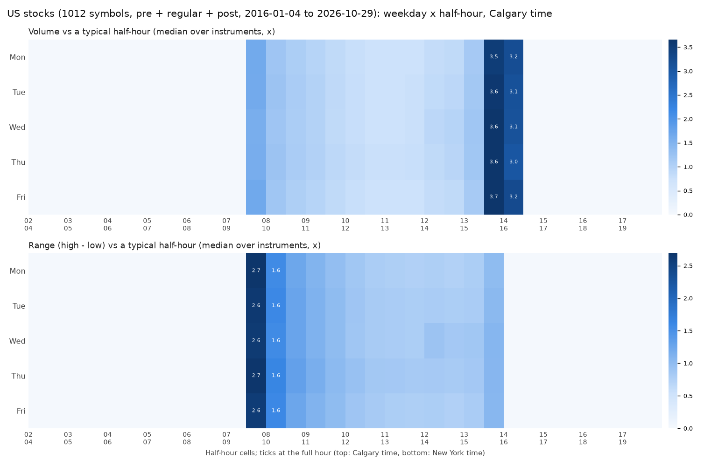

# Market hours: every US stock (Calgary time)

Generated 2026-10-29 23:20 UTC. 1012 stocks / ETFs, Alpaca 30-minute bars (2016-01-04 to 2026-10-29, median 10.8 years). Summary, method and caveats: [Market_Hours.md](Market_Hours.md). Calgary time; New York = Calgary + 2 h. Descriptive only, no profit claim.

## In plain words

- **Weekdays, stocks:** day activity Mon 0.98x / Tue 1.00x / Wed 1.01x / Thu 1.02x / Fri 0.99x - only 4% between the busiest and the quietest weekday. Best weekday reliable for 25.3% of instruments (mostly Thu 149, Wed 77, Mon 15).
- **All 1012 stocks:** strongest half-hours 07:30 (2.06x), 13:30 (1.95x) Calgary. The 07:30 open: volume 1.62x, range 2.63x, big-move days 75.6%. The 13:30 last half-hour: volume 3.63x but range 1.05x.
- **Price movement alone (range):** the biggest half-hour range is at 07:30 for 1011 stocks, 18:00 for 1 stocks - the open is where price travels; the 13:30 close is mostly volume.
- **Each stock's own best half-hour:** 07:30 for 600 stocks, 13:30 for 412 stocks; best times reliable for 96.4% of stocks.
- **NFP Fridays:** opening half-hour range 1.08x other Fridays (median stock); **FOMC days** 12:30 Calgary 1.95x.
- **Era:** median rho last 2 y vs all 0.99, before vs since 2020 0.99; 8.5% of stocks shifted.

## By sector (group profile)

| Sector | Stocks | Group peaks (Calgary) | Day activity Mon-Fri | NFP open ratio | FOMC 12:30 ratio | Shifted era |
|---|---|---|---|---|---|---|
| Communication Services | 33 | 07:30 (2.25x), 13:30 (1.86x) | Mon 0.98x / Tue 0.99x / Wed 1.01x / Thu 1.02x / Fri 0.99x | 1.07x | 1.86x | 3.0% |
| Consumer Discretionary | 68 | 07:30 (2.23x), 13:30 (1.85x) | Mon 0.99x / Tue 1.00x / Wed 1.00x / Thu 1.02x / Fri 0.99x | 1.09x | 1.94x | 11.8% |
| Consumer Staples | 41 | 07:30 (2.06x), 13:30 (1.99x) | Mon 0.98x / Tue 1.00x / Wed 1.01x / Thu 1.01x / Fri 0.99x | 1.05x | 1.76x | 7.3% |
| ETF | 4 | 07:30 (2.04x), 13:30 (1.63x) | Mon 0.92x / Tue 0.98x / Wed 1.01x / Thu 1.04x / Fri 1.03x | 1.15x | 2.83x | 0.0% |
| Energy | 45 | 07:30 (2.12x), 13:30 (1.69x) | Mon 0.98x / Tue 1.00x / Wed 1.03x / Thu 1.01x / Fri 0.98x | 1.13x | 1.78x | 2.2% |
| Financials | 108 | 07:30 (2.02x), 13:30 (1.99x) | Mon 0.96x / Tue 1.00x / Wed 1.02x / Thu 1.03x / Fri 0.99x | 1.07x | 2.14x | 5.6% |
| Health Care | 74 | 07:30 (2.06x), 13:30 (1.94x) | Mon 0.97x / Tue 1.00x / Wed 1.01x / Thu 1.02x / Fri 0.99x | 1.07x | 1.79x | 10.8% |
| Industrials | 99 | 13:30 (2.04x), 07:30 (1.95x) | Mon 0.97x / Tue 1.00x / Wed 1.01x / Thu 1.02x / Fri 0.99x | 1.06x | 2.01x | 8.1% |
| Information Technology | 100 | 07:30 (2.21x), 13:30 (1.86x) | Mon 0.97x / Tue 1.00x / Wed 1.01x / Thu 1.02x / Fri 1.00x | 1.08x | 2.01x | 8.0% |
| Materials | 69 | 07:30 (2.28x), 13:30 (1.74x) | Mon 0.97x / Tue 1.00x / Wed 1.02x / Thu 1.02x / Fri 1.00x | 1.09x | 2.46x | 2.9% |
| Other (top liquid) | 300 | 07:30 (2.00x), 13:30 (1.97x) | Mon 0.99x / Tue 0.99x / Wed 1.01x / Thu 1.01x / Fri 0.99x | 1.09x | 1.92x | 10.0% |
| Real Estate | 33 | 13:30 (2.16x), 07:30 (1.87x) | Mon 0.97x / Tue 1.00x / Wed 1.02x / Thu 1.01x / Fri 1.00x | 1.10x | 1.99x | 18.2% |
| Utilities | 38 | 13:30 (2.20x), 07:30 (1.92x) | Mon 0.97x / Tue 0.99x / Wed 1.02x / Thu 1.02x / Fri 1.00x | 1.08x | 1.88x | 13.2% |

## Every stock, by sector

Columns: the three best half-hour windows (Calgary, peak in bold, activity x typical, and the range alone - a close-of-day peak is mostly volume with an ordinary range); best and quietest weekday with the ratio and its 95% CI; reliability of times / days ("weak" = within noise); NFP = range of the 07:30 Calgary opening half-hour on NFP Fridays vs other Fridays; FOMC = 12:30 Calgary half-hour on FOMC days vs other Wednesdays; era = before vs since 2020.

### Communication Services (33)

| Symbol | Name | Years | Best 1 | Best 2 | Best 3 | Best / quiet day | Reliability (times / days) | NFP | FOMC | Era |
|---|---|---|---|---|---|---|---|---|---|---|
| **AMX** | America Movil | 10.8 | 13:30-14:00 **13:30** 2.10x (range 1.11x) | 07:30-08:30 **07:30** 1.82x (range 2.56x) | - | Wed / Mon 1.09x (1.03-1.15) | reliable / weak | 1.03x | 1.80x | stable |
| **APP** | AppLovin | 5.5 | 07:30-08:00 **07:30** 2.40x (range 2.95x) | 13:30-14:00 **13:30** 1.64x (range 0.93x) | - | Thu / Tue 1.08x (1.0-1.15) | reliable / reliable | 1.26x | 2.37x | stable |
| **BCE** | BCE Inc. | 10.8 | 07:30-08:00 **07:30** 2.11x (range 2.59x) | 13:30-14:00 **13:30** 1.86x (range 1.00x) | - | Thu / Mon 1.06x (1.02-1.1) | reliable / weak | 1.12x | 1.97x | stable |
| **BIDU** | Baidu | 10.8 | 07:30-08:00 **07:30** 3.15x (range 3.11x) | 13:30-14:00 **13:30** 1.58x (range 0.93x) | - | Wed / Thu 1.03x (0.98-1.07) | reliable / weak | 1.00x | 1.90x | stable |
| **BILI** | Bilibili | 8.6 | 07:30-08:00 **07:30** 3.36x (range 3.43x) | 13:30-14:00 **13:30** 1.43x (range 0.87x) | - | Thu / Fri 1.06x (1.0-1.15) | reliable / weak | 1.01x | 2.18x | stable |
| **CHTR** | Charter Communications | 10.8 | 07:30-08:30 **07:30** 2.04x (range 2.72x) | 13:30-14:00 **13:30** 1.90x (range 1.06x) | - | Thu / Fri 1.04x (1.0-1.09) | reliable / weak | 1.10x | 1.71x | stable |
| **CMCSA** | Comcast | 10.8 | 07:30-08:00 **07:30** 2.25x (range 2.65x) | 13:30-14:30 **13:30** 1.86x (range 1.09x) | - | Fri / Mon 1.08x (1.03-1.13) | reliable / weak | 0.93x | 1.98x | stable |
| **DIS** | Walt Disney Company (The) | 10.8 | 07:30-08:00 **07:30** 2.36x (range 2.60x) | 13:30-14:30 **13:30** 1.57x (range 1.00x) | - | Thu / Tue 1.03x (0.99-1.08) | reliable / weak | 1.06x | 2.03x | stable |
| **ECHO** | EchoStar | 10.8 | 13:30-14:00 **13:30** 2.10x (range 1.06x) | 07:30-08:00 **07:30** 1.95x (range 2.80x) | - | Mon / Tue 1.02x (0.97-1.08) | reliable / weak | 1.16x | 1.75x | stable |
| **FOX** | Fox Corporation (Class B) | 10.8 | 07:30-08:00 **07:30** 2.20x (range 2.73x) | 13:30-14:00 **13:30** 2.00x (range 1.09x) | - | Wed / Mon 1.07x (1.04-1.12) | reliable / weak | 1.04x | 2.03x | stable |
| **FOXA** | Fox Corporation (Class A) | 10.8 | 07:30-08:00 **07:30** 2.09x (range 2.70x) | 13:30-14:00 **13:30** 2.02x (range 1.09x) | - | Thu / Mon 1.06x (1.01-1.11) | reliable / weak | 1.09x | 1.98x | stable |
| **GOOG** | Alphabet Inc. (Class C) | 10.8 | 07:30-08:00 **07:30** 2.66x (range 2.49x) | 13:30-14:30 **13:30** 1.67x (range 1.10x) | - | Thu / Tue 1.03x (0.99-1.08) | reliable / weak | 1.11x | 2.17x | stable |
| **GOOGL** | Alphabet Inc. (Class A) | 10.8 | 07:30-08:00 **07:30** 2.68x (range 2.48x) | 13:30-14:30 **13:30** 1.68x (range 1.10x) | - | Thu / Tue 1.03x (0.99-1.08) | reliable / weak | 1.09x | 2.12x | stable |
| **LYV** | Live Nation Entertainment | 10.8 | 13:30-14:00 **13:30** 2.03x (range 1.00x) | 07:30-08:30 **07:30** 1.73x (range 2.50x) | - | Thu / Fri 1.04x (0.99-1.08) | reliable / weak | 1.06x | 1.80x | stable |
| **META** | Meta Platforms | 10.8 | 07:30-08:00 **07:30** 2.65x (range 2.55x) | 13:30-14:30 **13:30** 1.37x (range 1.00x) | - | Thu / Tue 1.02x (0.99-1.07) | reliable / weak | 1.09x | 2.16x | stable |
| **NFLX** | Netflix | 10.8 | 07:30-08:00 **07:30** 2.68x (range 2.68x) | 13:30-14:00 **13:30** 1.40x (range 0.93x) | - | Thu / Tue 1.04x (0.99-1.09) | reliable / weak | 1.10x | 1.81x | stable |
| **NTES** | NetEase | 10.8 | 07:30-08:00 **07:30** 3.10x (range 3.42x) | 13:30-14:00 **13:30** 1.70x (range 0.95x) | - | Wed / Mon 1.02x (0.98-1.07) | reliable / weak | 1.02x | 1.80x | stable |
| **NWS** | News Corp (Class B) | 10.8 | 07:30-08:00 **07:30** 2.34x (range 2.67x) | 13:30-14:00 **13:30** 2.30x (range 1.19x) | - | Thu / Mon 1.05x (1.01-1.1) | reliable / weak | 1.06x | 1.94x | stable |
| **NWSA** | News Corp (Class A) | 10.8 | 13:30-14:00 **13:30** 2.29x (range 1.13x) | 07:30-08:00 **07:30** 2.08x (range 2.80x) | - | Wed / Mon 1.03x (0.99-1.07) | reliable / weak | 1.07x | 1.89x | stable |
| **OMC** | Omnicom Group | 10.8 | 13:30-14:00 **13:30** 2.00x (range 1.05x) | 07:30-08:30 **07:30** 1.90x (range 2.65x) | - | Thu / Mon 1.07x (1.03-1.11) | reliable / weak | 1.02x | 1.71x | stable |
| **RCI** | Rogers Communications Inc. | 10.8 | 13:30-14:00 **13:30** 2.22x (range 1.06x) | 07:30-08:00 **07:30** 1.97x (range 2.56x) | - | Wed / Mon 1.08x (1.04-1.13) | reliable / reliable | 1.10x | 1.84x | shifted |
| **RDDT** | Reddit | 2.6 | 07:30-08:00 **07:30** 2.60x (range 2.82x) | 13:30-14:00 **13:30** 1.60x (range 1.00x) | - | Wed / Mon 1.05x (0.97-1.12) | reliable / weak | 1.10x | 1.91x | stable |
| **SKYD** | Skydance | 1.2 | 13:30-14:00 **13:30** 2.19x (range 1.25x) | 07:30-08:00 **07:30** 2.02x (range 2.58x) | - | Thu / Fri 1.15x (0.96-1.29) | reliable / weak | 1.22x | 1.37x | stable |
| **SPCX** | SpaceX | 0.4 | 07:30-08:00 **07:30** 2.85x (range 2.70x) | 13:30-14:00 **13:30** 1.60x (range 1.34x) | - | - | reliable / - | - | - | stable |
| **SPOT** | Spotify Technology | 8.6 | 07:30-08:00 **07:30** 2.34x (range 2.78x) | 13:30-14:00 **13:30** 1.77x (range 0.97x) | - | Wed / Fri 1.09x (1.03-1.15) | reliable / reliable | 1.03x | 1.84x | stable |
| **T** | AT&T | 10.8 | 07:30-08:00 **07:30** 2.26x (range 2.58x) | 13:30-14:30 **13:30** 1.72x (range 1.13x) | - | Tue / Mon 1.04x (0.98-1.08) | reliable / weak | 1.03x | 1.66x | stable |
| **TKO** | TKO Group Holdings | 10.8 | 13:30-14:00 **13:30** 2.16x (range 1.02x) | 07:30-09:00 **07:30** 1.67x (range 2.50x) | - | Thu / Tue 1.04x (1.0-1.1) | reliable / weak | 1.11x | 1.58x | stable |
| **TME** | Tencent Music Entertainment | 7.9 | 07:30-08:00 **07:30** 2.98x (range 3.55x) | 13:30-14:00 **13:30** 1.76x (range 1.00x) | - | Tue / Fri 1.08x (1.02-1.15) | reliable / weak | 1.03x | 1.67x | stable |
| **TMUS** | T-Mobile US | 10.8 | 07:30-08:00 **07:30** 2.20x (range 2.70x) | 13:30-14:00 **13:30** 1.96x (range 1.13x) | - | Fri / Mon 1.07x (1.03-1.13) | reliable / weak | 1.07x | 1.81x | stable |
| **TTWO** | Take-Two Interactive | 10.8 | 07:30-08:00 **07:30** 2.17x (range 2.70x) | 13:30-14:00 **13:30** 1.86x (range 0.99x) | - | Fri / Tue 1.03x (0.98-1.07) | reliable / weak | 1.07x | 1.96x | stable |
| **TU** | Telus Corporation | 10.8 | 07:30-08:00 **07:30** 2.10x (range 2.59x) | 13:30-14:00 **13:30** 2.03x (range 1.06x) | - | Thu / Mon 1.05x (1.02-1.11) | reliable / reliable | 1.09x | 1.76x | stable |
| **VOD** | Vodafone Group | 10.8 | 07:30-08:30 **07:30** 2.08x (range 1.93x) | 13:30-14:00 **13:30** 1.49x (range 1.00x) | 08:30-10:00 **09:00** 1.38x (range 1.30x) | Wed / Mon 1.07x (1.02-1.12) | reliable / reliable | 1.09x | 2.13x | stable |
| **VZ** | Verizon | 10.8 | 07:30-08:00 **07:30** 2.36x (range 2.67x) | 13:30-14:30 **13:30** 1.78x (range 1.12x) | - | Tue / Wed 1.02x (0.99-1.05) | reliable / weak | 1.01x | 1.58x | stable |

### Consumer Discretionary (68)

| Symbol | Name | Years | Best 1 | Best 2 | Best 3 | Best / quiet day | Reliability (times / days) | NFP | FOMC | Era |
|---|---|---|---|---|---|---|---|---|---|---|
| **ABNB** | Airbnb | 5.9 | 07:30-08:00 **07:30** 2.52x (range 2.91x) | 13:30-14:00 **13:30** 1.65x (range 0.96x) | - | Thu / Mon 1.06x (1.0-1.12) | reliable / weak | 1.12x | 2.73x | stable |
| **AMZN** | Amazon | 10.8 | 07:30-08:00 **07:30** 2.71x (range 2.48x) | 13:30-14:30 **13:30** 1.43x (range 1.02x) | - | Thu / Tue 1.05x (0.99-1.08) | reliable / weak | 1.14x | 2.09x | stable |
| **APTV** | Aptiv | 8.9 | 07:30-08:00 **07:30** 2.06x (range 2.78x) | 13:30-14:00 **13:30** 1.96x (range 1.02x) | - | Thu / Mon 1.11x (1.07-1.18) | reliable / reliable | 1.14x | 2.28x | stable |
| **AZO** | AutoZone | 10.8 | 13:30-14:00 **13:30** 2.13x (range 1.15x) | 07:30-08:30 **07:30** 1.86x (range 2.59x) | - | Thu / Fri 1.05x (1.02-1.1) | reliable / weak | 0.97x | 1.45x | shifted |
| **BABA** | Alibaba Group | 10.8 | 07:30-08:00 **07:30** 3.07x (range 2.96x) | 13:30-14:00 **13:30** 1.34x (range 0.93x) | - | Thu / Tue 1.03x (0.98-1.08) | reliable / weak | 1.04x | 2.11x | stable |
| **BBY** | Best Buy | 10.8 | 07:30-08:00 **07:30** 2.17x (range 2.83x) | 13:30-14:00 **13:30** 1.84x (range 0.98x) | - | Mon / Thu 1.02x (0.98-1.07) | reliable / weak | 0.95x | 1.78x | stable |
| **BKNG** | Booking Holdings | 10.8 | 07:30-08:00 **07:30** 2.46x (range 2.71x) | 13:30-14:00 **13:30** 1.97x (range 1.15x) | - | Thu / Tue 1.05x (1.0-1.09) | reliable / reliable | 1.15x | 1.86x | stable |
| **CCL** | Carnival Corporation | 10.8 | 07:30-08:00 **07:30** 2.57x (range 2.79x) | 13:30-14:00 **13:30** 1.46x (range 0.88x) | - | Thu / Fri 1.08x (1.03-1.12) | reliable / weak | 1.02x | 2.08x | stable |
| **CMG** | Chipotle Mexican Grill | 10.8 | 07:30-08:00 **07:30** 2.25x (range 2.69x) | 13:30-14:00 **13:30** 1.83x (range 1.03x) | - | Mon / Fri 1.06x (1.01-1.09) | reliable / reliable | 0.98x | 1.74x | stable |
| **CVNA** | Carvana | 9.5 | 07:30-08:30 **07:30** 2.30x (range 2.61x) | 13:30-14:00 **13:30** 1.53x (range 0.92x) | - | Tue / Fri 1.03x (0.98-1.1) | reliable / weak | 1.43x | 1.83x | stable |
| **DASH** | DoorDash | 5.9 | 07:30-08:00 **07:30** 2.32x (range 2.91x) | 13:30-14:00 **13:30** 1.74x (range 0.96x) | - | Thu / Tue 1.07x (1.0-1.13) | reliable / weak | 1.19x | 2.31x | stable |
| **DECK** | Deckers Brands | 10.8 | 13:30-14:00 **13:30** 2.00x (range 0.99x) | 07:30-08:30 **07:30** 1.95x (range 2.74x) | - | Thu / Wed 1.04x (1.0-1.09) | reliable / weak | 1.08x | 1.88x | stable |
| **DHI** | D. R. Horton | 10.8 | 07:30-08:30 **07:30** 2.08x (range 2.75x) | 13:30-14:00 **13:30** 1.85x (range 0.98x) | - | Wed / Mon 1.12x (1.07-1.17) | reliable / reliable | 1.09x | 2.39x | stable |
| **DPZ** | Domino's | 10.8 | 13:30-14:00 **13:30** 1.99x (range 1.02x) | 07:30-08:30 **07:30** 1.93x (range 2.60x) | - | Mon / Fri 1.09x (1.05-1.12) | weak / reliable | 1.08x | 1.76x | shifted |
| **DRI** | Darden Restaurants | 10.8 | 13:30-14:00 **13:30** 2.06x (range 1.03x) | 07:30-08:30 **07:30** 1.96x (range 2.78x) | - | Mon / Fri 1.05x (1.01-1.1) | weak / weak | 0.99x | 1.77x | shifted |
| **EBAY** | eBay Inc. | 10.8 | 07:30-08:00 **07:30** 2.23x (range 2.72x) | 13:30-14:00 **13:30** 1.92x (range 1.06x) | - | Wed / Mon 1.04x (1.0-1.08) | reliable / weak | 1.03x | 1.95x | stable |
| **EDU** | New Oriental Education & Tec | 10.8 | 07:30-08:00 **07:30** 2.87x (range 3.46x) | 13:30-14:00 **13:30** 1.66x (range 0.94x) | - | Tue / Fri 1.08x (1.01-1.16) | reliable / weak | 1.00x | 1.52x | stable |
| **EXPE** | Expedia Group | 10.8 | 07:30-08:00 **07:30** 2.18x (range 2.75x) | 13:30-14:00 **13:30** 1.83x (range 0.98x) | - | Thu / Fri 1.06x (1.02-1.11) | reliable / reliable | 1.11x | 1.96x | stable |
| **F** | Ford Motor Company | 10.8 | 07:30-08:00 **07:30** 2.33x (range 2.71x) | 13:30-14:30 **13:30** 1.45x (range 1.00x) | - | Thu / Mon 1.08x (1.03-1.12) | reliable / reliable | 1.17x | 1.89x | stable |
| **FLUT** | Flutter Entertainment | 2.7 | 07:30-08:30 **07:30** 2.11x (range 2.46x) | 13:30-14:00 **13:30** 2.08x (range 1.12x) | - | Fri / Thu 1.12x (1.01-1.24) | reliable / weak | 1.00x | 1.85x | stable |
| **GIL** | Gildan Activewear Inc. | 10.8 | 13:30-14:00 **13:30** 1.99x (range 1.00x) | 07:30-08:30 **07:30** 1.98x (range 2.73x) | - | Wed / Fri 1.08x (1.03-1.11) | reliable / weak | 1.12x | 2.00x | stable |
| **GM** | General Motors | 10.8 | 07:30-08:00 **07:30** 2.41x (range 2.85x) | 13:30-14:30 **13:30** 1.68x (range 0.99x) | - | Thu / Mon 1.09x (1.03-1.13) | reliable / weak | 1.15x | 1.88x | stable |
| **GPC** | Genuine Parts Company | 10.8 | 13:30-14:00 **13:30** 2.22x (range 1.08x) | 07:30-08:30 **07:30** 1.75x (range 2.54x) | - | Thu / Wed 1.03x (1.0-1.07) | reliable / weak | 0.92x | 1.84x | stable |
| **GRMN** | Garmin | 10.8 | 13:30-14:00 **13:30** 2.27x (range 1.13x) | 07:30-08:00 **07:30** 1.96x (range 2.54x) | - | Thu / Mon 1.07x (1.03-1.12) | reliable / weak | 1.11x | 1.98x | shifted |
| **HAS** | Hasbro | 10.8 | 13:30-14:00 **13:30** 2.09x (range 1.05x) | 07:30-08:00 **07:30** 1.94x (range 2.67x) | - | Thu / Wed 1.03x (0.98-1.06) | reliable / weak | 1.07x | 1.79x | shifted |
| **HD** | Home Depot (The) | 10.8 | 07:30-08:00 **07:30** 2.35x (range 2.69x) | 13:30-14:00 **13:30** 1.74x (range 1.05x) | - | Wed / Mon 1.03x (1.0-1.06) | reliable / weak | 1.04x | 2.22x | stable |
| **HLT** | Hilton Worldwide | 10.8 | 13:30-14:00 **13:30** 1.97x (range 1.03x) | 07:30-08:30 **07:30** 1.93x (range 2.65x) | - | Wed / Mon 1.06x (1.01-1.1) | reliable / reliable | 1.09x | 2.05x | stable |
| **HMC** | Honda Motor | 10.8 | 07:30-08:00 **07:30** 2.24x (range 2.62x) | 13:30-14:00 **13:30** 1.88x (range 1.09x) | - | Thu / Fri 1.03x (0.99-1.08) | reliable / weak | 1.16x | 2.55x | stable |
| **IHG** | InterContinental Hotels Grou | 10.8 | 07:30-08:00 **07:30** 2.54x (range 2.06x) | 13:30-14:00 **13:30** 1.87x (range 1.07x) | 08:30-10:00 **09:00** 1.40x (range 1.26x) | Wed / Mon 1.13x (1.07-1.18) | reliable / reliable | 1.11x | 2.25x | stable |
| **JD** | JD.com | 10.8 | 07:30-08:00 **07:30** 3.16x (range 3.22x) | 13:30-14:00 **13:30** 1.48x (range 0.90x) | - | Thu / Fri 1.05x (0.99-1.1) | reliable / weak | 0.96x | 1.95x | stable |
| **LEN** | Lennar | 10.8 | 07:30-08:30 **07:30** 2.04x (range 2.73x) | 13:30-14:00 **13:30** 1.82x (range 0.95x) | - | Wed / Mon 1.10x (1.06-1.15) | reliable / reliable | 1.16x | 2.39x | stable |
| **LI** | Li Auto | 6.2 | 07:30-08:00 **07:30** 3.39x (range 3.46x) | 13:30-14:00 **13:30** 1.54x (range 0.92x) | - | Mon / Fri 1.07x (1.0-1.14) | reliable / reliable | 1.14x | 2.10x | stable |
| **LOW** | Lowe's | 10.8 | 07:30-08:30 **07:30** 2.15x (range 2.66x) | 13:30-14:00 **13:30** 1.84x (range 1.04x) | - | Wed / Mon 1.05x (1.01-1.09) | reliable / reliable | 1.09x | 1.98x | stable |
| **LULU** | Lululemon Athletica | 10.8 | 07:30-08:00 **07:30** 2.35x (range 2.75x) | 13:30-14:00 **13:30** 1.65x (range 0.95x) | - | Mon / Wed 1.06x (1.01-1.12) | reliable / weak | 1.14x | 1.95x | stable |
| **LVS** | Las Vegas Sands | 10.8 | 07:30-08:00 **07:30** 2.32x (range 2.93x) | 13:30-14:00 **13:30** 1.78x (range 0.99x) | - | Thu / Wed 1.03x (0.98-1.09) | reliable / weak | 1.01x | 1.85x | stable |
| **MAR** | Marriott International | 10.8 | 07:30-08:00 **07:30** 2.18x (range 2.72x) | 13:30-14:00 **13:30** 1.88x (range 1.02x) | - | Wed / Mon 1.07x (1.03-1.12) | reliable / reliable | 1.13x | 2.11x | stable |
| **MCD** | McDonald's | 10.8 | 07:30-08:00 **07:30** 2.32x (range 2.63x) | 13:30-14:00 **13:30** 1.86x (range 1.12x) | - | Thu / Wed 1.03x (0.99-1.06) | reliable / weak | 1.05x | 1.80x | stable |
| **MELI** | Mercado Libre | 10.8 | 07:30-08:00 **07:30** 2.42x (range 2.70x) | 13:30-14:00 **13:30** 1.69x (range 0.98x) | - | Thu / Fri 1.05x (1.01-1.09) | reliable / weak | 1.22x | 1.67x | stable |
| **MGA** | Magna International Inc. | 10.8 | 07:30-08:00 **07:30** 2.23x (range 2.94x) | 13:30-14:00 **13:30** 1.78x (range 0.94x) | - | Thu / Mon 1.14x (1.07-1.19) | reliable / weak | 1.07x | 2.27x | stable |
| **MGM** | MGM Resorts | 10.8 | 07:30-08:30 **07:30** 2.18x (range 2.73x) | 13:30-14:00 **13:30** 1.80x (range 0.99x) | - | Thu / Mon 1.05x (1.0-1.1) | reliable / weak | 1.10x | 2.21x | stable |
| **NCLH** | Norwegian Cruise Line Holdin | 10.8 | 07:30-08:00 **07:30** 2.40x (range 2.82x) | 13:30-14:00 **13:30** 1.62x (range 0.91x) | - | Wed / Mon 1.05x (1.01-1.09) | reliable / weak | 1.14x | 2.05x | stable |
| **NIO** | NIO Inc. | 10.8 | 07:30-08:00 **07:30** 3.18x (range 3.17x) | 13:30-14:00 **13:30** 1.24x (range 0.90x) | - | Tue / Fri 1.08x (1.03-1.15) | reliable / weak | 1.09x | 1.87x | stable |
| **NKE** | Nike, Inc. | 10.8 | 07:30-08:00 **07:30** 2.47x (range 2.75x) | 13:30-14:30 **13:30** 1.68x (range 1.02x) | - | Thu / Mon 1.05x (1.0-1.08) | reliable / weak | 1.04x | 2.02x | stable |
| **NVR** | NVR, Inc. | 10.8 | 13:30-14:00 **13:30** 2.18x (range 1.23x) | 07:30-08:30 **07:30** 1.77x (range 2.38x) | - | Wed / Fri 1.06x (1.02-1.12) | reliable / reliable | 0.98x | 1.67x | stable |
| **ORLY** | O'Reilly Automotive | 10.8 | 07:30-08:00 **07:30** 2.15x (range 2.75x) | 13:30-14:00 **13:30** 2.03x (range 1.12x) | - | Tue / Mon 1.02x (0.98-1.05) | reliable / weak | 1.08x | 1.63x | stable |
| **PHM** | PulteGroup | 10.8 | 07:30-08:30 **07:30** 2.06x (range 2.69x) | 13:30-14:00 **13:30** 1.92x (range 0.97x) | - | Wed / Mon 1.13x (1.09-1.17) | reliable / reliable | 1.15x | 2.35x | stable |
| **QSR** | Restaurant Brands Internatio | 10.8 | 13:30-14:00 **13:30** 2.05x (range 1.02x) | 07:30-08:30 **07:30** 1.92x (range 2.63x) | - | Thu / Fri 1.05x (1.01-1.1) | reliable / reliable | 1.10x | 1.91x | shifted |
| **RACE** | Ferrari | 10.8 | 07:30-08:30 **07:30** 2.06x (range 1.88x) | 13:30-14:00 **13:30** 1.91x (range 1.08x) | 08:30-10:00 **09:30** 1.20x (range 1.22x) | Thu / Mon 1.11x (1.04-1.16) | reliable / weak | 1.16x | 2.25x | stable |
| **RCL** | Royal Caribbean Group | 10.8 | 07:30-08:00 **07:30** 2.33x (range 2.82x) | 13:30-14:00 **13:30** 1.71x (range 0.93x) | - | Thu / Mon 1.05x (0.99-1.09) | reliable / weak | 1.05x | 2.07x | stable |
| **RL** | Ralph Lauren Corporation | 10.8 | 07:30-08:30 **07:30** 2.01x (range 2.87x) | 13:30-14:00 **13:30** 2.00x (range 0.96x) | - | Thu / Fri 1.03x (0.99-1.08) | weak / weak | 1.04x | 2.01x | shifted |
| **ROST** | Ross Stores | 10.8 | 07:30-08:00 **07:30** 2.12x (range 2.75x) | 13:30-14:00 **13:30** 2.00x (range 1.07x) | - | Fri / Tue 1.03x (0.98-1.06) | reliable / weak | 1.01x | 1.81x | stable |
| **SBUX** | Starbucks | 10.8 | 07:30-08:00 **07:30** 2.41x (range 2.67x) | 13:30-14:30 **13:30** 1.79x (range 1.10x) | - | Fri / Mon 1.03x (0.99-1.08) | reliable / weak | 1.15x | 1.84x | stable |
| **SE** | Sea Limited | 10.8 | 07:30-08:00 **07:30** 2.57x (range 2.93x) | 13:30-14:00 **13:30** 1.60x (range 0.93x) | - | Tue / Fri 1.05x (1.0-1.1) | reliable / reliable | 1.06x | 1.92x | stable |
| **SONY** | Sony Group | 10.8 | 07:30-08:00 **07:30** 2.13x (range 2.44x) | 13:30-14:00 **13:30** 1.86x (range 1.05x) | - | Thu / Mon 1.09x (1.06-1.14) | reliable / weak | 1.10x | 2.37x | stable |
| **STLA** | Stellantis | 10.8 | 07:30-08:30 **07:30** 2.09x (range 1.99x) | 13:30-14:00 **13:30** 1.59x (range 1.00x) | - | Thu / Mon 1.12x (1.06-1.17) | reliable / weak | 1.14x | 2.50x | stable |
| **TCOM** | Trip.com Group | 10.8 | 07:30-08:00 **07:30** 3.03x (range 3.42x) | 13:30-14:00 **13:30** 1.80x (range 0.99x) | - | Thu / Fri 1.05x (0.99-1.09) | reliable / weak | 1.07x | 1.88x | stable |
| **TJX** | TJX Companies | 10.8 | 07:30-08:00 **07:30** 2.09x (range 2.63x) | 13:30-14:00 **13:30** 1.90x (range 1.09x) | - | Thu / Wed 1.04x (1.0-1.07) | reliable / reliable | 1.04x | 1.72x | stable |
| **TM** | Toyota Motor | 10.8 | 07:30-08:00 **07:30** 2.26x (range 2.43x) | 13:30-14:00 **13:30** 2.03x (range 1.13x) | - | Tue / Mon 1.06x (1.02-1.11) | reliable / reliable | 1.21x | 2.50x | stable |
| **TPR** | Tapestry, Inc. | 10.8 | 07:30-08:30 **07:30** 2.11x (range 2.85x) | 13:30-14:00 **13:30** 1.88x (range 0.95x) | - | Mon / Fri 1.06x (1.02-1.09) | reliable / weak | 1.05x | 2.13x | stable |
| **TSCO** | Tractor Supply | 10.8 | 07:30-08:00 **07:30** 2.10x (range 2.82x) | 13:30-14:00 **13:30** 1.92x (range 1.01x) | - | Thu / Wed 1.03x (1.0-1.07) | reliable / weak | 1.00x | 1.82x | stable |
| **TSLA** | Tesla, Inc. | 10.8 | 07:30-08:00 **07:30** 2.68x (range 2.58x) | 10:30-14:00 **13:30** 1.12x (range 0.89x) | - | Mon / Fri 1.10x (1.05-1.15) | reliable / reliable | 1.12x | 1.85x | stable |
| **ULTA** | Ulta Beauty | 10.8 | 07:30-08:00 **07:30** 2.23x (range 2.76x) | 13:30-14:00 **13:30** 1.87x (range 1.02x) | - | Mon / Fri 1.07x (1.01-1.12) | reliable / reliable | 1.11x | 1.68x | stable |
| **VIPS** | Vipshop Holdings | 10.8 | 07:30-08:00 **07:30** 2.80x (range 3.41x) | 13:30-14:00 **13:30** 1.70x (range 0.94x) | - | Tue / Fri 1.07x (1.01-1.1) | reliable / weak | 1.11x | 1.83x | stable |
| **WSM** | Williams-Sonoma, Inc. | 10.8 | 13:30-14:00 **13:30** 1.97x (range 0.96x) | 07:30-08:30 **07:30** 1.92x (range 2.74x) | - | Thu / Fri 1.07x (1.0-1.12) | reliable / reliable | 1.03x | 1.86x | shifted |
| **WYNN** | Wynn Resorts | 10.8 | 07:30-08:00 **07:30** 2.52x (range 2.95x) | 13:30-14:00 **13:30** 1.67x (range 0.93x) | - | Thu / Fri 1.06x (1.01-1.11) | reliable / weak | 1.00x | 1.93x | stable |
| **XPEV** | XPeng | 6.2 | 07:30-08:00 **07:30** 3.38x (range 3.34x) | 13:30-14:00 **13:30** 1.46x (range 0.89x) | - | Tue / Fri 1.04x (0.98-1.1) | reliable / weak | 1.07x | 2.60x | stable |
| **YUM** | Yum! Brands | 10.8 | 13:30-14:00 **13:30** 2.25x (range 1.15x) | 07:30-08:30 **07:30** 1.93x (range 2.66x) | - | Thu / Fri 1.03x (0.98-1.07) | reliable / weak | 1.16x | 1.88x | stable |
| **YUMC** | Yum China Holdings | 10.0 | 07:30-08:00 **07:30** 2.63x (range 3.30x) | 13:30-14:00 **13:30** 2.00x (range 1.08x) | - | Wed / Fri 1.04x (0.99-1.08) | reliable / weak | 1.10x | 1.91x | stable |

### Consumer Staples (41)

| Symbol | Name | Years | Best 1 | Best 2 | Best 3 | Best / quiet day | Reliability (times / days) | NFP | FOMC | Era |
|---|---|---|---|---|---|---|---|---|---|---|
| **ABEV** | Ambev | 10.8 | 07:30-09:30 **07:30** 1.50x (range 1.62x) | 13:30-14:00 **13:30** 1.37x (range 1.00x) | - | Wed / Mon 1.09x (1.05-1.15) | reliable / reliable | 1.04x | 1.67x | stable |
| **ADM** | Archer Daniels Midland | 10.8 | 07:30-08:00 **07:30** 2.14x (range 2.67x) | 13:30-14:00 **13:30** 2.04x (range 1.08x) | - | Tue / Mon 1.05x (1.0-1.08) | reliable / weak | 1.03x | 1.79x | stable |
| **BF.B** | Brown–Forman | 10.8 | 13:30-14:00 **13:30** 2.29x (range 1.13x) | 07:30-08:30 **07:30** 1.73x (range 2.58x) | - | Thu / Tue 1.02x (0.97-1.06) | reliable / weak | 1.05x | 1.80x | stable |
| **BG** | Bunge Global | 10.8 | 13:30-14:00 **13:30** 2.06x (range 1.04x) | 07:30-08:30 **07:30** 1.94x (range 2.71x) | - | Wed / Fri 1.09x (1.02-1.14) | reliable / reliable | 1.09x | 1.90x | stable |
| **BTI** | British American Tobacco | 10.8 | 07:30-08:30 **07:30** 2.25x (range 2.09x) | 13:30-14:00 **13:30** 1.53x (range 1.00x) | - | Thu / Mon 1.07x (1.02-1.11) | reliable / reliable | 1.05x | 2.05x | stable |
| **BUD** | Anheuser-Busch InBev | 10.8 | 07:30-08:30 **07:30** 2.01x (range 2.00x) | 13:30-14:00 **13:30** 1.71x (range 1.00x) | - | Thu / Mon 1.07x (1.01-1.12) | reliable / reliable | 1.12x | 2.30x | stable |
| **CASY** | Casey's | 10.8 | 13:30-14:00 **13:30** 2.29x (range 1.13x) | 07:30-08:30 **07:30** 1.66x (range 2.49x) | - | Thu / Tue 1.03x (0.99-1.06) | reliable / weak | 0.98x | 1.41x | stable |
| **CCEP** | Coca-Cola Europacific Partne | 10.8 | 13:30-14:00 **13:30** 2.11x (range 1.12x) | 07:30-08:30 **07:30** 2.06x (range 2.63x) | - | Wed / Mon 1.10x (1.05-1.14) | reliable / weak | 1.16x | 1.67x | stable |
| **CHD** | Church & Dwight | 10.8 | 13:30-14:00 **13:30** 2.23x (range 1.12x) | 07:30-08:30 **07:30** 1.98x (range 2.77x) | - | Tue / Fri 1.04x (1.0-1.08) | reliable / weak | 1.09x | 1.80x | stable |
| **CL** | Colgate-Palmolive | 10.8 | 07:30-08:00 **07:30** 2.24x (range 2.73x) | 13:30-14:00 **13:30** 2.02x (range 1.15x) | - | Fri / Mon 1.05x (1.02-1.08) | reliable / weak | 0.97x | 1.70x | stable |
| **CLX** | Clorox | 10.8 | 07:30-08:30 **07:30** 2.06x (range 2.71x) | 13:30-14:00 **13:30** 2.02x (range 1.07x) | - | Tue / Fri 1.02x (0.99-1.06) | reliable / weak | 1.18x | 1.65x | stable |
| **COST** | Costco | 10.8 | 07:30-08:00 **07:30** 2.43x (range 2.56x) | 13:30-14:00 **13:30** 1.81x (range 1.10x) | - | Thu / Tue 1.08x (1.04-1.11) | reliable / reliable | 1.20x | 1.94x | stable |
| **DEO** | Diageo | 10.8 | 07:30-08:30 **07:30** 2.03x (range 1.88x) | 13:30-14:00 **13:30** 1.53x (range 1.00x) | 08:30-10:00 **09:00** 1.28x (range 1.26x) | Thu / Mon 1.08x (1.04-1.12) | reliable / weak | 1.09x | 2.30x | stable |
| **DG** | Dollar General | 10.8 | 07:30-08:00 **07:30** 2.10x (range 2.82x) | 13:30-14:00 **13:30** 1.91x (range 1.04x) | - | Mon / Fri 1.04x (1.0-1.09) | reliable / weak | 1.12x | 1.55x | stable |
| **DLTR** | Dollar Tree | 10.8 | 07:30-08:00 **07:30** 2.10x (range 2.76x) | 13:30-14:00 **13:30** 1.95x (range 1.04x) | - | Thu / Fri 1.06x (0.99-1.1) | reliable / weak | 1.05x | 1.64x | stable |
| **EL** | Estée Lauder Companies (The) | 10.8 | 07:30-08:00 **07:30** 2.21x (range 2.76x) | 13:30-14:00 **13:30** 1.89x (range 1.04x) | - | Fri / Mon 1.04x (0.99-1.08) | reliable / weak | 1.10x | 2.14x | stable |
| **FMX** | Fomento Economico Mexicano | 10.8 | 13:30-14:00 **13:30** 1.99x (range 1.05x) | 07:30-08:30 **07:30** 1.66x (range 2.54x) | - | Wed / Mon 1.08x (1.03-1.13) | reliable / reliable | 1.02x | 1.79x | stable |
| **GIS** | General Mills | 10.8 | 07:30-08:00 **07:30** 2.18x (range 2.78x) | 13:30-14:00 **13:30** 1.93x (range 1.08x) | - | Wed / Mon 1.06x (1.02-1.1) | reliable / weak | 1.00x | 1.63x | stable |
| **HLN** | Haleon | 4.3 | 07:30-10:00 **07:30** 1.65x (range 1.83x) | 13:30-14:00 **13:30** 1.54x (range 1.00x) | - | Thu / Fri 1.09x (1.02-1.15) | reliable / weak | 1.12x | 2.29x | stable |
| **HRL** | Hormel Foods | 10.8 | 13:30-14:00 **13:30** 2.21x (range 1.11x) | 07:30-08:30 **07:30** 1.98x (range 2.65x) | - | Thu / Mon 1.05x (1.02-1.1) | reliable / reliable | 1.06x | 1.62x | shifted |
| **HSY** | Hershey Company (The) | 10.8 | 13:30-14:00 **13:30** 2.14x (range 1.10x) | 07:30-08:30 **07:30** 1.96x (range 2.64x) | - | Wed / Fri 1.05x (1.0-1.1) | reliable / weak | 1.02x | 1.61x | stable |
| **KDP** | Keurig Dr Pepper | 10.8 | 13:30-14:00 **13:30** 2.16x (range 1.15x) | 07:30-08:30 **07:30** 1.92x (range 2.59x) | - | Wed / Mon 1.06x (1.02-1.12) | reliable / reliable | 1.02x | 1.81x | stable |
| **KHC** | Kraft Heinz | 10.8 | 07:30-08:00 **07:30** 2.41x (range 2.79x) | 13:30-14:00 **13:30** 1.88x (range 1.08x) | - | Fri / Mon 1.02x (0.99-1.06) | reliable / weak | 1.01x | 2.00x | stable |
| **KMB** | Kimberly-Clark | 10.8 | 07:30-08:30 **07:30** 2.03x (range 2.68x) | 13:30-14:00 **13:30** 1.99x (range 1.12x) | - | Tue / Mon 1.05x (1.0-1.09) | reliable / weak | 0.98x | 1.63x | stable |
| **KO** | Coca-Cola Company (The) | 10.8 | 07:30-08:00 **07:30** 2.39x (range 2.56x) | 13:30-14:30 **13:30** 1.95x (range 1.19x) | - | Thu / Mon 1.03x (0.99-1.06) | reliable / weak | 1.00x | 1.82x | stable |
| **KR** | Kroger | 10.8 | 07:30-08:00 **07:30** 2.22x (range 2.78x) | 13:30-14:00 **13:30** 1.88x (range 1.05x) | - | Thu / Mon 1.07x (1.03-1.11) | reliable / reliable | 1.08x | 1.56x | stable |
| **KVUE** | Kenvue | 3.5 | 13:30-14:00 **13:30** 1.96x (range 1.18x) | 07:30-09:00 **07:30** 1.70x (range 2.52x) | - | Wed / Fri 1.11x (1.01-1.19) | reliable / weak | 1.12x | 1.78x | stable |
| **MDLZ** | Mondelez International | 10.8 | 07:30-08:00 **07:30** 2.31x (range 2.71x) | 13:30-14:00 **13:30** 2.01x (range 1.16x) | - | Tue / Mon 1.05x (1.0-1.09) | reliable / weak | 1.05x | 2.00x | stable |
| **MKC** | McCormick & Company | 10.8 | 13:30-14:00 **13:30** 2.22x (range 1.11x) | 07:30-08:30 **07:30** 1.89x (range 2.63x) | - | Tue / Fri 1.04x (1.01-1.08) | reliable / reliable | 1.04x | 1.67x | stable |
| **MNST** | Monster Beverage | 10.8 | 13:30-14:00 **13:30** 2.08x (range 1.10x) | 07:30-08:00 **07:30** 2.04x (range 2.62x) | - | Fri / Mon 1.04x (1.01-1.08) | reliable / weak | 1.07x | 1.76x | stable |
| **MO** | Altria | 10.8 | 07:30-08:00 **07:30** 2.30x (range 2.65x) | 13:30-14:30 **13:30** 1.88x (range 1.14x) | - | Tue / Mon 1.03x (0.99-1.06) | reliable / weak | 1.06x | 1.71x | stable |
| **PEP** | PepsiCo | 10.8 | 07:30-08:00 **07:30** 2.40x (range 2.68x) | 13:30-14:30 **13:30** 1.96x (range 1.20x) | - | Tue / Mon 1.06x (1.02-1.09) | reliable / weak | 1.03x | 1.94x | stable |
| **PG** | Procter & Gamble | 10.8 | 07:30-08:00 **07:30** 2.41x (range 2.63x) | 13:30-14:00 **13:30** 1.86x (range 1.17x) | - | Fri / Mon 1.02x (0.98-1.06) | reliable / weak | 1.02x | 1.73x | stable |
| **PM** | Philip Morris International | 10.8 | 07:30-08:00 **07:30** 2.17x (range 2.67x) | 13:30-14:00 **13:30** 2.01x (range 1.16x) | - | Thu / Mon 1.08x (1.04-1.13) | reliable / weak | 0.96x | 1.44x | stable |
| **SJM** | J.M. Smucker Company (The) | 10.8 | 13:30-14:00 **13:30** 2.16x (range 1.07x) | 07:30-08:30 **07:30** 1.89x (range 2.71x) | - | Wed / Mon 1.09x (1.05-1.13) | reliable / reliable | 1.09x | 1.53x | shifted |
| **STZ** | Constellation Brands | 10.8 | 13:30-14:00 **13:30** 2.04x (range 1.09x) | 07:30-08:30 **07:30** 1.92x (range 2.53x) | - | Tue / Thu 1.03x (0.98-1.07) | reliable / weak | 1.18x | 1.53x | shifted |
| **SYY** | Sysco | 10.8 | 13:30-14:00 **13:30** 2.02x (range 1.07x) | 07:30-08:30 **07:30** 1.89x (range 2.61x) | - | Wed / Mon 1.06x (1.02-1.1) | reliable / weak | 1.06x | 1.81x | stable |
| **TGT** | Target Corporation | 10.8 | 07:30-08:00 **07:30** 2.28x (range 2.76x) | 13:30-14:00 **13:30** 1.71x (range 1.00x) | - | Thu / Fri 1.04x (1.0-1.08) | reliable / weak | 0.99x | 1.81x | stable |
| **TSN** | Tyson Foods | 10.8 | 13:30-14:00 **13:30** 2.00x (range 1.05x) | 07:30-08:30 **07:30** 2.00x (range 2.70x) | - | Wed / Tue 1.04x (0.98-1.07) | weak / weak | 1.09x | 1.56x | stable |
| **UL** | Unilever | 10.8 | 07:30-08:30 **07:30** 2.13x (range 1.94x) | 13:30-14:00 **13:30** 1.50x (range 1.00x) | 08:30-10:00 **09:00** 1.34x (range 1.29x) | Thu / Mon 1.07x (1.03-1.12) | reliable / weak | 1.01x | 2.33x | stable |
| **WMT** | Walmart | 10.8 | 07:30-08:00 **07:30** 2.38x (range 2.71x) | 13:30-14:30 **13:30** 1.75x (range 1.09x) | - | Fri / Wed 1.03x (0.99-1.08) | reliable / weak | 0.98x | 1.66x | stable |

### ETF (4)

| Symbol | Name | Years | Best 1 | Best 2 | Best 3 | Best / quiet day | Reliability (times / days) | NFP | FOMC | Era |
|---|---|---|---|---|---|---|---|---|---|---|
| **DIA** | DIA | 10.8 | 07:30-08:00 **07:30** 2.22x (range 1.85x) | 13:30-14:00 **13:30** 1.72x (range 1.14x) | - | Thu / Mon 1.15x (1.1-1.2) | reliable / reliable | 1.12x | 2.76x | stable |
| **IWM** | IWM | 10.8 | 07:30-08:30 **07:30** 2.06x (range 2.03x) | 13:30-14:00 **13:30** 1.54x (range 0.99x) | - | Thu / Mon 1.12x (1.08-1.17) | reliable / reliable | 1.14x | 2.86x | stable |
| **QQQ** | QQQ | 10.8 | 07:30-08:30 **07:30** 2.02x (range 1.88x) | 13:30-14:00 **13:30** 1.50x (range 1.05x) | - | Thu / Mon 1.13x (1.08-1.17) | reliable / weak | 1.17x | 2.81x | stable |
| **SPY** | SPY | 10.8 | 13:30-14:30 **13:30** 1.87x (range 1.18x) | 07:30-09:00 **07:30** 1.65x (range 1.55x) | - | Fri / Mon 1.16x (1.1-1.2) | reliable / weak | 1.25x | 3.01x | stable |

### Energy (45)

| Symbol | Name | Years | Best 1 | Best 2 | Best 3 | Best / quiet day | Reliability (times / days) | NFP | FOMC | Era |
|---|---|---|---|---|---|---|---|---|---|---|
| **APA** | APA Corporation | 10.8 | 07:30-08:00 **07:30** 2.22x (range 2.63x) | 13:30-14:00 **13:30** 1.64x (range 0.90x) | - | Wed / Mon 1.07x (1.03-1.11) | reliable / reliable | 1.19x | 1.79x | stable |
| **BEP** | Brookfield Renewable Partner | 10.8 | 07:30-08:00 **07:30** 2.11x (range 2.57x) | 13:30-14:00 **13:30** 1.80x (range 1.10x) | - | Thu / Fri 1.05x (1.01-1.1) | reliable / weak | 1.22x | 1.84x | stable |
| **BKR** | Baker Hughes | 9.3 | 07:30-08:30 **07:30** 2.02x (range 2.64x) | 13:30-14:00 **13:30** 1.90x (range 1.00x) | - | Wed / Mon 1.06x (1.02-1.12) | reliable / weak | 1.03x | 1.87x | stable |
| **BP** | BP plc | 10.8 | 07:30-08:30 **07:30** 2.25x (range 2.20x) | 13:30-14:00 **13:30** 1.46x (range 0.92x) | - | Wed / Mon 1.10x (1.06-1.14) | reliable / reliable | 1.15x | 2.16x | stable |
| **BTE** | Baytex Energy Corp. | 3.7 | 07:30-09:30 **07:30** 1.71x (range 2.50x) | 12:30-14:00 **13:30** 1.11x (range 0.93x) | - | Wed / Fri 1.04x (0.98-1.13) | reliable / weak | 1.29x | 1.91x | stable |
| **CCJ** | Cameco Corporation | 10.8 | 07:30-08:00 **07:30** 2.37x (range 2.68x) | 13:30-14:00 **13:30** 1.55x (range 0.83x) | - | Thu / Mon 1.06x (1.02-1.12) | reliable / reliable | 1.00x | 1.97x | stable |
| **CNQ** | Canadian Natural Resources L | 10.8 | 07:30-08:00 **07:30** 2.12x (range 2.62x) | 13:30-14:00 **13:30** 1.73x (range 0.93x) | - | Wed / Mon 1.08x (1.04-1.13) | reliable / weak | 1.20x | 1.78x | stable |
| **COP** | ConocoPhillips | 10.8 | 07:30-08:00 **07:30** 2.15x (range 2.52x) | 13:30-14:00 **13:30** 1.69x (range 1.00x) | - | Wed / Mon 1.06x (1.02-1.09) | reliable / weak | 1.06x | 1.73x | stable |
| **CVE** | Cenovus Energy Inc. | 10.8 | 07:30-08:00 **07:30** 2.05x (range 2.50x) | 13:30-14:00 **13:30** 1.55x (range 0.88x) | - | Wed / Fri 1.11x (1.06-1.14) | reliable / weak | 1.16x | 1.69x | stable |
| **CVX** | Chevron Corporation | 10.8 | 07:30-08:00 **07:30** 2.25x (range 2.45x) | 13:30-14:30 **13:30** 1.69x (range 1.07x) | - | Wed / Mon 1.02x (0.99-1.08) | reliable / weak | 1.08x | 1.82x | stable |
| **DNN** | Denison Mines Corp. | 10.8 | 07:30-08:30 **07:30** 2.15x (range 2.33x) | 12:30-14:00 **13:30** 1.23x (range 1.00x) | - | Tue / Fri 1.04x (1.0-1.1) | reliable / reliable | 1.04x | 1.67x | stable |
| **DVN** | Devon Energy | 10.8 | 07:30-08:00 **07:30** 2.20x (range 2.60x) | 13:30-14:00 **13:30** 1.57x (range 0.91x) | - | Wed / Fri 1.09x (1.05-1.14) | reliable / reliable | 1.17x | 1.79x | stable |
| **E** | Eni | 10.8 | 07:30-08:30 **07:30** 1.97x (range 1.86x) | 13:30-14:00 **13:30** 1.65x (range 1.16x) | - | Thu / Fri 1.07x (1.02-1.13) | reliable / reliable | 1.13x | 2.46x | stable |
| **ENB** | Enbridge Inc. | 10.8 | 07:30-08:00 **07:30** 2.14x (range 2.62x) | 13:30-14:00 **13:30** 1.81x (range 1.00x) | - | Wed / Mon 1.05x (1.01-1.08) | reliable / reliable | 1.04x | 1.96x | stable |
| **EOG** | EOG Resources | 10.8 | 07:30-08:30 **07:30** 2.05x (range 2.57x) | 13:30-14:00 **13:30** 1.80x (range 0.98x) | - | Wed / Fri 1.06x (1.02-1.1) | reliable / reliable | 1.23x | 1.75x | stable |
| **EQNR** | Equinor | 10.8 | 07:30-08:30 **07:30** 2.43x (range 2.14x) | 13:30-14:00 **13:30** 1.68x (range 0.92x) | - | Wed / Mon 1.12x (1.08-1.16) | reliable / weak | 1.19x | 2.20x | stable |
| **EQT** | EQT Corporation | 10.8 | 07:30-08:30 **07:30** 1.96x (range 2.61x) | 13:30-14:00 **13:30** 1.76x (range 0.92x) | - | Thu / Fri 1.05x (0.99-1.09) | reliable / weak | 1.08x | 1.61x | stable |
| **EXE** | Expand Energy | 10.8 | 07:30-08:00 **07:30** 2.10x (range 2.50x) | 13:30-14:00 **13:30** 1.68x (range 0.99x) | - | Wed / Fri 1.10x (1.03-1.14) | reliable / weak | 1.15x | 1.55x | stable |
| **FANG** | Diamondback Energy | 10.8 | 07:30-08:00 **07:30** 2.09x (range 2.58x) | 13:30-14:00 **13:30** 1.74x (range 0.95x) | - | Wed / Fri 1.07x (1.03-1.14) | reliable / weak | 1.13x | 1.63x | stable |
| **HAL** | Halliburton | 10.8 | 07:30-08:00 **07:30** 2.21x (range 2.62x) | 13:30-14:00 **13:30** 1.66x (range 0.95x) | - | Wed / Mon 1.08x (1.03-1.12) | reliable / reliable | 1.09x | 1.67x | stable |
| **IMO** | Imperial Oil Limited | 10.8 | 07:30-08:00 **07:30** 2.13x (range 2.82x) | 13:30-14:00 **13:30** 1.86x (range 0.98x) | - | Thu / Fri 1.06x (1.0-1.1) | reliable / weak | 1.15x | 1.70x | stable |
| **KMI** | Kinder Morgan | 10.8 | 07:30-08:30 **07:30** 1.97x (range 2.39x) | 13:30-14:00 **13:30** 1.75x (range 1.00x) | - | Thu / Tue 1.05x (1.0-1.11) | reliable / weak | 1.05x | 1.53x | stable |
| **MPC** | Marathon Petroleum | 10.8 | 07:30-08:30 **07:30** 2.11x (range 2.69x) | 13:30-14:00 **13:30** 1.73x (range 0.97x) | - | Wed / Fri 1.09x (1.05-1.14) | reliable / reliable | 1.20x | 1.60x | stable |
| **NXE** | NexGen Energy Ltd. | 9.5 | 07:30-08:00 **07:30** 2.31x (range 2.86x) | 13:30-14:00 **13:30** 1.49x (range 1.00x) | - | Tue / Mon 1.05x (0.99-1.1) | reliable / weak | 1.01x | 1.94x | stable |
| **OKE** | Oneok | 10.8 | 07:30-08:30 **07:30** 1.94x (range 2.49x) | 13:30-14:00 **13:30** 1.85x (range 0.99x) | - | Wed / Fri 1.06x (1.01-1.1) | reliable / weak | 1.11x | 1.89x | stable |
| **OXY** | Occidental Petroleum | 10.8 | 07:30-08:00 **07:30** 2.35x (range 2.58x) | 13:30-14:00 **13:30** 1.54x (range 0.93x) | - | Wed / Fri 1.05x (1.01-1.08) | reliable / reliable | 1.15x | 1.75x | stable |
| **PBA** | Pembina Pipeline Corporation | 10.8 | 07:30-08:00 **07:30** 2.19x (range 2.67x) | 13:30-14:00 **13:30** 1.95x (range 1.00x) | - | Wed / Mon 1.05x (1.01-1.09) | reliable / weak | 1.22x | 1.99x | stable |
| **PBR** | Petrobras | 10.8 | 07:30-08:30 **07:30** 1.98x (range 2.14x) | 13:30-14:00 **13:30** 1.37x (range 0.83x) | - | Thu / Mon 1.05x (1.02-1.1) | reliable / weak | 1.13x | 1.98x | stable |
| **PSX** | Phillips 66 | 10.8 | 07:30-08:30 **07:30** 2.02x (range 2.59x) | 13:30-14:00 **13:30** 1.82x (range 0.99x) | - | Thu / Mon 1.07x (1.02-1.1) | reliable / weak | 1.14x | 1.70x | stable |
| **SHEL** | Shell plc | 4.7 | 07:30-08:30 **07:30** 2.27x (range 2.26x) | 13:30-14:00 **13:30** 1.67x (range 1.04x) | - | Thu / Mon 1.08x (1.01-1.13) | reliable / reliable | 1.24x | 2.73x | stable |
| **SLB** | Schlumberger | 10.8 | 07:30-08:00 **07:30** 2.23x (range 2.58x) | 13:30-14:00 **13:30** 1.65x (range 0.97x) | - | Wed / Mon 1.06x (1.01-1.1) | reliable / reliable | 1.03x | 1.78x | stable |
| **SOBO** | South Bow Corporation | 2.1 | 13:30-14:00 **13:30** 2.49x (range 1.13x) | 07:30-08:30 **07:30** 1.74x (range 2.57x) | - | Wed / Mon 1.03x (0.92-1.1) | reliable / weak | 1.33x | 1.67x | stable |
| **SU** | Suncor Energy Inc. | 10.8 | 07:30-08:00 **07:30** 2.19x (range 2.63x) | 13:30-14:00 **13:30** 1.69x (range 0.93x) | - | Wed / Fri 1.08x (1.04-1.12) | reliable / reliable | 1.17x | 1.79x | stable |
| **TPL** | Texas Pacific Land Corporati | 10.8 | 13:30-14:00 **13:30** 2.68x (range 1.89x) | 07:30-08:00 **07:30** 2.10x (range 2.81x) | - | Tue / Fri 1.03x (0.99-1.09) | reliable / weak | 0.96x | 1.76x | stable |
| **TRGP** | Targa Resources | 10.8 | 13:30-14:00 **13:30** 1.87x (range 0.96x) | 07:30-09:00 **07:30** 1.82x (range 2.63x) | - | Wed / Fri 1.08x (1.05-1.11) | reliable / reliable | 1.10x | 1.75x | stable |
| **TRP** | TC Energy Corporation | 7.5 | 13:30-14:00 **13:30** 2.14x (range 1.08x) | 07:30-08:00 **07:30** 2.01x (range 2.68x) | - | Wed / Tue 1.04x (0.99-1.11) | reliable / weak | 1.09x | 2.11x | stable |
| **TS** | Tenaris | 10.8 | 07:30-08:00 **07:30** 2.26x (range 2.30x) | 13:30-14:00 **13:30** 1.71x (range 0.96x) | - | Wed / Mon 1.09x (1.05-1.14) | reliable / weak | 1.15x | 2.22x | stable |
| **TTE** | TotalEnergies | 10.8 | 07:30-09:00 **07:30** 1.83x (range 1.87x) | 13:30-14:00 **13:30** 1.53x (range 1.02x) | - | Wed / Mon 1.14x (1.09-1.18) | reliable / reliable | 1.12x | 2.23x | stable |
| **UUUU** | Energy Fuels Inc. | 10.8 | 07:30-08:00 **07:30** 2.54x (range 2.68x) | 13:30-14:00 **13:30** 1.47x (range 1.00x) | - | Tue / Fri 1.04x (0.98-1.08) | reliable / weak | 1.01x | 1.78x | stable |
| **VET** | Vermilion Energy Inc. | 10.8 | 07:30-08:00 **07:30** 2.43x (range 2.69x) | 13:30-14:00 **13:30** 1.51x (range 0.84x) | - | Wed / Fri 1.10x (1.05-1.14) | reliable / weak | 1.20x | 1.86x | stable |
| **VLO** | Valero Energy | 10.8 | 07:30-08:00 **07:30** 2.23x (range 2.75x) | 13:30-14:00 **13:30** 1.70x (range 0.94x) | - | Wed / Mon 1.10x (1.05-1.14) | reliable / reliable | 1.17x | 1.65x | stable |
| **WDS** | Woodside Energy Group | 4.4 | 07:30-08:00 **07:30** 1.99x (range 2.55x) | 13:30-14:00 **13:30** 1.87x (range 1.04x) | - | Tue / Fri 1.08x (1.0-1.15) | reliable / weak | 1.06x | 3.25x | stable |
| **WMB** | Williams Companies | 10.8 | 07:30-08:30 **07:30** 1.92x (range 2.48x) | 13:30-14:00 **13:30** 1.86x (range 1.03x) | - | Thu / Fri 1.05x (1.01-1.1) | reliable / weak | 1.11x | 1.64x | stable |
| **XOM** | ExxonMobil | 10.8 | 07:30-08:00 **07:30** 2.38x (range 2.52x) | 13:30-14:30 **13:30** 1.79x (range 1.08x) | - | Tue / Mon 1.04x (0.99-1.08) | reliable / weak | 1.11x | 1.76x | stable |
| **YPF** | YPF | 10.8 | 07:30-08:30 **07:30** 1.97x (range 2.64x) | 13:30-14:00 **13:30** 1.64x (range 0.97x) | - | Mon / Fri 1.08x (1.03-1.13) | reliable / weak | 1.06x | 1.63x | shifted |

### Financials (108)

| Symbol | Name | Years | Best 1 | Best 2 | Best 3 | Best / quiet day | Reliability (times / days) | NFP | FOMC | Era |
|---|---|---|---|---|---|---|---|---|---|---|
| **ACGL** | Arch Capital Group | 10.8 | 13:30-14:00 **13:30** 2.29x (range 1.18x) | 07:30-08:30 **07:30** 1.95x (range 2.87x) | - | Wed / Mon 1.04x (1.01-1.09) | reliable / weak | 1.09x | 1.72x | stable |
| **AFL** | Aflac | 10.8 | 13:30-14:00 **13:30** 2.11x (range 1.15x) | 07:30-08:00 **07:30** 2.08x (range 2.79x) | - | Thu / Tue 1.03x (1.0-1.06) | reliable / reliable | 1.04x | 1.82x | stable |
| **AIG** | American International Group | 10.8 | 13:30-14:00 **13:30** 2.02x (range 1.12x) | 07:30-08:30 **07:30** 1.97x (range 2.56x) | - | Thu / Mon 1.08x (1.03-1.14) | reliable / weak | 1.06x | 1.77x | stable |
| **AIZ** | Assurant | 10.8 | 13:30-14:00 **13:30** 2.45x (range 1.17x) | 07:30-08:30 **07:30** 1.71x (range 2.53x) | - | Thu / Fri 1.06x (1.02-1.09) | reliable / weak | 1.10x | 1.79x | stable |
| **AJG** | Arthur J. Gallagher & Co. | 10.8 | 13:30-14:00 **13:30** 2.30x (range 1.16x) | 07:30-08:30 **07:30** 1.76x (range 2.51x) | - | Wed / Mon 1.05x (1.01-1.09) | reliable / weak | 0.98x | 1.84x | stable |
| **ALL** | Allstate | 10.8 | 13:30-14:00 **13:30** 2.08x (range 1.13x) | 07:30-08:30 **07:30** 1.90x (range 2.60x) | - | Thu / Mon 1.10x (1.05-1.15) | reliable / weak | 1.12x | 1.76x | stable |
| **AMP** | Ameriprise Financial | 10.8 | 13:30-14:00 **13:30** 2.10x (range 1.09x) | 07:30-08:30 **07:30** 1.89x (range 2.69x) | - | Thu / Mon 1.07x (1.03-1.12) | reliable / weak | 1.09x | 2.32x | shifted |
| **AON** | Aon plc | 10.8 | 13:30-14:00 **13:30** 2.13x (range 1.16x) | 07:30-08:30 **07:30** 1.92x (range 2.65x) | - | Thu / Mon 1.06x (1.01-1.1) | reliable / weak | 0.94x | 1.82x | stable |
| **APO** | Apollo Global Management | 10.8 | 13:30-14:00 **13:30** 2.02x (range 1.10x) | 07:30-08:30 **07:30** 1.89x (range 2.56x) | - | Thu / Fri 1.08x (1.04-1.13) | reliable / reliable | 1.17x | 1.95x | stable |
| **ARES** | Ares Management | 10.8 | 13:30-14:00 **13:30** 2.19x (range 1.13x) | 07:30-09:00 **07:30** 1.61x (range 2.40x) | - | Thu / Mon 1.09x (1.04-1.14) | reliable / reliable | 1.11x | 1.97x | stable |
| **AXP** | American Express | 10.8 | 07:30-08:00 **07:30** 2.16x (range 2.59x) | 13:30-14:00 **13:30** 1.81x (range 1.02x) | - | Fri / Mon 1.07x (1.02-1.13) | reliable / weak | 1.03x | 2.13x | stable |
| **BAC** | Bank of America | 10.8 | 07:30-08:00 **07:30** 2.51x (range 2.67x) | 13:30-14:30 **13:30** 1.59x (range 1.05x) | - | Thu / Mon 1.07x (1.03-1.11) | reliable / weak | 1.09x | 2.48x | stable |
| **BAM** | Brookfield Asset Management  | 10.8 | 07:30-08:30 **07:30** 1.97x (range 2.54x) | 13:30-14:00 **13:30** 1.91x (range 1.00x) | - | Thu / Mon 1.12x (1.06-1.17) | reliable / reliable | 1.09x | 2.08x | stable |
| **BAP** | Credicorp | 10.8 | 13:30-14:00 **13:30** 2.08x (range 1.05x) | 07:30-08:30 **07:30** 1.85x (range 2.90x) | - | Thu / Mon 1.09x (1.04-1.15) | reliable / weak | 1.16x | 1.82x | shifted |
| **BBD** | Banco Bradesco | 10.8 | 07:30-09:00 **07:30** 1.60x (range 1.75x) | 13:30-14:00 **13:30** 1.47x (range 1.00x) | - | Thu / Mon 1.13x (1.08-1.17) | reliable / reliable | 1.10x | 1.87x | stable |
| **BBVA** | Banco Bilbao Vizcaya Argenta | 10.8 | 07:30-09:30 **07:30** 1.94x (range 1.80x) | 13:30-14:00 **13:30** 1.48x (range 1.00x) | - | Thu / Mon 1.09x (1.05-1.16) | reliable / reliable | 1.12x | 2.28x | stable |
| **BCS** | Barclays | 10.8 | 07:30-09:00 **07:30** 2.09x (range 1.94x) | 13:30-14:00 **13:30** 1.32x (range 0.92x) | - | Thu / Mon 1.11x (1.08-1.15) | reliable / reliable | 1.03x | 2.46x | stable |
| **BEN** | Franklin Resources | 10.8 | 13:30-14:00 **13:30** 2.05x (range 1.04x) | 07:30-08:30 **07:30** 1.98x (range 2.61x) | - | Wed / Mon 1.05x (1.0-1.1) | reliable / reliable | 1.12x | 2.44x | stable |
| **BLK** | BlackRock | 10.8 | 07:30-08:30 **07:30** 2.04x (range 2.41x) | 13:30-14:00 **13:30** 2.00x (range 1.11x) | - | Thu / Mon 1.08x (1.04-1.13) | reliable / reliable | 1.07x | 2.18x | stable |
| **BMO** | Bank of Montreal | 10.8 | 07:30-08:00 **07:30** 2.35x (range 2.64x) | 13:30-14:00 **13:30** 2.12x (range 1.05x) | - | Thu / Mon 1.12x (1.06-1.17) | reliable / weak | 1.12x | 2.44x | stable |
| **BN** | Brookfield Corporation | 3.9 | 13:30-14:00 **13:30** 1.95x (range 1.03x) | 07:30-08:30 **07:30** 1.90x (range 2.62x) | - | Wed / Mon 1.11x (1.03-1.21) | reliable / weak | 1.08x | 3.33x | stable |
| **BNS** | Bank of Nova Scotia | 10.8 | 07:30-08:00 **07:30** 2.30x (range 2.60x) | 13:30-14:00 **13:30** 2.05x (range 1.05x) | - | Thu / Mon 1.11x (1.05-1.16) | reliable / weak | 1.14x | 2.51x | stable |
| **BNY** | BNY Mellon | 10.8 | 07:30-08:30 **07:30** 2.02x (range 2.61x) | 13:30-14:00 **13:30** 1.95x (range 1.08x) | - | Thu / Mon 1.10x (1.06-1.13) | reliable / weak | 1.05x | 2.22x | stable |
| **BRK.B** | Berkshire Hathaway | 10.8 | 07:30-08:00 **07:30** 2.27x (range 2.31x) | 13:30-14:30 **13:30** 1.93x (range 1.23x) | - | Fri / Tue 1.04x (1.0-1.08) | reliable / weak | 1.05x | 1.96x | stable |
| **BRO** | Brown & Brown | 10.8 | 13:30-14:00 **13:30** 2.31x (range 1.15x) | 07:30-08:30 **07:30** 1.78x (range 2.52x) | - | Tue / Fri 1.03x (0.99-1.06) | reliable / weak | 0.98x | 1.71x | stable |
| **BX** | Blackstone Inc. | 10.8 | 07:30-08:30 **07:30** 2.11x (range 2.55x) | 13:30-14:00 **13:30** 1.72x (range 1.00x) | - | Thu / Mon 1.11x (1.06-1.16) | reliable / reliable | 1.14x | 2.14x | stable |
| **C** | Citigroup | 10.8 | 07:30-08:00 **07:30** 2.43x (range 2.61x) | 13:30-14:30 **13:30** 1.62x (range 1.02x) | - | Wed / Mon 1.07x (1.03-1.11) | reliable / weak | 1.04x | 2.55x | stable |
| **CB** | Chubb Limited | 10.8 | 13:30-14:00 **13:30** 2.07x (range 1.15x) | 07:30-08:00 **07:30** 2.01x (range 2.70x) | - | Thu / Mon 1.10x (1.05-1.13) | reliable / reliable | 1.07x | 1.82x | stable |
| **CBOE** | Cboe Global Markets | 10.8 | 13:30-14:00 **13:30** 2.43x (range 1.25x) | 07:30-08:30 **07:30** 1.90x (range 2.74x) | - | Tue / Thu 1.03x (0.98-1.07) | reliable / weak | 1.21x | 1.58x | stable |
| **CFG** | Citizens Financial Group | 10.8 | 07:30-08:30 **07:30** 2.12x (range 2.71x) | 13:30-14:00 **13:30** 1.87x (range 1.00x) | - | Thu / Mon 1.08x (1.04-1.12) | reliable / weak | 1.06x | 2.36x | stable |
| **CINF** | Cincinnati Financial | 10.8 | 13:30-14:00 **13:30** 2.47x (range 1.20x) | 07:30-08:00 **07:30** 2.00x (range 2.66x) | - | Thu / Tue 1.03x (0.99-1.07) | reliable / weak | 1.06x | 1.79x | stable |
| **CM** | Canadian Imperial Bank of Co | 10.8 | 07:30-08:00 **07:30** 2.22x (range 2.65x) | 13:30-14:00 **13:30** 2.03x (range 1.04x) | - | Wed / Mon 1.12x (1.07-1.15) | reliable / weak | 1.09x | 2.43x | stable |
| **CME** | CME Group | 10.8 | 07:30-08:00 **07:30** 2.21x (range 2.76x) | 13:30-14:00 **13:30** 2.03x (range 1.10x) | - | Wed / Mon 1.12x (1.07-1.17) | reliable / weak | 1.07x | 1.82x | stable |
| **COF** | Capital One | 10.8 | 07:30-08:30 **07:30** 2.07x (range 2.73x) | 13:30-14:00 **13:30** 1.85x (range 1.02x) | - | Thu / Mon 1.09x (1.04-1.13) | reliable / weak | 1.02x | 2.30x | stable |
| **COIN** | Coinbase | 5.5 | 07:30-08:00 **07:30** 2.66x (range 2.50x) | 13:30-14:00 **13:30** 1.24x (range 0.87x) | - | Thu / Tue 1.02x (0.96-1.09) | reliable / weak | 1.11x | 2.82x | stable |
| **CPAY** | Corpay | 10.8 | 13:30-14:00 **13:30** 2.18x (range 1.07x) | 07:30-08:30 **07:30** 1.71x (range 2.49x) | - | Thu / Mon 1.08x (1.04-1.13) | reliable / reliable | 1.17x | 2.16x | stable |
| **DB** | Deutsche Bank | 10.8 | 07:30-09:00 **07:30** 2.14x (range 2.00x) | 13:30-14:00 **13:30** 1.44x (range 0.89x) | - | Thu / Mon 1.06x (1.02-1.12) | reliable / weak | 1.08x | 2.55x | stable |
| **EG** | Everest Group | 10.8 | 13:30-14:00 **13:30** 2.39x (range 1.16x) | 07:30-08:30 **07:30** 1.69x (range 2.60x) | - | Thu / Mon 1.05x (1.01-1.11) | reliable / weak | 1.05x | 1.68x | stable |
| **ERIE** | Erie Indemnity | 10.8 | 13:30-14:00 **13:30** 3.36x (range 1.64x) | 07:30-08:00 **07:30** 1.69x (range 2.45x) | - | Mon / Tue 1.02x (0.98-1.08) | reliable / weak | 0.86x | 1.62x | stable |
| **FDS** | FactSet | 10.8 | 13:30-14:00 **13:30** 2.37x (range 1.16x) | 07:30-09:00 **07:30** 1.58x (range 2.42x) | - | Tue / Fri 1.05x (1.01-1.09) | reliable / reliable | 0.97x | 1.60x | stable |
| **FIS** | Fidelity National Informatio | 10.8 | 13:30-14:00 **13:30** 2.00x (range 1.09x) | 07:30-08:30 **07:30** 1.88x (range 2.61x) | - | Thu / Mon 1.05x (1.0-1.1) | reliable / reliable | 1.13x | 1.98x | stable |
| **FISV** | Fiserv | 10.8 | 07:30-08:00 **07:30** 2.12x (range 2.71x) | 13:30-14:00 **13:30** 1.95x (range 1.09x) | - | Wed / Mon 1.05x (0.99-1.09) | reliable / weak | 1.05x | 1.88x | stable |
| **FITB** | Fifth Third Bancorp | 10.8 | 07:30-08:00 **07:30** 2.22x (range 2.73x) | 13:30-14:00 **13:30** 1.89x (range 1.03x) | - | Thu / Mon 1.09x (1.04-1.13) | reliable / reliable | 1.02x | 2.28x | stable |
| **GGAL** | Grupo Financiero Galicia | 10.8 | 07:30-08:30 **07:30** 1.89x (range 2.63x) | 13:30-14:00 **13:30** 1.47x (range 0.89x) | - | Tue / Mon 1.04x (0.99-1.09) | reliable / weak | 0.99x | 1.49x | stable |
| **GL** | Globe Life | 10.8 | 13:30-14:00 **13:30** 2.43x (range 1.16x) | 07:30-08:30 **07:30** 1.66x (range 2.54x) | - | Thu / Mon 1.06x (1.02-1.1) | reliable / weak | 0.97x | 1.75x | stable |
| **GPN** | Global Payments | 10.8 | 13:30-14:00 **13:30** 2.03x (range 1.04x) | 07:30-08:30 **07:30** 1.85x (range 2.59x) | - | Thu / Mon 1.06x (1.01-1.11) | reliable / weak | 1.10x | 2.11x | stable |
| **GS** | Goldman Sachs | 10.8 | 07:30-08:00 **07:30** 2.44x (range 2.60x) | 13:30-14:00 **13:30** 1.63x (range 0.97x) | - | Thu / Mon 1.08x (1.05-1.13) | reliable / weak | 1.09x | 2.38x | stable |
| **HBAN** | Huntington Bancshares | 10.8 | 07:30-08:00 **07:30** 2.13x (range 2.60x) | 13:30-14:00 **13:30** 1.69x (range 1.00x) | - | Thu / Mon 1.11x (1.07-1.15) | reliable / reliable | 1.06x | 2.10x | stable |
| **HDB** | HDFC Bank | 10.8 | 07:30-08:00 **07:30** 2.75x (range 3.21x) | 13:30-14:00 **13:30** 1.94x (range 1.09x) | - | Wed / Fri 1.03x (0.98-1.09) | reliable / weak | 1.11x | 1.94x | stable |
| **HIG** | Hartford (The) | 10.8 | 13:30-14:00 **13:30** 2.18x (range 1.13x) | 07:30-08:30 **07:30** 1.83x (range 2.57x) | - | Thu / Mon 1.06x (1.03-1.09) | reliable / reliable | 1.09x | 1.69x | stable |
| **HOOD** | Robinhood Markets | 5.3 | 07:30-08:00 **07:30** 2.57x (range 2.71x) | 13:30-14:00 **13:30** 1.35x (range 0.90x) | - | Thu / Mon 1.07x (1.03-1.15) | reliable / weak | 1.09x | 2.99x | stable |
| **HSBC** | HSBC Holdings | 10.8 | 07:30-08:30 **07:30** 2.19x (range 2.00x) | 13:30-14:00 **13:30** 1.66x (range 1.00x) | - | Thu / Mon 1.11x (1.07-1.15) | reliable / weak | 1.07x | 2.71x | stable |
| **IBKR** | Interactive Brokers | 10.8 | 13:30-14:00 **13:30** 1.95x (range 1.05x) | 07:30-08:30 **07:30** 1.89x (range 2.58x) | - | Thu / Mon 1.06x (1.0-1.1) | reliable / reliable | 1.21x | 1.92x | stable |
| **IBN** | ICICI Bank | 10.8 | 07:30-08:00 **07:30** 2.51x (range 2.67x) | 13:30-14:00 **13:30** 2.05x (range 1.13x) | - | Thu / Fri 1.05x (1.0-1.1) | reliable / weak | 1.07x | 1.89x | stable |
| **ICE** | Intercontinental Exchange | 10.8 | 13:30-14:00 **13:30** 2.05x (range 1.11x) | 07:30-08:00 **07:30** 2.03x (range 2.64x) | - | Wed / Mon 1.08x (1.01-1.11) | reliable / weak | 1.18x | 1.89x | stable |
| **ING** | ING Groep | 10.8 | 07:30-08:30 **07:30** 2.19x (range 1.91x) | 13:30-14:00 **13:30** 1.39x (range 0.90x) | - | Thu / Mon 1.11x (1.07-1.16) | reliable / reliable | 1.15x | 2.71x | stable |
| **ITUB** | Itau Unibanco Holding | 10.8 | 07:30-09:00 **07:30** 1.60x (range 1.80x) | 13:30-14:00 **13:30** 1.42x (range 0.92x) | - | Thu / Mon 1.13x (1.08-1.18) | reliable / reliable | 1.06x | 1.97x | stable |
| **IVZ** | Invesco | 10.8 | 07:30-08:30 **07:30** 1.99x (range 2.58x) | 13:30-14:00 **13:30** 1.93x (range 1.00x) | - | Thu / Mon 1.04x (1.0-1.08) | weak / weak | 1.12x | 2.47x | stable |
| **JKHY** | Jack Henry & Associates | 10.8 | 13:30-14:00 **13:30** 2.36x (range 1.17x) | 07:30-08:00 **07:30** 1.88x (range 2.73x) | - | Thu / Mon 1.05x (1.01-1.09) | reliable / weak | 1.07x | 1.85x | stable |
| **JPM** | JPMorgan Chase | 10.8 | 07:30-08:00 **07:30** 2.42x (range 2.57x) | 13:30-14:30 **13:30** 1.64x (range 1.07x) | - | Fri / Mon 1.07x (1.03-1.11) | reliable / weak | 1.05x | 2.42x | stable |
| **KB** | KB Financial Group | 10.8 | 07:30-08:00 **07:30** 2.17x (range 2.73x) | 13:30-14:00 **13:30** 2.08x (range 1.17x) | - | Thu / Mon 1.10x (1.04-1.15) | reliable / weak | 0.96x | 2.36x | stable |
| **KEY** | KeyCorp | 10.8 | 07:30-08:30 **07:30** 2.06x (range 2.50x) | 13:30-14:00 **13:30** 1.70x (range 1.00x) | - | Thu / Mon 1.09x (1.04-1.13) | reliable / weak | 1.09x | 2.39x | stable |
| **KKR** | KKR & Co. | 10.8 | 07:30-08:30 **07:30** 1.97x (range 2.61x) | 13:30-14:00 **13:30** 1.89x (range 1.05x) | - | Thu / Mon 1.05x (1.01-1.11) | reliable / weak | 1.02x | 2.27x | stable |
| **L** | Loews Corporation | 10.8 | 13:30-14:00 **13:30** 2.42x (range 1.21x) | 07:30-08:30 **07:30** 1.77x (range 2.52x) | - | Thu / Fri 1.01x (0.98-1.04) | reliable / weak | 1.07x | 1.85x | stable |
| **LYG** | Lloyds Banking Group | 10.8 | 07:30-08:30 **07:30** 2.11x (range 2.00x) | 13:30-14:00 **13:30** 1.38x (range 1.00x) | - | Thu / Mon 1.10x (1.05-1.15) | reliable / reliable | 1.00x | 1.51x | stable |
| **MA** | Mastercard | 10.8 | 07:30-08:00 **07:30** 2.30x (range 2.58x) | 13:30-14:00 **13:30** 1.83x (range 1.11x) | - | Thu / Tue 1.07x (1.03-1.11) | reliable / reliable | 1.02x | 2.05x | stable |
| **MCO** | Moody's Corporation | 10.8 | 13:30-14:00 **13:30** 2.15x (range 1.10x) | 07:30-08:30 **07:30** 1.98x (range 2.60x) | - | Thu / Mon 1.11x (1.06-1.16) | reliable / reliable | 1.06x | 2.08x | stable |
| **MET** | MetLife | 10.8 | 07:30-08:30 **07:30** 2.00x (range 2.62x) | 13:30-14:00 **13:30** 1.96x (range 1.09x) | - | Thu / Mon 1.07x (1.02-1.12) | reliable / weak | 1.18x | 2.25x | stable |
| **MFC** | Manulife Financial Corporati | 10.8 | 07:30-08:00 **07:30** 2.15x (range 2.64x) | 13:30-14:00 **13:30** 1.89x (range 1.00x) | - | Thu / Mon 1.13x (1.08-1.18) | reliable / reliable | 1.07x | 2.31x | stable |
| **MFG** | Mizuho Financial Group | 10.8 | 13:30-14:00 **13:30** 2.29x (range 1.33x) | 07:30-08:00 **07:30** 1.63x (range 2.00x) | 08:00-11:00 **09:00** 1.05x (range 1.00x) | Tue / Fri 1.10x (1.06-1.16) | reliable / reliable | 1.00x | 1.75x | stable |
| **MRSH** | Marsh McLennan | 10.8 | 13:30-14:00 **13:30** 2.13x (range 1.17x) | 07:30-08:30 **07:30** 1.92x (range 2.55x) | - | Thu / Mon 1.06x (1.03-1.11) | reliable / weak | 1.01x | 1.89x | stable |
| **MS** | Morgan Stanley | 10.8 | 07:30-08:00 **07:30** 2.20x (range 2.55x) | 13:30-14:00 **13:30** 1.78x (range 1.04x) | - | Thu / Mon 1.07x (1.04-1.13) | reliable / reliable | 1.03x | 2.29x | stable |
| **MSCI** | MSCI | 10.8 | 13:30-14:00 **13:30** 2.19x (range 1.10x) | 07:30-08:30 **07:30** 1.89x (range 2.58x) | - | Tue / Mon 1.06x (1.02-1.11) | reliable / weak | 1.13x | 1.88x | stable |
| **MTB** | M&T Bank | 10.8 | 13:30-14:00 **13:30** 2.08x (range 1.05x) | 07:30-08:30 **07:30** 1.86x (range 2.62x) | - | Thu / Mon 1.06x (1.03-1.11) | reliable / weak | 1.02x | 2.47x | stable |
| **MUFG** | Mitsubishi UFJ Financial Gro | 10.8 | 07:30-08:00 **07:30** 1.85x (range 2.25x) | 13:30-14:00 **13:30** 1.73x (range 1.00x) | - | Thu / Fri 1.03x (0.99-1.08) | reliable / weak | 1.11x | 2.04x | stable |
| **NDAQ** | Nasdaq, Inc. | 10.8 | 13:30-14:00 **13:30** 2.21x (range 1.17x) | 07:30-08:00 **07:30** 2.09x (range 2.60x) | - | Thu / Mon 1.06x (1.01-1.1) | reliable / weak | 1.07x | 1.93x | stable |
| **NMR** | Nomura Holdings | 10.8 | 13:30-14:00 **13:30** 2.07x (range 1.25x) | 07:30-08:00 **07:30** 2.05x (range 2.48x) | 08:30-11:00 **09:00** 1.04x (range 1.00x) | Tue / Fri 1.06x (1.02-1.13) | weak / weak | 1.19x | 2.00x | stable |
| **NTRS** | Northern Trust | 10.8 | 13:30-14:00 **13:30** 2.12x (range 1.10x) | 07:30-08:30 **07:30** 1.99x (range 2.80x) | - | Wed / Mon 1.10x (1.05-1.15) | reliable / weak | 1.01x | 2.34x | shifted |
| **NU** | Nu Holdings | 4.9 | 07:30-08:00 **07:30** 2.20x (range 2.88x) | 13:30-14:00 **13:30** 1.53x (range 1.00x) | - | Thu / Mon 1.11x (1.01-1.18) | reliable / reliable | 1.14x | 2.52x | stable |
| **NWG** | NatWest Group | 10.8 | 07:30-09:30 **07:30** 2.01x (range 1.75x) | 13:30-14:00 **13:30** 1.51x (range 1.00x) | - | Thu / Mon 1.10x (1.04-1.15) | reliable / weak | 1.14x | 2.10x | stable |
| **PFG** | Principal Financial Group | 10.8 | 13:30-14:00 **13:30** 2.10x (range 1.08x) | 07:30-08:00 **07:30** 1.99x (range 2.72x) | - | Fri / Mon 1.08x (1.04-1.13) | reliable / reliable | 1.04x | 2.16x | stable |
| **PGR** | Progressive Corporation | 10.8 | 13:30-14:00 **13:30** 2.03x (range 1.11x) | 07:30-08:30 **07:30** 1.99x (range 2.61x) | - | Wed / Mon 1.11x (1.06-1.15) | reliable / weak | 1.08x | 1.84x | stable |
| **PNC** | PNC Financial Services | 10.8 | 07:30-08:30 **07:30** 1.97x (range 2.63x) | 13:30-14:00 **13:30** 1.92x (range 1.05x) | - | Wed / Mon 1.08x (1.04-1.13) | reliable / reliable | 1.07x | 2.39x | stable |
| **PRU** | Prudential Financial | 10.8 | 07:30-08:00 **07:30** 2.08x (range 2.69x) | 13:30-14:00 **13:30** 1.93x (range 1.04x) | - | Wed / Mon 1.08x (1.04-1.13) | reliable / weak | 1.16x | 2.38x | stable |
| **PYPL** | PayPal | 10.8 | 07:30-08:00 **07:30** 2.61x (range 2.79x) | 13:30-14:30 **13:30** 1.58x (range 0.98x) | - | Wed / Tue 1.08x (1.04-1.13) | reliable / weak | 1.15x | 2.14x | stable |
| **RF** | Regions Financial Corporatio | 10.8 | 07:30-08:00 **07:30** 2.13x (range 2.60x) | 13:30-14:00 **13:30** 1.75x (range 1.00x) | - | Thu / Mon 1.09x (1.05-1.12) | reliable / weak | 1.11x | 2.39x | stable |
| **RJF** | Raymond James Financial | 10.8 | 13:30-14:00 **13:30** 2.25x (range 1.09x) | 07:30-08:30 **07:30** 1.77x (range 2.62x) | - | Thu / Mon 1.10x (1.06-1.16) | reliable / reliable | 1.01x | 2.16x | stable |
| **RY** | Royal Bank of Canada | 10.8 | 07:30-08:00 **07:30** 2.26x (range 2.57x) | 13:30-14:00 **13:30** 2.13x (range 1.08x) | - | Wed / Mon 1.13x (1.07-1.18) | reliable / weak | 1.06x | 2.46x | stable |
| **SAN** | Banco Santander | 10.8 | 07:30-09:30 **07:30** 1.87x (range 1.60x) | 13:30-14:00 **13:30** 1.44x (range 1.00x) | - | Thu / Mon 1.09x (1.05-1.15) | reliable / reliable | 1.09x | 2.16x | stable |
| **SCHW** | Charles Schwab Corporation | 10.8 | 07:30-08:00 **07:30** 2.13x (range 2.64x) | 13:30-14:00 **13:30** 1.80x (range 1.03x) | - | Thu / Mon 1.09x (1.04-1.13) | reliable / weak | 1.10x | 2.31x | stable |
| **SHG** | Shinhan Financial Group | 10.8 | 13:30-14:00 **13:30** 2.25x (range 1.28x) | 07:30-08:00 **07:30** 2.01x (range 2.56x) | - | Tue / Mon 1.06x (1.01-1.1) | reliable / weak | 0.99x | 2.33x | stable |
| **SII** | Sprott Inc. | 6.3 | 07:30-08:00 **07:30** 2.07x (range 2.53x) | 13:30-14:00 **13:30** 2.02x (range 1.10x) | - | Wed / Fri 1.03x (0.97-1.11) | reliable / weak | 0.97x | 2.79x | stable |
| **SLF** | Sun Life Financial Inc. | 10.8 | 07:30-08:00 **07:30** 2.23x (range 2.77x) | 13:30-14:00 **13:30** 2.19x (range 1.08x) | - | Thu / Mon 1.09x (1.04-1.14) | weak / reliable | 1.06x | 2.23x | stable |
| **SMFG** | Sumitomo Mitsui Financial Gr | 10.8 | 07:30-08:00 **07:30** 1.95x (range 2.40x) | 13:30-14:00 **13:30** 1.80x (range 1.00x) | - | Tue / Fri 1.05x (1.0-1.09) | reliable / weak | 1.04x | 2.17x | stable |
| **SPGI** | S&P Global | 10.8 | 07:30-08:00 **07:30** 2.16x (range 2.71x) | 13:30-14:00 **13:30** 1.98x (range 1.09x) | - | Thu / Mon 1.08x (1.04-1.12) | reliable / weak | 1.07x | 2.07x | stable |
| **STT** | State Street Corporation | 10.8 | 13:30-14:00 **13:30** 2.04x (range 1.05x) | 07:30-08:30 **07:30** 1.93x (range 2.65x) | - | Wed / Mon 1.07x (1.03-1.12) | reliable / weak | 1.06x | 2.35x | shifted |
| **SYF** | Synchrony Financial | 10.8 | 07:30-08:30 **07:30** 2.06x (range 2.71x) | 13:30-14:00 **13:30** 1.92x (range 1.03x) | - | Thu / Fri 1.05x (1.0-1.08) | reliable / weak | 1.01x | 2.17x | stable |
| **TD** | Toronto-Dominion Bank | 10.8 | 07:30-08:00 **07:30** 2.30x (range 2.62x) | 13:30-14:00 **13:30** 1.95x (range 1.04x) | - | Thu / Mon 1.12x (1.07-1.17) | reliable / weak | 1.15x | 2.35x | stable |
| **TFC** | Truist Financial | 10.8 | 07:30-08:00 **07:30** 2.06x (range 2.60x) | 13:30-14:00 **13:30** 1.84x (range 1.04x) | - | Thu / Mon 1.11x (1.08-1.15) | reliable / reliable | 1.09x | 2.30x | stable |
| **TROW** | T. Rowe Price | 10.8 | 07:30-08:00 **07:30** 2.08x (range 2.62x) | 13:30-14:00 **13:30** 2.06x (range 1.08x) | - | Thu / Mon 1.06x (1.03-1.11) | reliable / weak | 1.05x | 2.36x | stable |
| **TRV** | Travelers Companies (The) | 10.8 | 13:30-14:00 **13:30** 2.11x (range 1.10x) | 07:30-08:30 **07:30** 2.03x (range 2.71x) | - | Thu / Mon 1.10x (1.05-1.14) | reliable / weak | 1.04x | 1.82x | shifted |
| **UBS** | UBS Group | 10.8 | 07:30-08:30 **07:30** 2.08x (range 1.89x) | 13:30-14:00 **13:30** 1.62x (range 1.00x) | 08:30-09:30 **09:00** 1.46x (range 1.30x) | Wed / Mon 1.08x (1.04-1.13) | reliable / weak | 1.12x | 2.35x | stable |
| **USB** | U.S. Bancorp | 10.8 | 07:30-08:00 **07:30** 2.12x (range 2.60x) | 13:30-14:00 **13:30** 1.88x (range 1.07x) | - | Wed / Mon 1.11x (1.07-1.16) | reliable / reliable | 1.13x | 2.34x | stable |
| **V** | Visa Inc. | 10.8 | 07:30-08:00 **07:30** 2.40x (range 2.61x) | 13:30-14:30 **13:30** 1.76x (range 1.13x) | - | Thu / Mon 1.06x (1.02-1.1) | reliable / reliable | 1.00x | 1.95x | stable |
| **WFC** | Wells Fargo | 10.8 | 07:30-08:00 **07:30** 2.22x (range 2.53x) | 13:30-14:30 **13:30** 1.70x (range 1.06x) | - | Wed / Mon 1.09x (1.04-1.12) | reliable / weak | 1.12x | 2.23x | stable |
| **WRB** | W. R. Berkley Corporation | 10.8 | 13:30-14:00 **13:30** 2.40x (range 1.17x) | 07:30-08:30 **07:30** 1.70x (range 2.60x) | - | Thu / Mon 1.06x (1.01-1.1) | reliable / weak | 1.06x | 1.54x | stable |
| **WTW** | Willis Towers Watson | 10.8 | 13:30-14:00 **13:30** 2.29x (range 1.21x) | 07:30-08:30 **07:30** 1.91x (range 2.84x) | - | Thu / Mon 1.07x (1.02-1.1) | reliable / weak | 1.01x | 1.70x | shifted |
| **XYZ** | Block, Inc. | 10.8 | 07:30-08:00 **07:30** 2.56x (range 2.80x) | 13:30-14:00 **13:30** 1.41x (range 0.89x) | - | Thu / Fri 1.06x (1.02-1.09) | reliable / reliable | 1.23x | 2.09x | stable |

### Health Care (74)

| Symbol | Name | Years | Best 1 | Best 2 | Best 3 | Best / quiet day | Reliability (times / days) | NFP | FOMC | Era |
|---|---|---|---|---|---|---|---|---|---|---|
| **A** | Agilent Technologies | 10.8 | 13:30-14:00 **13:30** 2.10x (range 1.07x) | 07:30-08:30 **07:30** 1.99x (range 2.67x) | - | Wed / Mon 1.06x (1.02-1.11) | reliable / weak | 1.04x | 1.91x | stable |
| **ABBV** | AbbVie | 10.8 | 07:30-08:00 **07:30** 2.25x (range 2.73x) | 13:30-14:00 **13:30** 1.81x (range 1.11x) | - | Thu / Mon 1.06x (1.01-1.11) | reliable / weak | 1.00x | 1.63x | stable |
| **ABT** | Abbott Laboratories | 10.8 | 07:30-08:00 **07:30** 2.10x (range 2.54x) | 13:30-14:00 **13:30** 1.91x (range 1.10x) | - | Fri / Mon 1.05x (1.02-1.09) | reliable / reliable | 1.07x | 1.85x | stable |
| **ALC** | Alcon | 7.6 | 13:30-14:00 **13:30** 1.97x (range 1.10x) | 07:30-08:30 **07:30** 1.81x (range 1.90x) | 08:30-10:00 **09:00** 1.30x (range 1.15x) | Wed / Fri 1.09x (1.03-1.14) | reliable / weak | 1.18x | 2.41x | stable |
| **ALGN** | Align Technology | 10.8 | 07:30-08:30 **07:30** 2.21x (range 2.74x) | 13:30-14:00 **13:30** 1.80x (range 0.96x) | - | Fri / Tue 1.04x (1.0-1.08) | reliable / weak | 1.19x | 2.43x | stable |
| **ALNY** | Alnylam Pharmaceuticals | 10.8 | 07:30-08:30 **07:30** 2.06x (range 2.74x) | 13:30-14:00 **13:30** 2.02x (range 1.05x) | - | Mon / Wed 1.06x (1.01-1.11) | weak / reliable | 1.13x | 1.48x | stable |
| **AMGN** | Amgen | 10.8 | 07:30-08:00 **07:30** 2.35x (range 2.72x) | 13:30-14:00 **13:30** 1.94x (range 1.12x) | - | Fri / Mon 1.04x (1.0-1.07) | reliable / weak | 1.11x | 1.74x | stable |
| **ARGX** | argenx | 9.4 | 07:30-08:00 **07:30** 2.23x (range 2.13x) | 13:30-14:00 **13:30** 2.14x (range 1.27x) | - | Tue / Fri 1.04x (0.98-1.09) | reliable / weak | 1.11x | 1.76x | stable |
| **AZN** | AstraZeneca | 10.8 | 07:30-08:30 **07:30** 2.15x (range 2.11x) | 13:30-14:00 **13:30** 1.56x (range 0.99x) | - | Thu / Mon 1.09x (1.05-1.15) | reliable / reliable | 0.99x | 1.92x | stable |
| **BAX** | Baxter International | 10.8 | 13:30-14:00 **13:30** 1.96x (range 1.04x) | 07:30-08:30 **07:30** 1.84x (range 2.49x) | - | Thu / Mon 1.08x (1.03-1.12) | reliable / reliable | 1.05x | 1.78x | stable |
| **BDX** | Becton Dickinson | 10.8 | 13:30-14:00 **13:30** 2.01x (range 1.10x) | 07:30-08:30 **07:30** 1.95x (range 2.61x) | - | Thu / Mon 1.08x (1.04-1.11) | reliable / reliable | 1.09x | 1.79x | stable |
| **BHC** | Bausch Health Companies Inc. | 10.8 | 07:30-08:00 **07:30** 2.21x (range 2.63x) | 13:30-14:00 **13:30** 1.68x (range 0.92x) | - | Wed / Fri 1.04x (1.0-1.1) | reliable / weak | 1.06x | 1.74x | stable |
| **BIIB** | Biogen | 10.8 | 07:30-08:00 **07:30** 2.21x (range 2.61x) | 13:30-14:00 **13:30** 1.92x (range 1.09x) | - | Thu / Tue 1.04x (0.99-1.08) | reliable / weak | 1.09x | 1.72x | stable |
| **BMY** | Bristol Myers Squibb | 10.8 | 07:30-08:00 **07:30** 2.22x (range 2.68x) | 13:30-14:00 **13:30** 1.82x (range 1.08x) | - | Thu / Mon 1.03x (0.99-1.07) | reliable / weak | 1.03x | 1.49x | stable |
| **BSX** | Boston Scientific | 10.8 | 07:30-08:00 **07:30** 2.07x (range 2.56x) | 13:30-14:00 **13:30** 1.90x (range 1.07x) | - | Wed / Mon 1.09x (1.03-1.16) | reliable / weak | 1.08x | 1.83x | stable |
| **CAH** | Cardinal Health | 10.8 | 13:30-14:00 **13:30** 2.06x (range 1.08x) | 07:30-08:30 **07:30** 1.98x (range 2.69x) | - | Thu / Mon 1.07x (1.02-1.11) | reliable / reliable | 1.10x | 1.54x | shifted |
| **CI** | Cigna | 10.8 | 07:30-08:30 **07:30** 2.06x (range 2.76x) | 13:30-14:00 **13:30** 1.98x (range 1.11x) | - | Fri / Mon 1.06x (1.02-1.11) | reliable / weak | 1.17x | 1.48x | stable |
| **CNC** | Centene Corporation | 10.8 | 07:30-08:30 **07:30** 2.03x (range 2.79x) | 13:30-14:00 **13:30** 1.91x (range 1.02x) | - | Thu / Fri 1.08x (1.04-1.12) | reliable / reliable | 1.06x | 1.51x | stable |
| **COO** | Cooper Companies (The) | 10.8 | 13:30-14:00 **13:30** 2.23x (range 1.11x) | 07:30-08:30 **07:30** 1.82x (range 2.69x) | - | Thu / Mon 1.05x (1.0-1.11) | reliable / weak | 1.27x | 1.78x | stable |
| **COR** | Cencora | 10.8 | 13:30-14:00 **13:30** 2.08x (range 1.06x) | 07:30-08:30 **07:30** 1.94x (range 2.74x) | - | Thu / Mon 1.09x (1.03-1.14) | reliable / reliable | 1.09x | 1.55x | shifted |
| **CRL** | Charles River Laboratories | 10.8 | 13:30-14:00 **13:30** 2.14x (range 1.04x) | 07:30-09:00 **07:30** 1.65x (range 2.55x) | - | Thu / Mon 1.09x (1.04-1.15) | reliable / weak | 1.06x | 1.93x | stable |
| **CVS** | CVS Health | 10.8 | 07:30-08:00 **07:30** 2.22x (range 2.72x) | 13:30-14:00 **13:30** 1.72x (range 1.04x) | - | Wed / Mon 1.06x (1.01-1.1) | reliable / weak | 1.10x | 1.44x | stable |
| **DGX** | Quest Diagnostics | 10.8 | 13:30-14:00 **13:30** 2.18x (range 1.09x) | 07:30-08:30 **07:30** 1.85x (range 2.65x) | - | Thu / Mon 1.06x (1.03-1.1) | reliable / reliable | 0.93x | 1.63x | stable |
| **DHR** | Danaher Corporation | 10.8 | 07:30-08:00 **07:30** 2.13x (range 2.70x) | 13:30-14:00 **13:30** 1.92x (range 1.09x) | - | Thu / Mon 1.09x (1.04-1.12) | reliable / weak | 1.06x | 1.90x | stable |
| **DVA** | DaVita | 10.8 | 13:30-14:00 **13:30** 2.16x (range 1.06x) | 07:30-08:30 **07:30** 1.80x (range 2.62x) | - | Wed / Mon 1.03x (0.99-1.07) | reliable / weak | 1.16x | 1.74x | shifted |
| **DXCM** | Dexcom | 10.8 | 07:30-08:00 **07:30** 2.19x (range 2.84x) | 13:30-14:00 **13:30** 1.78x (range 0.97x) | - | Thu / Fri 1.02x (0.98-1.06) | reliable / weak | 1.05x | 1.73x | stable |
| **ELV** | Elevance Health | 10.8 | 07:30-08:00 **07:30** 2.14x (range 2.84x) | 13:30-14:00 **13:30** 1.95x (range 1.07x) | - | Wed / Mon 1.06x (1.02-1.11) | reliable / weak | 1.01x | 1.75x | stable |
| **EW** | Edwards Lifesciences | 10.8 | 07:30-08:00 **07:30** 2.10x (range 2.71x) | 13:30-14:00 **13:30** 1.88x (range 1.01x) | - | Wed / Mon 1.03x (1.0-1.08) | reliable / weak | 1.10x | 1.85x | stable |
| **GEHC** | GE HealthCare | 3.9 | 13:30-14:00 **13:30** 2.10x (range 1.14x) | 07:30-08:30 **07:30** 1.97x (range 2.59x) | - | Thu / Mon 1.11x (1.05-1.21) | reliable / weak | 1.10x | 2.65x | stable |
| **GILD** | Gilead Sciences | 10.8 | 07:30-08:00 **07:30** 2.44x (range 2.75x) | 13:30-14:30 **13:30** 1.85x (range 1.10x) | - | Fri / Wed 1.07x (1.03-1.11) | reliable / weak | 1.03x | 1.71x | stable |
| **GMAB** | Genmab | 7.3 | 07:30-09:00 **07:30** 2.12x (range 2.00x) | 13:30-14:00 **13:30** 1.87x (range 1.08x) | - | Wed / Fri 1.07x (1.02-1.12) | reliable / reliable | 1.06x | 2.47x | shifted |
| **GSK** | GSK plc | 10.8 | 07:30-08:30 **07:30** 2.10x (range 2.08x) | 13:30-14:00 **13:30** 1.61x (range 1.00x) | - | Thu / Mon 1.10x (1.07-1.15) | reliable / reliable | 0.99x | 2.04x | stable |
| **HCA** | HCA Healthcare | 10.8 | 07:30-08:30 **07:30** 2.12x (range 2.83x) | 13:30-14:00 **13:30** 1.96x (range 1.05x) | - | Thu / Mon 1.09x (1.05-1.13) | reliable / weak | 1.03x | 1.67x | stable |
| **HSIC** | Henry Schein | 10.8 | 13:30-14:00 **13:30** 2.17x (range 1.10x) | 07:30-08:00 **07:30** 1.99x (range 2.84x) | - | Wed / Tue 1.04x (1.0-1.09) | reliable / weak | 1.03x | 1.80x | shifted |
| **HUM** | Humana | 10.8 | 13:30-14:00 **13:30** 2.08x (range 1.13x) | 07:30-08:30 **07:30** 1.99x (range 2.65x) | - | Thu / Fri 1.05x (0.99-1.1) | reliable / weak | 1.05x | 1.56x | stable |
| **IDXX** | Idexx Laboratories | 10.8 | 07:30-08:00 **07:30** 2.05x (range 2.71x) | 13:30-14:00 **13:30** 2.00x (range 1.05x) | - | Thu / Mon 1.03x (1.0-1.07) | reliable / weak | 1.08x | 2.06x | stable |
| **ILMN** | Illumina, Inc. | 10.8 | 07:30-08:00 **07:30** 2.25x (range 2.74x) | 13:30-14:00 **13:30** 1.82x (range 1.00x) | - | Fri / Mon 1.05x (1.0-1.1) | reliable / weak | 1.18x | 1.92x | stable |
| **INCY** | Incyte | 10.8 | 07:30-08:00 **07:30** 2.16x (range 2.79x) | 13:30-14:00 **13:30** 2.00x (range 1.04x) | - | Mon / Wed 1.03x (0.98-1.08) | reliable / weak | 1.09x | 1.73x | stable |
| **IQV** | IQVIA | 10.8 | 13:30-14:00 **13:30** 2.08x (range 1.07x) | 07:30-08:30 **07:30** 1.90x (range 2.75x) | - | Wed / Mon 1.06x (1.02-1.13) | reliable / weak | 1.10x | 1.86x | stable |
| **ISRG** | Intuitive Surgical | 10.8 | 07:30-08:00 **07:30** 2.31x (range 2.61x) | 13:30-14:00 **13:30** 1.88x (range 1.06x) | - | Thu / Mon 1.04x (0.99-1.08) | reliable / weak | 1.09x | 2.15x | stable |
| **JNJ** | Johnson & Johnson | 10.8 | 07:30-08:00 **07:30** 2.36x (range 2.75x) | 13:30-14:30 **13:30** 1.91x (range 1.23x) | - | Thu / Mon 1.07x (1.04-1.11) | reliable / weak | 0.97x | 1.77x | stable |
| **LH** | Labcorp | 10.8 | 13:30-14:00 **13:30** 2.13x (range 1.07x) | 07:30-08:30 **07:30** 1.82x (range 2.61x) | - | Thu / Mon 1.04x (1.0-1.09) | reliable / weak | 0.98x | 1.87x | stable |
| **LLY** | Lilly (Eli) | 10.8 | 07:30-08:00 **07:30** 2.38x (range 2.76x) | 13:30-14:00 **13:30** 1.77x (range 1.05x) | - | Thu / Mon 1.07x (1.04-1.12) | reliable / reliable | 0.93x | 1.59x | stable |
| **MCK** | McKesson | 10.8 | 07:30-08:30 **07:30** 2.01x (range 2.72x) | 13:30-14:00 **13:30** 1.99x (range 1.06x) | - | Wed / Mon 1.07x (1.02-1.11) | reliable / weak | 1.07x | 1.50x | stable |
| **MDT** | Medtronic | 10.8 | 07:30-08:00 **07:30** 2.11x (range 2.63x) | 13:30-14:00 **13:30** 1.83x (range 1.11x) | - | Wed / Mon 1.06x (1.02-1.12) | reliable / weak | 1.05x | 1.79x | stable |
| **MRK** | Merck & Co. | 10.8 | 07:30-08:00 **07:30** 2.31x (range 2.73x) | 13:30-14:30 **13:30** 1.83x (range 1.12x) | - | Thu / Mon 1.04x (1.0-1.09) | reliable / weak | 0.98x | 1.69x | stable |
| **MRNA** | Moderna | 7.9 | 07:30-08:00 **07:30** 2.75x (range 2.95x) | 13:30-14:00 **13:30** 1.46x (range 0.92x) | - | Mon / Fri 1.06x (0.99-1.12) | reliable / weak | 1.03x | 2.02x | stable |
| **MTD** | Mettler Toledo | 10.8 | 13:30-14:00 **13:30** 2.35x (range 1.24x) | 07:30-08:30 **07:30** 1.83x (range 2.60x) | - | Thu / Mon 1.09x (1.04-1.14) | reliable / reliable | 1.16x | 1.98x | stable |
| **NVO** | Novo Nordisk | 10.8 | 07:30-08:30 **07:30** 2.18x (range 2.08x) | 08:30-09:30 **08:30** 1.60x (range 1.53x) | 13:30-14:00 **13:30** 1.57x (range 0.97x) | Thu / Mon 1.05x (1.01-1.1) | reliable / weak | 1.15x | 1.96x | stable |
| **NVS** | Novartis | 10.8 | 07:30-08:30 **07:30** 2.06x (range 1.94x) | 13:30-14:00 **13:30** 1.64x (range 1.03x) | 08:30-10:00 **09:00** 1.47x (range 1.34x) | Thu / Mon 1.07x (1.03-1.12) | reliable / weak | 1.02x | 2.22x | stable |
| **PFE** | Pfizer | 10.8 | 07:30-08:00 **07:30** 2.33x (range 2.67x) | 13:30-14:30 **13:30** 1.71x (range 1.10x) | - | Tue / Fri 1.05x (1.0-1.08) | reliable / weak | 1.02x | 1.67x | stable |
| **PHG** | Koninklijke Philips | 10.8 | 07:30-08:30 **07:30** 2.06x (range 1.91x) | 13:30-14:00 **13:30** 1.60x (range 0.98x) | - | Thu / Fri 1.06x (1.02-1.09) | reliable / weak | 1.08x | 2.79x | stable |
| **PODD** | Insulet Corporation | 10.8 | 13:30-14:00 **13:30** 2.04x (range 1.01x) | 07:30-08:30 **07:30** 1.81x (range 2.67x) | - | Thu / Mon 1.08x (1.03-1.12) | reliable / reliable | 1.11x | 1.76x | stable |
| **RDY** | Dr. Reddy's Laboratories | 10.8 | 13:30-14:00 **13:30** 2.35x (range 1.21x) | 07:30-08:00 **07:30** 2.16x (range 2.93x) | - | Thu / Mon 1.07x (1.04-1.12) | reliable / weak | 1.03x | 1.73x | shifted |
| **REGN** | Regeneron Pharmaceuticals | 10.8 | 07:30-08:00 **07:30** 2.25x (range 2.69x) | 13:30-14:00 **13:30** 1.90x (range 1.07x) | - | Thu / Wed 1.05x (1.01-1.1) | reliable / weak | 1.07x | 1.70x | stable |
| **RMD** | ResMed | 10.8 | 13:30-14:00 **13:30** 2.33x (range 1.10x) | 07:30-08:00 **07:30** 2.04x (range 2.73x) | - | Thu / Mon 1.06x (1.02-1.09) | reliable / reliable | 1.07x | 1.79x | stable |
| **RVTY** | Revvity | 10.8 | 13:30-14:00 **13:30** 2.23x (range 1.06x) | 07:30-08:30 **07:30** 1.87x (range 2.73x) | - | Thu / Mon 1.06x (1.01-1.1) | reliable / weak | 1.18x | 1.98x | stable |
| **SNN** | Smith & Nephew | 10.8 | 07:30-09:30 **07:30** 1.90x (range 2.00x) | 13:30-14:00 **13:30** 1.72x (range 1.00x) | - | Thu / Mon 1.07x (1.03-1.11) | reliable / weak | 1.15x | 2.38x | stable |
| **SNY** | Sanofi | 10.8 | 07:30-10:00 **07:30** 1.73x (range 1.75x) | 13:30-14:00 **13:30** 1.71x (range 1.11x) | - | Thu / Mon 1.09x (1.05-1.15) | weak / weak | 1.03x | 2.23x | stable |
| **SOLV** | Solventum | 2.6 | 13:30-14:00 **13:30** 2.36x (range 1.15x) | 07:30-08:30 **07:30** 1.86x (range 2.70x) | - | Thu / Tue 1.04x (0.92-1.13) | reliable / weak | 1.13x | 2.14x | stable |
| **STE** | Steris | 10.8 | 13:30-14:00 **13:30** 2.31x (range 1.11x) | 07:30-08:30 **07:30** 1.73x (range 2.61x) | - | Thu / Wed 1.02x (0.99-1.06) | reliable / weak | 1.08x | 1.78x | stable |
| **SYK** | Stryker Corporation | 10.8 | 13:30-14:00 **13:30** 2.07x (range 1.11x) | 07:30-08:30 **07:30** 2.00x (range 2.64x) | - | Thu / Mon 1.08x (1.02-1.11) | reliable / weak | 1.01x | 1.92x | stable |
| **TAK** | Takeda Pharmaceutical | 7.8 | 07:30-08:00 **07:30** 2.07x (range 2.71x) | 13:30-14:00 **13:30** 1.91x (range 1.11x) | - | Mon / Fri 1.02x (0.98-1.09) | reliable / weak | 0.96x | 2.06x | stable |
| **TECH** | Bio-Techne | 10.8 | 13:30-14:00 **13:30** 2.21x (range 1.11x) | 07:30-08:30 **07:30** 1.82x (range 2.75x) | - | Thu / Fri 1.06x (1.02-1.09) | reliable / weak | 1.26x | 1.72x | stable |
| **TMO** | Thermo Fisher Scientific | 10.8 | 07:30-08:00 **07:30** 2.30x (range 2.78x) | 13:30-14:00 **13:30** 1.86x (range 1.08x) | - | Wed / Mon 1.09x (1.04-1.14) | reliable / reliable | 1.10x | 1.87x | stable |
| **UHS** | Universal Health Services | 10.8 | 13:30-14:00 **13:30** 2.17x (range 1.04x) | 07:30-08:30 **07:30** 1.79x (range 2.69x) | - | Tue / Mon 1.06x (1.01-1.1) | reliable / weak | 0.94x | 1.75x | shifted |
| **UNH** | UnitedHealth Group | 10.8 | 07:30-08:00 **07:30** 2.36x (range 2.74x) | 13:30-14:00 **13:30** 1.75x (range 1.06x) | - | Fri / Mon 1.05x (1.02-1.09) | reliable / weak | 1.07x | 1.74x | stable |
| **VEEV** | Veeva Systems | 10.8 | 07:30-08:30 **07:30** 2.07x (range 2.76x) | 13:30-14:00 **13:30** 1.91x (range 0.98x) | - | Thu / Fri 1.06x (1.01-1.1) | reliable / weak | 1.18x | 1.73x | stable |
| **VRTX** | Vertex Pharmaceuticals | 10.8 | 07:30-08:00 **07:30** 2.23x (range 2.73x) | 13:30-14:00 **13:30** 1.91x (range 1.06x) | - | Fri / Tue 1.03x (0.99-1.07) | reliable / weak | 1.13x | 1.74x | stable |
| **VTRS** | Viatris | 6.0 | 13:30-14:00 **13:30** 2.12x (range 1.17x) | 07:30-08:00 **07:30** 2.07x (range 2.60x) | - | Wed / Fri 1.06x (1.0-1.12) | reliable / weak | 0.95x | 2.18x | stable |
| **WAT** | Waters Corporation | 10.8 | 13:30-14:00 **13:30** 2.15x (range 1.08x) | 07:30-08:30 **07:30** 1.90x (range 2.69x) | - | Wed / Mon 1.08x (1.02-1.13) | reliable / reliable | 1.19x | 1.82x | stable |
| **WST** | West Pharmaceutical Services | 10.8 | 13:30-14:00 **13:30** 2.26x (range 1.08x) | 07:30-08:30 **07:30** 1.79x (range 2.65x) | - | Thu / Mon 1.09x (1.04-1.13) | reliable / reliable | 0.99x | 1.68x | stable |
| **ZBH** | Zimmer Biomet | 10.8 | 13:30-14:00 **13:30** 2.01x (range 1.03x) | 07:30-08:30 **07:30** 1.84x (range 2.59x) | - | Wed / Mon 1.07x (1.0-1.11) | reliable / weak | 1.11x | 2.03x | shifted |
| **ZTS** | Zoetis | 10.8 | 07:30-08:00 **07:30** 2.02x (range 2.62x) | 13:30-14:00 **13:30** 1.91x (range 1.07x) | - | Thu / Mon 1.05x (1.02-1.09) | reliable / weak | 1.07x | 1.83x | stable |

### Industrials (99)

| Symbol | Name | Years | Best 1 | Best 2 | Best 3 | Best / quiet day | Reliability (times / days) | NFP | FOMC | Era |
|---|---|---|---|---|---|---|---|---|---|---|
| **ADP** | Automatic Data Processing | 10.8 | 07:30-08:00 **07:30** 2.16x (range 2.61x) | 13:30-14:00 **13:30** 2.09x (range 1.15x) | - | Wed / Mon 1.09x (1.05-1.13) | reliable / reliable | 1.13x | 2.16x | stable |
| **AER** | AerCap Holdings | 10.8 | 13:30-14:00 **13:30** 1.97x (range 1.01x) | 07:30-08:30 **07:30** 1.95x (range 2.81x) | - | Wed / Fri 1.08x (1.03-1.12) | weak / weak | 1.12x | 1.88x | stable |
| **ALLE** | Allegion | 10.8 | 13:30-14:00 **13:30** 2.25x (range 1.08x) | 07:30-08:30 **07:30** 1.71x (range 2.59x) | - | Fri / Mon 1.10x (1.04-1.15) | reliable / weak | 1.12x | 2.19x | stable |
| **AME** | Ametek | 10.8 | 13:30-14:00 **13:30** 2.26x (range 1.13x) | 07:30-08:30 **07:30** 1.78x (range 2.48x) | - | Thu / Mon 1.08x (1.04-1.14) | reliable / reliable | 1.09x | 2.05x | stable |
| **AOS** | A. O. Smith | 10.8 | 13:30-14:00 **13:30** 2.13x (range 1.07x) | 07:30-08:30 **07:30** 1.87x (range 2.60x) | - | Thu / Mon 1.05x (1.02-1.09) | reliable / weak | 0.94x | 2.13x | stable |
| **ATS** | ATS Corporation | 3.4 | 13:30-14:00 **13:30** 2.56x (range 1.20x) | 07:30-08:30 **07:30** 1.69x (range 2.67x) | - | Thu / Wed 1.09x (0.95-1.16) | reliable / weak | 1.39x | 2.02x | stable |
| **AXON** | Axon Enterprise | 10.8 | 07:30-08:00 **07:30** 2.21x (range 2.69x) | 13:30-14:00 **13:30** 1.90x (range 1.00x) | - | Tue / Fri 1.06x (1.02-1.09) | reliable / weak | 1.08x | 1.80x | stable |
| **BA** | Boeing | 10.8 | 07:30-08:00 **07:30** 2.51x (range 2.66x) | 13:30-14:00 **13:30** 1.40x (range 0.92x) | - | Wed / Fri 1.09x (1.05-1.14) | reliable / reliable | 1.03x | 2.03x | stable |
| **BBUC** | Brookfield Business Corporat | 4.6 | 13:30-14:00 **13:30** 3.35x (range 1.60x) | 07:30-08:30 **07:30** 1.41x (range 2.21x) | - | Wed / Tue 1.02x (0.95-1.09) | reliable / weak | 1.13x | 2.55x | stable |
| **BE** | Bloom Energy | 8.3 | 07:30-08:00 **07:30** 2.52x (range 2.73x) | 13:30-14:00 **13:30** 1.56x (range 0.92x) | - | Wed / Mon 1.05x (0.99-1.1) | reliable / weak | 1.15x | 2.10x | stable |
| **BR** | Broadridge Financial Solutio | 10.8 | 13:30-14:00 **13:30** 2.35x (range 1.14x) | 07:30-08:30 **07:30** 1.78x (range 2.54x) | - | Wed / Mon 1.04x (1.0-1.09) | reliable / weak | 1.10x | 1.98x | stable |
| **CAE** | CAE Inc. | 10.8 | 07:30-08:00 **07:30** 2.09x (range 2.64x) | 13:30-14:00 **13:30** 2.01x (range 1.00x) | - | Thu / Mon 1.06x (1.02-1.11) | reliable / weak | 1.05x | 1.99x | stable |
| **CARR** | Carrier Global | 6.6 | 07:30-08:30 **07:30** 2.01x (range 2.63x) | 13:30-14:00 **13:30** 2.00x (range 1.09x) | - | Thu / Mon 1.10x (1.02-1.14) | reliable / weak | 1.16x | 2.67x | stable |
| **CAT** | Caterpillar Inc. | 10.8 | 07:30-08:00 **07:30** 2.45x (range 2.71x) | 13:30-14:00 **13:30** 1.66x (range 0.97x) | - | Thu / Mon 1.10x (1.05-1.14) | reliable / weak | 1.06x | 2.34x | stable |
| **CHRW** | C.H. Robinson | 10.8 | 13:30-14:00 **13:30** 2.10x (range 1.07x) | 07:30-08:30 **07:30** 1.94x (range 2.77x) | - | Fri / Mon 1.05x (1.01-1.1) | reliable / reliable | 1.10x | 1.99x | shifted |
| **CMI** | Cummins | 10.8 | 07:30-08:30 **07:30** 2.02x (range 2.64x) | 13:30-14:00 **13:30** 2.00x (range 1.02x) | - | Wed / Mon 1.07x (1.02-1.11) | weak / weak | 1.03x | 2.24x | stable |
| **CNI** | Canadian National Railway Co | 10.8 | 07:30-08:00 **07:30** 2.07x (range 2.68x) | 13:30-14:00 **13:30** 2.04x (range 1.05x) | - | Wed / Mon 1.11x (1.06-1.16) | reliable / weak | 1.10x | 2.19x | stable |
| **CP** | Canadian Pacific Kansas City | 10.8 | 13:30-14:00 **13:30** 1.97x (range 1.04x) | 07:30-08:30 **07:30** 1.97x (range 2.65x) | - | Thu / Mon 1.08x (1.04-1.12) | reliable / weak | 1.07x | 1.89x | stable |
| **CPRT** | Copart | 10.8 | 13:30-14:00 **13:30** 2.03x (range 1.07x) | 07:30-08:00 **07:30** 1.92x (range 2.60x) | - | Thu / Mon 1.04x (1.0-1.09) | reliable / reliable | 1.01x | 1.88x | stable |
| **CSX** | CSX Corporation | 10.8 | 07:30-08:00 **07:30** 2.18x (range 2.67x) | 13:30-14:00 **13:30** 1.97x (range 1.09x) | - | Thu / Mon 1.05x (1.01-1.09) | reliable / weak | 1.01x | 1.81x | stable |
| **CTAS** | Cintas | 10.8 | 13:30-14:00 **13:30** 2.32x (range 1.20x) | 07:30-08:00 **07:30** 2.08x (range 2.64x) | - | Thu / Mon 1.05x (1.01-1.1) | reliable / reliable | 1.00x | 1.86x | shifted |
| **DAL** | Delta Air Lines | 10.8 | 07:30-08:00 **07:30** 2.49x (range 2.80x) | 13:30-14:00 **13:30** 1.62x (range 0.95x) | - | Wed / Fri 1.06x (1.02-1.1) | reliable / weak | 1.04x | 2.01x | stable |
| **DD** | DuPont | 10.8 | 07:30-08:30 **07:30** 1.94x (range 2.50x) | 13:30-14:00 **13:30** 1.92x (range 1.05x) | - | Tue / Mon 1.05x (1.0-1.09) | weak / weak | 1.12x | 1.92x | stable |
| **DE** | Deere & Company | 10.8 | 07:30-08:00 **07:30** 2.21x (range 2.69x) | 13:30-14:00 **13:30** 1.85x (range 1.04x) | - | Thu / Mon 1.07x (1.03-1.11) | reliable / reliable | 0.96x | 1.85x | stable |
| **DOV** | Dover Corporation | 10.8 | 13:30-14:00 **13:30** 2.25x (range 1.09x) | 07:30-08:30 **07:30** 1.76x (range 2.49x) | - | Wed / Mon 1.08x (1.03-1.13) | reliable / weak | 1.10x | 2.12x | stable |
| **EFX** | Equifax | 10.8 | 13:30-14:00 **13:30** 2.22x (range 1.09x) | 07:30-08:30 **07:30** 1.74x (range 2.56x) | - | Wed / Mon 1.07x (1.03-1.13) | reliable / weak | 1.18x | 1.98x | stable |
| **EFXT** | Enerflex Ltd. | 4.0 | 13:30-14:00 **13:30** 2.15x (range 1.13x) | 07:30-08:00 **07:30** 2.06x (range 3.00x) | - | Thu / Mon 1.09x (0.99-1.2) | reliable / weak | 1.27x | 2.48x | stable |
| **EME** | Emcor | 10.8 | 13:30-14:00 **13:30** 2.36x (range 1.13x) | 07:30-08:30 **07:30** 1.69x (range 2.47x) | - | Thu / Mon 1.05x (1.0-1.09) | reliable / weak | 0.91x | 2.01x | stable |
| **EMR** | Emerson Electric | 10.8 | 07:30-08:30 **07:30** 1.98x (range 2.56x) | 13:30-14:00 **13:30** 1.94x (range 1.06x) | - | Wed / Mon 1.08x (1.04-1.13) | reliable / weak | 1.06x | 2.07x | stable |
| **ETN** | Eaton Corporation | 10.8 | 07:30-08:30 **07:30** 2.01x (range 2.63x) | 13:30-14:00 **13:30** 1.88x (range 1.04x) | - | Thu / Mon 1.08x (1.03-1.11) | reliable / reliable | 1.04x | 2.10x | stable |
| **EXPD** | Expeditors International | 10.8 | 13:30-14:00 **13:30** 2.23x (range 1.13x) | 07:30-08:00 **07:30** 1.99x (range 2.77x) | - | Thu / Mon 1.03x (0.99-1.07) | reliable / weak | 1.00x | 1.86x | shifted |
| **FAST** | Fastenal | 10.8 | 07:30-08:00 **07:30** 2.06x (range 2.54x) | 13:30-14:00 **13:30** 2.00x (range 1.07x) | - | Thu / Mon 1.06x (1.01-1.09) | reliable / reliable | 1.07x | 1.82x | stable |
| **FDX** | FedEx | 10.8 | 07:30-08:30 **07:30** 2.09x (range 2.52x) | 13:30-14:00 **13:30** 1.87x (range 1.03x) | - | Tue / Fri 1.02x (0.97-1.06) | reliable / weak | 1.02x | 1.95x | stable |
| **FER** | Ferrovial | 2.5 | 13:30-14:00 **13:30** 1.98x (range 1.20x) | 07:30-09:00 **07:30** 1.71x (range 1.71x) | 09:00-10:00 **09:30** 1.51x (range 1.50x) | Thu / Wed 1.08x (0.97-1.21) | reliable / weak | 1.16x | 2.65x | stable |
| **FERG** | Ferguson Enterprises | 5.6 | 13:30-14:00 **13:30** 2.24x (range 1.22x) | 07:30-08:30 **07:30** 2.02x (range 2.32x) | - | Thu / Fri 1.12x (1.04-1.18) | reliable / weak | 1.11x | 2.97x | stable |
| **FIX** | Comfort Systems USA | 10.8 | 13:30-14:00 **13:30** 2.32x (range 1.11x) | 07:30-08:30 **07:30** 1.70x (range 2.40x) | - | Tue / Mon 1.02x (0.98-1.06) | reliable / weak | 0.99x | 1.80x | stable |
| **FTV** | Fortive | 10.3 | 13:30-14:00 **13:30** 2.14x (range 1.10x) | 07:30-08:30 **07:30** 1.74x (range 2.49x) | - | Thu / Mon 1.03x (0.99-1.1) | reliable / weak | 1.07x | 1.94x | stable |
| **GD** | General Dynamics | 10.8 | 13:30-14:00 **13:30** 2.02x (range 1.11x) | 07:30-08:30 **07:30** 1.92x (range 2.49x) | - | Thu / Mon 1.05x (1.0-1.1) | reliable / weak | 0.97x | 1.88x | shifted |
| **GE** | GE Aerospace | 10.8 | 07:30-08:00 **07:30** 2.36x (range 2.65x) | 13:30-14:30 **13:30** 1.65x (range 1.02x) | - | Tue / Mon 1.06x (1.03-1.1) | reliable / weak | 1.04x | 1.79x | stable |
| **GEV** | GE Vernova | 2.6 | 07:30-08:00 **07:30** 2.67x (range 3.00x) | 13:30-14:00 **13:30** 1.51x (range 0.94x) | - | Thu / Mon 1.21x (1.11-1.32) | reliable / reliable | 1.07x | 2.40x | stable |
| **GFL** | GFL Environmental Inc. | 6.7 | 13:30-14:00 **13:30** 2.21x (range 1.09x) | 07:30-08:30 **07:30** 1.72x (range 2.56x) | - | Thu / Mon 1.07x (1.0-1.18) | reliable / weak | 1.08x | 1.87x | stable |
| **GNRC** | Generac | 10.8 | 13:30-14:00 **13:30** 1.96x (range 0.97x) | 07:30-08:30 **07:30** 1.93x (range 2.58x) | - | Thu / Mon 1.03x (0.99-1.08) | reliable / weak | 1.16x | 1.98x | stable |
| **GRAB** | Grab Holdings | 5.9 | 07:30-08:00 **07:30** 2.42x (range 2.74x) | 13:30-14:00 **13:30** 1.59x (range 1.00x) | - | Wed / Mon 1.07x (1.01-1.14) | reliable / weak | 0.96x | 2.08x | stable |
| **GWW** | W. W. Grainger | 10.8 | 13:30-14:00 **13:30** 2.18x (range 1.10x) | 07:30-08:30 **07:30** 1.78x (range 2.47x) | - | Thu / Fri 1.05x (1.01-1.08) | reliable / weak | 1.19x | 1.67x | shifted |
| **HII** | Huntington Ingalls Industrie | 10.8 | 13:30-14:00 **13:30** 2.27x (range 1.11x) | 07:30-08:30 **07:30** 1.84x (range 2.55x) | - | Thu / Mon 1.05x (1.0-1.09) | reliable / weak | 1.00x | 1.84x | stable |
| **HON** | Honeywell Technologies | 10.8 | 07:30-08:00 **07:30** 1.99x (range 2.45x) | 13:30-14:00 **13:30** 1.92x (range 1.11x) | - | Thu / Mon 1.06x (1.02-1.1) | reliable / weak | 0.97x | 2.10x | stable |
| **HUBB** | Hubbell Incorporated | 10.8 | 13:30-14:00 **13:30** 2.34x (range 1.12x) | 07:30-09:00 **07:30** 1.64x (range 2.48x) | - | Wed / Mon 1.07x (1.02-1.11) | reliable / weak | 1.02x | 2.08x | stable |
| **HWM** | Howmet Aerospace | 6.6 | 13:30-14:00 **13:30** 2.07x (range 1.07x) | 07:30-08:30 **07:30** 1.97x (range 2.70x) | - | Thu / Mon 1.08x (1.03-1.16) | reliable / reliable | 1.03x | 2.37x | stable |
| **IEX** | IDEX Corporation | 10.8 | 13:30-14:00 **13:30** 2.51x (range 1.17x) | 07:30-08:30 **07:30** 1.70x (range 2.53x) | - | Thu / Mon 1.07x (1.04-1.11) | reliable / weak | 1.12x | 2.23x | stable |
| **IR** | Ingersoll Rand | 9.5 | 13:30-14:00 **13:30** 2.13x (range 1.09x) | 07:30-08:30 **07:30** 1.72x (range 2.55x) | - | Thu / Mon 1.08x (1.02-1.11) | reliable / weak | 1.12x | 2.17x | stable |
| **ITW** | Illinois Tool Works | 10.8 | 13:30-14:00 **13:30** 2.11x (range 1.14x) | 07:30-08:30 **07:30** 1.88x (range 2.53x) | - | Thu / Mon 1.07x (1.02-1.12) | reliable / weak | 1.10x | 2.22x | stable |
| **J** | Jacobs Solutions | 10.8 | 13:30-14:00 **13:30** 2.22x (range 1.07x) | 07:30-08:30 **07:30** 1.73x (range 2.52x) | - | Wed / Fri 1.04x (1.0-1.07) | reliable / weak | 1.02x | 1.90x | stable |
| **JBHT** | J.B. Hunt | 10.8 | 13:30-14:00 **13:30** 2.13x (range 1.05x) | 07:30-08:30 **07:30** 1.86x (range 2.64x) | - | Thu / Mon 1.05x (1.0-1.11) | reliable / weak | 1.02x | 1.94x | shifted |
| **JCI** | Johnson Controls | 10.8 | 13:30-14:00 **13:30** 1.94x (range 1.08x) | 07:30-08:30 **07:30** 1.91x (range 2.51x) | - | Thu / Mon 1.06x (1.02-1.1) | reliable / weak | 1.15x | 2.10x | stable |
| **LDOS** | Leidos | 10.8 | 13:30-14:00 **13:30** 2.32x (range 1.12x) | 07:30-08:30 **07:30** 1.79x (range 2.55x) | - | Mon / Tue 1.03x (1.0-1.07) | reliable / weak | 1.12x | 1.66x | stable |
| **LHX** | L3Harris | 10.8 | 13:30-14:00 **13:30** 2.06x (range 1.08x) | 07:30-08:30 **07:30** 1.85x (range 2.54x) | - | Thu / Wed 1.03x (1.0-1.07) | reliable / weak | 1.02x | 1.88x | stable |
| **LII** | Lennox International | 10.8 | 13:30-14:00 **13:30** 2.32x (range 1.10x) | 07:30-09:00 **07:30** 1.62x (range 2.51x) | - | Wed / Fri 1.04x (1.0-1.08) | reliable / weak | 1.09x | 2.07x | stable |
| **LMT** | Lockheed Martin | 10.8 | 07:30-08:00 **07:30** 2.19x (range 2.59x) | 13:30-14:00 **13:30** 1.84x (range 1.08x) | - | Wed / Tue 1.04x (0.99-1.08) | reliable / weak | 1.01x | 1.62x | stable |
| **LUV** | Southwest Airlines | 10.8 | 07:30-08:00 **07:30** 2.19x (range 2.68x) | 13:30-14:00 **13:30** 1.75x (range 0.99x) | - | Thu / Fri 1.08x (1.04-1.12) | reliable / weak | 1.06x | 1.85x | stable |
| **MAS** | Masco | 10.8 | 13:30-14:00 **13:30** 2.08x (range 1.05x) | 07:30-08:30 **07:30** 1.85x (range 2.63x) | - | Wed / Fri 1.10x (1.05-1.13) | reliable / reliable | 1.08x | 2.27x | stable |
| **MDA** | MDA Space Ltd. | 0.6 | 07:30-08:00 **07:30** 2.49x (range 3.14x) | 13:30-14:00 **13:30** 1.89x (range 0.95x) | - | Thu / Mon 1.22x (1.1-1.46) | reliable / weak | 1.14x | 1.87x | stable |
| **MMM** | 3M | 10.8 | 07:30-08:00 **07:30** 2.19x (range 2.54x) | 13:30-14:00 **13:30** 1.85x (range 1.05x) | - | Thu / Mon 1.04x (0.99-1.08) | reliable / weak | 1.05x | 2.04x | stable |
| **NDSN** | Nordson Corporation | 10.8 | 13:30-14:00 **13:30** 2.47x (range 1.20x) | 07:30-08:30 **07:30** 1.79x (range 2.69x) | - | Wed / Mon 1.08x (1.02-1.13) | reliable / weak | 1.01x | 1.95x | stable |
| **NOC** | Northrop Grumman | 10.8 | 13:30-14:00 **13:30** 2.00x (range 1.10x) | 07:30-08:30 **07:30** 1.99x (range 2.57x) | - | Thu / Mon 1.05x (1.01-1.12) | reliable / weak | 0.95x | 1.69x | stable |
| **NSC** | Norfolk Southern | 10.8 | 13:30-14:00 **13:30** 2.03x (range 1.09x) | 07:30-08:30 **07:30** 1.94x (range 2.60x) | - | Thu / Tue 1.03x (0.97-1.07) | reliable / weak | 1.03x | 1.99x | shifted |
| **ODFL** | Old Dominion | 10.8 | 13:30-14:00 **13:30** 1.99x (range 1.02x) | 07:30-08:30 **07:30** 1.95x (range 2.73x) | - | Thu / Tue 1.05x (1.01-1.1) | reliable / weak | 1.05x | 1.87x | stable |
| **OTIS** | Otis Worldwide | 6.6 | 13:30-14:00 **13:30** 2.20x (range 1.17x) | 07:30-08:30 **07:30** 1.98x (range 2.62x) | - | Thu / Mon 1.09x (1.03-1.15) | reliable / weak | 1.14x | 2.35x | stable |
| **PAYX** | Paychex | 10.8 | 13:30-14:00 **13:30** 2.12x (range 1.13x) | 07:30-08:00 **07:30** 2.03x (range 2.58x) | - | Wed / Mon 1.05x (1.0-1.1) | reliable / weak | 1.00x | 2.00x | stable |
| **PCAR** | Paccar | 10.8 | 07:30-08:00 **07:30** 2.11x (range 2.78x) | 13:30-14:00 **13:30** 2.09x (range 1.07x) | - | Thu / Mon 1.09x (1.05-1.12) | reliable / reliable | 1.10x | 1.87x | stable |
| **PH** | Parker Hannifin | 10.8 | 13:30-14:00 **13:30** 1.96x (range 1.03x) | 07:30-08:30 **07:30** 1.92x (range 2.59x) | - | Thu / Mon 1.08x (1.03-1.12) | reliable / reliable | 1.15x | 2.04x | stable |
| **PNR** | Pentair | 10.8 | 13:30-14:00 **13:30** 2.22x (range 1.08x) | 07:30-08:30 **07:30** 1.84x (range 2.62x) | - | Thu / Mon 1.10x (1.06-1.15) | reliable / weak | 1.09x | 2.09x | stable |
| **PWR** | Quanta Services | 10.8 | 13:30-14:00 **13:30** 1.98x (range 0.99x) | 07:30-08:30 **07:30** 1.87x (range 2.54x) | - | Thu / Mon 1.08x (1.03-1.13) | reliable / weak | 1.05x | 2.02x | stable |
| **RBA** | RB Global, Inc. | 10.8 | 13:30-14:00 **13:30** 2.05x (range 1.02x) | 07:30-08:30 **07:30** 1.77x (range 2.58x) | - | Tue / Thu 1.04x (0.99-1.09) | reliable / weak | 1.08x | 1.73x | stable |
| **RELX** | RELX plc | 10.8 | 07:30-09:30 **07:30** 1.93x (range 1.82x) | 13:30-14:00 **13:30** 1.56x (range 1.00x) | - | Thu / Mon 1.09x (1.05-1.13) | reliable / weak | 1.01x | 2.67x | stable |
| **RKLB** | Rocket Lab | 5.8 | 07:30-08:00 **07:30** 2.75x (range 2.78x) | 13:30-14:00 **13:30** 1.36x (range 0.91x) | - | Thu / Fri 1.06x (0.99-1.16) | reliable / weak | 1.06x | 2.64x | stable |
| **ROK** | Rockwell Automation | 10.8 | 13:30-14:00 **13:30** 2.00x (range 1.05x) | 07:30-08:30 **07:30** 1.94x (range 2.55x) | - | Thu / Mon 1.09x (1.05-1.14) | reliable / reliable | 0.99x | 2.23x | stable |
| **ROL** | Rollins, Inc. | 10.8 | 13:30-14:00 **13:30** 2.24x (range 1.11x) | 07:30-08:30 **07:30** 1.77x (range 2.55x) | - | Wed / Mon 1.03x (0.99-1.08) | reliable / weak | 1.04x | 1.72x | stable |
| **RSG** | Republic Services | 10.8 | 13:30-14:00 **13:30** 2.25x (range 1.17x) | 07:30-08:30 **07:30** 1.91x (range 2.66x) | - | Wed / Mon 1.07x (1.03-1.12) | reliable / reliable | 1.06x | 1.67x | stable |
| **RTX** | RTX Corporation | 10.8 | 07:30-08:00 **07:30** 2.12x (range 2.60x) | 13:30-14:00 **13:30** 1.84x (range 1.09x) | - | Wed / Fri 1.02x (0.99-1.08) | reliable / weak | 1.01x | 1.85x | stable |
| **SNA** | Snap-on | 10.8 | 13:30-14:00 **13:30** 2.21x (range 1.09x) | 07:30-08:30 **07:30** 1.78x (range 2.53x) | - | Thu / Mon 1.05x (0.99-1.09) | reliable / weak | 1.07x | 1.86x | stable |
| **STN** | Stantec Inc. | 10.8 | 07:30-08:00 **07:30** 2.40x (range 3.00x) | 13:30-14:00 **13:30** 2.24x (range 1.24x) | - | Wed / Fri 1.07x (1.0-1.13) | reliable / weak | 0.98x | 1.92x | stable |
| **SWK** | Stanley Black & Decker | 10.8 | 13:30-14:00 **13:30** 2.00x (range 1.02x) | 07:30-08:30 **07:30** 1.87x (range 2.60x) | - | Thu / Mon 1.07x (1.01-1.12) | reliable / weak | 1.01x | 2.01x | stable |
| **TDG** | TransDigm Group | 10.8 | 13:30-14:00 **13:30** 2.15x (range 1.08x) | 07:30-08:30 **07:30** 1.74x (range 2.47x) | - | Tue / Fri 1.05x (1.01-1.1) | reliable / weak | 1.08x | 1.69x | stable |
| **TFII** | TFI International Inc. | 6.7 | 13:30-14:00 **13:30** 2.18x (range 1.04x) | 07:30-08:30 **07:30** 1.89x (range 2.71x) | - | Thu / Mon 1.05x (0.98-1.1) | reliable / weak | 1.09x | 2.25x | stable |
| **TT** | Trane Technologies | 10.8 | 07:30-08:30 **07:30** 1.97x (range 2.64x) | 13:30-14:00 **13:30** 1.97x (range 1.06x) | - | Thu / Mon 1.06x (1.02-1.11) | reliable / weak | 1.14x | 2.09x | stable |
| **TXT** | Textron | 10.8 | 13:30-14:00 **13:30** 2.18x (range 1.09x) | 07:30-08:30 **07:30** 1.67x (range 2.53x) | - | Wed / Mon 1.07x (1.03-1.1) | reliable / reliable | 0.96x | 2.02x | stable |
| **UAL** | United Airlines Holdings | 10.8 | 07:30-08:00 **07:30** 2.49x (range 2.82x) | 13:30-14:00 **13:30** 1.59x (range 0.93x) | - | Thu / Fri 1.12x (1.06-1.17) | reliable / reliable | 1.13x | 1.97x | stable |
| **UBER** | Uber | 7.5 | 07:30-08:00 **07:30** 2.46x (range 2.75x) | 13:30-14:30 **13:30** 1.46x (range 0.94x) | - | Thu / Mon 1.06x (1.01-1.12) | reliable / weak | 1.31x | 2.24x | stable |
| **UNP** | Union Pacific Corporation | 10.8 | 07:30-08:00 **07:30** 2.05x (range 2.63x) | 13:30-14:00 **13:30** 1.89x (range 1.08x) | - | Thu / Mon 1.07x (1.03-1.12) | reliable / weak | 1.00x | 1.84x | stable |
| **UPS** | United Parcel Service | 10.8 | 07:30-08:00 **07:30** 2.04x (range 2.47x) | 13:30-14:00 **13:30** 1.84x (range 1.07x) | - | Tue / Mon 1.04x (1.0-1.07) | reliable / weak | 1.00x | 2.07x | stable |
| **URI** | United Rentals | 10.8 | 07:30-08:30 **07:30** 2.10x (range 2.65x) | 13:30-14:00 **13:30** 1.82x (range 0.97x) | - | Thu / Mon 1.07x (1.04-1.12) | reliable / reliable | 1.07x | 2.22x | stable |
| **VLTO** | Veralto | 3.1 | 13:30-14:00 **13:30** 2.44x (range 1.21x) | 07:30-08:30 **07:30** 1.89x (range 2.91x) | - | Thu / Fri 1.13x (1.04-1.2) | reliable / weak | 1.32x | 2.19x | stable |
| **VRSK** | Verisk Analytics | 10.8 | 13:30-14:00 **13:30** 2.15x (range 1.13x) | 07:30-08:00 **07:30** 2.05x (range 2.80x) | - | Wed / Mon 1.05x (1.01-1.09) | reliable / weak | 1.10x | 2.09x | stable |
| **VRT** | Vertiv | 6.9 | 07:30-08:30 **07:30** 2.27x (range 2.81x) | 13:30-14:00 **13:30** 1.72x (range 0.99x) | - | Thu / Mon 1.15x (1.08-1.23) | reliable / reliable | 1.05x | 2.35x | stable |
| **WAB** | Wabtec | 10.8 | 13:30-14:00 **13:30** 2.10x (range 1.03x) | 07:30-08:30 **07:30** 1.80x (range 2.62x) | - | Tue / Mon 1.03x (1.0-1.07) | reliable / weak | 1.01x | 1.94x | shifted |
| **WCN** | Waste Connections Inc. | 10.8 | 13:30-14:00 **13:30** 2.16x (range 1.09x) | 07:30-08:30 **07:30** 1.92x (range 2.63x) | - | Wed / Mon 1.09x (1.03-1.12) | reliable / weak | 1.10x | 1.69x | stable |
| **WM** | Waste Management | 10.8 | 07:30-08:00 **07:30** 2.07x (range 2.59x) | 13:30-14:00 **13:30** 2.04x (range 1.13x) | - | Thu / Mon 1.10x (1.04-1.14) | reliable / reliable | 1.01x | 1.72x | stable |
| **XYL** | Xylem Inc. | 10.8 | 13:30-14:00 **13:30** 2.09x (range 1.07x) | 07:30-08:30 **07:30** 1.97x (range 2.66x) | - | Tue / Mon 1.04x (1.0-1.09) | reliable / weak | 1.11x | 2.06x | stable |
| **ZTO** | ZTO Express | 10.0 | 07:30-08:00 **07:30** 2.77x (range 3.70x) | 13:30-14:00 **13:30** 2.02x (range 1.06x) | - | Thu / Fri 1.04x (1.0-1.1) | reliable / weak | 1.04x | 1.75x | stable |

### Information Technology (100)

| Symbol | Name | Years | Best 1 | Best 2 | Best 3 | Best / quiet day | Reliability (times / days) | NFP | FOMC | Era |
|---|---|---|---|---|---|---|---|---|---|---|
| **AAPL** | Apple Inc. | 10.8 | 07:30-08:00 **07:30** 2.58x (range 2.42x) | 13:30-14:30 **13:30** 1.49x (range 1.11x) | - | Fri / Tue 1.04x (1.0-1.07) | reliable / weak | 1.16x | 2.19x | stable |
| **ACN** | Accenture | 10.8 | 07:30-08:00 **07:30** 2.26x (range 2.64x) | 13:30-14:00 **13:30** 1.89x (range 1.09x) | - | Thu / Mon 1.11x (1.06-1.14) | reliable / weak | 0.96x | 2.04x | stable |
| **ADBE** | Adobe Inc. | 10.8 | 07:30-08:00 **07:30** 2.52x (range 2.70x) | 13:30-14:00 **13:30** 1.69x (range 1.00x) | - | Fri / Mon 1.06x (1.0-1.11) | reliable / weak | 1.13x | 2.15x | stable |
| **ADI** | Analog Devices | 10.8 | 07:30-08:00 **07:30** 2.14x (range 2.63x) | 13:30-14:00 **13:30** 2.04x (range 1.10x) | - | Thu / Mon 1.09x (1.05-1.13) | reliable / weak | 1.01x | 2.00x | stable |
| **ADSK** | Autodesk | 10.8 | 07:30-08:00 **07:30** 2.17x (range 2.66x) | 13:30-14:00 **13:30** 1.90x (range 1.01x) | - | Thu / Tue 1.09x (1.04-1.12) | reliable / weak | 1.07x | 2.11x | stable |
| **AKAM** | Akamai Technologies | 10.8 | 07:30-08:00 **07:30** 2.08x (range 2.60x) | 13:30-14:00 **13:30** 2.02x (range 1.06x) | - | Thu / Mon 1.05x (1.01-1.1) | weak / weak | 1.13x | 1.92x | stable |
| **ALAB** | Astera Labs | 2.6 | 07:30-08:00 **07:30** 2.73x (range 2.94x) | 13:30-14:00 **13:30** 1.63x (range 1.00x) | - | Wed / Mon 1.06x (0.96-1.16) | reliable / weak | 1.00x | 2.33x | stable |
| **AMAT** | Applied Materials | 10.8 | 07:30-08:00 **07:30** 2.57x (range 2.71x) | 13:30-14:30 **13:30** 1.71x (range 1.00x) | - | Thu / Mon 1.12x (1.05-1.15) | reliable / weak | 1.02x | 2.11x | stable |
| **AMD** | Advanced Micro Devices | 10.8 | 07:30-08:00 **07:30** 2.80x (range 2.80x) | 13:00-14:00 **13:30** 1.14x (range 0.88x) | - | Thu / Fri 1.06x (1.03-1.1) | reliable / weak | 1.08x | 2.21x | stable |
| **ANET** | Arista Networks | 10.8 | 07:30-08:00 **07:30** 2.31x (range 2.72x) | 13:30-14:00 **13:30** 1.74x (range 0.96x) | - | Thu / Tue 1.05x (1.0-1.09) | reliable / weak | 1.19x | 2.00x | stable |
| **APH** | Amphenol | 10.8 | 13:30-14:00 **13:30** 2.00x (range 1.07x) | 07:30-08:00 **07:30** 1.97x (range 2.52x) | - | Thu / Mon 1.06x (1.02-1.1) | reliable / weak | 1.00x | 2.27x | stable |
| **ARM** | Arm Holdings | 3.1 | 07:30-08:00 **07:30** 2.98x (range 3.01x) | 13:30-14:00 **13:30** 1.52x (range 0.97x) | - | Thu / Wed 1.12x (0.99-1.25) | reliable / weak | 1.15x | 2.82x | stable |
| **ASML** | ASML Holding | 10.8 | 07:30-08:00 **07:30** 2.47x (range 2.03x) | 13:30-14:00 **13:30** 1.73x (range 1.07x) | - | Thu / Mon 1.09x (1.06-1.16) | reliable / weak | 1.10x | 2.35x | stable |
| **ASX** | ASE Technology Holding | 10.8 | 07:30-08:00 **07:30** 2.11x (range 2.50x) | 13:30-14:00 **13:30** 1.96x (range 1.13x) | - | Thu / Tue 1.08x (1.03-1.12) | reliable / reliable | 1.02x | 2.19x | stable |
| **AVGO** | Broadcom | 10.8 | 07:30-08:00 **07:30** 2.43x (range 2.52x) | 13:30-14:30 **13:30** 1.77x (range 1.08x) | - | Thu / Mon 1.11x (1.07-1.15) | reliable / weak | 1.13x | 2.04x | stable |
| **BB** | BlackBerry Limited | 10.8 | 07:30-08:00 **07:30** 2.21x (range 2.50x) | 13:30-14:00 **13:30** 1.39x (range 0.87x) | - | Thu / Mon 1.04x (1.0-1.1) | reliable / reliable | 1.09x | 1.86x | stable |
| **CDNS** | Cadence Design Systems | 10.8 | 07:30-08:00 **07:30** 2.22x (range 2.73x) | 13:30-14:00 **13:30** 1.94x (range 1.02x) | - | Wed / Mon 1.06x (1.02-1.11) | reliable / weak | 1.05x | 2.07x | stable |
| **CDW** | CDW Corporation | 10.8 | 13:30-14:00 **13:30** 2.13x (range 1.12x) | 07:30-08:00 **07:30** 1.92x (range 2.70x) | - | Thu / Mon 1.06x (1.02-1.1) | reliable / reliable | 1.08x | 1.75x | shifted |
| **CHKP** | Check Point Software Technol | 10.8 | 07:30-08:00 **07:30** 2.19x (range 2.87x) | 13:30-14:00 **13:30** 1.97x (range 1.08x) | - | Tue / Fri 1.05x (1.0-1.08) | reliable / weak | 1.05x | 1.78x | stable |
| **CIEN** | Ciena | 10.8 | 07:30-08:30 **07:30** 2.01x (range 2.59x) | 13:30-14:00 **13:30** 1.83x (range 0.96x) | - | Thu / Mon 1.08x (1.04-1.12) | reliable / reliable | 1.08x | 1.71x | stable |
| **CLS** | Celestica Inc. | 10.8 | 07:30-08:00 **07:30** 2.21x (range 2.73x) | 13:30-14:00 **13:30** 1.74x (range 0.96x) | - | Thu / Mon 1.09x (1.03-1.14) | reliable / weak | 1.06x | 2.00x | stable |
| **COHR** | Coherent Corp. | 10.8 | 07:30-08:00 **07:30** 2.17x (range 2.71x) | 13:30-14:00 **13:30** 1.82x (range 0.98x) | - | Thu / Wed 1.03x (0.98-1.09) | reliable / weak | 1.16x | 1.96x | stable |
| **CRM** | Salesforce | 10.8 | 07:30-08:00 **07:30** 2.49x (range 2.79x) | 13:30-14:30 **13:30** 1.61x (range 0.97x) | - | Thu / Mon 1.10x (1.06-1.14) | reliable / weak | 0.99x | 1.95x | stable |
| **CRWD** | CrowdStrike | 7.4 | 07:30-08:00 **07:30** 2.92x (range 3.00x) | 13:30-14:00 **13:30** 1.45x (range 0.90x) | - | Thu / Fri 1.04x (0.98-1.1) | reliable / weak | 1.14x | 2.03x | stable |
| **CRWV** | CoreWeave | 1.6 | 07:30-08:00 **07:30** 2.83x (range 2.82x) | 13:30-14:00 **13:30** 1.25x (range 0.92x) | - | Fri / Wed 1.10x (0.95-1.27) | reliable / weak | 1.03x | 2.14x | stable |
| **CSCO** | Cisco | 10.8 | 07:30-08:00 **07:30** 2.38x (range 2.50x) | 13:30-14:30 **14:00** 1.94x (range 0.70x) | - | Fri / Mon 1.11x (1.08-1.17) | reliable / reliable | 1.04x | 1.99x | stable |
| **CTSH** | Cognizant | 10.8 | 07:30-08:00 **07:30** 2.19x (range 2.72x) | 13:30-14:00 **13:30** 2.01x (range 1.10x) | - | Thu / Mon 1.07x (1.04-1.11) | reliable / weak | 1.14x | 1.96x | stable |
| **DDOG** | Datadog | 7.1 | 07:30-08:00 **07:30** 2.65x (range 3.03x) | 13:30-14:00 **13:30** 1.65x (range 0.93x) | - | Thu / Tue 1.06x (0.99-1.14) | reliable / weak | 1.14x | 2.15x | stable |
| **DELL** | Dell Technologies | 7.8 | 07:30-08:30 **07:30** 2.19x (range 2.61x) | 13:30-14:00 **13:30** 1.76x (range 1.03x) | - | Thu / Mon 1.09x (1.02-1.13) | reliable / reliable | 1.08x | 2.02x | stable |
| **DSGX** | Descartes Systems Group Inc. | 10.8 | 13:30-14:00 **13:30** 2.07x (range 1.08x) | 07:30-08:00 **07:30** 1.95x (range 2.70x) | - | Thu / Fri 1.05x (1.01-1.11) | reliable / weak | 1.17x | 1.81x | stable |
| **ERIC** | Ericsson | 10.8 | 07:30-09:30 **07:30** 2.03x (range 1.90x) | 13:30-14:00 **13:30** 1.56x (range 1.00x) | - | Wed / Mon 1.08x (1.03-1.13) | reliable / weak | 1.09x | 2.42x | stable |
| **FFIV** | F5, Inc. | 10.8 | 13:30-14:00 **13:30** 2.15x (range 1.11x) | 07:30-08:00 **07:30** 2.00x (range 2.65x) | - | Thu / Mon 1.07x (1.03-1.13) | weak / reliable | 1.01x | 1.95x | shifted |
| **FICO** | Fair Isaac | 10.8 | 13:30-14:00 **13:30** 2.35x (range 1.14x) | 07:30-08:30 **07:30** 1.74x (range 2.50x) | - | Thu / Mon 1.05x (1.0-1.11) | reliable / weak | 1.14x | 1.80x | stable |
| **FLEX** | Flex Ltd. | 10.8 | 07:30-08:30 **07:30** 2.00x (range 2.60x) | 13:30-14:00 **13:30** 1.87x (range 1.02x) | - | Thu / Mon 1.09x (1.04-1.14) | reliable / weak | 1.03x | 2.05x | stable |
| **FSLR** | First Solar | 10.8 | 07:30-08:00 **07:30** 2.50x (range 2.88x) | 13:30-14:00 **13:30** 1.57x (range 0.88x) | - | Wed / Tue 1.04x (0.99-1.09) | reliable / weak | 1.25x | 1.87x | stable |
| **FTNT** | Fortinet | 10.8 | 07:30-08:00 **07:30** 2.36x (range 2.86x) | 13:30-14:00 **13:30** 1.80x (range 0.98x) | - | Thu / Fri 1.04x (0.98-1.09) | reliable / weak | 1.14x | 1.86x | stable |
| **GDDY** | GoDaddy | 10.8 | 13:30-14:00 **13:30** 2.06x (range 1.03x) | 07:30-08:30 **07:30** 1.81x (range 2.69x) | - | Tue / Fri 1.03x (0.98-1.08) | reliable / weak | 1.22x | 1.87x | stable |
| **GEN** | Gen Digital | 10.8 | 13:30-14:00 **13:30** 2.13x (range 1.12x) | 07:30-08:00 **07:30** 2.04x (range 2.62x) | - | Thu / Fri 1.03x (0.98-1.07) | reliable / weak | 1.20x | 1.81x | stable |
| **GIB** | CGI Inc. | 10.8 | 07:30-08:00 **07:30** 2.27x (range 2.66x) | 13:30-14:00 **13:30** 2.19x (range 1.07x) | - | Tue / Mon 1.05x (1.01-1.1) | reliable / weak | 1.14x | 2.15x | stable |
| **GLW** | Corning Inc. | 10.8 | 07:30-08:30 **07:30** 2.00x (range 2.41x) | 13:30-14:00 **13:30** 1.90x (range 1.05x) | - | Wed / Mon 1.05x (1.01-1.1) | reliable / weak | 1.02x | 2.07x | stable |
| **HPE** | Hewlett Packard Enterprise | 10.8 | 07:30-08:30 **07:30** 1.98x (range 2.50x) | 13:30-14:00 **13:30** 1.85x (range 1.05x) | - | Fri / Mon 1.04x (1.0-1.08) | reliable / weak | 1.03x | 1.63x | stable |
| **HPQ** | HP Inc. | 10.8 | 07:30-08:30 **07:30** 2.04x (range 2.50x) | 13:30-14:00 **13:30** 1.90x (range 1.05x) | - | Wed / Mon 1.02x (0.97-1.07) | reliable / weak | 0.93x | 1.79x | stable |
| **IBM** | IBM | 10.8 | 07:30-08:00 **07:30** 2.30x (range 2.57x) | 13:30-14:30 **13:30** 1.77x (range 1.06x) | - | Thu / Mon 1.09x (1.05-1.14) | reliable / weak | 1.12x | 1.86x | stable |
| **INFY** | Infosys | 10.8 | 07:30-08:00 **07:30** 2.32x (range 2.69x) | 13:30-14:00 **13:30** 1.95x (range 1.07x) | - | Thu / Mon 1.09x (1.02-1.13) | reliable / weak | 0.98x | 1.99x | stable |
| **INTC** | Intel | 10.8 | 07:30-08:00 **07:30** 2.53x (range 2.58x) | 13:30-14:30 **13:30** 1.67x (range 1.07x) | - | Fri / Mon 1.09x (1.04-1.13) | reliable / reliable | 1.04x | 2.18x | stable |
| **INTU** | Intuit | 10.8 | 07:30-08:00 **07:30** 2.25x (range 2.69x) | 13:30-14:00 **13:30** 1.93x (range 1.06x) | - | Thu / Mon 1.09x (1.04-1.13) | reliable / weak | 1.07x | 1.96x | stable |
| **IT** | Gartner | 10.8 | 13:30-14:00 **13:30** 2.22x (range 1.09x) | 07:30-08:30 **07:30** 1.66x (range 2.47x) | - | Thu / Mon 1.06x (1.01-1.1) | reliable / weak | 1.11x | 1.79x | stable |
| **JBL** | Jabil | 10.8 | 13:30-14:00 **13:30** 2.11x (range 1.03x) | 07:30-08:30 **07:30** 1.89x (range 2.62x) | - | Thu / Mon 1.04x (1.01-1.08) | reliable / reliable | 0.97x | 2.17x | stable |
| **KEYS** | Keysight Technologies | 10.8 | 13:30-14:00 **13:30** 2.14x (range 1.07x) | 07:30-08:30 **07:30** 1.86x (range 2.51x) | - | Thu / Mon 1.05x (1.02-1.09) | reliable / weak | 0.94x | 2.18x | stable |
| **KLAC** | KLA Corporation | 10.8 | 07:30-08:00 **07:30** 2.27x (range 2.68x) | 13:30-14:00 **13:30** 2.02x (range 1.07x) | - | Thu / Mon 1.08x (1.04-1.13) | reliable / weak | 1.04x | 1.96x | stable |
| **LITE** | Lumentum | 10.8 | 07:30-08:00 **07:30** 2.28x (range 2.71x) | 13:30-14:00 **13:30** 1.78x (range 0.99x) | - | Tue / Fri 1.04x (1.0-1.09) | reliable / weak | 1.00x | 1.90x | stable |
| **LRCX** | Lam Research | 10.8 | 07:30-08:00 **07:30** 2.52x (range 2.73x) | 13:30-14:00 **13:30** 1.75x (range 1.00x) | - | Thu / Mon 1.11x (1.07-1.16) | reliable / weak | 0.97x | 2.12x | stable |
| **LSPD** | Lightspeed Commerce Inc. | 6.1 | 07:30-08:30 **07:30** 2.17x (range 2.82x) | 13:30-14:00 **13:30** 1.90x (range 0.94x) | - | Thu / Fri 1.08x (1.0-1.14) | weak / weak | 1.23x | 3.08x | stable |
| **MCHP** | Microchip Technology | 10.8 | 07:30-08:00 **07:30** 2.06x (range 2.52x) | 13:30-14:00 **13:30** 2.01x (range 1.07x) | - | Thu / Mon 1.09x (1.05-1.14) | reliable / weak | 1.10x | 2.03x | stable |
| **MPWR** | Monolithic Power Systems | 10.8 | 13:30-14:00 **13:30** 2.16x (range 1.09x) | 07:30-08:30 **07:30** 2.00x (range 2.61x) | - | Thu / Tue 1.01x (0.97-1.05) | reliable / weak | 0.98x | 2.14x | shifted |
| **MRVL** | Marvell Technology | 10.8 | 07:30-08:00 **07:30** 2.34x (range 2.60x) | 13:30-14:00 **13:30** 1.72x (range 1.00x) | - | Thu / Mon 1.10x (1.04-1.15) | reliable / reliable | 1.11x | 1.99x | stable |
| **MSFT** | Microsoft | 10.8 | 07:30-08:00 **07:30** 2.54x (range 2.43x) | 13:30-14:30 **14:00** 1.72x (range 0.62x) | - | Fri / Mon 1.07x (1.04-1.12) | reliable / reliable | 1.10x | 2.19x | stable |
| **MSI** | Motorola Solutions | 10.8 | 13:30-14:00 **13:30** 2.22x (range 1.13x) | 07:30-08:30 **07:30** 1.82x (range 2.50x) | - | Thu / Mon 1.05x (1.0-1.09) | reliable / reliable | 1.17x | 1.77x | stable |
| **MSTR** | MicroStrategy | 10.8 | 07:30-08:30 **07:30** 2.11x (range 2.23x) | 13:30-14:00 **13:30** 1.67x (range 1.00x) | - | Fri / Tue 1.08x (1.01-1.12) | weak / weak | 1.11x | 2.00x | shifted |
| **MU** | Micron Technology | 10.8 | 07:30-08:00 **07:30** 2.91x (range 2.82x) | 13:30-14:30 **13:30** 1.42x (range 0.94x) | - | Thu / Mon 1.06x (1.02-1.11) | reliable / weak | 1.01x | 2.15x | stable |
| **NBIS** | Nebius Group | 10.8 | 07:30-08:00 **07:30** 2.59x (range 2.62x) | 13:30-14:00 **13:30** 1.51x (range 0.91x) | - | Thu / Mon 1.05x (0.99-1.1) | reliable / weak | 1.05x | 1.60x | stable |
| **NOK** | Nokia | 10.8 | 07:30-09:30 **07:30** 1.95x (range 1.75x) | 13:30-14:00 **13:30** 1.36x (range 1.00x) | - | Thu / Mon 1.11x (1.06-1.17) | reliable / reliable | 0.99x | 1.97x | stable |
| **NOW** | ServiceNow | 10.8 | 07:30-08:00 **07:30** 2.35x (range 2.83x) | 13:30-14:00 **13:30** 1.69x (range 0.96x) | - | Thu / Mon 1.06x (1.01-1.1) | reliable / weak | 1.19x | 1.93x | stable |
| **NTAP** | NetApp | 10.8 | 07:30-08:00 **07:30** 2.09x (range 2.70x) | 13:30-14:00 **13:30** 1.97x (range 1.03x) | - | Thu / Mon 1.03x (0.99-1.07) | reliable / weak | 1.03x | 1.84x | stable |
| **NVDA** | Nvidia | 10.8 | 07:30-08:00 **07:30** 2.71x (range 2.61x) | 13:00-14:30 **13:30** 1.25x (range 0.96x) | - | Thu / Tue 1.04x (1.0-1.07) | reliable / weak | 1.03x | 1.98x | stable |
| **NXPI** | NXP Semiconductors | 10.8 | 07:30-08:00 **07:30** 2.19x (range 2.60x) | 13:30-14:00 **13:30** 2.00x (range 1.12x) | - | Thu / Mon 1.09x (1.05-1.13) | reliable / weak | 1.02x | 2.02x | stable |
| **ON** | ON Semiconductor | 10.8 | 07:30-08:00 **07:30** 2.30x (range 2.65x) | 13:30-14:00 **13:30** 1.80x (range 1.00x) | - | Wed / Mon 1.07x (1.02-1.12) | reliable / weak | 1.10x | 2.04x | stable |
| **ORCL** | Oracle Corporation | 10.8 | 07:30-08:00 **07:30** 2.22x (range 2.58x) | 13:30-14:30 **13:30** 1.72x (range 1.07x) | - | Thu / Mon 1.05x (1.01-1.1) | reliable / reliable | 1.05x | 1.80x | stable |
| **OTEX** | Open Text Corporation | 10.8 | 07:30-08:00 **07:30** 2.13x (range 2.74x) | 13:30-14:00 **13:30** 1.98x (range 1.00x) | - | Wed / Fri 1.08x (1.04-1.13) | reliable / weak | 1.50x | 2.05x | stable |
| **P** | Everpure | 10.8 | 07:30-08:30 **07:30** 2.00x (range 2.58x) | 13:30-14:00 **13:30** 1.89x (range 0.99x) | - | Thu / Tue 1.06x (1.02-1.11) | reliable / weak | 1.03x | 2.04x | stable |
| **PANW** | Palo Alto Networks | 10.8 | 07:30-08:00 **07:30** 2.37x (range 2.78x) | 13:30-14:00 **13:30** 1.61x (range 0.93x) | - | Thu / Tue 1.04x (0.99-1.08) | reliable / weak | 1.15x | 1.76x | stable |
| **PDD** | PDD Holdings | 8.3 | 07:30-08:00 **07:30** 3.65x (range 3.70x) | 13:30-14:00 **13:30** 1.42x (range 0.92x) | - | Wed / Thu 1.03x (0.96-1.11) | reliable / weak | 1.07x | 1.83x | stable |
| **PLTR** | Palantir Technologies | 6.1 | 07:30-08:00 **07:30** 2.85x (range 2.95x) | 13:00-14:00 **13:30** 1.16x (range 0.84x) | - | Thu / Mon 1.05x (0.99-1.11) | reliable / weak | 1.18x | 2.81x | stable |
| **PTC** | PTC Inc. | 10.8 | 13:30-14:00 **13:30** 2.13x (range 1.06x) | 07:30-08:30 **07:30** 1.94x (range 2.67x) | - | Thu / Tue 1.06x (1.02-1.11) | reliable / weak | 1.11x | 2.04x | stable |
| **Q** | Qnity Electronics | 1.0 | 07:30-08:00 **07:30** 2.10x (range 2.88x) | 13:30-14:00 **13:30** 1.96x (range 1.02x) | - | Thu / Fri 1.21x (1.08-1.38) | reliable / weak | 1.02x | 2.50x | stable |
| **QCOM** | Qualcomm | 10.8 | 07:30-08:00 **07:30** 2.44x (range 2.57x) | 13:30-14:30 **13:30** 1.74x (range 1.08x) | - | Thu / Mon 1.05x (1.0-1.1) | reliable / weak | 0.98x | 2.31x | stable |
| **ROP** | Roper Technologies | 10.8 | 13:30-14:00 **13:30** 2.27x (range 1.16x) | 07:30-08:30 **07:30** 1.85x (range 2.48x) | - | Thu / Tue 1.03x (1.0-1.07) | reliable / reliable | 0.97x | 2.06x | stable |
| **SAP** | SAP SE | 10.8 | 07:30-08:30 **07:30** 2.01x (range 1.84x) | 13:30-14:00 **13:30** 1.68x (range 1.00x) | - | Thu / Mon 1.12x (1.07-1.18) | reliable / reliable | 1.10x | 2.59x | stable |
| **SHOP** | Shopify | 10.8 | 07:30-08:00 **07:30** 2.60x (range 2.83x) | 13:30-14:00 **13:30** 1.38x (range 0.87x) | - | Thu / Fri 1.03x (0.98-1.1) | reliable / weak | 1.12x | 1.97x | stable |
| **SMCI** | Supermicro | 10.8 | 07:30-08:00 **07:30** 2.31x (range 2.53x) | 13:30-14:00 **13:30** 1.71x (range 1.00x) | - | Fri / Wed 1.02x (0.98-1.08) | reliable / weak | 1.09x | 1.89x | shifted |
| **SNDK** | Sandisk | 1.7 | 07:30-08:00 **07:30** 3.03x (range 3.05x) | 13:30-14:00 **13:30** 1.43x (range 1.08x) | - | Thu / Tue 1.20x (1.01-1.34) | reliable / weak | 1.13x | 2.32x | stable |
| **SNPS** | Synopsys | 10.8 | 07:30-08:00 **07:30** 2.23x (range 2.73x) | 13:30-14:00 **13:30** 2.01x (range 1.05x) | - | Fri / Mon 1.09x (1.04-1.13) | reliable / weak | 1.10x | 1.93x | stable |
| **STM** | STMicroelectronics | 10.8 | 07:30-08:00 **07:30** 2.35x (range 2.05x) | 13:30-14:00 **13:30** 1.65x (range 1.00x) | - | Thu / Fri 1.11x (1.07-1.16) | reliable / reliable | 1.06x | 2.58x | stable |
| **STX** | Seagate Technology | 10.8 | 07:30-08:00 **07:30** 2.30x (range 2.77x) | 13:30-14:00 **13:30** 1.75x (range 0.97x) | - | Tue / Mon 1.02x (0.99-1.08) | reliable / weak | 0.96x | 1.99x | stable |
| **SWKS** | Skyworks Solutions | 10.8 | 07:30-08:00 **07:30** 2.28x (range 2.66x) | 13:30-14:00 **13:30** 2.02x (range 1.06x) | - | Thu / Mon 1.05x (1.01-1.1) | weak / weak | 1.15x | 2.10x | stable |
| **TDY** | Teledyne Technologies | 10.8 | 13:30-14:00 **13:30** 2.54x (range 1.18x) | 07:30-09:00 **07:30** 1.55x (range 2.35x) | - | Thu / Mon 1.04x (0.99-1.08) | reliable / weak | 0.99x | 1.88x | stable |
| **TEL** | TE Connectivity | 10.8 | 13:30-14:00 **13:30** 2.05x (range 1.09x) | 07:30-08:30 **07:30** 1.87x (range 2.56x) | - | Thu / Mon 1.10x (1.05-1.15) | reliable / reliable | 1.01x | 2.15x | stable |
| **TER** | Teradyne | 10.8 | 07:30-08:00 **07:30** 2.12x (range 2.66x) | 13:30-14:00 **13:30** 2.02x (range 1.03x) | - | Thu / Mon 1.06x (1.02-1.11) | reliable / reliable | 0.97x | 2.20x | stable |
| **TRI** | Thomson Reuters | 10.8 | 13:30-14:00 **13:30** 2.13x (range 1.06x) | 07:30-08:00 **07:30** 2.05x (range 2.73x) | - | Wed / Mon 1.06x (1.01-1.11) | reliable / weak | 1.12x | 2.03x | shifted |
| **TRMB** | Trimble Inc. | 10.8 | 13:30-14:00 **13:30** 2.12x (range 1.06x) | 07:30-08:00 **07:30** 2.01x (range 2.76x) | - | Thu / Mon 1.04x (1.0-1.09) | reliable / weak | 1.18x | 2.17x | stable |
| **TSM** | Taiwan Semiconductor Manufac | 10.8 | 07:30-08:00 **07:30** 2.78x (range 2.71x) | 13:30-14:00 **13:30** 1.66x (range 1.04x) | - | Thu / Mon 1.07x (1.03-1.13) | reliable / reliable | 0.97x | 2.23x | stable |
| **TWLO** | Twilio | 10.3 | 07:30-08:00 **07:30** 2.41x (range 2.85x) | 13:30-14:00 **13:30** 1.56x (range 0.90x) | - | Thu / Mon 1.04x (0.99-1.08) | reliable / weak | 1.19x | 1.87x | stable |
| **TXN** | Texas Instruments | 10.8 | 07:30-08:00 **07:30** 2.22x (range 2.46x) | 13:30-14:00 **13:30** 1.96x (range 1.11x) | - | Fri / Mon 1.08x (1.04-1.14) | reliable / weak | 1.00x | 2.12x | stable |
| **TYL** | Tyler Technologies | 10.8 | 13:30-14:00 **13:30** 2.23x (range 1.08x) | 07:30-09:00 **07:30** 1.63x (range 2.48x) | - | Thu / Wed 1.03x (0.97-1.06) | reliable / weak | 1.10x | 1.86x | stable |
| **UMC** | United Microelectronics | 10.8 | 13:30-14:00 **13:30** 2.19x (range 1.15x) | 07:30-08:00 **07:30** 2.14x (range 2.33x) | - | Thu / Mon 1.11x (1.06-1.16) | reliable / reliable | 1.09x | 1.63x | stable |
| **VRSN** | Verisign | 10.8 | 13:30-14:00 **13:30** 2.25x (range 1.14x) | 07:30-08:00 **07:30** 2.01x (range 2.66x) | - | Thu / Mon 1.03x (0.98-1.08) | reliable / weak | 1.03x | 1.71x | shifted |
| **WDAY** | Workday, Inc. | 10.8 | 07:30-08:00 **07:30** 2.21x (range 2.79x) | 13:30-14:00 **13:30** 1.81x (range 0.97x) | - | Thu / Mon 1.06x (1.01-1.12) | reliable / weak | 1.15x | 1.98x | stable |
| **WDC** | Western Digital | 10.8 | 07:30-08:00 **07:30** 2.55x (range 2.91x) | 13:30-14:00 **13:30** 1.61x (range 0.92x) | - | Thu / Fri 1.04x (1.0-1.09) | reliable / weak | 0.95x | 2.14x | stable |
| **WIT** | Wipro | 10.8 | 13:30-14:00 **13:30** 2.26x (range 1.22x) | 07:30-08:00 **07:30** 2.04x (range 2.50x) | - | Thu / Mon 1.08x (1.01-1.14) | reliable / reliable | 0.90x | 1.50x | stable |
| **ZBRA** | Zebra Technologies | 10.8 | 13:30-14:00 **13:30** 2.05x (range 1.06x) | 07:30-08:30 **07:30** 1.85x (range 2.55x) | - | Tue / Mon 1.02x (0.97-1.06) | reliable / weak | 1.12x | 1.81x | shifted |

### Materials (69)

| Symbol | Name | Years | Best 1 | Best 2 | Best 3 | Best / quiet day | Reliability (times / days) | NFP | FOMC | Era |
|---|---|---|---|---|---|---|---|---|---|---|
| **AAUC** | Allied Gold Corporation | 1.4 | 07:30-08:00 **07:30** 2.69x (range 3.17x) | 13:30-14:00 **13:30** 2.20x (range 1.23x) | - | Thu / Wed 1.15x (0.96-1.31) | reliable / weak | 0.95x | 3.94x | stable |
| **AEM** | Agnico Eagle Mines Limited | 10.8 | 07:30-08:00 **07:30** 2.38x (range 2.66x) | 13:30-14:00 **13:30** 1.68x (range 0.89x) | - | Wed / Mon 1.10x (1.06-1.14) | reliable / reliable | 1.04x | 3.30x | stable |
| **AG** | First Majestic Silver Corp. | 10.8 | 07:30-08:00 **07:30** 2.62x (range 2.75x) | 13:30-14:00 **13:30** 1.27x (range 0.80x) | - | Thu / Tue 1.04x (0.99-1.1) | reliable / weak | 1.12x | 3.08x | stable |
| **AGI** | Alamos Gold Inc. | 10.8 | 07:30-08:00 **07:30** 2.27x (range 2.67x) | 13:30-14:00 **13:30** 1.65x (range 0.90x) | - | Thu / Mon 1.07x (1.02-1.12) | reliable / reliable | 1.04x | 2.92x | stable |
| **ALB** | Albemarle Corporation | 10.8 | 07:30-08:00 **07:30** 2.45x (range 2.89x) | 13:30-14:00 **13:30** 1.73x (range 0.92x) | - | Thu / Mon 1.05x (1.01-1.1) | reliable / weak | 1.13x | 1.83x | stable |
| **AMCR** | Amcor | 7.4 | 13:30-14:00 **13:30** 2.21x (range 1.18x) | 07:30-08:30 **07:30** 1.88x (range 2.50x) | - | Thu / Mon 1.06x (1.01-1.11) | reliable / weak | 1.01x | 2.01x | stable |
| **APD** | Air Products | 10.8 | 13:30-14:00 **13:30** 2.07x (range 1.10x) | 07:30-08:30 **07:30** 1.86x (range 2.45x) | - | Thu / Wed 1.04x (0.99-1.08) | reliable / weak | 1.01x | 1.83x | stable |
| **ASM** | Avino Silver & Gold Mines Lt | 10.8 | 07:30-08:00 **07:30** 2.69x (range 2.51x) | 13:30-14:00 **13:30** 1.26x (range 1.00x) | - | Thu / Fri 1.06x (1.0-1.11) | reliable / weak | 1.05x | 1.85x | stable |
| **AVY** | Avery Dennison | 10.8 | 13:30-14:00 **13:30** 2.36x (range 1.12x) | 07:30-08:30 **07:30** 1.71x (range 2.57x) | - | Thu / Mon 1.05x (1.01-1.1) | reliable / weak | 1.01x | 2.08x | stable |
| **AYA** | Aya Gold & Silver Inc. | 0.5 | 07:30-08:00 **07:30** 2.67x (range 3.18x) | 13:30-14:00 **13:30** 1.58x (range 0.87x) | - | Wed / Mon 1.22x (0.96-1.39) | reliable / weak | 1.02x | - | stable |
| **B** | Barrick Mining Corporation | 10.8 | 07:30-08:00 **07:30** 2.42x (range 2.60x) | 13:30-14:00 **13:30** 1.45x (range 0.90x) | - | Wed / Mon 1.09x (1.05-1.13) | reliable / reliable | 1.17x | 3.13x | stable |
| **BALL** | Ball Corporation | 10.8 | 13:30-14:00 **13:30** 2.07x (range 1.06x) | 07:30-08:30 **07:30** 1.84x (range 2.59x) | - | Thu / Mon 1.05x (1.0-1.09) | reliable / weak | 1.19x | 1.91x | stable |
| **BHP** | BHP Group | 10.8 | 07:30-08:30 **07:30** 2.30x (range 2.31x) | 13:30-14:00 **13:30** 1.62x (range 0.91x) | - | Wed / Mon 1.12x (1.06-1.17) | reliable / weak | 1.08x | 3.24x | stable |
| **BTG** | B2Gold Corp. | 10.8 | 07:30-08:30 **07:30** 2.11x (range 2.34x) | 13:30-14:00 **13:30** 1.46x (range 1.00x) | - | Wed / Mon 1.07x (1.03-1.11) | reliable / weak | 1.09x | 2.86x | stable |
| **CF** | CF Industries | 10.8 | 07:30-08:00 **07:30** 2.23x (range 3.00x) | 13:30-14:00 **13:30** 1.85x (range 0.93x) | - | Wed / Mon 1.04x (1.01-1.09) | reliable / weak | 1.11x | 1.69x | stable |
| **CGAU** | Centerra Gold Inc. | 5.5 | 07:30-08:00 **07:30** 2.58x (range 3.29x) | 13:30-14:00 **13:30** 1.93x (range 1.07x) | - | Wed / Mon 1.08x (0.99-1.17) | reliable / weak | 1.10x | 3.97x | stable |
| **CRH** | CRH plc | 10.8 | 07:30-08:30 **07:30** 2.23x (range 2.00x) | 13:30-14:00 **13:30** 1.65x (range 1.00x) | 08:30-10:00 **09:00** 1.55x (range 1.33x) | Thu / Mon 1.11x (1.07-1.17) | reliable / reliable | 1.00x | 2.42x | stable |
| **CX** | Cemex | 10.8 | 07:30-08:30 **07:30** 1.79x (range 2.40x) | 13:30-14:00 **13:30** 1.75x (range 1.00x) | - | Thu / Mon 1.15x (1.11-1.2) | reliable / reliable | 1.02x | 2.01x | stable |
| **DOW** | Dow Inc. | 10.8 | 07:30-08:00 **07:30** 2.26x (range 2.69x) | 13:30-14:00 **13:30** 1.80x (range 1.02x) | - | Thu / Mon 1.05x (1.01-1.1) | reliable / weak | 1.12x | 2.09x | stable |
| **ECL** | Ecolab | 10.8 | 13:30-14:00 **13:30** 2.13x (range 1.14x) | 07:30-08:00 **07:30** 2.02x (range 2.65x) | - | Wed / Mon 1.03x (0.99-1.08) | reliable / weak | 1.15x | 1.85x | stable |
| **EGO** | Eldorado Gold Corporation | 10.8 | 07:30-08:00 **07:30** 2.43x (range 2.70x) | 13:30-14:00 **13:30** 1.64x (range 0.92x) | - | Wed / Mon 1.07x (1.03-1.11) | reliable / weak | 1.12x | 2.84x | stable |
| **EQX** | Equinox Gold Corp. | 7.1 | 07:30-08:00 **07:30** 2.37x (range 2.82x) | 13:30-14:00 **13:30** 1.53x (range 0.96x) | - | Thu / Tue 1.06x (1.0-1.13) | reliable / weak | 1.12x | 2.93x | stable |
| **ERO** | Ero Copper Corp. | 5.4 | 07:30-08:00 **07:30** 2.62x (range 3.17x) | 13:30-14:00 **13:30** 1.84x (range 0.99x) | - | Tue / Fri 1.04x (0.95-1.09) | reliable / weak | 1.36x | 3.50x | stable |
| **EXK** | Endeavour Silver Corp. | 10.8 | 07:30-08:00 **07:30** 2.59x (range 2.62x) | 13:30-14:00 **13:30** 1.24x (range 0.83x) | - | Thu / Mon 1.06x (1.02-1.12) | reliable / weak | 1.07x | 2.88x | stable |
| **FCX** | Freeport-McMoRan | 10.8 | 07:30-08:00 **07:30** 2.56x (range 2.76x) | 13:30-14:00 **13:30** 1.55x (range 0.90x) | - | Thu / Mon 1.13x (1.09-1.18) | reliable / weak | 1.05x | 2.53x | stable |
| **FNV** | Franco-Nevada Corporation | 10.8 | 07:30-08:00 **07:30** 2.28x (range 2.69x) | 13:30-14:00 **13:30** 1.91x (range 0.96x) | - | Wed / Mon 1.10x (1.06-1.14) | reliable / weak | 1.16x | 3.14x | stable |
| **FSM** | Fortuna Mining Corp. | 10.8 | 07:30-08:00 **07:30** 2.29x (range 2.64x) | 13:30-14:00 **13:30** 1.30x (range 0.86x) | - | Thu / Mon 1.06x (1.02-1.11) | reliable / reliable | 1.07x | 2.73x | stable |
| **GFI** | Gold Fields | 10.8 | 07:30-08:30 **07:30** 2.43x (range 2.33x) | 13:30-14:00 **13:30** 1.74x (range 1.00x) | - | Wed / Mon 1.09x (1.05-1.13) | reliable / reliable | 1.10x | 3.16x | stable |
| **HBM** | Hudbay Minerals Inc. | 10.8 | 07:30-08:00 **07:30** 2.42x (range 2.77x) | 13:30-14:00 **13:30** 1.56x (range 0.94x) | - | Wed / Mon 1.12x (1.05-1.17) | reliable / weak | 1.15x | 2.20x | stable |
| **IAG** | Iamgold Corporation | 10.8 | 07:30-08:30 **07:30** 2.13x (range 2.47x) | 13:30-14:00 **13:30** 1.41x (range 0.90x) | - | Wed / Mon 1.08x (1.03-1.14) | reliable / reliable | 1.08x | 2.83x | stable |
| **IAUX** | I-80 Gold Corp. | 4.4 | 07:30-08:00 **07:30** 2.15x (range 2.39x) | 13:30-14:00 **13:30** 1.46x (range 1.00x) | - | Thu / Mon 1.03x (0.97-1.1) | reliable / weak | 1.09x | 2.36x | stable |
| **IFF** | International Flavors & Frag | 10.8 | 13:30-14:00 **13:30** 2.13x (range 1.07x) | 07:30-08:30 **07:30** 1.88x (range 2.62x) | - | Thu / Mon 1.08x (1.03-1.13) | reliable / reliable | 1.05x | 1.89x | stable |
| **IP** | International Paper | 10.8 | 07:30-08:30 **07:30** 2.02x (range 2.58x) | 13:30-14:00 **13:30** 1.99x (range 1.05x) | - | Thu / Tue 1.02x (0.98-1.08) | reliable / weak | 1.09x | 1.76x | stable |
| **KGC** | Kinross Gold Corporation | 10.8 | 07:30-08:30 **07:30** 2.18x (range 2.50x) | 13:30-14:00 **13:30** 1.43x (range 0.93x) | - | Wed / Mon 1.09x (1.06-1.14) | reliable / weak | 1.10x | 2.95x | stable |
| **LAC** | Lithium Americas Corp. | 8.8 | 07:30-08:00 **07:30** 2.89x (range 3.00x) | 13:30-14:00 **13:30** 1.27x (range 0.89x) | - | Mon / Fri 1.11x (1.03-1.17) | reliable / weak | 1.02x | 1.79x | stable |
| **LIN** | Linde plc | 8.0 | 07:30-08:00 **07:30** 2.15x (range 2.22x) | 13:30-14:00 **13:30** 2.07x (range 1.21x) | - | Thu / Mon 1.08x (1.02-1.13) | reliable / weak | 1.03x | 2.24x | stable |
| **LYB** | LyondellBasell | 10.8 | 07:30-08:00 **07:30** 2.15x (range 2.87x) | 13:30-14:00 **13:30** 1.91x (range 0.99x) | - | Thu / Tue 1.04x (1.0-1.08) | reliable / reliable | 1.08x | 1.84x | stable |
| **MEOH** | Methanex Corporation | 10.8 | 07:30-08:00 **07:30** 2.17x (range 2.90x) | 13:30-14:00 **13:30** 1.86x (range 0.93x) | - | Thu / Fri 1.07x (1.02-1.12) | reliable / weak | 1.13x | 1.79x | stable |
| **MLM** | Martin Marietta Materials | 10.8 | 13:30-14:00 **13:30** 2.04x (range 1.03x) | 07:30-08:30 **07:30** 1.84x (range 2.54x) | - | Thu / Mon 1.08x (1.04-1.13) | reliable / weak | 1.06x | 1.87x | shifted |
| **MOS** | Mosaic Company (The) | 10.8 | 07:30-08:00 **07:30** 2.30x (range 2.88x) | 13:30-14:00 **13:30** 1.74x (range 0.90x) | - | Wed / Fri 1.05x (1.01-1.09) | reliable / weak | 1.09x | 1.84x | stable |
| **NEM** | Newmont | 10.8 | 07:30-08:00 **07:30** 2.46x (range 2.69x) | 13:30-14:00 **13:30** 1.67x (range 0.92x) | - | Wed / Mon 1.05x (1.02-1.1) | reliable / weak | 1.11x | 3.15x | stable |
| **NG** | NovaGold Resources Inc. | 10.8 | 07:30-08:00 **07:30** 2.25x (range 2.60x) | 13:30-14:00 **13:30** 1.77x (range 1.00x) | - | Fri / Mon 1.08x (1.03-1.13) | reliable / weak | 1.04x | 2.70x | stable |
| **NTR** | Nutrien Ltd. | 8.8 | 07:30-08:00 **07:30** 2.32x (range 2.95x) | 13:30-14:00 **13:30** 1.82x (range 0.99x) | - | Tue / Fri 1.06x (1.02-1.1) | reliable / weak | 1.09x | 1.85x | stable |
| **NUE** | Nucor | 10.8 | 07:30-08:00 **07:30** 2.20x (range 2.78x) | 13:30-14:00 **13:30** 1.86x (range 0.96x) | - | Tue / Mon 1.04x (1.0-1.08) | reliable / weak | 1.03x | 1.98x | stable |
| **OGC** | OceanaGold Corporation | 0.6 | 07:30-08:30 **07:30** 2.15x (range 3.23x) | 13:30-14:00 **13:30** 2.15x (range 1.05x) | - | Tue / Wed 1.06x (0.81-1.27) | reliable / weak | 1.11x | 4.13x | stable |
| **OR** | Osisko Gold Royalties Ltd. | 10.3 | 07:30-08:00 **07:30** 2.26x (range 2.71x) | 13:30-14:00 **13:30** 1.86x (range 1.00x) | - | Wed / Tue 1.04x (0.99-1.09) | reliable / weak | 1.12x | 2.81x | stable |
| **PAAS** | Pan American Silver Corp. | 10.8 | 07:30-08:00 **07:30** 2.58x (range 2.75x) | 13:30-14:00 **13:30** 1.55x (range 0.84x) | - | Thu / Mon 1.07x (1.03-1.14) | reliable / reliable | 1.13x | 3.30x | stable |
| **PKG** | Packaging Corporation of Ame | 10.8 | 13:30-14:00 **13:30** 2.29x (range 1.10x) | 07:30-08:30 **07:30** 1.83x (range 2.60x) | - | Thu / Mon 1.03x (0.98-1.07) | reliable / weak | 1.00x | 1.89x | stable |
| **PKX** | POSCO Holdings | 10.8 | 07:30-08:00 **07:30** 2.17x (range 2.59x) | 13:30-14:00 **13:30** 1.98x (range 1.07x) | - | Thu / Mon 1.10x (1.06-1.15) | reliable / reliable | 1.16x | 2.73x | stable |
| **PPG** | PPG Industries | 10.8 | 13:30-14:00 **13:30** 2.17x (range 1.09x) | 07:30-08:30 **07:30** 1.84x (range 2.64x) | - | Thu / Mon 1.08x (1.03-1.13) | reliable / reliable | 1.01x | 2.17x | stable |
| **PPTA** | Perpetua Resources Corp. | 5.7 | 07:30-08:00 **07:30** 2.45x (range 2.75x) | 13:30-14:00 **13:30** 1.79x (range 1.09x) | - | Mon / Thu 1.04x (0.96-1.12) | reliable / weak | 1.16x | 2.67x | stable |
| **RIO** | Rio Tinto | 10.8 | 07:30-08:30 **07:30** 2.32x (range 2.17x) | 13:30-14:00 **13:30** 1.55x (range 0.93x) | - | Tue / Mon 1.09x (1.03-1.13) | reliable / weak | 1.14x | 3.10x | stable |
| **SA** | Seabridge Gold Inc. | 10.8 | 07:30-08:00 **07:30** 2.34x (range 2.57x) | 13:30-14:00 **13:30** 1.63x (range 0.92x) | - | Wed / Mon 1.05x (1.01-1.1) | reliable / weak | 1.12x | 2.90x | stable |
| **SHW** | Sherwin-Williams | 10.8 | 13:30-14:00 **13:30** 2.00x (range 1.07x) | 07:30-08:30 **07:30** 1.96x (range 2.58x) | - | Thu / Mon 1.06x (1.01-1.11) | reliable / reliable | 1.08x | 2.18x | stable |
| **SKE** | Skeena Resources Limited | 5.0 | 07:30-08:00 **07:30** 2.51x (range 3.11x) | 13:30-14:00 **13:30** 1.78x (range 1.03x) | - | Mon / Thu 1.06x (0.99-1.14) | reliable / weak | 0.98x | 4.34x | stable |
| **SQM** | Sociedad Quimica y Minera de | 10.8 | 07:30-08:00 **07:30** 2.45x (range 2.96x) | 13:30-14:00 **13:30** 1.68x (range 0.93x) | - | Thu / Fri 1.08x (1.03-1.13) | reliable / reliable | 1.06x | 1.82x | stable |
| **SSRM** | SSR Mining Inc. | 10.8 | 07:30-08:00 **07:30** 2.43x (range 2.77x) | 13:30-14:00 **13:30** 1.66x (range 0.89x) | - | Wed / Mon 1.07x (1.02-1.11) | reliable / reliable | 0.98x | 3.20x | stable |
| **STLD** | Steel Dynamics | 10.8 | 07:30-08:00 **07:30** 2.20x (range 2.87x) | 13:30-14:00 **13:30** 1.90x (range 1.00x) | - | Tue / Fri 1.05x (1.01-1.1) | reliable / weak | 1.13x | 1.84x | stable |
| **SVM** | Silvercorp Metals Inc. | 9.5 | 07:30-08:00 **07:30** 2.65x (range 2.83x) | 13:30-14:00 **13:30** 1.45x (range 1.00x) | - | Fri / Mon 1.02x (0.98-1.09) | reliable / weak | 1.08x | 2.78x | stable |
| **SW** | Smurfit Westrock | 10.8 | 07:30-08:30 **07:30** 2.06x (range 2.68x) | 13:30-14:00 **13:30** 1.99x (range 1.03x) | - | Thu / Fri 1.05x (1.0-1.1) | reliable / weak | 1.08x | 1.85x | stable |
| **TECK** | Teck Resources Limited | 10.8 | 07:30-08:00 **07:30** 2.54x (range 2.87x) | 13:30-14:00 **13:30** 1.61x (range 0.86x) | - | Thu / Mon 1.08x (1.03-1.14) | reliable / weak | 1.07x | 2.40x | stable |
| **TFPM** | Triple Flag Precious Metals  | 4.0 | 07:30-08:00 **07:30** 2.23x (range 2.91x) | 13:30-14:00 **13:30** 2.06x (range 1.10x) | - | Fri / Tue 1.04x (0.98-1.12) | reliable / weak | 0.96x | 2.91x | stable |
| **TGB** | Taseko Mines Limited | 10.8 | 07:30-08:00 **07:30** 2.37x (range 2.50x) | 13:30-14:00 **13:30** 1.40x (range 1.00x) | - | Wed / Fri 1.05x (0.99-1.1) | reliable / weak | 1.07x | 1.72x | stable |
| **USAS** | Americas Gold And Silver Cor | 9.8 | 07:30-08:00 **07:30** 2.57x (range 2.59x) | 13:30-14:00 **13:30** 1.43x (range 1.09x) | - | Fri / Tue 1.05x (0.98-1.1) | reliable / weak | 1.17x | 2.08x | stable |
| **VALE** | Vale | 10.8 | 07:30-08:30 **07:30** 2.03x (range 2.12x) | 13:30-14:00 **13:30** 1.45x (range 0.91x) | - | Wed / Mon 1.09x (1.04-1.13) | reliable / weak | 1.00x | 2.50x | stable |
| **VMC** | Vulcan Materials Company | 10.8 | 13:30-14:00 **13:30** 2.05x (range 1.02x) | 07:30-08:30 **07:30** 1.84x (range 2.58x) | - | Wed / Mon 1.08x (1.05-1.12) | reliable / weak | 1.15x | 2.00x | shifted |
| **VZLA** | Vizsla Silver Corp. | 4.8 | 07:30-08:00 **07:30** 2.42x (range 2.75x) | 13:30-14:00 **13:30** 1.42x (range 1.03x) | - | Mon / Thu 1.05x (0.97-1.13) | reliable / weak | 1.15x | 2.39x | stable |
| **WFG** | West Fraser Timber Co. Ltd. | 5.7 | 07:30-08:30 **07:30** 2.06x (range 2.78x) | 13:30-14:00 **13:30** 2.04x (range 1.08x) | - | Wed / Mon 1.11x (1.05-1.17) | weak / reliable | 1.14x | 2.50x | stable |
| **WPM** | Wheaton Precious Metals Corp | 10.8 | 07:30-08:00 **07:30** 2.42x (range 2.74x) | 13:30-14:00 **13:30** 1.73x (range 0.90x) | - | Wed / Mon 1.07x (1.02-1.12) | reliable / reliable | 1.11x | 3.26x | stable |

### Other (top liquid) (300)

| Symbol | Name | Years | Best 1 | Best 2 | Best 3 | Best / quiet day | Reliability (times / days) | NFP | FOMC | Era |
|---|---|---|---|---|---|---|---|---|---|---|
| **AA** | Alcoa Corporation | 10.1 | 07:30-08:00 **07:30** 2.49x (range 2.79x) | 13:30-14:00 **13:30** 1.62x (range 0.92x) | - | Thu / Mon 1.10x (1.04-1.14) | reliable / reliable | 1.08x | 2.26x | stable |
| **AAL** | American Airlines Group Inc. | 10.8 | 07:30-08:00 **07:30** 2.40x (range 2.76x) | 13:30-14:00 **13:30** 1.44x (range 0.94x) | - | Thu / Fri 1.10x (1.06-1.15) | reliable / reliable | 1.24x | 2.03x | stable |
| **AAOI** | Applied Optoelectronics, Inc | 10.8 | 07:30-08:00 **07:30** 2.58x (range 2.75x) | 13:30-14:00 **13:30** 1.50x (range 0.93x) | - | Thu / Tue 1.05x (0.99-1.1) | reliable / weak | 1.15x | 1.67x | stable |
| **AEHR** | Aehr Test Systems | 10.2 | 07:30-08:00 **07:30** 2.43x (range 2.56x) | 13:30-14:00 **13:30** 1.64x (range 1.06x) | - | Wed / Fri 1.04x (0.99-1.12) | reliable / weak | 1.28x | 2.18x | shifted |
| **AEIS** | Advanced Energy Industries,  | 10.8 | 13:30-14:00 **13:30** 2.19x (range 1.08x) | 07:30-08:00 **07:30** 2.05x (range 2.78x) | - | Wed / Mon 1.09x (1.05-1.14) | reliable / weak | 1.02x | 1.96x | shifted |
| **AFRM** | Affirm Holdings, Inc. | 5.8 | 07:30-08:00 **07:30** 2.57x (range 2.79x) | 13:30-14:00 **13:30** 1.44x (range 0.90x) | - | Thu / Mon 1.04x (0.99-1.12) | reliable / weak | 1.20x | 3.11x | stable |
| **AGNC** | AGNC Investment Corp. | 10.8 | 07:30-08:00 **07:30** 2.31x (range 2.56x) | 13:30-14:00 **13:30** 1.72x (range 1.10x) | - | Tue / Fri 1.02x (0.97-1.06) | reliable / weak | 1.16x | 1.92x | stable |
| **AGX** | Argan, Inc | 10.8 | 13:30-14:00 **13:30** 2.27x (range 1.17x) | 07:30-08:30 **07:30** 1.74x (range 2.31x) | - | Tue / Wed 1.02x (0.98-1.07) | reliable / weak | 1.05x | 1.83x | stable |
| **AHR** | American Healthcare REIT, In | 2.7 | 13:30-14:00 **13:30** 2.41x (range 1.21x) | 07:30-08:30 **07:30** 1.69x (range 2.71x) | - | Thu / Mon 1.11x (0.99-1.21) | reliable / weak | 1.17x | 1.79x | stable |
| **ALK** | Alaska Air Group, Inc. | 10.8 | 07:30-08:00 **07:30** 2.12x (range 2.77x) | 13:30-14:00 **13:30** 1.86x (range 0.95x) | - | Thu / Fri 1.07x (1.02-1.12) | reliable / weak | 1.15x | 2.08x | stable |
| **ALLY** | Ally Financial Inc. | 10.8 | 13:30-14:00 **13:30** 2.00x (range 1.03x) | 07:30-08:30 **07:30** 1.98x (range 2.66x) | - | Thu / Mon 1.08x (1.03-1.13) | reliable / reliable | 1.12x | 2.02x | stable |
| **AMKR** | Amkor Technology, Inc. | 10.8 | 07:30-08:00 **07:30** 2.18x (range 2.72x) | 13:30-14:00 **13:30** 1.93x (range 1.00x) | - | Thu / Mon 1.02x (0.99-1.05) | reliable / weak | 1.09x | 2.16x | stable |
| **AMRZ** | Amrize Ltd | 1.3 | 07:30-08:30 **07:30** 2.16x (range 2.49x) | 13:30-14:00 **13:30** 2.01x (range 1.14x) | 08:30-10:00 **09:00** 1.33x (range 1.19x) | Wed / Tue 1.08x (0.95-1.2) | reliable / weak | 1.20x | 2.87x | stable |
| **ANF** | Abercrombie & Fitch Co. | 10.8 | 07:30-08:30 **07:30** 2.15x (range 2.77x) | 13:30-14:00 **13:30** 1.83x (range 0.91x) | - | Mon / Thu 1.09x (1.04-1.15) | reliable / reliable | 1.11x | 1.68x | stable |
| **APLD** | Applied Digital Corporation | 4.5 | 07:30-08:00 **07:30** 2.51x (range 2.64x) | 13:30-14:00 **13:30** 1.38x (range 0.93x) | - | Fri / Thu 1.03x (0.95-1.13) | reliable / weak | 1.06x | 2.29x | stable |
| **AR** | ANTERO RESOURCES CORPORATION | 10.8 | 07:30-08:00 **07:30** 2.06x (range 2.55x) | 13:30-14:00 **13:30** 1.71x (range 0.91x) | - | Thu / Fri 1.06x (1.03-1.11) | reliable / weak | 1.10x | 1.71x | stable |
| **AS** | Amer Sports, Inc. | 2.7 | 13:30-14:00 **13:30** 2.19x (range 1.14x) | 07:30-08:30 **07:30** 2.08x (range 2.88x) | - | Tue / Fri 1.04x (0.97-1.18) | reliable / weak | 1.08x | 2.62x | stable |
| **ASND** | Ascendis Pharma A/S Ordinary | 10.8 | 13:30-14:00 **13:30** 2.22x (range 1.20x) | 07:30-08:30 **07:30** 1.68x (range 2.40x) | - | Thu / Fri 1.08x (1.0-1.13) | reliable / weak | 1.06x | 1.40x | stable |
| **ASST** | Strive, Inc. | 3.7 | 07:30-08:00 **07:30** 2.56x (range 2.46x) | 13:30-14:00 **13:30** 1.37x (range 1.09x) | - | Thu / Tue 1.10x (1.01-1.24) | reliable / weak | 1.08x | 1.61x | stable |
| **ASTS** | AST SpaceMobile, Inc. | 5.9 | 07:30-08:00 **07:30** 2.59x (range 2.63x) | 13:30-14:00 **13:30** 1.33x (range 0.92x) | - | Mon / Wed 1.06x (0.98-1.15) | reliable / weak | 1.11x | 2.17x | stable |
| **ATI** | ATI Inc. | 10.8 | 13:30-14:00 **13:30** 2.01x (range 0.98x) | 07:30-08:30 **07:30** 1.89x (range 2.63x) | - | Thu / Mon 1.04x (1.0-1.1) | reliable / weak | 1.08x | 2.15x | shifted |
| **AU** | AngloGold Ashanti plc | 10.8 | 07:30-08:00 **07:30** 2.49x (range 2.41x) | 13:30-14:00 **13:30** 1.71x (range 0.93x) | - | Thu / Mon 1.09x (1.04-1.15) | reliable / reliable | 1.13x | 3.26x | stable |
| **AVAV** | AeroVironment, Inc. | 10.8 | 07:30-08:00 **07:30** 2.12x (range 2.51x) | 13:30-14:00 **13:30** 2.03x (range 1.06x) | - | Thu / Fri 1.04x (0.99-1.09) | reliable / weak | 1.08x | 1.74x | stable |
| **AVT** | Avnet, Inc. | 10.8 | 13:30-14:00 **13:30** 2.21x (range 1.10x) | 07:30-08:30 **07:30** 1.78x (range 2.72x) | - | Wed / Fri 1.04x (0.99-1.08) | reliable / weak | 1.12x | 2.06x | stable |
| **AVTR** | Avantor, Inc. | 7.5 | 13:30-14:00 **13:30** 2.00x (range 1.06x) | 07:30-08:30 **07:30** 1.84x (range 2.71x) | - | Wed / Mon 1.11x (1.02-1.16) | reliable / reliable | 1.19x | 1.83x | stable |
| **AXSM** | Axsome Therapeutics, Inc. | 10.8 | 07:30-08:30 **07:30** 2.09x (range 2.43x) | 13:30-14:00 **13:30** 1.85x (range 1.05x) | - | Tue / Thu 1.07x (1.01-1.11) | reliable / weak | 1.07x | 1.73x | stable |
| **AXTI** | AXT Inc | 10.8 | 07:30-08:00 **07:30** 2.42x (range 2.60x) | 13:30-14:00 **13:30** 1.77x (range 1.09x) | - | Thu / Wed 1.05x (1.0-1.11) | reliable / weak | 0.97x | 1.75x | stable |
| **BBIO** | BridgeBio Pharma, Inc. | 7.3 | 13:30-14:00 **13:30** 2.08x (range 1.08x) | 07:30-08:30 **07:30** 1.86x (range 2.54x) | - | Fri / Wed 1.05x (1.0-1.11) | reliable / weak | 1.02x | 1.80x | stable |
| **BBWI** | Bath & Body Works, Inc. | 5.2 | 13:30-14:00 **13:30** 2.11x (range 1.02x) | 07:30-08:30 **07:30** 1.95x (range 2.78x) | - | Mon / Fri 1.07x (1.02-1.19) | reliable / weak | 1.15x | 2.66x | stable |
| **BJ** | BJs Wholesale Club Holdings, | 8.3 | 13:30-14:00 **13:30** 2.10x (range 1.05x) | 07:30-08:30 **07:30** 1.77x (range 2.67x) | - | Thu / Tue 1.03x (0.98-1.08) | reliable / weak | 1.05x | 1.57x | stable |
| **BLDR** | Builders FirstSource, Inc. | 10.8 | 07:30-08:30 **07:30** 2.00x (range 2.71x) | 13:30-14:00 **13:30** 1.88x (range 0.97x) | - | Thu / Fri 1.04x (1.01-1.08) | reliable / weak | 1.15x | 2.05x | stable |
| **BMNR** | BitMine Immersion Technologi | 1.4 | 07:30-08:00 **07:30** 2.34x (range 2.15x) | 13:30-14:30 **13:30** 1.36x (range 0.96x) | - | Thu / Tue 1.18x (1.08-1.29) | reliable / reliable | 1.03x | 2.35x | stable |
| **BMRN** | BioMarin Pharmaceutical Inc. | 10.8 | 07:30-08:30 **07:30** 2.00x (range 2.67x) | 13:30-14:00 **13:30** 1.97x (range 1.04x) | - | Thu / Mon 1.06x (1.01-1.11) | weak / weak | 0.97x | 1.63x | stable |
| **BRK.A** | Berkshire Hathaway Inc. | 10.8 | 07:30-08:00 **07:30** 3.38x (range 2.72x) | 13:30-14:00 **13:30** 1.31x (range 1.29x) | - | Mon / Fri 1.11x (1.07-1.16) | reliable / reliable | 1.07x | 2.01x | stable |
| **BRKR** | Bruker Corporation | 10.8 | 13:30-14:00 **13:30** 2.17x (range 1.06x) | 07:30-08:30 **07:30** 1.77x (range 2.87x) | - | Wed / Mon 1.07x (1.03-1.11) | reliable / weak | 1.16x | 1.65x | stable |
| **BROS** | Dutch Bros Inc. | 5.1 | 07:30-08:30 **07:30** 2.09x (range 2.59x) | 13:30-14:00 **13:30** 1.83x (range 1.01x) | - | Wed / Fri 1.09x (1.02-1.15) | reliable / weak | 1.16x | 2.46x | stable |
| **BURL** | BURLINGTON STORES, INC. | 10.8 | 13:30-14:00 **13:30** 1.99x (range 1.00x) | 07:30-08:30 **07:30** 1.91x (range 2.77x) | - | Thu / Tue 1.05x (1.0-1.08) | weak / reliable | 1.03x | 1.65x | shifted |
| **BWA** | BorgWarner Inc. | 10.8 | 13:30-14:00 **13:30** 2.00x (range 1.00x) | 07:30-08:30 **07:30** 1.97x (range 2.81x) | - | Thu / Mon 1.12x (1.07-1.16) | reliable / weak | 1.02x | 1.96x | stable |
| **BWXT** | BWX Technologies, Inc. | 10.8 | 13:30-14:00 **13:30** 2.22x (range 1.09x) | 07:30-09:00 **07:30** 1.66x (range 2.46x) | - | Thu / Fri 1.06x (1.02-1.11) | reliable / weak | 0.98x | 1.84x | stable |
| **CACI** | CACI INTERNATIONAL CLA | 10.8 | 13:30-14:00 **13:30** 2.60x (range 1.20x) | 07:30-09:00 **07:30** 1.52x (range 2.35x) | - | Wed / Fri 1.03x (0.96-1.07) | reliable / weak | 1.14x | 1.71x | stable |
| **CAG** | Conagra Brands, Inc. | 10.8 | 13:30-14:00 **13:30** 2.00x (range 1.06x) | 07:30-08:30 **07:30** 1.95x (range 2.61x) | - | Wed / Fri 1.06x (1.01-1.1) | reliable / weak | 1.05x | 1.50x | stable |
| **CAKE** | Cheesecake Factory Incorpora | 10.8 | 07:30-08:30 **07:30** 2.02x (range 2.81x) | 13:30-14:00 **13:30** 1.96x (range 0.99x) | - | Thu / Wed 1.03x (0.98-1.08) | reliable / weak | 1.03x | 1.98x | stable |
| **CART** | Maplebear Inc. | 7.3 | 13:30-14:00 **13:30** 2.22x (range 1.21x) | 07:30-08:00 **07:30** 2.05x (range 2.91x) | - | Thu / Fri 1.17x (1.06-1.28) | weak / reliable | 1.04x | 1.69x | stable |
| **CAVA** | CAVA Group, Inc. | 3.4 | 07:30-08:30 **07:30** 2.16x (range 2.64x) | 13:30-14:00 **13:30** 1.84x (range 1.04x) | - | Mon / Fri 1.10x (1.0-1.19) | reliable / weak | 1.13x | 1.98x | stable |
| **CBRS** | Cerebras Systems Inc. | 0.5 | 07:30-08:00 **07:30** 2.95x (range 3.02x) | 13:30-14:00 **13:30** 1.49x (range 1.05x) | - | Fri / Thu 1.11x (0.86-1.37) | reliable / weak | - | - | stable |
| **CCC** | CCC Intelligent Solutions Ho | 6.1 | 13:30-14:00 **13:30** 2.25x (range 1.22x) | 07:30-08:30 **07:30** 1.78x (range 2.69x) | - | Mon / Tue 1.06x (0.98-1.13) | reliable / weak | 1.21x | 2.31x | stable |
| **CDE** | Coeur Mining, Inc. | 10.8 | 07:30-08:00 **07:30** 2.50x (range 2.75x) | 13:30-14:00 **13:30** 1.48x (range 0.87x) | - | Thu / Mon 1.07x (1.02-1.11) | reliable / weak | 1.09x | 2.76x | stable |
| **CELC** | Celcuity Inc. | 9.1 | 13:30-14:00 **13:30** 2.71x (range 1.56x) | 07:30-08:30 **07:30** 1.75x (range 2.36x) | - | Thu / Tue 1.01x (0.95-1.09) | reliable / weak | 1.03x | 1.43x | stable |
| **CELH** | Celsius Holdings, Inc. | 9.4 | 07:30-08:00 **07:30** 2.36x (range 2.68x) | 13:30-14:00 **13:30** 1.74x (range 1.04x) | - | Mon / Fri 1.05x (0.99-1.12) | reliable / weak | 1.12x | 1.59x | stable |
| **CG** | The Carlyle Group Inc. | 10.8 | 13:30-14:00 **13:30** 2.01x (range 1.09x) | 07:30-08:30 **07:30** 1.98x (range 2.56x) | - | Thu / Fri 1.08x (1.04-1.14) | reliable / weak | 1.20x | 2.03x | stable |
| **CHWY** | Chewy, Inc. | 7.4 | 07:30-08:30 **07:30** 2.28x (range 2.79x) | 13:30-14:00 **13:30** 1.75x (range 1.00x) | - | Mon / Fri 1.02x (0.96-1.08) | reliable / weak | 1.02x | 1.74x | stable |
| **CIFR** | Cipher Digital Inc. | 5.9 | 07:30-08:00 **07:30** 2.40x (range 2.56x) | 13:30-14:00 **13:30** 1.42x (range 1.00x) | - | Mon / Tue 1.05x (1.0-1.14) | reliable / weak | 1.19x | 2.30x | stable |
| **CLF** | Cleveland-Cliffs Inc. | 10.8 | 07:30-08:00 **07:30** 2.39x (range 2.63x) | 13:30-14:00 **13:30** 1.52x (range 0.91x) | - | Wed / Mon 1.07x (1.02-1.12) | reliable / reliable | 1.09x | 2.00x | stable |
| **CLH** | Clean Harbors, Inc | 10.8 | 13:30-14:00 **13:30** 2.43x (range 1.14x) | 07:30-09:00 **07:30** 1.62x (range 2.47x) | - | Wed / Fri 1.08x (1.03-1.12) | reliable / reliable | 1.10x | 1.98x | stable |
| **CLSK** | CleanSpark, Inc. | 6.7 | 07:30-08:00 **07:30** 2.57x (range 2.53x) | 13:00-14:00 **13:30** 1.18x (range 0.84x) | - | Mon / Fri 1.03x (0.97-1.09) | reliable / weak | 1.04x | 2.13x | stable |
| **CNH** | CNH INDUSTRIAL N.V. | 10.8 | 07:30-08:30 **07:30** 2.12x (range 2.21x) | 13:30-14:00 **13:30** 1.81x (range 1.00x) | - | Thu / Mon 1.09x (1.05-1.14) | reliable / weak | 1.12x | 2.11x | stable |
| **COMP** | Compass, Inc. | 5.6 | 07:30-08:30 **07:30** 2.02x (range 2.70x) | 13:30-14:00 **13:30** 1.83x (range 1.00x) | - | Wed / Fri 1.07x (1.01-1.16) | reliable / weak | 1.06x | 3.17x | stable |
| **CORZ** | Core Scientific, Inc. | 5.3 | 07:30-08:30 **07:30** 2.17x (range 2.44x) | 13:30-14:00 **13:30** 1.61x (range 1.00x) | - | Thu / Wed 1.09x (1.01-1.15) | reliable / weak | 1.05x | 2.17x | stable |
| **CPB** | The Campbell's Company | 10.8 | 13:30-14:00 **13:30** 2.04x (range 1.06x) | 07:30-08:30 **07:30** 2.02x (range 2.75x) | - | Wed / Mon 1.04x (1.0-1.09) | reliable / weak | 1.07x | 1.59x | stable |
| **CPNG** | Coupang, Inc. | 5.6 | 07:30-08:00 **07:30** 2.34x (range 2.94x) | 13:30-14:00 **13:30** 1.83x (range 1.00x) | - | Thu / Fri 1.05x (0.98-1.13) | reliable / weak | 1.04x | 2.25x | stable |
| **CRBG** | Corebridge Financial, Inc. | 4.1 | 13:30-14:00 **13:30** 2.28x (range 1.17x) | 07:30-09:00 **07:30** 1.74x (range 2.67x) | - | Wed / Mon 1.07x (1.01-1.17) | reliable / weak | 1.00x | 2.50x | stable |
| **CRCL** | Circle Internet Group, Inc. | 1.4 | 07:30-08:00 **07:30** 3.06x (range 2.93x) | 13:30-14:30 **13:30** 1.34x (range 0.97x) | - | Fri / Tue 1.12x (0.94-1.24) | reliable / weak | 1.16x | 2.70x | stable |
| **CRDO** | Credo Technology Group Holdi | 4.8 | 07:30-08:00 **07:30** 2.46x (range 2.82x) | 13:30-14:00 **13:30** 1.78x (range 1.01x) | - | Thu / Fri 1.09x (1.0-1.18) | reliable / reliable | 1.12x | 2.62x | stable |
| **CROX** | Crocs, Inc. | 10.8 | 07:30-08:00 **07:30** 2.19x (range 2.76x) | 13:30-14:00 **13:30** 1.88x (range 0.98x) | - | Mon / Thu 1.05x (1.01-1.09) | reliable / weak | 0.98x | 1.83x | stable |
| **CRS** | Carpenter Technology Corp | 10.8 | 13:30-14:00 **13:30** 2.17x (range 1.00x) | 07:30-08:30 **07:30** 1.81x (range 2.56x) | - | Thu / Mon 1.04x (0.99-1.07) | reliable / weak | 1.07x | 2.14x | stable |
| **CSL** | Carlisle Companies, Inc. | 10.8 | 13:30-14:00 **13:30** 2.28x (range 1.12x) | 07:30-09:00 **07:30** 1.57x (range 2.54x) | - | Thu / Mon 1.04x (1.0-1.08) | reliable / weak | 0.98x | 2.18x | stable |
| **CTVA** | Corteva, Inc. | 7.4 | 13:30-14:00 **13:30** 2.14x (range 1.12x) | 07:30-08:30 **07:30** 1.98x (range 2.67x) | - | Thu / Tue 1.05x (1.0-1.09) | reliable / weak | 1.09x | 1.92x | stable |
| **CW** | Curtiss-Wright Corp. | 10.8 | 13:30-14:00 **13:30** 2.53x (range 1.16x) | 07:30-09:00 **07:30** 1.57x (range 2.45x) | - | Thu / Fri 1.06x (1.0-1.12) | reliable / weak | 1.05x | 1.79x | stable |
| **CYTK** | Cytokinetics, Incorporated | 10.8 | 13:30-14:00 **13:30** 2.10x (range 1.06x) | 07:30-08:30 **07:30** 1.85x (range 2.44x) | - | Mon / Thu 1.06x (1.01-1.11) | reliable / reliable | 1.11x | 1.53x | stable |
| **CZR** | Caesars Entertainment, Inc. | 10.8 | 07:30-08:30 **07:30** 1.96x (range 2.57x) | 13:30-14:00 **13:30** 1.87x (range 1.00x) | - | Fri / Mon 1.03x (0.98-1.07) | reliable / weak | 1.18x | 1.90x | shifted |
| **DAR** | DARLING INGREDIENTS INC. | 10.8 | 13:30-14:00 **13:30** 2.11x (range 1.00x) | 07:30-08:30 **07:30** 1.75x (range 2.57x) | - | Wed / Mon 1.06x (1.01-1.11) | reliable / weak | 1.09x | 1.87x | stable |
| **DHT** | DHT HOLDINGS, INC. | 10.8 | 07:30-08:00 **07:30** 2.39x (range 2.81x) | 13:30-14:00 **13:30** 1.84x (range 1.00x) | - | Wed / Mon 1.03x (0.98-1.07) | reliable / weak | 1.12x | 1.50x | stable |
| **DINO** | HF Sinclair Corporation | 10.8 | 07:30-08:30 **07:30** 1.92x (range 2.68x) | 13:30-14:00 **13:30** 1.88x (range 0.94x) | - | Wed / Fri 1.10x (1.06-1.14) | reliable / reliable | 1.14x | 1.66x | stable |
| **DK** | Delek US Holdings, Inc. | 10.8 | 13:30-14:00 **13:30** 1.97x (range 0.95x) | 07:30-08:30 **07:30** 1.83x (range 2.60x) | - | Wed / Fri 1.09x (1.04-1.15) | reliable / reliable | 1.16x | 1.78x | shifted |
| **DKNG** | DraftKings Inc. | 6.9 | 07:30-08:00 **07:30** 2.42x (range 2.69x) | 13:30-14:00 **13:30** 1.51x (range 0.95x) | - | Fri / Mon 1.05x (0.98-1.1) | reliable / weak | 1.24x | 2.10x | stable |
| **DKS** | Dick's Sporting Goods, Inc. | 10.8 | 07:30-08:30 **07:30** 2.02x (range 2.80x) | 13:30-14:00 **13:30** 1.94x (range 0.96x) | - | Mon / Fri 1.03x (0.99-1.08) | reliable / weak | 1.01x | 1.49x | stable |
| **DOCN** | DigitalOcean Holdings, Inc. | 5.6 | 07:30-08:30 **07:30** 2.10x (range 2.70x) | 13:30-14:00 **13:30** 1.95x (range 0.98x) | - | Wed / Tue 1.06x (0.98-1.11) | reliable / weak | 1.21x | 3.14x | stable |
| **DOCU** | DocuSign, Inc. | 8.5 | 07:30-08:00 **07:30** 2.40x (range 2.86x) | 13:30-14:00 **13:30** 1.70x (range 0.96x) | - | Thu / Fri 1.06x (1.01-1.1) | reliable / reliable | 1.25x | 1.92x | stable |
| **DT** | Dynatrace, Inc. | 7.2 | 07:30-08:30 **07:30** 1.99x (range 2.82x) | 13:30-14:00 **13:30** 1.95x (range 1.00x) | - | Thu / Mon 1.07x (1.0-1.12) | reliable / weak | 1.21x | 2.15x | stable |
| **DUOL** | Duolingo, Inc. | 5.3 | 07:30-08:00 **07:30** 2.22x (range 2.81x) | 13:30-14:00 **13:30** 1.91x (range 1.01x) | - | Mon / Fri 1.06x (0.98-1.15) | reliable / weak | 1.13x | 2.26x | stable |
| **DY** | Dycom Industries, Inc. | 10.8 | 13:30-14:00 **13:30** 2.19x (range 1.01x) | 07:30-09:00 **07:30** 1.68x (range 2.40x) | - | Thu / Mon 1.06x (1.01-1.11) | reliable / weak | 1.13x | 1.82x | stable |
| **EAT** | Brinker International, Inc. | 10.8 | 13:30-14:00 **13:30** 1.97x (range 0.96x) | 07:30-08:30 **07:30** 1.92x (range 2.76x) | - | Mon / Fri 1.06x (1.02-1.1) | weak / weak | 1.00x | 1.92x | stable |
| **EHC** | Encompass Health Corporation | 10.8 | 13:30-14:00 **13:30** 2.30x (range 1.08x) | 07:30-09:00 **07:30** 1.58x (range 2.51x) | - | Wed / Mon 1.05x (1.0-1.1) | reliable / weak | 1.04x | 1.61x | stable |
| **ELF** | e.l.f. Beauty, Inc. | 10.1 | 13:30-14:00 **13:30** 1.99x (range 1.03x) | 07:30-08:30 **07:30** 1.96x (range 2.57x) | - | Tue / Thu 1.04x (1.0-1.1) | reliable / weak | 1.03x | 1.75x | stable |
| **ELS** | Equity Lifestyle Properties, | 10.8 | 13:30-14:00 **13:30** 2.36x (range 1.19x) | 07:30-08:30 **07:30** 1.67x (range 2.61x) | - | Thu / Fri 1.05x (1.01-1.09) | reliable / weak | 1.07x | 1.80x | stable |
| **ENPH** | Enphase Energy, Inc. | 10.8 | 07:30-08:00 **07:30** 2.60x (range 2.75x) | 13:30-14:00 **13:30** 1.44x (range 0.89x) | - | Wed / Fri 1.04x (0.99-1.09) | reliable / weak | 1.09x | 1.85x | stable |
| **ENTG** | Entegris, Inc. | 10.8 | 13:30-14:00 **13:30** 2.14x (range 1.06x) | 07:30-08:30 **07:30** 1.92x (range 2.67x) | - | Thu / Mon 1.07x (1.03-1.12) | reliable / weak | 1.04x | 2.14x | stable |
| **EPAM** | EPAM SYSTEMS, INC. | 10.8 | 13:30-14:00 **13:30** 2.07x (range 1.05x) | 07:30-08:30 **07:30** 1.85x (range 2.56x) | - | Thu / Mon 1.08x (1.03-1.12) | reliable / weak | 1.15x | 1.87x | stable |
| **EPD** | Enterprise Products Partners | 10.8 | 07:30-08:30 **07:30** 1.93x (range 2.32x) | 13:30-14:00 **13:30** 1.76x (range 1.11x) | - | Mon / Fri 1.05x (1.02-1.09) | reliable / weak | 1.03x | 1.60x | stable |
| **EQH** | Equitable Holdings, Inc. | 8.5 | 13:30-14:00 **13:30** 2.15x (range 1.11x) | 07:30-08:30 **07:30** 1.82x (range 2.68x) | - | Thu / Mon 1.10x (1.06-1.15) | reliable / weak | 1.12x | 2.29x | stable |
| **ESI** | Element Solutions Inc. | 10.8 | 13:30-14:00 **13:30** 2.16x (range 1.07x) | 07:30-09:00 **07:30** 1.70x (range 2.48x) | - | Thu / Fri 1.08x (1.04-1.13) | reliable / weak | 1.08x | 1.88x | stable |
| **ESTC** | Elastic N.V. | 8.1 | 07:30-08:30 **07:30** 2.04x (range 2.80x) | 13:30-14:00 **13:30** 1.98x (range 0.97x) | - | Thu / Tue 1.08x (1.01-1.14) | weak / reliable | 1.25x | 2.01x | stable |
| **ET** | Energy Transfer LP | 10.8 | 07:30-08:30 **07:30** 2.01x (range 2.33x) | 13:30-14:00 **13:30** 1.59x (range 1.07x) | - | Wed / Fri 1.04x (0.99-1.1) | reliable / weak | 1.09x | 1.65x | stable |
| **ETSY** | Etsy, Inc. | 10.8 | 07:30-08:00 **07:30** 2.31x (range 2.86x) | 13:30-14:00 **13:30** 1.74x (range 0.94x) | - | Thu / Fri 1.06x (1.0-1.11) | reliable / weak | 1.25x | 1.92x | stable |
| **EVR** | Evercore Inc. | 10.8 | 13:30-14:00 **13:30** 2.22x (range 1.06x) | 07:30-08:30 **07:30** 1.69x (range 2.50x) | - | Wed / Fri 1.06x (1.01-1.11) | reliable / weak | 1.17x | 1.95x | stable |
| **EXEL** | Exelixis, Inc. | 10.8 | 07:30-08:00 **07:30** 2.07x (range 2.67x) | 13:30-14:00 **13:30** 2.00x (range 1.10x) | - | Tue / Fri 1.04x (0.99-1.08) | weak / weak | 1.08x | 1.49x | stable |
| **FCNCA** | First Citizens BancShares, I | 10.8 | 13:30-14:00 **13:30** 3.13x (range 1.78x) | 07:30-08:30 **07:30** 1.78x (range 2.53x) | - | Wed / Fri 1.04x (0.99-1.08) | reliable / weak | 0.92x | 2.55x | stable |
| **FHN** | First Horizon Corporation | 10.8 | 13:30-14:00 **13:30** 1.98x (range 1.06x) | 07:30-08:30 **07:30** 1.91x (range 2.50x) | - | Wed / Mon 1.09x (1.05-1.14) | reliable / reliable | 1.03x | 2.09x | stable |
| **FIG** | Figma, Inc. | 1.2 | 07:30-08:00 **07:30** 2.81x (range 3.14x) | 13:30-14:00 **13:30** 1.59x (range 1.01x) | - | Thu / Mon 1.19x (1.02-1.39) | reliable / reliable | 1.30x | 1.93x | stable |
| **FIGR** | Figure Technology Solutions, | 1.1 | 07:30-08:00 **07:30** 2.38x (range 2.84x) | 13:30-14:00 **13:30** 1.72x (range 1.01x) | - | Thu / Tue 1.10x (1.0-1.25) | reliable / weak | 0.80x | 2.15x | stable |
| **FIVE** | Five Below, Inc. | 10.8 | 07:30-08:30 **07:30** 1.95x (range 2.72x) | 13:30-14:00 **13:30** 1.94x (range 1.00x) | - | Mon / Wed 1.06x (1.02-1.11) | weak / weak | 1.17x | 1.55x | stable |
| **FN** | Fabrinet | 10.8 | 13:30-14:00 **13:30** 2.17x (range 1.05x) | 07:30-08:30 **07:30** 1.81x (range 2.52x) | - | Wed / Mon 1.04x (1.0-1.08) | reliable / weak | 1.08x | 1.89x | shifted |
| **FND** | Floor & Decor Holdings, Inc. | 9.5 | 13:30-14:00 **13:30** 2.03x (range 0.99x) | 07:30-09:00 **07:30** 1.77x (range 2.69x) | - | Thu / Fri 1.06x (0.99-1.12) | reliable / weak | 1.14x | 1.98x | stable |
| **FORM** | FormFactor, Inc. FormFactor, | 10.8 | 13:30-14:00 **13:30** 2.07x (range 1.07x) | 07:30-08:00 **07:30** 2.05x (range 2.65x) | - | Wed / Tue 1.03x (0.99-1.08) | reliable / weak | 1.08x | 1.90x | stable |
| **FPS** | Forgent Power Solutions, Inc | 0.7 | 07:30-08:00 **07:30** 2.28x (range 2.92x) | 13:30-14:00 **13:30** 1.78x (range 1.01x) | - | Thu / Tue 1.23x (0.94-1.39) | reliable / weak | 1.28x | 2.34x | stable |
| **FRO** | Frontline Plc | 10.8 | 07:30-08:00 **07:30** 2.67x (range 2.39x) | 13:30-14:00 **13:30** 1.71x (range 0.94x) | - | Wed / Fri 1.05x (1.01-1.1) | reliable / weak | 1.06x | 1.55x | stable |
| **FROG** | JFrog Ltd. | 6.1 | 07:30-08:30 **07:30** 2.02x (range 2.75x) | 13:30-14:00 **13:30** 1.94x (range 1.01x) | - | Thu / Tue 1.04x (0.98-1.12) | reliable / weak | 1.21x | 2.11x | stable |
| **FSLY** | Fastly, Inc. | 7.5 | 07:30-08:00 **07:30** 2.43x (range 2.73x) | 13:30-14:00 **13:30** 1.70x (range 0.96x) | - | Mon / Fri 1.02x (0.95-1.08) | reliable / weak | 1.12x | 2.29x | stable |
| **FTAI** | FTAI Aviation Ltd. | 10.8 | 13:30-14:00 **13:30** 2.03x (range 1.14x) | 07:30-08:30 **07:30** 1.70x (range 2.33x) | - | Thu / Tue 1.08x (1.0-1.16) | reliable / weak | 1.02x | 1.61x | stable |
| **FTI** | TechnipFMC plc Ordinary Shar | 9.8 | 07:30-08:30 **07:30** 1.96x (range 2.35x) | 13:30-14:00 **13:30** 1.87x (range 1.00x) | - | Wed / Mon 1.10x (1.05-1.15) | reliable / reliable | 1.16x | 1.87x | stable |
| **FUTU** | Futu Holdings Limited | 7.6 | 07:30-08:00 **07:30** 3.49x (range 3.41x) | 13:30-14:00 **13:30** 1.36x (range 0.92x) | - | Thu / Wed 1.03x (0.97-1.12) | reliable / weak | 1.13x | 1.90x | stable |
| **FWONK** | Liberty Media Corporation Se | 10.5 | 13:30-14:00 **13:30** 2.18x (range 1.10x) | 07:30-08:30 **07:30** 1.64x (range 2.64x) | - | Thu / Fri 1.03x (0.99-1.08) | reliable / weak | 1.22x | 1.57x | stable |
| **GAP** | The Gap, Inc. | 10.8 | 07:30-08:30 **07:30** 2.20x (range 2.90x) | 13:30-14:00 **13:30** 1.80x (range 0.93x) | - | Mon / Fri 1.06x (1.01-1.1) | reliable / reliable | 1.03x | 1.65x | stable |
| **GFS** | GlobalFoundries Inc. | 5.0 | 07:30-08:30 **07:30** 2.11x (range 2.71x) | 13:30-14:00 **13:30** 2.00x (range 1.03x) | - | Thu / Wed 1.09x (1.03-1.15) | reliable / reliable | 1.00x | 3.13x | stable |
| **GGG** | Graco Inc | 10.8 | 13:30-14:00 **13:30** 2.37x (range 1.14x) | 07:30-09:00 **07:30** 1.64x (range 2.50x) | - | Thu / Mon 1.06x (1.02-1.1) | reliable / weak | 1.01x | 2.02x | stable |
| **GH** | Guardant Health, Inc. | 8.1 | 07:30-08:30 **07:30** 2.05x (range 2.71x) | 13:30-14:00 **13:30** 1.84x (range 1.00x) | - | Mon / Wed 1.04x (0.99-1.09) | reliable / weak | 1.20x | 2.12x | stable |
| **GKOS** | Glaukos Corporation | 10.8 | 13:30-14:00 **13:30** 2.23x (range 1.05x) | 07:30-09:00 **07:30** 1.58x (range 2.30x) | - | Wed / Fri 1.05x (0.99-1.1) | reliable / weak | 1.17x | 1.75x | stable |
| **GLXY** | Galaxy Digital Inc. | 1.5 | 07:30-08:00 **07:30** 2.34x (range 2.64x) | 13:30-14:30 **13:30** 1.53x (range 0.95x) | - | Wed / Mon 1.11x (0.93-1.19) | reliable / weak | 1.03x | 2.43x | stable |
| **GME** | GameStop Corp. Class A | 10.8 | 07:30-08:00 **07:30** 2.17x (range 2.45x) | 13:30-14:00 **13:30** 1.57x (range 0.94x) | - | Mon / Fri 1.08x (1.02-1.13) | reliable / weak | 1.03x | 1.47x | stable |
| **GRAL** | GRAIL, Inc. | 2.4 | 07:30-08:30 **07:30** 2.19x (range 2.57x) | 13:30-14:00 **13:30** 1.82x (range 1.02x) | - | Wed / Mon 1.09x (0.96-1.22) | reliable / weak | 1.02x | 1.95x | stable |
| **GTLB** | GitLab Inc. | 5.0 | 07:30-08:00 **07:30** 2.26x (range 2.86x) | 13:30-14:00 **13:30** 1.78x (range 0.97x) | - | Thu / Mon 1.05x (0.99-1.12) | reliable / weak | 1.18x | 2.34x | stable |
| **GWRE** | GUIDEWIRE SOFTWARE, INC. | 10.8 | 13:30-14:00 **13:30** 2.16x (range 1.04x) | 07:30-09:00 **07:30** 1.68x (range 2.61x) | - | Wed / Mon 1.02x (0.98-1.07) | reliable / weak | 1.26x | 1.75x | stable |
| **H** | Hyatt Hotels Corporation | 10.8 | 13:30-14:00 **13:30** 2.22x (range 1.06x) | 07:30-09:00 **07:30** 1.71x (range 2.58x) | - | Thu / Fri 1.09x (1.04-1.14) | reliable / weak | 1.07x | 2.06x | stable |
| **HALO** | Halozyme Therapeutics, Inc. | 10.8 | 13:30-14:00 **13:30** 2.08x (range 1.04x) | 07:30-08:30 **07:30** 1.94x (range 2.64x) | - | Wed / Mon 1.04x (0.99-1.09) | reliable / weak | 1.03x | 1.72x | shifted |
| **HEI** | HEICO Corporation | 10.8 | 13:30-14:00 **13:30** 2.37x (range 1.12x) | 07:30-08:30 **07:30** 1.67x (range 2.47x) | - | Thu / Fri 1.07x (1.01-1.11) | reliable / weak | 0.98x | 1.84x | stable |
| **HIMS** | Hims & Hers Health, Inc. | 6.2 | 07:30-08:00 **07:30** 2.46x (range 2.72x) | 13:30-14:00 **13:30** 1.53x (range 0.94x) | - | Thu / Fri 1.03x (0.98-1.11) | reliable / weak | 1.04x | 2.34x | stable |
| **HL** | Hecla Mining Company | 10.8 | 07:30-08:00 **07:30** 2.43x (range 2.67x) | 13:30-14:00 **13:30** 1.44x (range 0.89x) | - | Tue / Mon 1.05x (1.01-1.09) | reliable / weak | 1.05x | 2.74x | stable |
| **HNGE** | Hinge Health, Inc. | 1.4 | 13:30-14:00 **13:30** 2.17x (range 1.17x) | 07:30-08:30 **07:30** 2.02x (range 2.76x) | - | Thu / Mon 1.09x (0.95-1.25) | reliable / weak | 1.08x | 1.85x | stable |
| **HUBS** | HUBSPOT, INC. | 10.8 | 07:30-08:30 **07:30** 2.07x (range 2.72x) | 13:30-14:00 **13:30** 1.93x (range 0.99x) | - | Thu / Mon 1.09x (1.02-1.13) | reliable / weak | 1.24x | 1.87x | stable |
| **HUT** | Hut 8 Corp. | 5.4 | 07:30-08:00 **07:30** 2.47x (range 2.49x) | 13:00-14:00 **13:30** 1.18x (range 0.78x) | - | Thu / Wed 1.03x (0.97-1.08) | reliable / weak | 1.14x | 2.60x | stable |
| **IBRX** | ImmunityBio, Inc. | 10.8 | 07:30-08:00 **07:30** 2.15x (range 2.38x) | 13:30-14:00 **13:30** 1.59x (range 1.00x) | - | Mon / Thu 1.07x (1.01-1.13) | reliable / reliable | 1.04x | 1.49x | stable |
| **ICLR** | ICON plc | 10.8 | 13:30-14:00 **13:30** 2.01x (range 1.08x) | 07:30-08:30 **07:30** 1.99x (range 2.94x) | - | Thu / Mon 1.09x (1.05-1.16) | reliable / weak | 0.95x | 1.61x | stable |
| **INSM** | Insmed Incorporated | 10.8 | 13:30-14:00 **13:30** 2.05x (range 1.02x) | 07:30-08:30 **07:30** 1.87x (range 2.65x) | - | Mon / Wed 1.04x (0.99-1.09) | reliable / weak | 1.07x | 1.54x | stable |
| **IONQ** | IonQ, Inc. | 5.8 | 07:30-08:00 **07:30** 2.97x (range 2.89x) | 13:30-14:00 **13:30** 1.28x (range 0.89x) | - | Thu / Tue 1.05x (0.97-1.15) | reliable / weak | 1.11x | 2.63x | stable |
| **IONS** | Ionis Pharmaceuticals, Inc. | 10.8 | 13:30-14:00 **13:30** 2.02x (range 1.03x) | 07:30-08:30 **07:30** 1.92x (range 2.62x) | - | Thu / Fri 1.03x (1.01-1.08) | weak / weak | 1.11x | 1.71x | shifted |
| **IOT** | Samsara Inc. | 4.9 | 07:30-08:30 **07:30** 2.14x (range 2.84x) | 13:30-14:00 **13:30** 1.88x (range 0.98x) | - | Wed / Mon 1.07x (1.0-1.15) | reliable / weak | 1.44x | 2.58x | stable |
| **IOVA** | Iovance Biotherapeutics, Inc | 10.8 | 07:30-08:00 **07:30** 2.10x (range 2.50x) | 13:30-14:00 **13:30** 1.78x (range 1.00x) | - | Mon / Thu 1.07x (1.01-1.13) | reliable / reliable | 1.06x | 1.47x | stable |
| **IREN** | IREN Limited | 4.9 | 07:30-08:00 **07:30** 2.75x (range 2.68x) | 13:30-14:00 **13:30** 1.31x (range 0.90x) | - | Mon / Thu 1.05x (0.95-1.13) | reliable / weak | 1.18x | 2.31x | stable |
| **ITT** | ITT Inc. | 10.8 | 13:30-14:00 **13:30** 2.39x (range 1.09x) | 07:30-09:00 **07:30** 1.55x (range 2.55x) | - | Wed / Mon 1.06x (1.01-1.1) | reliable / weak | 1.19x | 1.89x | stable |
| **JAZZ** | Jazz Pharmaceuticals plc | 10.8 | 13:30-14:00 **13:30** 2.04x (range 1.07x) | 07:30-08:30 **07:30** 1.86x (range 2.65x) | - | Thu / Fri 1.05x (1.0-1.1) | reliable / weak | 1.17x | 1.55x | shifted |
| **JHX** | James Hardie Industries plc | 10.8 | 13:30-14:00 **13:30** 2.48x (range 1.43x) | 07:30-08:00 **07:30** 1.99x (range 2.44x) | 08:30-11:00 **09:00** 1.05x (range 1.11x) | Tue / Fri 1.10x (1.04-1.17) | reliable / reliable | 1.01x | 2.40x | stable |
| **JLL** | Jones Lang LaSalle, Inc. | 10.8 | 13:30-14:00 **13:30** 2.28x (range 1.09x) | 07:30-08:30 **07:30** 1.70x (range 2.53x) | - | Wed / Mon 1.07x (1.03-1.11) | reliable / weak | 1.10x | 2.10x | stable |
| **JOBY** | Joby Aviation, Inc. | 6.0 | 07:30-08:00 **07:30** 2.53x (range 2.77x) | 13:30-14:00 **13:30** 1.48x (range 1.00x) | - | Fri / Wed 1.03x (0.97-1.09) | reliable / weak | 1.05x | 2.58x | stable |
| **KMX** | CarMax Inc. | 10.8 | 07:30-08:30 **07:30** 1.94x (range 2.76x) | 13:30-14:00 **13:30** 1.86x (range 0.95x) | - | Wed / Mon 1.12x (1.07-1.16) | reliable / weak | 1.00x | 1.91x | stable |
| **KNX** | Knight-Swift Transportation  | 10.8 | 13:30-14:00 **13:30** 2.07x (range 1.00x) | 07:30-09:00 **07:30** 1.69x (range 2.50x) | - | Thu / Mon 1.07x (1.02-1.11) | reliable / reliable | 1.00x | 1.73x | stable |
| **KOD** | Kodiak Sciences Inc | 8.1 | 07:30-08:00 **07:30** 2.04x (range 2.60x) | 13:30-14:00 **13:30** 1.97x (range 1.11x) | - | Mon / Wed 1.07x (1.02-1.13) | reliable / reliable | 1.14x | 1.87x | stable |
| **KTOS** | Kratos Defense & Security So | 10.8 | 07:30-08:00 **07:30** 2.27x (range 2.62x) | 13:30-14:00 **13:30** 1.80x (range 1.00x) | - | Tue / Fri 1.02x (0.98-1.08) | reliable / weak | 1.01x | 1.88x | stable |
| **LNG** | Cheniere Energy Inc | 10.8 | 07:30-08:30 **07:30** 1.99x (range 2.64x) | 13:30-14:00 **13:30** 1.93x (range 1.05x) | - | Wed / Mon 1.06x (1.03-1.1) | reliable / reliable | 1.14x | 1.66x | stable |
| **LPLA** | LPL Financial Holdings Inc. | 10.8 | 13:30-14:00 **13:30** 2.14x (range 1.09x) | 07:30-08:30 **07:30** 1.79x (range 2.77x) | - | Thu / Mon 1.08x (1.03-1.12) | reliable / reliable | 1.12x | 2.08x | stable |
| **LQDA** | Liquidia Corporation | 8.3 | 07:30-08:00 **07:30** 2.01x (range 2.42x) | 13:30-14:00 **13:30** 1.97x (range 1.17x) | - | Thu / Fri 1.05x (0.97-1.12) | reliable / weak | 1.07x | 1.71x | stable |
| **LSCC** | Lattice Semiconductor Corpor | 10.8 | 13:30-14:00 **13:30** 2.10x (range 1.05x) | 07:30-08:30 **07:30** 1.99x (range 2.59x) | - | Wed / Mon 1.03x (0.99-1.08) | weak / weak | 1.04x | 1.90x | shifted |
| **LTH** | Life Time Group Holdings, In | 5.1 | 13:30-14:00 **13:30** 2.29x (range 1.10x) | 07:30-08:30 **07:30** 1.75x (range 2.66x) | - | Tue / Wed 1.05x (0.97-1.12) | reliable / weak | 1.04x | 2.64x | stable |
| **LW** | Lamb Weston Holdings, Inc. | 10.0 | 13:30-14:00 **13:30** 2.20x (range 1.08x) | 07:30-09:00 **07:30** 1.64x (range 2.54x) | - | Wed / Fri 1.06x (1.02-1.11) | reliable / weak | 1.07x | 1.63x | stable |
| **LYFT** | Lyft, Inc. | 7.6 | 07:30-08:00 **07:30** 2.34x (range 2.68x) | 13:30-14:00 **13:30** 1.65x (range 0.98x) | - | Wed / Fri 1.06x (1.01-1.11) | reliable / weak | 1.23x | 2.23x | stable |
| **M** | Macy's Inc. | 10.8 | 07:30-08:00 **07:30** 2.42x (range 2.87x) | 13:30-14:00 **13:30** 1.58x (range 0.91x) | - | Mon / Fri 1.06x (1.02-1.1) | reliable / weak | 1.10x | 1.62x | stable |
| **MANH** | Manhattan Associates, Inc. | 10.8 | 13:30-14:00 **13:30** 2.17x (range 1.06x) | 07:30-08:30 **07:30** 1.69x (range 2.69x) | - | Tue / Fri 1.04x (1.01-1.09) | reliable / weak | 1.12x | 1.93x | stable |
| **MARA** | MARA Holdings, Inc. | 9.0 | 07:30-08:00 **07:30** 2.51x (range 2.43x) | 11:30-14:00 **13:30** 1.11x (range 0.88x) | - | Thu / Fri 1.04x (0.99-1.11) | reliable / weak | 1.05x | 2.19x | stable |
| **MAT** | Mattel, Inc. | 10.8 | 13:30-14:00 **13:30** 1.99x (range 1.04x) | 07:30-08:30 **07:30** 1.94x (range 2.62x) | - | Wed / Thu 1.03x (0.98-1.1) | weak / weak | 0.99x | 1.56x | shifted |
| **MDB** | MongoDB, Inc. | 9.0 | 07:30-08:00 **07:30** 2.44x (range 2.87x) | 13:30-14:00 **13:30** 1.69x (range 0.96x) | - | Thu / Tue 1.06x (1.02-1.15) | reliable / weak | 1.15x | 1.85x | stable |
| **MDGL** | Madrigal Pharmaceuticals, In | 10.8 | 13:30-14:00 **13:30** 2.21x (range 1.17x) | 07:30-08:30 **07:30** 1.81x (range 2.34x) | - | Thu / Tue 1.01x (0.97-1.05) | reliable / weak | 1.01x | 1.59x | stable |
| **MDLN** | Medline Inc. | 0.9 | 13:30-14:00 **13:30** 2.15x (range 1.23x) | 07:30-08:30 **07:30** 1.92x (range 2.97x) | - | Thu / Mon 1.33x (1.14-1.44) | reliable / weak | 1.31x | 1.67x | stable |
| **MEDP** | Medpace Holdings, Inc. | 10.2 | 13:30-14:00 **13:30** 2.14x (range 1.11x) | 07:30-08:30 **07:30** 1.77x (range 2.55x) | - | Wed / Mon 1.06x (1.0-1.12) | reliable / weak | 1.02x | 1.68x | stable |
| **MHK** | Mohawk Industries, Inc. | 10.8 | 13:30-14:00 **13:30** 2.14x (range 1.02x) | 07:30-08:30 **07:30** 1.81x (range 2.66x) | - | Thu / Mon 1.04x (1.0-1.09) | reliable / weak | 1.12x | 2.06x | shifted |
| **MKL** | Markel Group Inc. | 10.8 | 13:30-14:00 **13:30** 2.31x (range 1.32x) | 07:30-08:30 **07:30** 1.71x (range 2.33x) | - | Wed / Fri 1.03x (1.0-1.06) | reliable / weak | 1.17x | 1.70x | stable |
| **MKSI** | MKS Inc. | 10.8 | 13:30-14:00 **13:30** 2.15x (range 1.07x) | 07:30-08:30 **07:30** 1.96x (range 2.64x) | - | Thu / Mon 1.10x (1.05-1.15) | reliable / weak | 0.91x | 2.04x | shifted |
| **MKTX** | MarketAxess Holdings, Inc. | 10.8 | 13:30-14:00 **13:30** 2.23x (range 1.13x) | 07:30-08:30 **07:30** 1.87x (range 2.63x) | - | Wed / Mon 1.07x (1.01-1.12) | reliable / weak | 1.27x | 1.67x | stable |
| **MMED** | MiniMed Group, Inc. | 0.6 | 13:30-14:00 **13:30** 2.63x (range 1.41x) | 07:30-08:30 **07:30** 1.77x (range 2.83x) | - | Mon / Thu 1.10x (0.88-1.29) | reliable / weak | 1.05x | 1.25x | stable |
| **MOD** | Modine Manufacturing Co | 10.8 | 13:30-14:00 **13:30** 2.05x (range 1.03x) | 07:30-08:30 **07:30** 1.91x (range 2.50x) | - | Fri / Tue 1.02x (0.98-1.07) | reliable / weak | 1.03x | 1.87x | stable |
| **MOH** | Molina Healthcare, Inc. | 10.8 | 13:30-14:00 **13:30** 2.24x (range 1.06x) | 07:30-08:30 **07:30** 1.84x (range 2.73x) | - | Wed / Mon 1.04x (1.0-1.09) | reliable / weak | 1.00x | 1.49x | shifted |
| **MP** | MP Materials Corp. | 6.3 | 07:30-08:00 **07:30** 2.39x (range 2.67x) | 13:30-14:00 **13:30** 1.56x (range 0.91x) | - | Thu / Fri 1.06x (1.01-1.1) | reliable / weak | 1.22x | 2.63x | stable |
| **MSGS** | Madison Square Garden Sports | 6.5 | 13:30-14:00 **13:30** 2.84x (range 1.32x) | 07:30-09:00 **07:30** 1.44x (range 2.28x) | - | Thu / Fri 1.03x (0.97-1.1) | reliable / weak | 0.99x | 1.95x | stable |
| **MTCH** | Match Group, Inc. | 10.8 | 07:30-08:30 **07:30** 2.02x (range 2.65x) | 13:30-14:00 **13:30** 1.85x (range 1.00x) | - | Wed / Fri 1.03x (0.98-1.07) | reliable / weak | 1.11x | 2.04x | stable |
| **MTSI** | MACOM Technology Solutions H | 10.8 | 13:30-14:00 **13:30** 1.98x (range 1.00x) | 07:30-08:30 **07:30** 1.85x (range 2.60x) | - | Thu / Tue 1.06x (1.0-1.11) | weak / weak | 1.12x | 2.04x | shifted |
| **MTZ** | MasTec, Inc. | 10.8 | 13:30-14:00 **13:30** 2.10x (range 1.00x) | 07:30-08:30 **07:30** 1.81x (range 2.60x) | - | Thu / Fri 1.09x (1.02-1.13) | reliable / reliable | 1.09x | 1.67x | stable |
| **MXL** | MaxLinear, Inc. | 10.8 | 13:30-14:00 **13:30** 2.01x (range 1.00x) | 07:30-08:30 **07:30** 1.91x (range 2.60x) | - | Tue / Fri 1.02x (0.98-1.07) | reliable / weak | 1.01x | 1.88x | stable |
| **NBIX** | Neurocrine Biosciences, Inc. | 10.8 | 13:30-14:00 **13:30** 2.07x (range 1.07x) | 07:30-08:30 **07:30** 1.91x (range 2.72x) | - | Tue / Mon 1.03x (0.99-1.06) | reliable / weak | 1.14x | 1.74x | shifted |
| **NET** | Cloudflare, Inc. | 7.1 | 07:30-08:00 **07:30** 2.48x (range 2.87x) | 13:30-14:00 **13:30** 1.63x (range 0.94x) | - | Thu / Wed 1.06x (1.01-1.13) | reliable / reliable | 1.24x | 2.00x | stable |
| **NLY** | Annaly Capital Management. I | 10.8 | 07:30-08:00 **07:30** 2.15x (range 2.44x) | 13:30-14:00 **13:30** 1.72x (range 1.02x) | - | Mon / Fri 1.03x (0.99-1.07) | reliable / weak | 1.13x | 2.12x | stable |
| **NTNX** | Nutanix, Inc. | 10.1 | 07:30-08:30 **07:30** 2.17x (range 2.70x) | 13:30-14:00 **13:30** 1.73x (range 0.95x) | - | Thu / Mon 1.03x (0.99-1.08) | reliable / weak | 1.10x | 1.92x | stable |
| **NTRA** | Natera, Inc. | 10.8 | 07:30-08:30 **07:30** 1.92x (range 2.63x) | 13:30-14:00 **13:30** 1.91x (range 1.00x) | - | Thu / Tue 1.03x (0.99-1.07) | reliable / weak | 1.07x | 1.52x | stable |
| **NTSK** | Netskope, Inc. | 1.1 | 07:30-08:00 **07:30** 2.31x (range 3.00x) | 13:30-14:00 **13:30** 2.02x (range 1.16x) | - | Thu / Wed 1.10x (0.97-1.25) | reliable / weak | 1.21x | 1.61x | stable |
| **NVT** | nVent Electric plc | 8.5 | 13:30-14:00 **13:30** 2.22x (range 1.08x) | 07:30-09:00 **07:30** 1.67x (range 2.63x) | - | Thu / Mon 1.07x (1.02-1.13) | reliable / weak | 1.11x | 2.37x | stable |
| **NVTS** | Navitas Semiconductor Corpor | 5.8 | 07:30-08:00 **07:30** 2.58x (range 2.84x) | 13:30-14:00 **13:30** 1.53x (range 1.00x) | - | Wed / Mon 1.06x (0.99-1.11) | reliable / weak | 1.15x | 2.61x | stable |
| **NXT** | Nextpower Inc. | 3.7 | 07:30-08:30 **07:30** 2.05x (range 2.75x) | 13:30-14:00 **13:30** 1.87x (range 0.99x) | - | Wed / Mon 1.06x (1.01-1.18) | reliable / weak | 1.10x | 2.47x | stable |
| **NYT** | New York Times Co. | 10.8 | 13:30-14:00 **13:30** 2.28x (range 1.06x) | 07:30-09:00 **07:30** 1.59x (range 2.39x) | - | Fri / Wed 1.02x (0.98-1.06) | reliable / weak | 1.18x | 1.72x | stable |
| **OC** | Owens Corning | 10.8 | 13:30-14:00 **13:30** 2.10x (range 1.02x) | 07:30-08:30 **07:30** 1.86x (range 2.71x) | - | Wed / Mon 1.11x (1.06-1.17) | reliable / reliable | 1.08x | 2.39x | stable |
| **OKLO** | Oklo Inc. | 3.6 | 07:30-08:00 **07:30** 2.89x (range 2.94x) | 13:30-14:00 **13:30** 1.40x (range 1.00x) | - | Tue / Fri 1.04x (0.92-1.15) | reliable / weak | 1.17x | 2.30x | stable |
| **OKTA** | Okta, Inc. | 9.6 | 07:30-08:00 **07:30** 2.47x (range 2.86x) | 13:30-14:00 **13:30** 1.68x (range 0.94x) | - | Mon / Fri 1.04x (0.99-1.08) | reliable / weak | 1.15x | 1.80x | stable |
| **OLLI** | Ollie's Bargain Outlet Holdi | 10.8 | 13:30-14:00 **13:30** 2.01x (range 1.01x) | 07:30-08:30 **07:30** 1.85x (range 2.62x) | - | Mon / Fri 1.08x (1.03-1.15) | reliable / reliable | 1.13x | 1.47x | shifted |
| **ONB** | Old National Bancorp | 10.8 | 13:30-14:00 **13:30** 2.23x (range 1.13x) | 07:30-08:00 **07:30** 1.92x (range 2.50x) | - | Wed / Mon 1.06x (1.02-1.1) | reliable / reliable | 0.99x | 2.25x | stable |
| **ONC** | BeOne Medicines Ltd. | 10.7 | 07:30-08:00 **07:30** 2.19x (range 2.78x) | 13:30-14:00 **13:30** 2.01x (range 1.11x) | - | Wed / Fri 1.04x (0.98-1.1) | reliable / weak | 1.01x | 1.56x | stable |
| **ONDS** | Ondas Inc. | 5.9 | 07:30-08:00 **07:30** 2.18x (range 2.40x) | 13:00-14:00 **13:30** 1.33x (range 1.00x) | - | Wed / Thu 1.04x (0.96-1.1) | reliable / weak | 1.08x | 1.45x | stable |
| **ONON** | On Holding AG | 5.1 | 07:30-08:00 **07:30** 2.24x (range 2.83x) | 13:30-14:00 **13:30** 1.80x (range 0.99x) | - | Wed / Fri 1.05x (0.96-1.13) | reliable / weak | 1.06x | 2.63x | stable |
| **ONTO** | Onto Innovation Inc. | 10.8 | 13:30-14:00 **13:30** 2.19x (range 1.08x) | 07:30-08:30 **07:30** 1.97x (range 2.65x) | - | Wed / Mon 1.05x (1.01-1.1) | reliable / weak | 0.98x | 1.88x | shifted |
| **OSCR** | Oscar Health, Inc. | 5.7 | 07:30-08:00 **07:30** 2.23x (range 2.88x) | 13:30-14:00 **13:30** 1.86x (range 1.00x) | - | Thu / Tue 1.04x (0.99-1.11) | reliable / weak | 1.10x | 2.22x | stable |
| **OVV** | Ovintiv Inc. | 10.8 | 07:30-08:30 **07:30** 2.06x (range 2.50x) | 13:30-14:00 **13:30** 1.69x (range 0.89x) | - | Wed / Mon 1.09x (1.05-1.14) | reliable / reliable | 1.15x | 1.90x | stable |
| **OWL** | Blue Owl Capital Inc. | 5.9 | 13:30-14:00 **13:30** 2.05x (range 1.09x) | 07:30-08:30 **07:30** 1.79x (range 2.53x) | - | Thu / Mon 1.19x (1.08-1.26) | reliable / reliable | 1.10x | 2.82x | stable |
| **PATH** | UiPath, Inc. | 5.5 | 07:30-08:00 **07:30** 2.34x (range 2.90x) | 13:30-14:00 **13:30** 1.60x (range 0.95x) | - | Thu / Wed 1.05x (1.0-1.11) | reliable / weak | 1.36x | 2.68x | stable |
| **PAYC** | PAYCOM SOFTWARE, INC. | 10.8 | 13:30-14:00 **13:30** 2.03x (range 0.99x) | 07:30-08:30 **07:30** 1.88x (range 2.64x) | - | Thu / Fri 1.05x (1.01-1.09) | reliable / reliable | 1.24x | 2.05x | shifted |
| **PBF** | PBF ENERGY INC. | 10.8 | 07:30-08:30 **07:30** 2.01x (range 2.76x) | 13:30-14:00 **13:30** 1.83x (range 0.93x) | - | Wed / Fri 1.09x (1.06-1.13) | reliable / reliable | 1.09x | 1.61x | stable |
| **PBR.A** | Petroleo Brasileiro S.A.-Pet | 10.8 | 07:30-08:30 **07:30** 1.92x (range 1.94x) | 13:30-14:00 **13:30** 1.45x (range 0.89x) | - | Thu / Mon 1.10x (1.04-1.15) | reliable / reliable | 1.10x | 2.07x | stable |
| **PCOR** | Procore Technologies, Inc. | 5.4 | 13:30-14:00 **13:30** 2.16x (range 1.02x) | 07:30-08:30 **07:30** 1.79x (range 2.78x) | - | Thu / Mon 1.09x (1.03-1.15) | reliable / weak | 1.25x | 2.89x | stable |
| **PCVX** | Vaxcyte, Inc. | 6.4 | 13:30-14:00 **13:30** 2.33x (range 1.16x) | 07:30-08:30 **07:30** 1.72x (range 2.52x) | - | Thu / Tue 1.06x (1.0-1.12) | reliable / weak | 0.95x | 1.85x | stable |
| **PEN** | Penumbra, Inc. | 10.8 | 13:30-14:00 **13:30** 2.26x (range 1.10x) | 07:30-09:00 **07:30** 1.58x (range 2.45x) | - | Mon / Fri 1.04x (1.0-1.09) | reliable / weak | 1.05x | 1.74x | stable |
| **PENG** | Penguin Solutions, Inc. | 9.4 | 13:30-14:00 **13:30** 2.08x (range 1.09x) | 07:30-08:00 **07:30** 2.00x (range 2.57x) | - | Mon / Tue 1.02x (0.95-1.06) | weak / weak | 1.08x | 1.76x | shifted |
| **PFGC** | Performance Food Group Compa | 10.8 | 13:30-14:00 **13:30** 2.35x (range 1.12x) | 07:30-09:30 **07:30** 1.53x (range 2.39x) | - | Wed / Mon 1.05x (1.01-1.1) | reliable / reliable | 0.99x | 1.73x | stable |
| **PINS** | Pinterest, Inc. | 7.5 | 07:30-08:00 **07:30** 2.35x (range 2.79x) | 13:30-14:00 **13:30** 1.69x (range 0.98x) | - | Thu / Fri 1.10x (1.04-1.14) | reliable / weak | 1.24x | 2.14x | stable |
| **PL** | Planet Labs PBC | 5.3 | 07:30-08:00 **07:30** 2.57x (range 2.90x) | 13:30-14:00 **13:30** 1.61x (range 1.00x) | - | Thu / Mon 1.09x (1.0-1.2) | reliable / weak | 0.98x | 2.59x | stable |
| **PNFP** | Pinnacle Financial Partners, | 10.8 | 13:30-14:00 **13:30** 2.31x (range 1.11x) | 07:30-08:30 **07:30** 1.73x (range 2.62x) | - | Wed / Mon 1.04x (1.0-1.1) | reliable / weak | 1.08x | 2.32x | stable |
| **POOL** | Pool Corporation | 10.8 | 13:30-14:00 **13:30** 2.14x (range 1.10x) | 07:30-08:30 **07:30** 1.82x (range 2.65x) | - | Thu / Mon 1.05x (1.01-1.09) | reliable / weak | 1.16x | 1.87x | stable |
| **PR** | Permian Resources Corporatio | 10.3 | 07:30-08:30 **07:30** 1.90x (range 2.53x) | 13:30-14:00 **13:30** 1.71x (range 0.99x) | - | Wed / Mon 1.04x (1.0-1.08) | reliable / reliable | 1.12x | 1.89x | shifted |
| **PRAX** | Praxis Precision Medicines,  | 6.0 | 13:30-14:00 **13:30** 2.29x (range 1.25x) | 07:30-08:30 **07:30** 1.86x (range 2.41x) | - | Mon / Fri 1.07x (0.95-1.14) | reliable / weak | 1.09x | 1.66x | stable |
| **PRIM** | Primoris Services Corporatio | 10.8 | 13:30-14:00 **13:30** 2.22x (range 1.08x) | 07:30-08:00 **07:30** 1.91x (range 2.76x) | - | Thu / Mon 1.09x (1.02-1.13) | reliable / weak | 1.03x | 1.86x | stable |
| **PURR** | Hyperliquid Strategies Inc | 0.9 | 07:30-08:00 **07:30** 2.45x (range 2.64x) | 13:30-14:00 **13:30** 1.43x (range 1.00x) | - | Thu / Wed 1.17x (1.07-1.37) | reliable / weak | 1.07x | 2.00x | stable |
| **QBTS** | D-Wave Quantum Inc. | 5.9 | 07:30-08:00 **07:30** 2.50x (range 2.42x) | 13:30-14:00 **13:30** 1.25x (range 1.00x) | - | Fri / Tue 1.02x (0.9-1.1) | reliable / weak | 0.82x | 1.83x | stable |
| **QLYS** | Qualys, Inc. | 10.8 | 13:30-14:00 **13:30** 2.11x (range 1.06x) | 07:30-08:30 **07:30** 1.96x (range 2.67x) | - | Mon / Thu 1.05x (1.0-1.1) | reliable / weak | 1.12x | 2.02x | shifted |
| **QXO** | QXO, Inc. | 7.2 | 07:30-08:00 **07:30** 2.19x (range 2.67x) | 13:30-14:00 **13:30** 1.80x (range 1.21x) | - | Wed / Mon 1.07x (0.97-1.18) | reliable / weak | 1.07x | 1.85x | stable |
| **RBC** | RBC Bearings Incorporated | 10.8 | 13:30-14:00 **13:30** 2.54x (range 1.20x) | 07:30-09:00 **07:30** 1.56x (range 2.49x) | - | Fri / Tue 1.05x (1.0-1.09) | reliable / weak | 1.06x | 1.86x | stable |
| **RBLX** | Roblox Corporation | 5.6 | 07:30-08:00 **07:30** 2.54x (range 2.96x) | 13:30-14:00 **13:30** 1.60x (range 0.96x) | - | Thu / Tue 1.04x (0.96-1.1) | reliable / weak | 1.27x | 2.29x | stable |
| **RBRK** | Rubrik, Inc. | 2.5 | 07:30-08:00 **07:30** 2.36x (range 2.96x) | 13:30-14:00 **13:30** 1.90x (range 1.06x) | - | Fri / Wed 1.09x (1.0-1.19) | reliable / weak | 1.09x | 1.92x | stable |
| **RGA** | Reinsurance Group of America | 10.8 | 13:30-14:00 **13:30** 2.52x (range 1.16x) | 07:30-09:00 **07:30** 1.61x (range 2.52x) | - | Wed / Mon 1.02x (0.98-1.06) | reliable / weak | 1.13x | 1.83x | stable |
| **RGEN** | Repligen Corporation | 10.8 | 13:30-14:00 **13:30** 2.11x (range 1.03x) | 07:30-08:30 **07:30** 1.88x (range 2.68x) | - | Wed / Fri 1.04x (1.0-1.09) | reliable / weak | 1.10x | 1.70x | stable |
| **RGLD** | Royal Gold, Inc. | 10.8 | 07:30-08:00 **07:30** 2.13x (range 2.64x) | 13:30-14:00 **13:30** 2.03x (range 0.99x) | - | Thu / Mon 1.05x (1.0-1.1) | reliable / reliable | 1.10x | 2.64x | stable |
| **RGTI** | Rigetti Computing, Inc. | 5.1 | 07:30-08:00 **07:30** 2.60x (range 2.50x) | 13:30-14:00 **13:30** 1.32x (range 1.00x) | - | Thu / Fri 1.09x (0.99-1.18) | reliable / weak | 1.04x | 1.82x | stable |
| **RIG** | Transocean LTD. | 10.8 | 07:30-08:00 **07:30** 2.23x (range 2.52x) | 13:30-14:00 **13:30** 1.35x (range 0.86x) | - | Wed / Fri 1.06x (1.02-1.11) | reliable / weak | 1.12x | 1.89x | stable |
| **RIOT** | Riot Platforms, Inc. | 10.8 | 07:30-08:00 **07:30** 2.48x (range 2.44x) | 13:00-14:00 **13:30** 1.21x (range 0.90x) | - | Wed / Mon 1.02x (0.96-1.08) | reliable / weak | 1.12x | 2.02x | stable |
| **RIVN** | Rivian Automotive, Inc. | 5.0 | 07:30-08:00 **07:30** 2.61x (range 2.79x) | 13:30-14:00 **13:30** 1.35x (range 0.91x) | - | Thu / Mon 1.05x (0.97-1.11) | reliable / weak | 1.14x | 2.43x | stable |
| **RKT** | Rocket Companies, Inc. | 6.2 | 07:30-08:30 **07:30** 2.11x (range 2.57x) | 13:30-14:00 **13:30** 1.76x (range 1.00x) | - | Wed / Fri 1.11x (1.05-1.19) | reliable / reliable | 1.38x | 3.27x | stable |
| **RMBS** | Rambus Inc. | 10.8 | 13:30-14:00 **13:30** 2.14x (range 1.07x) | 07:30-08:00 **07:30** 2.06x (range 2.67x) | - | Wed / Mon 1.05x (1.01-1.09) | reliable / weak | 1.03x | 1.95x | stable |
| **RNG** | RINGCENTRAL, INC. | 10.8 | 07:30-08:30 **07:30** 2.02x (range 2.76x) | 13:30-14:00 **13:30** 1.97x (range 0.97x) | - | Tue / Fri 1.02x (0.97-1.06) | reliable / weak | 1.09x | 1.92x | stable |
| **RNR** | RenaissanceRe Holdings Ltd. | 10.8 | 13:30-14:00 **13:30** 2.46x (range 1.17x) | 07:30-09:00 **07:30** 1.60x (range 2.59x) | - | Thu / Mon 1.04x (1.0-1.09) | reliable / weak | 1.09x | 1.66x | stable |
| **ROIV** | Roivant Sciences Ltd. | 5.8 | 13:30-14:00 **13:30** 2.15x (range 1.17x) | 07:30-08:30 **07:30** 1.98x (range 2.75x) | - | Mon / Thu 1.06x (0.98-1.15) | reliable / weak | 1.06x | 1.86x | stable |
| **ROKU** | Roku, Inc. | 9.1 | 07:30-08:00 **07:30** 2.60x (range 2.79x) | 13:30-14:00 **13:30** 1.35x (range 0.88x) | - | Thu / Fri 1.06x (1.0-1.11) | reliable / weak | 1.13x | 1.77x | stable |
| **RPRX** | Royalty Pharma plc | 6.4 | 13:30-14:00 **13:30** 2.18x (range 1.18x) | 07:30-08:30 **07:30** 2.00x (range 2.73x) | - | Wed / Mon 1.07x (1.01-1.13) | reliable / weak | 1.04x | 1.74x | stable |
| **RRX** | Regal Rexnord Corporation | 10.8 | 13:30-14:00 **13:30** 2.41x (range 1.12x) | 07:30-09:00 **07:30** 1.58x (range 2.53x) | - | Thu / Mon 1.08x (1.03-1.13) | reliable / reliable | 1.06x | 1.77x | stable |
| **RVMD** | Revolution Medicines, Inc. | 6.7 | 13:30-14:00 **13:30** 2.18x (range 1.12x) | 07:30-08:30 **07:30** 1.83x (range 2.61x) | - | Wed / Mon 1.07x (1.02-1.13) | reliable / weak | 1.07x | 1.96x | stable |
| **S** | SentinelOne, Inc. | 5.3 | 07:30-08:00 **07:30** 2.33x (range 2.86x) | 13:30-14:00 **13:30** 1.78x (range 0.97x) | - | Wed / Mon 1.04x (0.98-1.09) | reliable / weak | 1.16x | 2.62x | stable |
| **SANM** | Sanmina Corporation | 10.8 | 13:30-14:00 **13:30** 2.23x (range 1.13x) | 07:30-08:30 **07:30** 1.89x (range 2.63x) | - | Tue / Mon 1.02x (0.98-1.07) | reliable / weak | 1.01x | 1.99x | stable |
| **SCCO** | Southern Copper Corporation | 10.8 | 07:30-08:30 **07:30** 2.15x (range 2.85x) | 13:30-14:00 **13:30** 1.92x (range 0.96x) | - | Thu / Mon 1.09x (1.04-1.14) | reliable / weak | 1.06x | 2.50x | stable |
| **SEI** | Solaris Energy Infrastructur | 9.5 | 13:30-14:00 **13:30** 1.94x (range 1.01x) | 07:30-08:30 **07:30** 1.93x (range 2.57x) | - | Wed / Mon 1.09x (1.02-1.13) | reliable / weak | 1.07x | 1.70x | stable |
| **SFM** | Sprouts Farmers Market, Inc. | 10.8 | 07:30-08:00 **07:30** 2.06x (range 2.90x) | 13:30-14:00 **13:30** 2.00x (range 1.02x) | - | Mon / Thu 1.02x (0.97-1.07) | reliable / weak | 1.11x | 1.64x | stable |
| **SGI** | Somnigroup International Inc | 10.8 | 13:30-14:00 **13:30** 2.06x (range 1.00x) | 07:30-08:30 **07:30** 1.75x (range 2.67x) | - | Thu / Fri 1.05x (1.0-1.12) | reliable / reliable | 1.10x | 2.27x | stable |
| **SIMO** | Silicon Motion Technology Co | 10.8 | 07:30-08:30 **07:30** 1.99x (range 2.69x) | 13:30-14:00 **13:30** 1.84x (range 1.02x) | - | Thu / Tue 1.06x (1.0-1.1) | reliable / weak | 1.22x | 1.65x | stable |
| **SITM** | SiTime Corporation | 6.9 | 13:30-14:00 **13:30** 2.13x (range 1.11x) | 07:30-08:30 **07:30** 1.90x (range 2.47x) | - | Thu / Mon 1.10x (1.0-1.18) | reliable / weak | 1.24x | 2.75x | stable |
| **SKHY** | SK hynix Inc. | 0.3 | 07:30-08:00 **07:30** 2.95x (range 2.67x) | 13:30-14:30 **13:30** 1.33x (range 1.02x) | 02:00-02:30 **02:00** 1.11x (range 2.39x) | - | reliable / - | - | - | stable |
| **SMR** | NuScale Power Corporation | 5.9 | 07:30-08:00 **07:30** 2.72x (range 2.74x) | 13:30-14:00 **13:30** 1.44x (range 1.00x) | - | Tue / Wed 1.06x (1.0-1.19) | reliable / weak | 1.02x | 2.20x | stable |
| **SMTC** | Semtech Corporation | 10.8 | 13:30-14:00 **13:30** 2.15x (range 1.06x) | 07:30-08:30 **07:30** 1.89x (range 2.60x) | - | Wed / Mon 1.06x (1.01-1.11) | reliable / weak | 1.16x | 1.99x | stable |
| **SN** | SharkNinja, Inc. | 10.8 | 07:30-08:30 **07:30** 2.06x (range 2.60x) | 13:30-14:00 **13:30** 1.74x (range 0.96x) | - | Wed / Fri 1.14x (1.08-1.22) | weak / reliable | 1.10x | 1.59x | shifted |
| **SNAP** | Snap Inc. | 9.7 | 07:30-08:00 **07:30** 2.29x (range 2.64x) | 13:30-14:00 **13:30** 1.48x (range 0.93x) | - | Thu / Tue 1.06x (1.02-1.11) | reliable / reliable | 1.20x | 1.93x | stable |
| **SNOW** | Snowflake Inc. | 6.1 | 07:30-08:00 **07:30** 2.60x (range 2.88x) | 13:30-14:00 **13:30** 1.52x (range 0.94x) | - | Thu / Tue 1.11x (1.04-1.17) | reliable / reliable | 1.17x | 2.61x | stable |
| **SNX** | TD SYNNEX Corporation | 10.8 | 13:30-14:00 **13:30** 2.38x (range 1.09x) | 07:30-09:00 **07:30** 1.62x (range 2.46x) | - | Wed / Mon 1.04x (1.0-1.09) | reliable / weak | 1.03x | 1.88x | stable |
| **SOFI** | SoFi Technologies, Inc. | 5.9 | 07:30-08:00 **07:30** 2.46x (range 2.71x) | 13:00-14:00 **13:30** 1.25x (range 0.91x) | - | Thu / Fri 1.07x (1.0-1.15) | reliable / weak | 1.08x | 3.17x | stable |
| **SOLS** | Solstice Advanced Materials  | 1.0 | 07:30-08:30 **07:30** 2.03x (range 2.77x) | 13:30-14:00 **13:30** 1.98x (range 1.05x) | - | Wed / Mon 1.15x (1.0-1.31) | reliable / weak | 0.93x | 2.16x | stable |
| **STRL** | Sterling Infrastructure, Inc | 10.8 | 07:30-08:00 **07:30** 2.09x (range 2.57x) | 13:30-14:00 **13:30** 1.91x (range 1.05x) | - | Tue / Fri 1.06x (1.0-1.12) | reliable / weak | 1.12x | 1.87x | stable |
| **SUI** | Sun Communities, Inc | 10.8 | 13:30-14:00 **13:30** 2.38x (range 1.19x) | 07:30-09:00 **07:30** 1.59x (range 2.49x) | - | Wed / Fri 1.05x (1.02-1.1) | reliable / reliable | 1.06x | 1.82x | stable |
| **SUNB** | Sunbelt Rentals Holdings, In | 0.7 | 13:30-14:00 **13:30** 2.01x (range 1.22x) | 07:30-08:30 **07:30** 2.00x (range 2.51x) | 08:30-10:00 **09:00** 1.26x (range 1.16x) | Thu / Mon 1.28x (1.1-1.38) | reliable / reliable | 1.24x | 1.56x | stable |
| **TAP** | Molson Coors Beverage Compan | 10.8 | 13:30-14:00 **13:30** 2.07x (range 1.05x) | 07:30-08:30 **07:30** 1.86x (range 2.58x) | - | Wed / Fri 1.05x (1.01-1.11) | reliable / reliable | 1.09x | 1.88x | stable |
| **TEAM** | Atlassian Corporation | 10.8 | 07:30-08:00 **07:30** 2.37x (range 2.96x) | 13:30-14:00 **13:30** 1.80x (range 0.96x) | - | Thu / Fri 1.06x (1.01-1.1) | reliable / reliable | 1.13x | 1.94x | stable |
| **TEM** | Tempus AI, Inc. | 2.4 | 07:30-08:00 **07:30** 2.97x (range 2.94x) | 13:30-14:00 **13:30** 1.38x (range 0.93x) | - | Thu / Wed 1.09x (0.96-1.19) | reliable / weak | 1.14x | 2.40x | stable |
| **TENB** | Tenable Holdings, Inc. | 8.3 | 13:30-14:00 **13:30** 2.03x (range 1.05x) | 07:30-08:30 **07:30** 1.98x (range 2.77x) | - | Thu / Fri 1.03x (0.99-1.08) | weak / weak | 1.08x | 2.15x | stable |
| **THC** | Tenet Healthcare Corporation | 10.8 | 13:30-14:00 **13:30** 2.00x (range 0.97x) | 07:30-08:30 **07:30** 1.85x (range 2.69x) | - | Wed / Mon 1.04x (0.99-1.09) | reliable / weak | 1.04x | 1.67x | shifted |
| **TLN** | Talen Energy Corporation | 2.3 | 07:30-08:30 **07:30** 2.01x (range 2.76x) | 13:30-14:00 **13:30** 1.93x (range 1.04x) | - | Wed / Thu 1.13x (0.99-1.25) | reliable / weak | 1.35x | 2.15x | stable |
| **TOL** | Toll Brothers, Inc. | 10.8 | 13:30-14:00 **13:30** 1.97x (range 0.98x) | 07:30-08:30 **07:30** 1.97x (range 2.68x) | - | Wed / Mon 1.12x (1.07-1.17) | reliable / reliable | 1.14x | 2.27x | stable |
| **TOST** | Toast, Inc. | 5.1 | 07:30-08:30 **07:30** 2.13x (range 2.79x) | 13:30-14:00 **13:30** 1.87x (range 1.00x) | - | Wed / Mon 1.08x (1.02-1.15) | reliable / weak | 1.11x | 3.01x | stable |
| **TPG** | TPG Inc. | 4.8 | 13:30-14:00 **13:30** 2.30x (range 1.12x) | 07:30-09:00 **07:30** 1.65x (range 2.77x) | - | Thu / Mon 1.14x (1.06-1.22) | reliable / reliable | 1.08x | 2.91x | stable |
| **TRU** | TransUnion | 10.8 | 13:30-14:00 **13:30** 2.19x (range 1.08x) | 07:30-09:00 **07:30** 1.60x (range 2.55x) | - | Thu / Fri 1.05x (1.01-1.1) | reliable / weak | 0.98x | 2.02x | stable |
| **TSEM** | Tower Semiconductor Ltd. | 10.8 | 07:30-08:00 **07:30** 2.21x (range 2.33x) | 13:30-14:00 **13:30** 1.90x (range 1.04x) | - | Wed / Fri 1.14x (1.09-1.18) | reliable / reliable | 0.97x | 1.78x | stable |
| **TTAN** | ServiceTitan, Inc. | 1.9 | 13:30-14:00 **13:30** 2.21x (range 1.18x) | 07:30-08:30 **07:30** 1.98x (range 2.89x) | - | Thu / Mon 1.12x (0.96-1.25) | reliable / weak | 0.95x | 2.02x | stable |
| **TTD** | The Trade Desk, Inc. | 10.1 | 07:30-08:00 **07:30** 2.49x (range 2.76x) | 13:30-14:00 **13:30** 1.50x (range 0.91x) | - | Wed / Fri 1.03x (0.99-1.08) | reliable / weak | 1.19x | 1.82x | stable |
| **TTMI** | TTM Technologies, Inc. | 10.8 | 13:30-14:00 **13:30** 2.25x (range 1.13x) | 07:30-08:00 **07:30** 2.10x (range 2.79x) | - | Thu / Mon 1.04x (0.99-1.09) | reliable / weak | 1.07x | 2.01x | stable |
| **TW** | Tradeweb Markets Inc. | 7.6 | 13:30-14:00 **13:30** 2.38x (range 1.18x) | 07:30-08:30 **07:30** 1.74x (range 2.68x) | - | Thu / Mon 1.06x (1.01-1.11) | reliable / reliable | 1.16x | 1.89x | stable |
| **TWST** | Twist Bioscience Corporation | 8.0 | 07:30-08:30 **07:30** 2.06x (range 2.63x) | 13:30-14:00 **13:30** 1.95x (range 1.03x) | - | Wed / Fri 1.03x (0.98-1.08) | reliable / weak | 1.39x | 2.17x | stable |
| **TXG** | 10x Genomics, Inc. | 7.1 | 07:30-08:30 **07:30** 2.05x (range 2.78x) | 13:30-14:00 **13:30** 1.93x (range 1.02x) | - | Wed / Mon 1.05x (0.98-1.1) | reliable / weak | 1.23x | 2.28x | stable |
| **TXRH** | Texas Roadhouse, Inc. | 10.8 | 13:30-14:00 **13:30** 2.10x (range 1.02x) | 07:30-08:30 **07:30** 1.91x (range 2.74x) | - | Mon / Thu 1.03x (0.99-1.08) | reliable / weak | 0.94x | 1.83x | shifted |
| **U** | Unity Software Inc. | 6.1 | 07:30-08:00 **07:30** 2.62x (range 2.97x) | 13:30-14:00 **13:30** 1.49x (range 0.91x) | - | Thu / Tue 1.08x (1.01-1.15) | reliable / reliable | 1.15x | 2.69x | stable |
| **UNM** | Unum Group | 10.8 | 13:30-14:00 **13:30** 2.13x (range 1.06x) | 07:30-08:30 **07:30** 1.95x (range 2.74x) | - | Wed / Mon 1.05x (1.01-1.09) | reliable / weak | 1.06x | 2.02x | stable |
| **USAR** | USA Rare Earth, Inc. | 1.7 | 07:30-08:00 **07:30** 2.97x (range 2.96x) | 13:30-14:00 **13:30** 1.33x (range 0.94x) | - | Thu / Wed 1.17x (1.01-1.32) | reliable / weak | 1.02x | 2.12x | stable |
| **USFD** | US Foods Holding Corp. | 10.4 | 13:30-14:00 **13:30** 2.21x (range 1.07x) | 07:30-09:00 **07:30** 1.65x (range 2.60x) | - | Thu / Fri 1.07x (1.01-1.11) | reliable / weak | 1.02x | 1.77x | stable |
| **UTHR** | United Therapeutics Corporat | 10.8 | 13:30-14:00 **13:30** 2.25x (range 1.15x) | 07:30-08:30 **07:30** 1.93x (range 2.74x) | - | Wed / Fri 1.09x (1.04-1.13) | reliable / reliable | 1.05x | 1.70x | shifted |
| **VFC** | V.F. Corporation | 10.8 | 07:30-08:30 **07:30** 2.00x (range 2.75x) | 13:30-14:00 **13:30** 1.92x (range 1.00x) | - | Fri / Wed 1.03x (1.0-1.07) | reliable / weak | 1.00x | 2.16x | stable |
| **VG** | Venture Global, Inc. | 10.8 | 07:30-08:30 **07:30** 1.91x (range 2.46x) | 13:30-14:00 **13:30** 1.87x (range 1.00x) | - | Tue / Fri 1.03x (0.99-1.1) | reliable / weak | 1.07x | 1.46x | stable |
| **VIAV** | Viavi Solutions Inc. | 10.8 | 13:30-14:00 **13:30** 2.14x (range 1.09x) | 07:30-08:00 **07:30** 1.99x (range 2.60x) | - | Tue / Mon 1.03x (0.99-1.07) | reliable / weak | 1.12x | 1.96x | shifted |
| **VICR** | Vicor Corporation | 10.8 | 13:30-14:00 **13:30** 2.23x (range 1.13x) | 07:30-08:30 **07:30** 1.84x (range 2.40x) | - | Fri / Mon 1.04x (0.99-1.1) | reliable / weak | 1.01x | 1.99x | stable |
| **VIK** | Viking Holdings Ltd | 2.5 | 13:30-14:00 **13:30** 2.21x (range 1.11x) | 07:30-08:30 **07:30** 1.86x (range 2.69x) | - | Wed / Mon 1.08x (0.96-1.15) | reliable / weak | 1.07x | 2.28x | stable |
| **VKTX** | Viking Therapeutics, Inc. | 10.8 | 07:30-08:00 **07:30** 2.24x (range 2.44x) | 13:30-14:00 **13:30** 1.63x (range 1.04x) | - | Tue / Mon 1.04x (0.99-1.09) | reliable / weak | 1.06x | 1.51x | stable |
| **VSAT** | ViaSat, Inc. | 10.8 | 13:30-14:00 **13:30** 1.99x (range 1.00x) | 07:30-08:30 **07:30** 1.94x (range 2.67x) | - | Wed / Tue 1.04x (0.99-1.08) | reliable / weak | 1.06x | 1.76x | stable |
| **VSH** | Vishay Intertechnology, Inc. | 10.8 | 13:30-14:00 **13:30** 2.25x (range 1.09x) | 07:30-08:30 **07:30** 1.82x (range 2.40x) | - | Wed / Mon 1.10x (1.05-1.14) | reliable / reliable | 1.04x | 1.99x | stable |
| **VSXY** | Victorias Secret & Co. | 5.2 | 13:30-14:00 **13:30** 2.13x (range 1.04x) | 07:30-08:30 **07:30** 1.94x (range 2.69x) | - | Mon / Fri 1.04x (1.0-1.12) | reliable / reliable | 1.13x | 2.26x | stable |
| **W** | Wayfair Inc. | 10.8 | 07:30-08:30 **07:30** 2.16x (range 2.69x) | 13:30-14:00 **13:30** 1.69x (range 0.91x) | - | Wed / Tue 1.05x (1.0-1.09) | reliable / weak | 1.12x | 2.08x | stable |
| **WCC** | Wesco International Inc. | 10.8 | 13:30-14:00 **13:30** 2.23x (range 1.05x) | 07:30-09:00 **07:30** 1.70x (range 2.59x) | - | Wed / Mon 1.07x (1.02-1.12) | reliable / reliable | 1.06x | 2.12x | stable |
| **WING** | Wingstop Inc. | 10.8 | 13:30-14:00 **13:30** 2.02x (range 1.02x) | 07:30-08:30 **07:30** 1.96x (range 2.67x) | - | Mon / Fri 1.06x (0.99-1.11) | reliable / weak | 1.12x | 1.75x | shifted |
| **WSO** | Watsco, Inc. | 10.8 | 13:30-14:00 **13:30** 2.39x (range 1.12x) | 07:30-09:00 **07:30** 1.53x (range 2.44x) | - | Tue / Fri 1.04x (0.99-1.08) | reliable / weak | 1.04x | 1.90x | stable |
| **WULF** | TeraWulf Inc. | 6.1 | 07:30-08:00 **07:30** 2.45x (range 2.58x) | 13:30-14:00 **13:30** 1.36x (range 1.00x) | - | Mon / Thu 1.04x (0.98-1.11) | reliable / weak | 0.99x | 1.99x | stable |
| **WWD** | Woodward, Inc. | 10.8 | 13:30-14:00 **13:30** 2.32x (range 1.12x) | 07:30-08:30 **07:30** 1.89x (range 2.80x) | - | Fri / Mon 1.03x (0.96-1.07) | reliable / weak | 1.14x | 1.96x | stable |
| **XP** | XP Inc. | 6.9 | 07:30-08:30 **07:30** 1.94x (range 2.59x) | 13:30-14:00 **13:30** 1.80x (range 1.00x) | - | Wed / Mon 1.12x (1.06-1.17) | reliable / weak | 1.21x | 1.89x | stable |
| **XPO** | XPO, Inc. | 10.8 | 13:30-14:00 **13:30** 1.91x (range 0.94x) | 07:30-08:30 **07:30** 1.84x (range 2.60x) | - | Thu / Mon 1.03x (0.99-1.08) | weak / weak | 1.08x | 1.94x | shifted |
| **Z** | Zillow Group, Inc. Class C C | 10.8 | 07:30-08:30 **07:30** 2.10x (range 2.69x) | 13:30-14:00 **13:30** 1.80x (range 0.94x) | - | Wed / Mon 1.08x (1.04-1.13) | reliable / reliable | 1.25x | 1.87x | stable |
| **ZETA** | Zeta Global Holdings Corp. | 5.4 | 07:30-08:00 **07:30** 2.25x (range 2.77x) | 13:30-14:00 **13:30** 1.89x (range 1.03x) | - | Wed / Fri 1.03x (0.95-1.1) | reliable / weak | 1.05x | 2.45x | stable |
| **ZM** | Zoom Communications, Inc. | 7.5 | 07:30-08:00 **07:30** 2.50x (range 2.84x) | 13:30-14:00 **13:30** 1.72x (range 0.99x) | - | Mon / Fri 1.04x (0.99-1.1) | reliable / weak | 1.17x | 2.00x | stable |
| **ZS** | Zscaler, Inc. | 8.6 | 07:30-08:00 **07:30** 2.65x (range 3.00x) | 13:30-14:00 **13:30** 1.62x (range 0.91x) | - | Thu / Fri 1.03x (0.98-1.08) | reliable / weak | 1.10x | 1.91x | stable |

### Real Estate (33)

| Symbol | Name | Years | Best 1 | Best 2 | Best 3 | Best / quiet day | Reliability (times / days) | NFP | FOMC | Era |
|---|---|---|---|---|---|---|---|---|---|---|
| **AMT** | American Tower | 10.8 | 07:30-08:00 **07:30** 2.09x (range 2.70x) | 13:30-14:00 **13:30** 1.97x (range 1.12x) | - | Thu / Mon 1.03x (1.0-1.07) | reliable / weak | 1.01x | 1.91x | stable |
| **ARE** | Alexandria Real Estate Equit | 10.8 | 13:30-14:00 **13:30** 2.25x (range 1.13x) | 07:30-08:30 **07:30** 1.73x (range 2.52x) | - | Tue / Mon 1.04x (0.99-1.08) | reliable / weak | 1.09x | 1.99x | stable |
| **BEKE** | KE Holdings | 6.2 | 07:30-08:00 **07:30** 3.25x (range 3.73x) | 13:30-14:00 **13:30** 1.81x (range 1.03x) | - | Tue / Mon 1.05x (0.99-1.12) | reliable / weak | 0.97x | 2.40x | stable |
| **BXP** | BXP, Inc. | 10.8 | 13:30-14:00 **13:30** 2.22x (range 1.12x) | 07:30-08:30 **07:30** 1.80x (range 2.55x) | - | Wed / Mon 1.09x (1.03-1.13) | reliable / reliable | 1.12x | 2.31x | stable |
| **CBRE** | CBRE Group | 10.8 | 13:30-14:00 **13:30** 2.12x (range 1.07x) | 07:30-08:30 **07:30** 1.83x (range 2.63x) | - | Thu / Mon 1.05x (1.02-1.1) | reliable / reliable | 1.07x | 2.07x | stable |
| **CCI** | Crown Castle | 10.8 | 13:30-14:00 **13:30** 1.98x (range 1.11x) | 07:30-08:30 **07:30** 1.92x (range 2.62x) | - | Thu / Fri 1.05x (1.0-1.08) | reliable / weak | 1.01x | 1.89x | stable |
| **CIGI** | Colliers International Group | 10.8 | 13:30-14:00 **13:30** 2.31x (range 1.23x) | 07:30-08:30 **07:30** 1.84x (range 2.65x) | - | Thu / Tue 1.05x (0.96-1.11) | reliable / weak | 1.09x | 2.00x | stable |
| **CPT** | Camden Property Trust | 10.8 | 13:30-14:00 **13:30** 2.38x (range 1.17x) | 07:30-08:30 **07:30** 1.67x (range 2.58x) | - | Wed / Tue 1.02x (0.97-1.06) | reliable / weak | 1.20x | 1.78x | stable |
| **CSGP** | CoStar Group | 10.8 | 13:30-14:00 **13:30** 2.05x (range 1.10x) | 07:30-08:30 **07:30** 1.78x (range 2.59x) | - | Thu / Mon 1.07x (1.02-1.13) | reliable / weak | 1.04x | 2.04x | stable |
| **DLR** | Digital Realty | 10.8 | 13:30-14:00 **13:30** 2.05x (range 1.09x) | 07:30-08:30 **07:30** 1.89x (range 2.60x) | - | Thu / Mon 1.06x (1.01-1.12) | reliable / reliable | 1.13x | 1.86x | stable |
| **DOC** | Healthpeak Properties | 10.8 | 13:30-14:00 **13:30** 2.08x (range 1.11x) | 07:30-08:30 **07:30** 1.88x (range 2.57x) | - | Wed / Mon 1.06x (1.03-1.1) | reliable / weak | 1.14x | 2.11x | shifted |
| **EQIX** | Equinix | 10.8 | 13:30-14:00 **13:30** 2.12x (range 1.16x) | 07:30-08:00 **07:30** 2.04x (range 2.65x) | - | Thu / Mon 1.05x (1.01-1.11) | reliable / reliable | 1.07x | 1.69x | stable |
| **ESS** | Essex Property Trust | 10.8 | 13:30-14:00 **13:30** 2.45x (range 1.20x) | 07:30-08:30 **07:30** 1.74x (range 2.55x) | - | Wed / Tue 1.06x (1.02-1.1) | reliable / weak | 1.10x | 1.92x | stable |
| **EXR** | Extra Space Storage | 10.8 | 13:30-14:00 **13:30** 2.29x (range 1.15x) | 07:30-08:30 **07:30** 1.83x (range 2.61x) | - | Wed / Thu 1.03x (0.99-1.07) | reliable / weak | 1.01x | 2.07x | stable |
| **FRT** | Federal Realty Investment Tr | 10.8 | 13:30-14:00 **13:30** 2.42x (range 1.17x) | 07:30-08:30 **07:30** 1.79x (range 2.60x) | - | Thu / Mon 1.02x (0.97-1.07) | reliable / weak | 1.14x | 2.03x | stable |
| **FSV** | FirstService Corporation | 10.8 | 13:30-14:00 **13:30** 2.43x (range 1.32x) | 07:30-08:30 **07:30** 1.82x (range 2.62x) | - | Fri / Tue 1.07x (1.0-1.13) | reliable / weak | 1.03x | 1.98x | stable |
| **HST** | Host Hotels & Resorts | 10.8 | 13:30-14:00 **13:30** 2.02x (range 1.06x) | 07:30-08:30 **07:30** 1.95x (range 2.61x) | - | Wed / Mon 1.12x (1.07-1.16) | reliable / reliable | 1.03x | 2.11x | stable |
| **INVH** | Invitation Homes | 9.7 | 13:30-14:00 **13:30** 2.25x (range 1.19x) | 07:30-08:30 **07:30** 1.79x (range 2.50x) | - | Thu / Mon 1.05x (1.0-1.09) | reliable / weak | 1.07x | 1.84x | stable |
| **IRM** | Iron Mountain | 10.8 | 13:30-14:00 **13:30** 2.14x (range 1.12x) | 07:30-08:30 **07:30** 1.90x (range 2.47x) | - | Wed / Mon 1.05x (1.02-1.1) | reliable / reliable | 1.11x | 1.90x | stable |
| **KIM** | Kimco Realty | 10.8 | 13:30-14:00 **13:30** 2.10x (range 1.11x) | 07:30-08:30 **07:30** 1.95x (range 2.60x) | - | Fri / Mon 1.05x (1.01-1.08) | reliable / weak | 1.14x | 1.88x | shifted |
| **MAA** | Mid-America Apartment Commun | 10.8 | 13:30-14:00 **13:30** 2.39x (range 1.18x) | 07:30-08:30 **07:30** 1.74x (range 2.56x) | - | Thu / Mon 1.03x (0.99-1.09) | reliable / weak | 1.21x | 1.81x | stable |
| **O** | Realty Income | 10.8 | 07:30-08:00 **07:30** 2.15x (range 2.54x) | 13:30-14:00 **13:30** 1.93x (range 1.15x) | - | Thu / Tue 1.04x (1.0-1.08) | reliable / weak | 1.16x | 2.10x | stable |
| **PLD** | Prologis | 10.8 | 13:30-14:00 **13:30** 2.10x (range 1.16x) | 07:30-08:00 **07:30** 1.96x (range 2.55x) | - | Wed / Mon 1.09x (1.05-1.13) | reliable / weak | 1.09x | 2.04x | stable |
| **PSA** | Public Storage | 10.8 | 13:30-14:00 **13:30** 2.22x (range 1.15x) | 07:30-08:30 **07:30** 1.87x (range 2.57x) | - | Wed / Mon 1.06x (1.02-1.09) | reliable / weak | 1.16x | 2.08x | shifted |
| **REG** | Regency Centers | 10.8 | 13:30-14:00 **13:30** 2.36x (range 1.17x) | 07:30-08:30 **07:30** 1.83x (range 2.72x) | - | Tue / Mon 1.05x (1.01-1.09) | reliable / weak | 1.12x | 2.05x | stable |
| **SBAC** | SBA Communications | 10.8 | 13:30-14:00 **13:30** 2.17x (range 1.15x) | 07:30-08:30 **07:30** 1.93x (range 2.78x) | - | Thu / Mon 1.03x (1.0-1.07) | reliable / weak | 1.06x | 1.64x | shifted |
| **SPG** | Simon Property Group | 10.8 | 07:30-08:30 **07:30** 2.04x (range 2.62x) | 13:30-14:00 **13:30** 1.99x (range 1.09x) | - | Wed / Mon 1.06x (1.0-1.1) | weak / weak | 1.08x | 2.05x | stable |
| **UDR** | UDR, Inc. | 10.8 | 13:30-14:00 **13:30** 2.36x (range 1.18x) | 07:30-08:30 **07:30** 1.86x (range 2.59x) | - | Wed / Mon 1.09x (1.04-1.15) | reliable / reliable | 1.16x | 1.97x | stable |
| **VICI** | Vici Properties | 8.7 | 13:30-14:00 **13:30** 2.24x (range 1.23x) | 07:30-08:30 **07:30** 1.84x (range 2.50x) | - | Thu / Tue 1.03x (0.99-1.09) | reliable / weak | 1.24x | 1.90x | stable |
| **VMRK** | Vivmark Residential | 10.8 | 13:30-14:00 **13:30** 2.24x (range 1.17x) | 07:30-08:30 **07:30** 1.84x (range 2.58x) | - | Wed / Tue 1.04x (0.99-1.07) | reliable / weak | 1.10x | 1.94x | stable |
| **VTR** | Ventas | 10.8 | 13:30-14:00 **13:30** 2.16x (range 1.12x) | 07:30-08:30 **07:30** 1.89x (range 2.64x) | - | Fri / Mon 1.07x (1.02-1.11) | reliable / reliable | 1.21x | 1.98x | shifted |
| **WELL** | Welltower | 10.8 | 13:30-14:00 **13:30** 2.10x (range 1.12x) | 07:30-08:30 **07:30** 1.95x (range 2.70x) | - | Wed / Mon 1.07x (1.02-1.11) | reliable / weak | 1.11x | 2.00x | shifted |
| **WY** | Weyerhaeuser | 10.8 | 13:30-14:00 **13:30** 2.03x (range 1.07x) | 07:30-08:30 **07:30** 1.93x (range 2.51x) | - | Fri / Mon 1.04x (1.0-1.08) | reliable / weak | 1.09x | 1.99x | stable |

### Utilities (38)

| Symbol | Name | Years | Best 1 | Best 2 | Best 3 | Best / quiet day | Reliability (times / days) | NFP | FOMC | Era |
|---|---|---|---|---|---|---|---|---|---|---|
| **AEE** | Ameren | 10.8 | 13:30-14:00 **13:30** 2.39x (range 1.18x) | 07:30-08:30 **07:30** 1.77x (range 2.51x) | - | Thu / Mon 1.05x (1.02-1.1) | reliable / weak | 1.00x | 1.94x | stable |
| **AEP** | American Electric Power | 10.8 | 13:30-14:00 **13:30** 2.09x (range 1.16x) | 07:30-08:30 **07:30** 2.01x (range 2.50x) | - | Thu / Tue 1.05x (1.02-1.09) | reliable / reliable | 1.07x | 1.92x | stable |
| **AES** | AES Corporation | 10.8 | 13:30-14:00 **13:30** 2.05x (range 1.08x) | 07:30-08:30 **07:30** 1.85x (range 2.37x) | - | Thu / Mon 1.08x (1.03-1.13) | reliable / weak | 1.26x | 1.82x | stable |
| **AQN** | Algonquin Power & Utilities  | 9.9 | 07:30-08:00 **07:30** 1.94x (range 2.39x) | 13:30-14:00 **13:30** 1.78x (range 1.06x) | - | Thu / Tue 1.05x (1.0-1.09) | reliable / weak | 0.99x | 1.99x | stable |
| **ATO** | Atmos Energy | 10.8 | 13:30-14:00 **13:30** 2.47x (range 1.20x) | 07:30-08:30 **07:30** 1.80x (range 2.52x) | - | Wed / Mon 1.07x (1.02-1.12) | reliable / weak | 1.06x | 1.86x | stable |
| **AWK** | American Water Works | 10.8 | 13:30-14:00 **13:30** 2.18x (range 1.14x) | 07:30-08:00 **07:30** 2.06x (range 2.66x) | - | Thu / Mon 1.07x (1.02-1.11) | reliable / reliable | 1.06x | 1.86x | stable |
| **BIP** | Brookfield Infrastructure Pa | 10.8 | 07:30-08:00 **07:30** 1.91x (range 2.33x) | 13:30-14:00 **13:30** 1.87x (range 1.11x) | - | Thu / Fri 1.07x (1.02-1.13) | weak / reliable | 1.11x | 1.84x | stable |
| **CEG** | Constellation Energy | 4.7 | 07:30-08:00 **07:30** 2.26x (range 2.84x) | 13:30-14:00 **13:30** 1.83x (range 1.01x) | - | Thu / Tue 1.08x (1.01-1.15) | reliable / weak | 1.20x | 2.30x | stable |
| **CMS** | CMS Energy | 10.8 | 13:30-14:00 **13:30** 2.26x (range 1.17x) | 07:30-08:30 **07:30** 1.89x (range 2.54x) | - | Thu / Mon 1.07x (1.03-1.1) | reliable / weak | 1.09x | 1.80x | shifted |
| **CNP** | CenterPoint Energy | 10.8 | 13:30-14:00 **13:30** 2.21x (range 1.17x) | 07:30-08:30 **07:30** 1.91x (range 2.50x) | - | Thu / Mon 1.10x (1.06-1.15) | reliable / reliable | 1.12x | 1.73x | stable |
| **D** | Dominion Energy | 10.8 | 13:30-14:00 **13:30** 2.05x (range 1.15x) | 07:30-08:30 **07:30** 1.95x (range 2.52x) | - | Thu / Mon 1.06x (1.02-1.09) | reliable / reliable | 1.13x | 1.84x | stable |
| **DTE** | DTE Energy | 10.8 | 13:30-14:00 **13:30** 2.40x (range 1.19x) | 07:30-08:30 **07:30** 1.76x (range 2.54x) | - | Thu / Mon 1.06x (1.01-1.1) | reliable / reliable | 1.05x | 1.97x | stable |
| **DUK** | Duke Energy | 10.8 | 13:30-14:00 **13:30** 2.05x (range 1.18x) | 07:30-08:30 **07:30** 2.02x (range 2.53x) | - | Thu / Mon 1.08x (1.04-1.12) | reliable / reliable | 1.06x | 1.87x | stable |
| **ED** | Consolidated Edison | 10.8 | 13:30-14:00 **13:30** 2.24x (range 1.17x) | 07:30-08:30 **07:30** 1.95x (range 2.59x) | - | Fri / Mon 1.04x (1.0-1.09) | reliable / weak | 1.12x | 1.83x | stable |
| **EIX** | Edison International | 10.8 | 13:30-14:00 **13:30** 2.16x (range 1.14x) | 07:30-08:30 **07:30** 1.86x (range 2.51x) | - | Wed / Mon 1.08x (1.03-1.14) | reliable / weak | 1.01x | 1.89x | stable |
| **EMA** | Emera Incorporated | 1.4 | 13:30-14:00 **13:30** 3.18x (range 1.33x) | 07:30-08:00 **07:30** 1.92x (range 2.90x) | - | Thu / Mon 1.11x (1.01-1.19) | reliable / weak | 1.09x | 1.58x | stable |
| **ES** | Eversource Energy | 10.8 | 13:30-14:00 **13:30** 2.23x (range 1.15x) | 07:30-08:30 **07:30** 1.86x (range 2.61x) | - | Thu / Mon 1.06x (1.03-1.09) | reliable / weak | 1.19x | 1.84x | stable |
| **ETR** | Entergy | 10.8 | 13:30-14:00 **13:30** 2.26x (range 1.17x) | 07:30-08:30 **07:30** 1.81x (range 2.53x) | - | Thu / Mon 1.06x (1.02-1.1) | reliable / weak | 1.08x | 1.88x | stable |
| **EVRG** | Evergy | 8.4 | 13:30-14:00 **13:30** 2.41x (range 1.24x) | 07:30-08:30 **07:30** 1.77x (range 2.52x) | - | Thu / Mon 1.03x (0.98-1.09) | reliable / weak | 1.04x | 1.61x | stable |
| **EXC** | Exelon | 10.8 | 13:30-14:00 **13:30** 2.17x (range 1.18x) | 07:30-08:00 **07:30** 2.11x (range 2.52x) | - | Thu / Mon 1.08x (1.04-1.12) | reliable / weak | 1.14x | 1.90x | stable |
| **FE** | FirstEnergy | 10.8 | 13:30-14:00 **13:30** 2.19x (range 1.15x) | 07:30-08:30 **07:30** 1.85x (range 2.45x) | - | Wed / Mon 1.05x (1.01-1.11) | reliable / weak | 1.09x | 1.91x | stable |
| **FTS** | Fortis Inc. | 10.0 | 13:30-14:00 **13:30** 2.33x (range 1.15x) | 07:30-08:00 **07:30** 2.18x (range 2.65x) | - | Wed / Mon 1.08x (1.04-1.12) | reliable / reliable | 1.00x | 2.00x | shifted |
| **KEP** | Korea Electric Power | 10.8 | 07:30-08:00 **07:30** 2.40x (range 2.99x) | 13:30-14:00 **13:30** 2.36x (range 1.33x) | 08:30-11:00 **09:00** 1.01x (range 1.03x) | Tue / Fri 1.05x (1.0-1.1) | reliable / weak | 0.92x | 2.50x | stable |
| **LNT** | Alliant Energy | 10.8 | 13:30-14:00 **13:30** 2.31x (range 1.20x) | 07:30-08:00 **07:30** 2.00x (range 2.65x) | - | Fri / Mon 1.06x (1.03-1.1) | reliable / reliable | 1.08x | 1.95x | stable |
| **NEE** | NextEra Energy | 10.8 | 07:30-08:00 **07:30** 2.12x (range 2.57x) | 13:30-14:00 **13:30** 1.90x (range 1.11x) | - | Thu / Mon 1.06x (1.04-1.11) | reliable / weak | 1.01x | 2.04x | stable |
| **NGG** | National Grid | 9.4 | 07:30-08:30 **07:30** 2.07x (range 1.91x) | 13:30-14:00 **13:30** 1.61x (range 1.03x) | 08:30-10:00 **09:00** 1.29x (range 1.24x) | Thu / Fri 1.05x (1.01-1.09) | reliable / weak | 1.08x | 2.21x | stable |
| **NI** | NiSource | 10.8 | 13:30-14:00 **13:30** 2.30x (range 1.17x) | 07:30-08:30 **07:30** 1.88x (range 2.48x) | - | Wed / Mon 1.05x (1.01-1.09) | reliable / reliable | 1.09x | 1.75x | stable |
| **NRG** | NRG Energy | 10.8 | 13:30-14:00 **13:30** 2.00x (range 1.01x) | 07:30-08:30 **07:30** 1.85x (range 2.54x) | - | Wed / Mon 1.04x (1.0-1.08) | reliable / weak | 1.06x | 1.75x | stable |
| **PCG** | PG&E Corporation | 10.8 | 07:30-08:30 **07:30** 1.93x (range 2.57x) | 13:30-14:00 **13:30** 1.90x (range 1.08x) | - | Wed / Mon 1.07x (1.02-1.11) | reliable / weak | 0.96x | 1.67x | stable |
| **PEG** | Public Service Enterprise Gr | 10.8 | 13:30-14:00 **13:30** 2.24x (range 1.16x) | 07:30-08:30 **07:30** 1.89x (range 2.53x) | - | Fri / Mon 1.04x (1.0-1.08) | reliable / weak | 1.15x | 1.91x | stable |
| **PNW** | Pinnacle West Capital | 10.8 | 13:30-14:00 **13:30** 2.43x (range 1.17x) | 07:30-08:30 **07:30** 1.74x (range 2.51x) | - | Thu / Mon 1.06x (1.02-1.09) | reliable / reliable | 1.11x | 1.87x | stable |
| **PPL** | PPL Corporation | 10.8 | 13:30-14:00 **13:30** 2.15x (range 1.16x) | 07:30-08:30 **07:30** 1.93x (range 2.41x) | - | Thu / Mon 1.07x (1.03-1.11) | reliable / weak | 1.20x | 1.79x | shifted |
| **SO** | Southern Company | 10.8 | 07:30-08:30 **07:30** 2.05x (range 2.46x) | 13:30-14:00 **13:30** 2.04x (range 1.18x) | - | Thu / Mon 1.09x (1.04-1.14) | reliable / reliable | 1.05x | 1.90x | stable |
| **SRE** | Sempra | 10.8 | 13:30-14:00 **13:30** 2.22x (range 1.15x) | 07:30-08:30 **07:30** 1.80x (range 2.57x) | - | Thu / Mon 1.05x (1.01-1.09) | reliable / weak | 1.09x | 1.98x | stable |
| **TAC** | TransAlta Corporation | 10.8 | 13:30-14:00 **13:30** 2.25x (range 1.20x) | 07:30-08:00 **07:30** 2.04x (range 2.61x) | - | Wed / Mon 1.07x (1.01-1.13) | reliable / weak | 1.05x | 1.95x | shifted |
| **VST** | Vistra Corp. | 9.5 | 07:30-08:30 **07:30** 1.97x (range 2.59x) | 13:30-14:00 **13:30** 1.93x (range 1.05x) | - | Wed / Fri 1.05x (1.0-1.1) | weak / weak | 1.20x | 1.86x | shifted |
| **WEC** | WEC Energy Group | 10.8 | 13:30-14:00 **13:30** 2.22x (range 1.16x) | 07:30-08:30 **07:30** 1.87x (range 2.56x) | - | Wed / Mon 1.05x (1.01-1.08) | reliable / weak | 1.09x | 1.98x | stable |
| **XEL** | Xcel Energy | 10.8 | 13:30-14:00 **13:30** 2.14x (range 1.16x) | 07:30-08:00 **07:30** 2.11x (range 2.60x) | - | Thu / Mon 1.10x (1.06-1.14) | reliable / reliable | 1.10x | 1.73x | stable |
