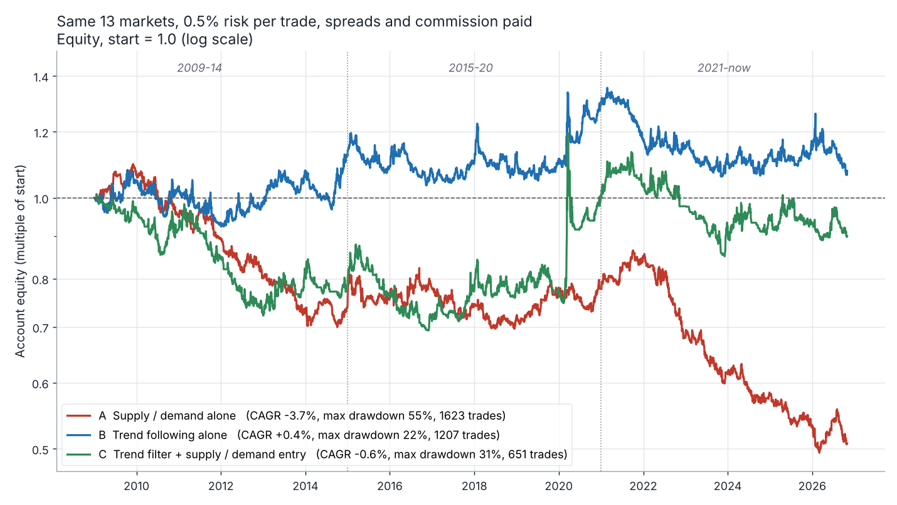
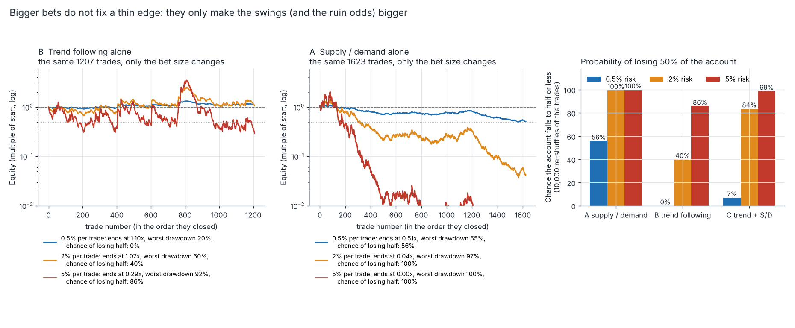

# Trend following vs supply / demand: which one makes money?

Back-test of three rule sets on the same 13 markets, Jan 2009 to 2026-10-30 (17.8 years, daily bars, spreads and commission paid, 0.5% of the account risked per trade). Run 2026-11-01. Nothing was tuned: the trend parameters, risk and costs were fixed before the first run (the few choices made later are listed under Caveats), so every year is out-of-sample.

## The answer in five lines

1. **None of the three makes money.** Trend alone (B) is break-even (+0.02R per trade, +0.4% a year); supply / demand alone (A) loses (-0.08R, -3.7% a year, the account falls to 0.51x); trend filter + S/D (C) is break-even (-0.01R, -0.6% a year). C beats A and ties B; it does not beat both.
2. **It fades out of sample.** 2015-20 was mildly positive for all three, 2021-now is negative for all three (A -0.16R, B -0.10R, C -0.13R per trade). Nothing is statistically different from zero except A, which is (just) negative.
3. **The zones carry no edge.** A is -0.05R per trade before costs; the scanner's full rule set never fires on D1 / W1 (0 orders in 18 years) and its zone-quality rules did not help (-0.25R on 79 trades). Only the exit helped: a trailing stop instead of a fixed target gave +0.07R (not proven).
4. **More risk only brings ruin faster.** Chance of losing half the account at 0.5% / 2% / 5% risk per trade: A 56% / 100% / 100%; even the break-even B 0% / 40% / 86%.
5. **Change:** risk 0.5% or less until a forward journal shows an edge; journal which zones you take and when you exit by hand (the mechanical zones show no edge, so any edge would be in that discretion); try trailing exits against fixed targets; do not expect a trend filter to fix the entries.



## 1. The three variants side by side

Whole period, Jan 2009 to 2026-10-30. R = profit in units of the planned risk (entry to stop, spread included). Expectancy = average R per trade. PF = gross profit / gross loss. 95% CI: resampled by calendar month (trades in a month share the market). CAGR and drawdown are from the daily mark-to-market account at 0.5% risk per trade.

| variant | trades | win % | avg win R | avg loss R | expectancy R (95% CI) | PF | CAGR | max DD | longest losing streak |
|---|---:|---:|---:|---:|---:|---:|---:|---:|---:|
| A  Supply / demand alone | 1623 | 36% | +1.55 | -1.00 | -0.08 (-0.15 … -0.00) | 0.88 | -3.7% | 55% | 16 |
| B  Trend following alone | 1207 | 34% | +1.30 | -0.64 | +0.02 (-0.07 … +0.11) | 1.05 | +0.4% | 22% | 20 |
| C  Trend filter + S/D entry | 651 | 16% | +4.43 | -0.83 | -0.01 (-0.22 … +0.25) | 0.99 | -0.6% | 31% | 31 |

### Out-of-sample split (nothing tuned on either half)

| variant | period | trades | win % | expectancy R (95% CI) | PF | CAGR | max DD |
|---|---|---:|---:|---:|---:|---:|---:|
| A  Supply / demand alone | 2009-14 | 575 | 36% | -0.10 (-0.23 … +0.04) | 0.85 | -4.9% | 36% |
|  | 2015-20 | 528 | 39% | +0.03 (-0.10 … +0.16) | 1.04 | +0.8% | 15% |
|  | 2021-now | 520 | 33% | -0.16 (-0.29 … -0.03) | 0.76 | -7.1% | 43% |
|  | 2015-now | 1048 | 36% | -0.07 (-0.16 … +0.03) | 0.89 | -3.1% | 43% |
| B  Trend following alone | 2009-14 | 407 | 36% | +0.09 (-0.08 … +0.31) | 1.23 | +2.0% | 15% |
|  | 2015-20 | 387 | 37% | +0.07 (-0.08 … +0.22) | 1.16 | +2.5% | 15% |
|  | 2021-now | 413 | 30% | -0.10 (-0.22 … +0.03) | 0.78 | -3.2% | 22% |
|  | 2015-now | 800 | 34% | -0.02 (-0.11 … +0.08) | 0.96 | -0.4% | 22% |
| C  Trend filter + S/D entry | 2009-14 | 225 | 15% | -0.12 (-0.41 … +0.25) | 0.84 | -3.9% | 29% |
|  | 2015-20 | 215 | 16% | +0.23 (-0.23 … +0.82) | 1.32 | +4.3% | 24% |
|  | 2021-now | 211 | 16% | -0.13 (-0.41 … +0.20) | 0.81 | -2.0% | 25% |
|  | 2015-now | 426 | 16% | +0.05 (-0.23 … +0.40) | 1.07 | +1.1% | 29% |

2015-20 vs 2021-now is the requested split. 2009-14 is extra history (the zone engine needs about three years of monthly bars before it can start), shown so that the picture does not hang on one decade.

### What each ingredient does (fixed rules, a 2 x 2 look, not an optimisation)

| entries / exit / filter | trades | win % | expectancy R (95% CI) | PF | 2015-20 R | 2021-now R | CAGR | max DD |
|---|---:|---:|---:|---:|---:|---:|---:|---:|
| A: S/D zones, target exit, no filter | 1623 | 36% | -0.08 (-0.15 … -0.00) | 0.88 | +0.03 | -0.16 | -3.7% | 55% |
| S/D zones, target exit, **with** trend filter | 727 | 38% | -0.08 (-0.18 … +0.03) | 0.88 | +0.06 | -0.21 | -1.7% | 29% |
| S/D zones, **trailing** exit, no filter | 1378 | 15% | +0.07 (-0.10 … +0.26) | 1.11 | +0.19 | +0.11 | +1.8% | 43% |
| C: S/D zones, trailing exit, trend filter | 651 | 16% | -0.01 (-0.22 … +0.25) | 0.99 | +0.23 | -0.13 | -0.6% | 31% |

Reading it: the trend filter does nothing for the target-exit version (A vs filtered A) and makes the trailing-exit version worse (AT vs C). The trailing exit is what moved the result, and even that is inside the noise (all CIs include zero). It was found by looking at four cells, so treat it as a lead for a forward test, not a result.

## 2. Per year and per symbol

Year return = change of the 0.5%-risk account in that calendar year. Trades and expectancy are by entry year.

| year | A return | A n | A R | B return | B n | B R | C return | C n | C R |
|---|---:|---:|---:|---:|---:|---:|---:|---:|---:|
| 2009 | +6.7% | 88 | +0.14 | +4.4% | 58 | +0.14 | -4.3% | 31 | -0.32 |
| 2010 | -11.0% | 104 | -0.19 | -1.3% | 72 | -0.07 | -4.2% | 44 | -0.10 |
| 2011 | -6.1% | 101 | -0.14 | -9.7% | 71 | -0.25 | -7.4% | 39 | -0.47 |
| 2012 | -9.7% | 108 | -0.18 | +6.3% | 64 | +0.38 | -14.9% | 48 | -0.63 |
| 2013 | -9.0% | 89 | -0.26 | +9.1% | 70 | +0.04 | +13.0% | 32 | +0.81 |
| 2014 | +1.2% | 85 | +0.09 | +4.3% | 72 | +0.36 | -3.7% | 31 | +0.37 |
| 2015 | +2.6% | 82 | +0.09 | -2.9% | 67 | -0.19 | -2.4% | 37 | -0.66 |
| 2016 | +2.6% | 96 | +0.04 | -1.8% | 76 | -0.07 | -7.3% | 44 | -0.01 |
| 2017 | -4.4% | 83 | -0.10 | +2.4% | 57 | +0.19 | +8.5% | 33 | +0.36 |
| 2018 | -3.6% | 87 | -0.06 | +1.5% | 71 | -0.12 | +1.2% | 33 | -0.00 |
| 2019 | +8.2% | 88 | +0.19 | -0.0% | 61 | +0.04 | -0.0% | 38 | -0.18 |
| 2020 | -0.0% | 92 | +0.01 | +17.2% | 55 | +0.71 | +29.2% | 30 | +2.29 |
| 2021 | +8.9% | 87 | +0.18 | -10.4% | 75 | -0.33 | +2.1% | 29 | -0.11 |
| 2022 | -19.8% | 88 | -0.48 | -1.1% | 75 | -0.02 | -5.2% | 42 | -0.24 |
| 2023 | -9.4% | 97 | -0.20 | -2.7% | 72 | -0.09 | -5.4% | 40 | -0.10 |
| 2024 | -5.8% | 93 | -0.15 | +0.3% | 64 | +0.01 | +1.8% | 36 | -0.13 |
| 2025 | -8.1% | 79 | -0.25 | +1.1% | 70 | +0.14 | -0.8% | 32 | +0.02 |
| 2026 | -4.8% | 76 | -0.06 | -5.6% | 57 | -0.31 | -3.6% | 32 | -0.21 |

| symbol | group | A n | A R/trade | A sum R | B n | B R/trade | B sum R | C n | C R/trade | C sum R |
|---|---|---:|---:|---:|---:|---:|---:|---:|---:|---:|
| AUDUSD | FX | 137 | -0.02 | -2.1 | 102 | -0.13 | -12.8 | 69 | -0.18 | -12.5 |
| EURUSD | FX | 125 | -0.12 | -14.6 | 86 | +0.09 | +7.9 | 45 | -0.00 | -0.1 |
| GBPJPY | FX | 110 | +0.02 | +2.6 | 97 | -0.12 | -11.8 | 38 | +0.40 | +15.1 |
| GBPUSD | FX | 144 | -0.30 | -42.9 | 96 | -0.09 | -8.4 | 60 | -0.34 | -20.2 |
| NZDUSD | FX | 137 | -0.01 | -0.7 | 105 | -0.18 | -19.2 | 54 | -0.44 | -23.6 |
| USDCAD | FX | 115 | -0.21 | -23.8 | 98 | -0.13 | -12.9 | 39 | +0.67 | +26.0 |
| USDJPY | FX | 117 | +0.07 | +8.0 | 86 | +0.12 | +10.2 | 43 | -0.33 | -14.4 |
| XAGUSD | Metals | 96 | -0.16 | -15.2 | 89 | +0.10 | +9.1 | 44 | -0.46 | -20.2 |
| XAUUSD | Metals | 135 | +0.22 | +29.4 | 82 | +0.36 | +29.4 | 50 | +0.18 | +9.1 |
| US30 | Indices | 148 | -0.13 | -19.2 | 97 | +0.02 | +1.7 | 58 | +0.11 | +6.3 |
| NAS100 | Indices | 110 | -0.12 | -12.7 | 92 | +0.03 | +3.0 | 50 | -0.09 | -4.6 |
| US500 | Indices | 124 | -0.17 | -20.7 | 92 | +0.08 | +7.4 | 39 | +1.16 | +45.4 |
| SPOTCRUDE | Oil | 125 | -0.12 | -14.7 | 85 | +0.24 | +20.7 | 62 | -0.18 | -11.3 |

No symbol is a reliable winner across the variants (the best single numbers, such as gold for A and B or the S&P 500 for C, come from 30-150 trades with a standard error of 0.1-0.4R, and 13 symbols x 3 variants guarantee some good-looking cells).

## 3. Variant A, rule by rule: how much of the owner's method is left

The live scanner (`tools/fx_scanner/fxcore.py`, the same functions) was run at every D1 close from Sep 2008 on the bars closed at that moment. 4,851 different D1 / W1 zones came within one zone-height of price; 3,486 were still fresh on that first day. Share of those fresh zones that FAIL each scanner rule on that day (a zone can fail several):

| scanner rule | fresh zones failing it |
|---|---:|
| HTF location chain (MN -> W1 -> D1 touched) | 100% |
| a limit order is allowed here (arrival / WOW / at the trendline) | 78% |
| departure at least 2x the base | 77% |
| nearest opposite zone (any TF) at least 2x the stop away | 74% |
| strong zone type (ARR / WOW / STR) | 68% |
| direction agrees (D1 -> W1 -> MN) | 67% |
| curve side | 47% |
| not an overlap / flip zone | 42% |
| not sideways | 42% |
| not out of the trendline | 32% |
| has not done its job yet | 28% |
| D1 / H4 zone, not a W1 / MN area | 20% |
| no opposite HTF zone on top | 20% |
| trendline distance / touches | 18% |
| direction FULL, not reduced | 16% |
| not the 3rd continuation in a row | 6% |
| spread under 10% of the stop | 2% |

Variant A (the headline) keeps only the first step. Each later step adds the next group of rules (cumulative). The last step is the whole live scanner.

| step | rules added | orders | A trades | win % | A expectancy R (95% CI) | PF | C trades | C R |
|---|---|---:|---:|---:|---:|---:|---:|---:|
| L0 | every fresh D1 / W1 zone near price | 3365 | 1623 | 36% | -0.08 (-0.15 … -0.00) | 0.88 | 651 | -0.01 |
| L1 | + zone quality: departure >= 2x, strong type (ARR / WOW / STR), clean, not used, not a 3rd CP | 128 | 79 | 28% | -0.25 (-0.55 … +0.07) | 0.66 | 22 | -0.23 |
| L2 | + room: nearest opposite zone (any TF) at least 2x the stop away | 59 | 40 | 18% | -0.31 (-0.73 … +0.23) | 0.62 | 12 | -0.65 |
| L3 | + a limit order is allowed here (arrival zone, WOW, or at the trendline) | 41 | 27 | 19% | -0.21 (-0.78 … +0.50) | 0.75 | 8 | -0.69 |
| L4 | + local structure: no opposite HTF zone on top, not sideways, trendline, host zone | 13 | 5 | 20% | -0.26 | 0.68 | 1 | -0.08 |
| L5 | + top-down direction: direction FULL, curve side | 8 | 4 | 25% | -0.07 | 0.91 | 0 |  |
| L6 | + HTF location chain (MN -> W1 -> D1 touched) = every rule of the live scanner | 0 | 0 |  |  |  | 0 |  |

Everything below 30 trades is anecdote. The pattern is what matters: the more of the owner's rules are applied, the fewer the trades and the worse the average (the 95% CI at L1 is -0.55 … +0.07R). The complete scanner rule set produced no D1 / W1 order at all, so "the method as written" cannot be tested mechanically on D1 / W1; what the owner trades is a looser, discretionary version.

A by zone timeframe: D1 -0.06R (1383 trades), W1 -0.16R (240 trades). Exits: 1023 stops, 591 targets, 9 gaps through the stop.

## 4. Risk size: what 0.5%, 2% and 5% per trade do to the same trades

The closed trades of each variant (in the order they closed, 0.5% run) are replayed at a fixed fraction of the current account per trade: "replay" is the real order of the trades; "re-shuffled" resamples the trades with replacement 10,000 times (same number of trades as in the history, 18 years) to see how lucky or unlucky the order was. **Chance of losing 50%** = share of the 10,000 paths whose account touches half of its start at any time. The 5% total-open-risk cap is not applied here, so at 2% and 5% the real damage from several trades going wrong together (USD pairs, index shorts) would be worse than shown.

| variant | risk per trade | final equity (replay) | max drawdown (replay) | re-shuffled: median final (5th … 95th pct) | chance of losing 50% | chance of a 50% drawdown | same, in blocks of 10 trades |
|---|---:|---:|---:|---:|---:|---:|---:|
| A  Supply / demand alone | 0.5% | 0.51x | 55% | 0.51x (0.32 … 0.81) | 56% | 64% | 54% |
|  | 2% | 0.04x | 97% | 0.04x (0.01 … 0.26) | 100% | 100% | 100% |
|  | 5% | 0.00x | 100% | 0.00x (0.00 … 0.00) | 100% | 100% | 100% |
| B  Trend following alone (best) | 0.5% | 1.10x | 20% | 1.10x (0.75 … 1.63) | 0% | 0% | 0% |
|  | 2% | 1.07x | 60% | 1.06x (0.25 … 4.91) | 40% | 78% | 45% |
|  | 5% | 0.29x | 92% | 0.29x (0.01 … 10.68) | 86% | 100% | 85% |
| C  Trend filter + S/D entry | 0.5% | 0.91x | 33% | 0.89x (0.52 … 1.69) | 7% | 12% | 8% |
|  | 2% | 0.35x | 85% | 0.33x (0.04 … 3.19) | 84% | 100% | 81% |
|  | 5% | 0.01x | 100% | 0.01x (0.00 … 0.70) | 99% | 100% | 98% |

"Chance of losing 50%" counts any dip to half of the starting account; "50% drawdown" is a fall of half from the highest point so far; the last column resamples blocks of 10 consecutive trades so losing streaks stay together. The best variant by expectancy is B; A is shown because it is the owner's method.



At 0.5% the owner's method already halves the account over the period (56% chance). An average trade of -0.08R costs 0.039% of the account at 0.5% risk, 0.16% at 2% and 0.39% at 5%; over 1,623 trades that compounds to 0.51x, 0.04x and 0.00x. Risking more multiplies the good and the bad trades alike, but with an average below zero the loss side wins. At 2-5% risk, losing the account is the expected outcome here, not bad luck.

## 5. How sure are these numbers? (checks and sensitivities)

|  | R/trade, no cost | R/trade, base cost | R/trade, 2x cost | CAGR, no cost | CAGR, base cost | CAGR, 2x cost |
|---|---:|---:|---:|---:|---:|---:|
| A  Supply / demand alone | -0.05 | -0.08 | -0.10 | -2.5% | -3.7% | -4.9% |
| B  Trend following alone | +0.03 | +0.02 | +0.01 | +0.7% | +0.4% | +0.1% |
| C  Trend filter + S/D entry | +0.03 | -0.01 | -0.04 | -0.0% | -0.6% | -1.1% |
| A, generous fill (a limit bar may also credit the target) |  | -0.01 |  |  | -0.6% |  |

- Costs matter for A (about 0.03R per trade) and little for B (the stops are 3 ATR wide). Without any cost A is still negative; under the most generous fill rule A is -0.01R, i.e. break-even at best. No reading of the fills turns A into a money maker.
- **No look-ahead.** `tools/research/trend_vs_sd/validate.py` cuts all the data at 2019-12-15 and re-runs everything: every trade that closed before the cut and the whole equity curve up to it are identical for A, B and C, and the zone records of three symbols (EURUSD, XAUUSD, US30) before the cut are identical with and without the later bars. A zone enters only through `fxcore.analyse` on the bars that were closed at that close (leg-out and stay-away candle included).
- **H4 history.** The scanner also reads H4 zones (they limit the room / target of a D1 zone), so real H4 bars from 2008 were fetched (qa-bars.yml, `since`). A stand-in (the D1 bar as an H4 bar) was tried first and changed the room rule on about a quarter of the zone-days, which is why it was not used.
- **Sample size.** B and A have about 1,200-1,600 trades, C 650. Trades are correlated (USD pairs, index shorts in a crash), which is why the CIs resample whole months.

## 6. Rules used (all fixed in advance)

**Markets (13):** AUDUSD, EURUSD, GBPJPY, GBPUSD, NZDUSD, USDCAD, USDJPY, XAGUSD, XAUUSD, US30, NAS100, US500, SPOTCRUDE. The first 11 are the owner's MT5 symbols; US500 and SPOTCRUDE (OANDA SPX500_USD and WTICO_USD) were added for breadth. Daily bars, BID, OANDA practice history aligned to 17:00 New York (= Pepperstone server midnight), `data` branch `qa/bars`. Older thin Sunday bars are merged into Monday.

**A: supply / demand alone.** The live scanner's functions at every D1 close: fresh D1 or W1 zone, price within one zone height of the proximal (the moment the scanner shows a BUY / SELL), a target exists (nearest opposite zone of any TF minus 7 pips, else the 250% projection) and the spread is under 10% of the stop. Limit at the proximal (buys pay the ask), stop = distal + 10% of the zone height (D1) or 5% (W1), at least 3 pips, target as above, valid 15 days (D1) / 45 days (W1), cancelled if a close goes beyond the distal or the target trades first, time stop after 150 days. No other filter. (The 3-pip minimum buffer is 0.04 ATR on indices and oil, the scanner's ATR-pip rule.)

**B: trend following alone.** Long when the close is above the 100-day SMA and is a new 50-day closing high (short: the mirror); market entry at the next open. Initial stop 3 x ATR(20) (Wilder). Exit: a trailing stop at the 20-day low (shorts: 20-day high), a stop order that only moves in the trade's favour; no target.

**C: trend filter + S/D entry.** A's orders, filled only if at the previous close the symbol is in a B-regime in the order's direction: close above the 100-day SMA and the most recent 50-day closing extreme was a high (shorts: below and a low). Stop = A's stop, exit = B's trailing 20-day stop (never looser than A's stop), no target, no time stop.

**Fills (daily bars, stated conservatively).** Limit orders fill at the limit price on the first bar that trades through it (no price improvement on gaps). A trade can be stopped out on its fill bar; a target is not credited on the fill bar. When a bar touches both stop and target, the stop wins. A bar that opens beyond a stop exits at the open. Moving (trailing) stops act from the next bar. One open trade per symbol; when several orders compete on a day they are taken in a pseudo-random fixed order.

**Risk.** Each trade risks 0.5% of the mark-to-market account to its stop (units = 0.5% x equity / (|entry - stop| + cost)); P&L = R x that amount (currency conversion drift ignored). Open risk = every open trade's distance to its CURRENT stop, summed with no credit for correlation (several USD-short trades count in full); a new trade is skipped when the total would pass 5%. The cap skipped 24 B trades and no A or C trades. Median size: A 0.6x the account (max 3.7x), B 0.15x (max 0.44x), C 0.5x (max 3.1x); this is why B's CAGR looks small at 0.5% risk, so compare the R columns.

**Costs (one full spread + commission per round trip, constant over the years):** AUDUSD 0.00014, EURUSD 0.00012, GBPJPY 0.03, GBPUSD 0.00015, NZDUSD 0.00018, USDCAD 0.00018, USDJPY 0.014, XAGUSD 0.035, XAUUSD 0.4, US30 3, NAS100 2, US500 0.8, SPOTCRUDE 0.05 (price units).

## 7. Caveats

- OANDA practice BID prices, not the owner's Pepperstone feed; daily bars aligned the same way. Spreads are typical averages held constant; real 2009-2019 spreads were wider and widen at rollover and news, which hurts A more than B.
- No swaps / financing. Trend trades are held for weeks; long index and gold CFDs pay financing, carry earns or costs on FX. This would move B and C by a small amount in either direction.
- The zone engine is the project's reading of the Raja / Kevin rules. The owner's discretion (which zones to take, how they read structure, when they exit by hand) is not in A. The earlier arrival study (`docs/research/arrival_study`) found the same on Kevin's own calls: about break-even before the owner's extras.
- 13 markets, no bonds, rates or agricultural futures. Trend following earns most of its historical return there; with only FX, gold / silver, three US indices and one oil contract the sample is narrow, and the 2008 crash (best year for trend followers) is before the start.
- SPOTCRUDE is a futures-based CFD: OANDA and the owner's broker roll on different dates, so zone levels can differ (the scanner marks it "context only"). On the owner's 11 symbols only (no US500, no oil) the picture is the same: A -0.07R, B -0.00R, C -0.07R per trade (CAGR -2.7%, -0.2%, -1.4%).
- Variant A's zone scan starts in Sep 2008 and the sims in Jan 2009 (monthly bars start in 2005 and the engine needs about three years of them; H4 bars start in 2008). Everything before 2015 was also untuned, so it counts as out-of-sample too.
- The "which ingredient" 2 x 2 and the ladder look at several cells; with CIs this wide a positive cell is expected by chance. Only A, B and C were pre-specified.
- Choices made after seeing data, all stated: A's headline step is L0 (picked because it is the only step with a few hundred trades; the order counts were looked at before the results); weekend bars merged into Monday; real H4 bars fetched; the fill-bar and cost sensitivities. The numbers 100 / 50 / 20 / 3 ATR, 0.5% / 5% and the cost table were fixed before the first run and never changed.
- Data branch: to get the long history, `qa-bars.yml` was dispatched on this branch for MN / W1 / D1 since 2005 and H4 since 2008 (new `since` input; US500 added to `qa_bars.py`). The `qa/bars` files of the `data` branch now hold these longer histories (a superset of what they held); default ranges of the workflow are unchanged.

## 8. Reproduce

```
git fetch origin data                                   # qa/bars: OANDA bars (qa-bars.yml; H4 from 2008 via the `since` input)
python tools/research/trend_vs_sd/collect_zones.py --out /tmp/zones.json          # variant A zone records, ~4 min on 4 cores
python tools/research/trend_vs_sd/run_all.py --zones /tmp/zones.json --out docs/research/trend_vs_sd
python tools/research/trend_vs_sd/make_doc.py --results docs/research/trend_vs_sd/results.json --out docs/research/TREND_VS_SD.md
python tools/research/trend_vs_sd/validate.py --zones /tmp/zones.json              # look-ahead test
```

Files: `docs/research/trend_vs_sd/results.json` (every number above), `trades.csv` (every trade of A, B, C), `equity.png`, `risk.png`. Code: `tools/research/trend_vs_sd/` (`tvsdlib.py` data and costs, `collect_zones.py`, `sim.py`, `stats.py`, `run_all.py`, `charts.py`, `make_doc.py`, `validate.py`).

Not financial advice. Past results do not guarantee future results.
