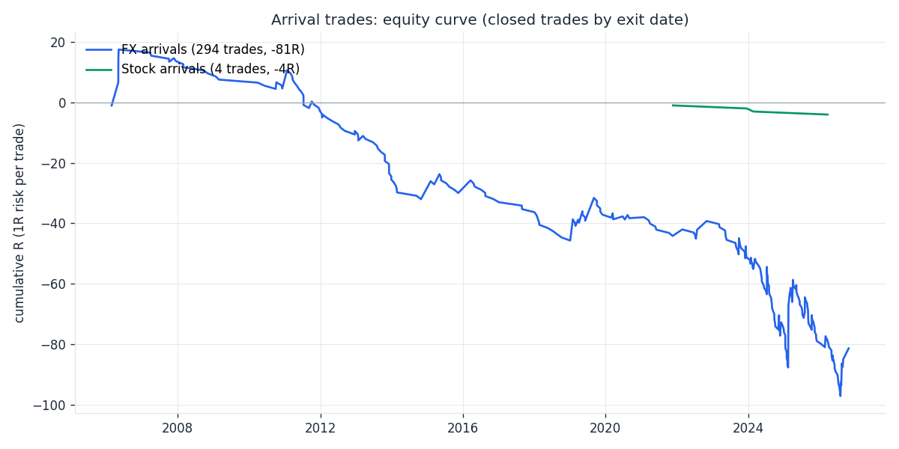
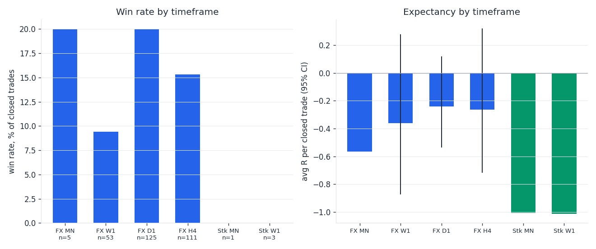
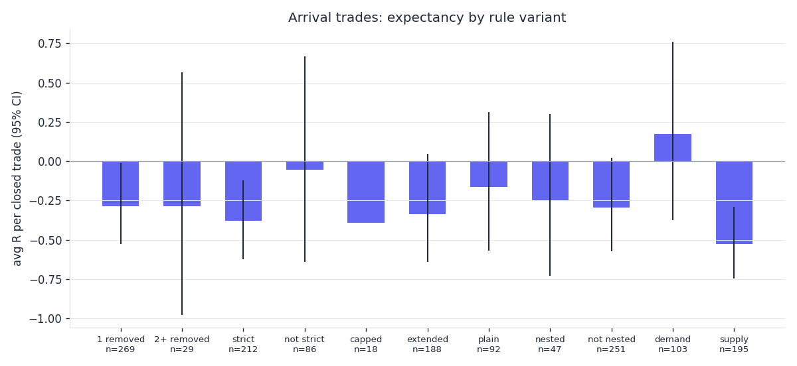

# Arrival study (Raja arrival rules, walk-forward on full history)

Generated 2026-10-30 13:38 UTC by `tools/research/arrival_study/study.py` (GitHub Actions, OANDA practice + Alpaca). 115 FX instruments (OANDA), 92 stocks (Alpaca, daily since 2016). Runtime 6 min.

## Method (short)

- Rules = the live code (`tools/stock_scanner/arrival.py`, parity with the bot's `arrival.ts`): an arrival = a zone whose leg-out crosses the TF trend line against it and removes >= 1 opposite zone (LOOSE, the live rule). Each candidate is re-read at the bar it became true with only the bars closed by then (HTF too) and counts only when the live rule names it the current arrival; its plan (target / ceiling / extension, the new stop rule, R:R) is the one the bot showed at that moment.
- Trade: limit at the proximal, filled within 20 entry-TF bars (cancelled when a close removes the zone or the target trades first); stop = the stop rule (buffer = max(0.1 ATR14, spread); 2 buffers beyond a same-side HTF zone the entry zone sits in, else 1 buffer beyond the base valley / peak); target = the plan's TP. Simulated on daily bars (FX H4 entries: H4), a bar touching stop and target = loss, the fill bar never reaches the target, gaps exit at the open. Costs: FX one typical spread, stocks 10 bps (in R). Open after 100 entry-TF bars or at the end of the data = open (not in win %; marked in "avg R all").
- Realignment + LTF confirmation (FX D1->1H for the last ~2 years, W1->4H, MN->D1; stocks MN->D1): the first LTF arrival of the other side inside the realignment area within 30 TF bars; stop = the stop rule with the area as host; target = the TF's last real pivot.
- Strict ("at a valley"): the arrival zone's valley / peak is also the extreme of the 20 bars before its base.
- 1R = entry - stop. Win % over closed trades. CI = bootstrap 95% of avg R (closed trades).

## Headline

- Verified arrivals: **779** (726 with a target; 53 had none). Filled: 313 (43%), closed 298.
- Arrival trades: win rate **16%**, avg **-0.29R** per closed trade (95% CI -0.51 … -0.01), profit factor 0.68, total -85R.
- Confirmation trades (realignment + LTF arrival): 0 found, 0 closed, win rate –%, avg –R.

## Conclusions (plain English)

- All arrival trades: 298 closed, win 16%, avg -0.29R, PF 0.68 -> expectancy negative (the 95% CI is below 0).
- FX MN: too few closed trades (5) to say anything.
- FX W1: 53 closed, win 9%, avg -0.36R, PF 0.61 -> expectancy not distinguishable from zero.
- FX D1: 125 closed, win 20%, avg -0.24R, PF 0.72 -> expectancy not distinguishable from zero.
- FX H4: 111 closed, win 15%, avg -0.26R, PF 0.73 -> expectancy not distinguishable from zero.
- Stocks MN: too few closed trades (1) to say anything.
- Stocks W1: too few closed trades (3) to say anything.
- Strong (2+ removed): too few closed trades (29) to say anything.
- Single removal: 269 closed, win 16%, avg -0.29R, PF 0.68 -> expectancy negative (the 95% CI is below 0).
- Strict (at a valley): 212 closed, win 15%, avg -0.38R, PF 0.58 -> expectancy negative (the 95% CI is below 0).
- Not at a valley: 86 closed, win 19%, avg -0.05R, PF 0.94 -> expectancy not distinguishable from zero.
- Capped targets: too few closed trades (18) to say anything.
- Extended targets: 188 closed, win 15%, avg -0.34R, PF 0.64 -> expectancy not distinguishable from zero.
- Nested in an HTF zone: 47 closed, win 21%, avg -0.25R, PF 0.70 -> expectancy not distinguishable from zero.
- Not nested: 251 closed, win 15%, avg -0.29R, PF 0.68 -> expectancy not distinguishable from zero.
- Confirmation trades: too few closed trades (0) to say anything.
- Stop rule vs the old distal stop on the same arrivals: win 16% vs 13%, avg -0.29R vs -0.16R (R is smaller per point with the wider stop, so compare the win rate and the sum).

## Arrival trades

**By timeframe (FX + stocks)**

| group | arrivals | filled | closed | win % | avg R | 95% CI | PF | sum R | med. bars to fill | med. bars in trade | med. MFE / MAE (R) |
|---|---|---|---|---|---|---|---|---|---|---|---|
| fx MN | 15 | 5 | 5 | 20 | -0.56 | n < 20 | 0.30 | -2.8 | 4 | 2 | 0.34 / 1.05 |
| fx W1 | 90 | 54 | 53 | 9 | -0.36 | -0.87 … +0.27 | 0.61 | -19.1 | 6 | 7 | 0.92 / 1.08 |
| fx D1 | 335 | 135 | 125 | 20 | -0.24 | -0.53 … +0.11 | 0.72 | -30.0 | 6 | 6 | 0.99 / 1.20 |
| fx H4 | 269 | 113 | 111 | 15 | -0.26 | -0.71 … +0.32 | 0.73 | -29.4 | 6 | 6 | 0.66 / 1.24 |
| stock MN | 2 | 2 | 1 | 0 | -1.01 | n < 20 | 0.00 | -1.0 | 5 | 4 | 1.65 / 0.75 |
| stock W1 | 15 | 4 | 3 | 0 | -1.01 | n < 20 | 0.00 | -3.0 | 11 | 8 | 1.92 / 1.03 |

**FX vs stocks**

| group | arrivals | filled | closed | win % | avg R | 95% CI | PF | sum R | med. bars to fill | med. bars in trade | med. MFE / MAE (R) |
|---|---|---|---|---|---|---|---|---|---|---|---|
| fx | 709 | 307 | 294 | 16 | -0.28 | -0.51 … +0.01 | 0.69 | -81.4 | 6 | 6 | 0.81 / 1.17 |
| stock | 17 | 6 | 4 | 0 | -1.01 | n < 20 | 0.00 | -4.0 | 7 | 7 | 1.65 / 1.02 |

**Demand vs supply**

| group | arrivals | filled | closed | win % | avg R | 95% CI | PF | sum R | med. bars to fill | med. bars in trade | med. MFE / MAE (R) |
|---|---|---|---|---|---|---|---|---|---|---|---|
| fx demand | 298 | 105 | 100 | 22 | +0.21 | -0.36 … +0.82 | 1.24 | +20.7 | 7 | 8 | 1.25 / 1.12 |
| fx supply | 411 | 202 | 194 | 13 | -0.53 | -0.75 … -0.29 | 0.44 | -102.1 | 6 | 5 | 0.61 / 1.20 |
| stock demand | 10 | 4 | 3 | 0 | -1.01 | n < 20 | 0.00 | -3.0 | 7 | 8 | 2.27 / 1.04 |
| stock supply | 7 | 2 | 1 | 0 | -1.01 | n < 20 | 0.00 | -1.0 | 10 | 6 | 1.10 / 0.73 |

**Opposite zones removed**

| group | arrivals | filled | closed | win % | avg R | 95% CI | PF | sum R | med. bars to fill | med. bars in trade | med. MFE / MAE (R) |
|---|---|---|---|---|---|---|---|---|---|---|---|
| 1 removed | 632 | 283 | 269 | 16 | -0.29 | -0.52 … -0.02 | 0.68 | -77.2 | 6 | 6 | 0.91 / 1.17 |
| 2+ removed (strong) | 94 | 30 | 29 | 17 | -0.28 | -0.97 … +0.56 | 0.70 | -8.3 | 6 | 6 | 0.49 / 1.10 |

**Target type**

| group | arrivals | filled | closed | win % | avg R | 95% CI | PF | sum R | med. bars to fill | med. bars in trade | med. MFE / MAE (R) |
|---|---|---|---|---|---|---|---|---|---|---|---|
| capped below / above the HTF line | 34 | 19 | 18 | 17 | -0.39 | n < 20 | 0.56 | -7.1 | 6 | 6 | 0.77 / 1.19 |
| extended to the HTF zone | 459 | 200 | 188 | 15 | -0.34 | -0.64 … +0.04 | 0.64 | -63.2 | 7 | 6 | 0.93 / 1.19 |
| plain (same-TF weak zone) | 233 | 94 | 92 | 18 | -0.17 | -0.57 … +0.31 | 0.81 | -15.2 | 6 | 5 | 0.56 / 1.10 |

**Nested in a same-side HTF zone (stop rule)**

| group | arrivals | filled | closed | win % | avg R | 95% CI | PF | sum R | med. bars to fill | med. bars in trade | med. MFE / MAE (R) |
|---|---|---|---|---|---|---|---|---|---|---|---|
| nested, valley stop further | 46 | 18 | 18 | 11 | -0.67 | n < 20 | 0.32 | -12.0 | 7 | 6 | 1.04 / 1.20 |
| nested: stop beyond the HTF zone | 86 | 31 | 29 | 28 | +0.00 | -0.65 … +0.78 | 1.01 | +0.1 | 8 | 22 | 1.30 / 1.09 |
| not nested: valley stop | 594 | 264 | 251 | 15 | -0.29 | -0.57 … +0.02 | 0.68 | -73.6 | 6 | 5 | 0.73 / 1.17 |

**Loose (live rule) vs strict (at a valley)**

| group | arrivals | filled | closed | win % | avg R | 95% CI | PF | sum R | med. bars to fill | med. bars in trade | med. MFE / MAE (R) |
|---|---|---|---|---|---|---|---|---|---|---|---|
| loose: every arrival | 726 | 313 | 298 | 16 | -0.29 | -0.51 … -0.01 | 0.68 | -85.4 | 6 | 6 | 0.90 / 1.17 |
| strict: at a valley | 537 | 224 | 212 | 15 | -0.38 | -0.62 … -0.13 | 0.58 | -80.7 | 6 | 6 | 0.65 / 1.13 |
| loose but not at a valley | 189 | 89 | 86 | 19 | -0.05 | -0.64 … +0.66 | 0.94 | -4.7 | 6 | 7 | 0.99 / 1.20 |

**Strict vs loose by market**

| group | arrivals | filled | closed | win % | avg R | 95% CI | PF | sum R | med. bars to fill | med. bars in trade | med. MFE / MAE (R) |
|---|---|---|---|---|---|---|---|---|---|---|---|
| fx not strict | 184 | 88 | 86 | 19 | -0.05 | -0.64 … +0.66 | 0.94 | -4.7 | 6 | 7 | 0.99 / 1.20 |
| fx strict | 525 | 219 | 208 | 15 | -0.37 | -0.60 … -0.10 | 0.59 | -76.7 | 6 | 6 | 0.64 / 1.13 |
| stock not strict | 5 | 1 | 0 | – | – | n < 20 | – | +0.0 | 5 | – | 1.66 / 0.46 |
| stock strict | 12 | 5 | 4 | 0 | -1.01 | n < 20 | 0.00 | -4.0 | 9 | 7 | 1.63 / 1.03 |

**Stop rule vs the old stop (zone distal), same entries / targets**

| group | arrivals | filled | closed | win % | avg R | 95% CI | PF | sum R | med. bars to fill | med. bars in trade | med. MFE / MAE (R) |
|---|---|---|---|---|---|---|---|---|---|---|---|
| new stop rule | 726 | 313 | 298 | 16 | -0.29 | -0.51 … -0.01 | 0.68 | -85.4 | 6 | 6 | 0.90 / 1.17 |

****

| group | arrivals | filled | closed | win % | avg R | 95% CI | PF | sum R | med. bars to fill | med. bars in trade | med. MFE / MAE (R) |
|---|---|---|---|---|---|---|---|---|---|---|---|
| old stop = distal | 726 | 313 | 304 | 13 | -0.16 | -0.49 … +0.19 | 0.84 | -48.9 | 6 | 6 | 0.90 / 1.17 |

**Planned R:R bucket**

| group | arrivals | filled | closed | win % | avg R | 95% CI | PF | sum R | med. bars to fill | med. bars in trade | med. MFE / MAE (R) |
|---|---|---|---|---|---|---|---|---|---|---|---|
| < 1 | 12 | 5 | 5 | 80 | +0.42 | n < 20 | 2.96 | +2.1 | 2 | 6 | 0.99 / 0.39 |
| 1-2 | 78 | 29 | 29 | 31 | -0.26 | -0.66 … +0.17 | 0.64 | -7.6 | 4 | 6 | 0.60 / 1.08 |
| 2-4 | 162 | 69 | 66 | 26 | -0.07 | -0.45 … +0.34 | 0.91 | -4.9 | 6 | 7 | 0.96 / 1.08 |
| 4+ | 474 | 210 | 198 | 9 | -0.38 | -0.69 … +0.00 | 0.62 | -75.1 | 7 | 5 | 0.91 / 1.27 |

## Realignment + lower-TF confirmation trades

**By TF pair**

| group | arrivals | filled | closed | win % | avg R | 95% CI | PF | sum R | med. bars to fill | med. bars in trade | med. MFE / MAE (R) |
|---|---|---|---|---|---|---|---|---|---|---|---|

**Stop basis**

| group | arrivals | filled | closed | win % | avg R | 95% CI | PF | sum R | med. bars to fill | med. bars in trade | med. MFE / MAE (R) |
|---|---|---|---|---|---|---|---|---|---|---|---|

**Old stop (the LTF zone distal)**

| group | arrivals | filled | closed | win % | avg R | 95% CI | PF | sum R | med. bars to fill | med. bars in trade | med. MFE / MAE (R) |
|---|---|---|---|---|---|---|---|---|---|---|---|

## Data / counts

| instrument TF | candidates | verified current | not current at that bar | no target |
|---|---|---|---|---|
| fx D1 | 356 | 356 | 0 | 21 |
| fx H4 | 282 | 281 | 1 | 12 |
| fx MN | 20 | 20 | 0 | 5 |
| fx W1 | 98 | 98 | 0 | 8 |
| stock MN | 4 | 4 | 0 | 2 |
| stock W1 | 20 | 20 | 0 | 5 |

**No-look-ahead check** (the live reading at every closed bar vs the candidate pass; same arrival on the same bar):

| instrument | TF | bars walked | walk-forward arrivals | candidate pass | same arrival, same bar | walk only | candidates only |
|---|---|---|---|---|---|---|---|
| AUDUSD | D1 | 600 | 1 | 1 | 1 | 0 | 0 |
| EURUSD | D1 | 600 | 0 | 0 | 0 | 0 | 0 |
| GBPUSD | D1 | 600 | 0 | 0 | 0 | 0 | 0 |

## Caveats

- One random-free path per instrument; FX instruments are correlated (USD pairs move together), so the effective sample is smaller than the trade count. CIs assume independent trades: read them as optimistic.
- Daily-bar simulation is conservative inside a bar (stop first). FX spread = the median of the last ~3000 H4 spreads (older history had wider spreads). No swap / financing, no slippage beyond the gap rule.
- Stocks: Alpaca split-adjusted daily since 2016 only (~10 years of W1, ~120 MN bars: few MN arrivals); survivorship bias (today's liquid list).
- The live alerts also require the arrival to be the newest closed bar's news and cap messages per day; the study takes every verified arrival.
- Fetch / run errors: 8: SKHY: 80 daily bars; CBRS: 118 daily bars; BMNR: 354 daily bars; CRCL: 354 daily bars; MDLN: 219 daily bars; FPS: 186 daily bars; SUNB: 170 daily bars; MMED: 166 daily bars.

## Charts

