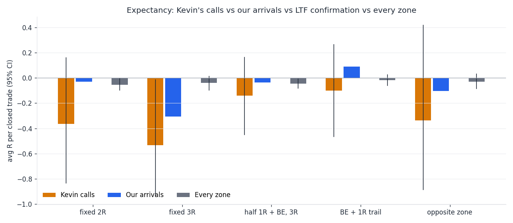
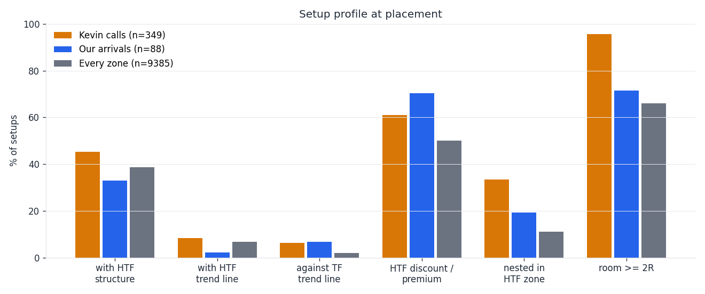
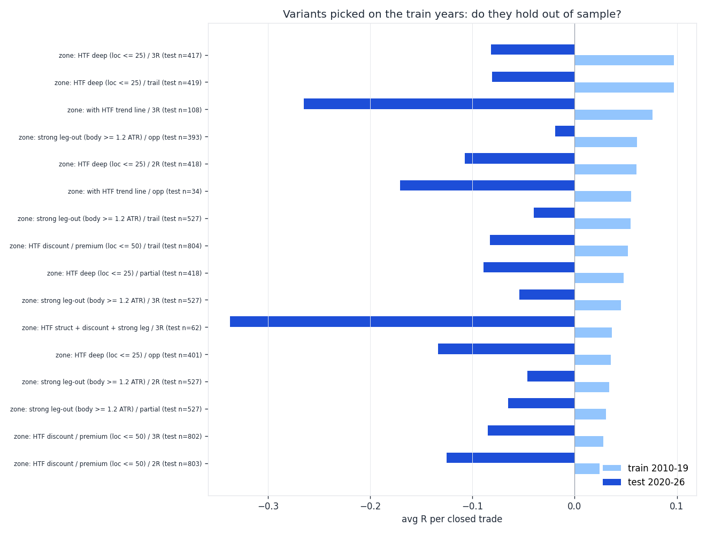
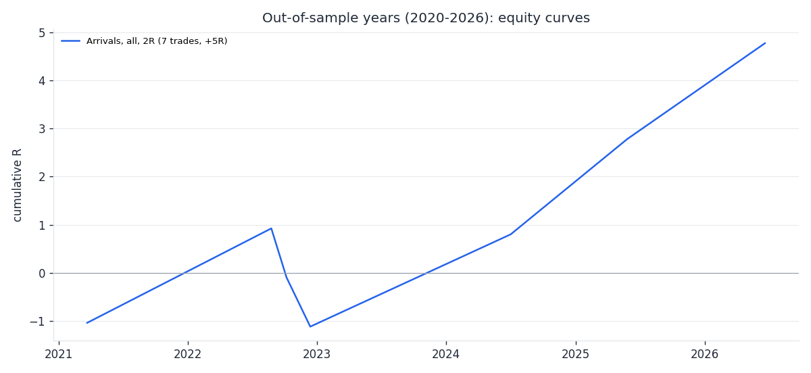

# Arrival study, round 2: what is missing vs the mentor?

Generated 2026-10-30 15:57 UTC by `tools/research/arrival_study/round2.py` (GitHub Actions, OANDA practice). 4 FX / CFD instruments (OANDA), runtime 2 min.

<!--ANSWER-->

## 1. Kevin's real calls, back-tested

880 calls in `tools/kevin_daily/calls.json` (63 recorded breakdowns, plan days 2026-07-09 … 2026-10-29). 426 name a price (a zone / limit); the rest are trend-line / context calls (direction only). Zone calls: traded 349, price off 56, no instrument 16, zone already broken 5. Median zone height used when he gave no distal (ATR of his zone TF): D1 0.80, H1 0.98, H4 0.96, M5 7.28, W1 0.91.

Rules: limit at his proximal placed at the recording time (read as US Eastern: never early), valid for the plan day + 2 trading days, stop = his distal + the stop-rule buffer, simulated on OANDA **M5** bars, spread charged; he states almost no targets, so the target is a variant.

**Kevin, every zone call, by management**

| variant | setups | filled | closed | win % | avg R | 95% CI | 95% CI (week blocks) | PF | sum R | max DD (R) |
|---|---|---|---|---|---|---|---|---|---|---|
| fixed 1R | 349 | 41 (12%) | 41 | 56 | +0.03 | -0.27 … +0.33 | -0.27 … +0.31 | 1.06 | +1.2 | 8.8 |
| fixed 2R | 349 | 41 (12%) | 41 | 24 | -0.36 | -0.71 … +0.03 | -0.84 … +0.16 | 0.54 | -14.9 | 25.1 |
| fixed 3R | 349 | 41 (12%) | 41 | 15 | -0.53 | -0.87 … -0.07 | -0.94 … -0.01 | 0.40 | -21.9 | 26.1 |
| half at 1R + break-even, rest 3R | 349 | 41 (12%) | 41 | 54 | -0.14 | -0.40 … +0.15 | -0.45 … +0.16 | 0.71 | -5.7 | 12.7 |
| break-even at 1R, then 1R trail | 349 | 41 (12%) | 41 | 49 | -0.10 | -0.40 … +0.24 | -0.47 … +0.27 | 0.80 | -4.1 | 13.1 |
| nearest opposite zone (his TF) | 349 | 32 (9%) | 32 | 22 | -0.34 | -0.77 … +0.18 | -0.89 … +0.42 | 0.58 | -10.8 | 23.6 |
| fixed 2R, plan day only | 349 | 38 (11%) | 38 | 24 | -0.41 | -0.80 … +0.01 | -0.84 … +0.12 | 0.50 | -15.7 | 24.1 |

**Kevin, fixed 2R, by zone TF**

| variant | setups | filled | closed | win % | avg R | 95% CI | 95% CI (week blocks) | PF | sum R | max DD (R) |
|---|---|---|---|---|---|---|---|---|---|---|
| M5 | 2 | 2 (100%) | 2 | 0 | -1.06 | n<20 | – | 0.00 | -2.1 | 2.1 |
| M15 | 1 | 0 (0%) | 0 | – | – | n<20 | – | – | +0.0 | 0.0 |
| H1 | 147 | 20 (14%) | 20 | 25 | -0.35 | -0.82 … +0.24 | -0.83 … +0.31 | 0.57 | -7.0 | 10.3 |
| H4 | 190 | 14 (7%) | 14 | 29 | -0.20 | n<20 | – | 0.73 | -2.9 | 9.6 |
| D1 | 8 | 4 (50%) | 4 | 0 | -0.80 | n<20 | – | 0.00 | -3.2 | 3.2 |
| W1 | 1 | 1 (100%) | 1 | 100 | +0.25 | n<20 | – | ∞ | +0.2 | 0.0 |

**Kevin, fixed 2R, by direction**

| variant | setups | filled | closed | win % | avg R | 95% CI | 95% CI (week blocks) | PF | sum R | max DD (R) |
|---|---|---|---|---|---|---|---|---|---|---|
| long | 202 | 20 (10%) | 20 | 20 | -0.51 | -0.92 … -0.02 | -0.96 … +0.17 | 0.38 | -10.1 | 14.2 |
| short | 147 | 21 (14%) | 21 | 29 | -0.23 | -0.80 … +0.35 | -0.89 … +0.51 | 0.70 | -4.8 | 11.8 |

**Kevin, fixed 2R, by instrument**

| variant | setups | filled | closed | win % | avg R | 95% CI | 95% CI (week blocks) | PF | sum R | max DD (R) |
|---|---|---|---|---|---|---|---|---|---|---|
| AUDUSD | 43 | 6 (14%) | 6 | 33 | -0.09 | n<20 | – | 0.88 | -0.5 | 2.2 |
| CADJPY | 14 | 0 (0%) | 0 | – | – | n<20 | – | – | +0.0 | 0.0 |
| EURGBP | 26 | 2 (8%) | 2 | 50 | +0.36 | n<20 | – | 1.67 | +0.7 | 1.1 |
| EURJPY | 14 | 0 (0%) | 0 | – | – | n<20 | – | – | +0.0 | 0.0 |
| EURUSD | 32 | 8 (25%) | 8 | 12 | -0.70 | n<20 | – | 0.26 | -5.6 | 7.5 |
| GBPJPY | 21 | 0 (0%) | 0 | – | – | n<20 | – | – | +0.0 | 0.0 |
| GBPUSD | 31 | 1 (3%) | 1 | 0 | -1.20 | n<20 | – | 0.00 | -1.2 | 1.2 |
| NATGAS | 8 | 2 (25%) | 2 | 0 | -1.11 | n<20 | – | 0.00 | -2.2 | 2.2 |
| SPX500 | 48 | 1 (2%) | 1 | 100 | +1.99 | n<20 | – | ∞ | +2.0 | 0.0 |
| UK100 | 1 | 1 (100%) | 1 | 0 | -1.06 | n<20 | – | 0.00 | -1.1 | 1.1 |
| USDCAD | 31 | 10 (32%) | 10 | 20 | -0.58 | n<20 | – | 0.27 | -5.8 | 7.7 |
| USDCHF | 24 | 0 (0%) | 0 | – | – | n<20 | – | – | +0.0 | 0.0 |
| USDJPY | 17 | 1 (6%) | 1 | 0 | -1.04 | n<20 | – | 0.00 | -1.0 | 1.0 |
| WTICOUSD | 6 | 1 (17%) | 1 | 100 | +1.97 | n<20 | – | ∞ | +2.0 | 0.0 |
| XAUUSD | 33 | 8 (24%) | 8 | 25 | -0.27 | n<20 | – | 0.64 | -2.2 | 6.1 |

**Kevin, fixed 2R, by his confidence**

| variant | setups | filled | closed | win % | avg R | 95% CI | 95% CI (week blocks) | PF | sum R | max DD (R) |
|---|---|---|---|---|---|---|---|---|---|---|
| high | 268 | 25 (9%) | 25 | 20 | -0.51 | -0.91 … -0.07 | -0.96 … -0.05 | 0.39 | -12.7 | 18.4 |
| med | 72 | 12 (17%) | 12 | 33 | -0.08 | n<20 | – | 0.89 | -1.0 | 5.4 |
| low | 9 | 4 (44%) | 4 | 25 | -0.32 | n<20 | – | 0.61 | -1.3 | 2.2 |

**Kevin, fixed 2R, by entry type**

| variant | setups | filled | closed | win % | avg R | 95% CI | 95% CI (week blocks) | PF | sum R | max DD (R) |
|---|---|---|---|---|---|---|---|---|---|---|
| limit at proximal | 322 | 29 (9%) | 29 | 24 | -0.39 | -0.79 … +0.05 | -0.84 … +0.14 | 0.51 | -11.2 | 15.6 |
| confirmation / other (tested as a limit) | 27 | 12 (44%) | 12 | 25 | -0.31 | n<20 | – | 0.61 | -3.8 | 9.5 |

**Kevin, fixed 2R, distal stated vs estimated**

| variant | setups | filled | closed | win % | avg R | 95% CI | 95% CI (week blocks) | PF | sum R | max DD (R) |
|---|---|---|---|---|---|---|---|---|---|---|
| distal stated | 223 | 30 (13%) | 30 | 30 | -0.20 | -0.63 … +0.25 | -0.75 … +0.51 | 0.73 | -5.9 | 17.6 |
| distal estimated | 126 | 11 (9%) | 11 | 9 | -0.82 | n<20 | – | 0.17 | -9.0 | 9.0 |

**Kevin, fixed 2R, by month of the plan day**

| variant | setups | filled | closed | win % | avg R | 95% CI | 95% CI (week blocks) | PF | sum R | max DD (R) |
|---|---|---|---|---|---|---|---|---|---|---|
| 2026-07 | 45 | 8 (18%) | 8 | 62 | +0.71 | n<20 | – | 3.42 | +5.7 | 2.2 |
| 2026-08 | 86 | 7 (8%) | 7 | 43 | +0.18 | n<20 | – | 1.29 | +1.3 | 3.3 |
| 2026-09 | 110 | 11 (10%) | 11 | 9 | -0.79 | n<20 | – | 0.18 | -8.7 | 8.7 |
| 2026-10 | 108 | 15 (14%) | 15 | 7 | -0.88 | n<20 | – | 0.13 | -13.2 | 13.2 |

**His own reports in later sessions vs the back-test (fixed 2R)**

| he said | back-test win | loss | flat | open | cancelled / not filled |
|---|---|---|---|---|---|
| won | 5 | 3 | 0 | 0 | 29 |
| lost | 1 | 4 | 0 | 0 | 19 |
| breakeven | 0 | 1 | 0 | 0 | 1 |

He followed up on 116 of 880 calls; wins are mentioned more often than losses (82 won / 38 lost / 7 break-even reported in the transcripts): a reporting bias on top of the selection bias.

**Direction test (every call with a direction): from the recording, 1 ATR (his TF) with the call before 1 ATR against it, within 3 trading days**

| calls | n | with first | against first | neither | hit rate |
|---|---|---|---|---|---|
| all | 826 | 413 | 394 | 19 | 51% |
| zone calls (with a price) | 410 | 215 | 188 | 7 | 53% |
| trend-line / context calls | 416 | 198 | 206 | 12 | 49% |
| his confidence high | 512 | 253 | 250 | 9 | 50% |

## 2. Our arrivals again, on finer bars and with other management

Round-1 rules (live code, re-read at the bar each arrival became true), MN / W1 since 2005, D1 / H4 since 2010 (H4 now full history), simulated on finer bars (H4 -> M15, D1 -> H1, W1 -> H4, MN -> D1). Trades that time out (100 TF bars) are counted at their exit price (round 1 left them out).

**All arrivals by management**

| variant | setups | filled | closed | win % | avg R | 95% CI | 95% CI (week blocks) | PF | sum R | max DD (R) |
|---|---|---|---|---|---|---|---|---|---|---|
| plan's target on round-1 bars (check) | 88 | 22 (25%) | 22 | 27 | +0.83 | -0.41 … +2.18 | -0.37 … +2.26 | 2.09 | +18.2 | 8.4 |
| plan's target (round 1) | 88 | 23 (26%) | 23 | 30 | +0.85 | -0.38 … +2.19 | -0.33 … +2.23 | 2.17 | +19.5 | 8.4 |
| fixed 2R | 88 | 18 (20%) | 18 | 33 | -0.03 | n<20 | – | 0.96 | -0.5 | 7.3 |
| fixed 3R | 88 | 18 (20%) | 17 | 24 | -0.31 | n<20 | – | 0.61 | -5.2 | 10.3 |
| nearest opposite zone | 88 | 14 (16%) | 14 | 43 | -0.10 | n<20 | – | 0.82 | -1.4 | 5.2 |
| half at 1R + break-even, rest 3R | 88 | 18 (20%) | 17 | 59 | -0.03 | n<20 | – | 0.92 | -0.6 | 4.2 |
| break-even at 1R, then 1R trail | 88 | 18 (20%) | 18 | 56 | +0.09 | n<20 | – | 1.22 | +1.6 | 4.6 |

**Arrivals, fixed 2R, by TF**

| variant | setups | filled | closed | win % | avg R | 95% CI | 95% CI (week blocks) | PF | sum R | max DD (R) |
|---|---|---|---|---|---|---|---|---|---|---|
| MN | 3 | 0 (0%) | 0 | – | – | n<20 | – | – | +0.0 | 0.0 |
| W1 | 5 | 3 (60%) | 3 | 33 | -0.01 | n<20 | – | 0.99 | -0.0 | 2.0 |
| D1 | 16 | 2 (12%) | 2 | 100 | +1.99 | n<20 | – | ∞ | +4.0 | 0.0 |
| H4 | 64 | 13 (20%) | 13 | 23 | -0.35 | n<20 | – | 0.56 | -4.5 | 8.4 |

**Arrivals, fixed 2R, demand vs supply**

| variant | setups | filled | closed | win % | avg R | 95% CI | 95% CI (week blocks) | PF | sum R | max DD (R) |
|---|---|---|---|---|---|---|---|---|---|---|
| demand | 43 | 8 (19%) | 8 | 50 | +0.47 | n<20 | – | 1.91 | +3.8 | 4.1 |
| supply | 45 | 10 (22%) | 10 | 20 | -0.43 | n<20 | – | 0.48 | -4.3 | 5.2 |

**Arrivals, fixed 2R, train vs test years**

| variant | setups | filled | closed | win % | avg R | 95% CI | 95% CI (week blocks) | PF | sum R | max DD (R) |
|---|---|---|---|---|---|---|---|---|---|---|
| before 2020-01-01 | 65 | 11 (17%) | 11 | 18 | -0.48 | n<20 | – | 0.43 | -5.3 | 6.2 |
| 2020-01-01 on | 23 | 7 (30%) | 7 | 57 | +0.68 | n<20 | – | 2.55 | +4.8 | 2.0 |

## 3. LTF confirmation entries (finally with data)

After price reaches the arrival zone: the first LTF arrival of the same side at the zone (within the TF zone +/- half its height, known after the first touch, within 10 TF bars after the expiry), limit at its proximal, LTF stop rule (tight). "2R, TF stop" keeps the TF arrival's stop with the LTF entry.

**LTF confirmation entries by management**

| variant | setups | filled | closed | win % | avg R | 95% CI | 95% CI (week blocks) | PF | sum R | max DD (R) |
|---|---|---|---|---|---|---|---|---|---|---|
| plan's target (round 1) | 0 | 0 (–%) | 0 | – | – | n<20 | – | – | +0.0 | 0.0 |
| fixed 2R | 0 | 0 (–%) | 0 | – | – | n<20 | – | – | +0.0 | 0.0 |
| fixed 3R | 0 | 0 (–%) | 0 | – | – | n<20 | – | – | +0.0 | 0.0 |
| nearest opposite zone | 0 | 0 (–%) | 0 | – | – | n<20 | – | – | +0.0 | 0.0 |
| half at 1R + break-even, rest 3R | 0 | 0 (–%) | 0 | – | – | n<20 | – | – | +0.0 | 0.0 |
| break-even at 1R, then 1R trail | 0 | 0 (–%) | 0 | – | – | n<20 | – | – | +0.0 | 0.0 |
| 2R with the TF stop | 0 | 0 (–%) | 0 | – | – | n<20 | – | – | +0.0 | 0.0 |

**LTF confirmation, fixed 2R, by TF pair**

| variant | setups | filled | closed | win % | avg R | 95% CI | 95% CI (week blocks) | PF | sum R | max DD (R) |
|---|---|---|---|---|---|---|---|---|---|---|

**LTF confirmation, fixed 3R, by TF pair**

| variant | setups | filled | closed | win % | avg R | 95% CI | 95% CI (week blocks) | PF | sum R | max DD (R) |
|---|---|---|---|---|---|---|---|---|---|---|

**Realignment + LTF confirmation (round-1 rule, the other side), target = the TF swing**

| variant | setups | filled | closed | win % | avg R | 95% CI | 95% CI (week blocks) | PF | sum R | max DD (R) |
|---|---|---|---|---|---|---|---|---|---|---|
| none | 0 | 0 (–%) | 0 | – | – | n<20 | – | – | +0.0 | 0.0 |

## 4. Control: every fresh zone (not only arrivals), majors / crosses / gold, D1 + H4 since 2010

9385 zones; 4093 reached (filled) in 20 TF bars. Same stop rule, simulated on H4.

**Every zone, by management**

| variant | setups | filled | closed | win % | avg R | 95% CI | 95% CI (week blocks) | PF | sum R | max DD (R) |
|---|---|---|---|---|---|---|---|---|---|---|
| fixed 2R | 4093 | 4093 (100%) | 4091 | 33 | -0.05 | -0.10 … -0.01 | -0.10 … -0.01 | 0.92 | -219.9 | 244.1 |
| fixed 3R | 4093 | 4093 (100%) | 4090 | 26 | -0.04 | -0.09 … +0.01 | -0.10 … +0.01 | 0.95 | -165.4 | 213.4 |
| nearest opposite zone | 4093 | 3005 (73%) | 3003 | 41 | -0.03 | -0.08 … +0.03 | -0.09 … +0.03 | 0.95 | -85.0 | 160.9 |
| half at 1R + break-even, rest 3R | 4093 | 4093 (100%) | 4091 | 49 | -0.04 | -0.08 … -0.01 | -0.08 … -0.01 | 0.92 | -179.1 | 226.2 |
| break-even at 1R, then 1R trail | 4093 | 4093 (100%) | 4092 | 44 | -0.02 | -0.06 … +0.02 | -0.06 … +0.03 | 0.97 | -68.5 | 140.8 |

**Every zone, fixed 2R, Kevin-like filters**

| variant | setups | filled | closed | win % | avg R | 95% CI | 95% CI (week blocks) | PF | sum R | max DD (R) |
|---|---|---|---|---|---|---|---|---|---|---|
| all | 4093 | 4093 (100%) | 4091 | 33 | -0.05 | -0.10 … -0.01 | -0.10 … -0.01 | 0.92 | -219.9 | 244.1 |
| with HTF structure (HH/HL) | 1605 | 1605 (100%) | 1604 | 31 | -0.13 | -0.20 … -0.07 | -0.21 … -0.06 | 0.82 | -212.4 | 229.2 |
| with HTF trend line | 285 | 285 (100%) | 285 | 33 | -0.06 | -0.23 … +0.11 | -0.23 … +0.10 | 0.91 | -17.3 | 41.0 |
| with HTF structure or line | 1640 | 1640 (100%) | 1639 | 31 | -0.13 | -0.20 … -0.06 | -0.20 … -0.05 | 0.82 | -209.8 | 229.3 |
| not against HTF (struct >= 0) | 2521 | 2521 (100%) | 2519 | 32 | -0.09 | -0.14 … -0.03 | -0.14 … -0.03 | 0.88 | -220.5 | 245.9 |
| HTF discount / premium (loc <= 50) | 1990 | 1990 (100%) | 1989 | 34 | -0.04 | -0.10 … +0.02 | -0.11 … +0.04 | 0.95 | -71.5 | 130.9 |
| HTF deep (loc <= 25) | 1013 | 1013 (100%) | 1012 | 35 | -0.01 | -0.09 … +0.08 | -0.11 … +0.09 | 0.99 | -9.0 | 63.5 |
| nested in HTF zone | 566 | 566 (100%) | 566 | 33 | -0.05 | -0.17 … +0.07 | -0.18 … +0.07 | 0.92 | -29.5 | 76.1 |
| strong leg-out (body >= 1.2 ATR) | 1369 | 1369 (100%) | 1369 | 35 | +0.00 | -0.08 … +0.08 | -0.07 … +0.08 | 1.00 | +3.8 | 48.8 |
| small base (<= 2 candles) | 3252 | 3252 (100%) | 3250 | 33 | -0.07 | -0.11 … -0.02 | -0.12 … -0.02 | 0.90 | -219.5 | 238.7 |
| room >= 2R to opposite zone | 2291 | 2291 (100%) | 2291 | 31 | -0.13 | -0.18 … -0.07 | -0.18 … -0.07 | 0.82 | -292.6 | 299.0 |
| HTF struct + discount | 485 | 485 (100%) | 485 | 28 | -0.21 | -0.33 … -0.10 | -0.33 … -0.09 | 0.71 | -104.2 | 115.0 |
| HTF struct or line + discount | 494 | 494 (100%) | 494 | 28 | -0.21 | -0.31 … -0.08 | -0.33 … -0.06 | 0.73 | -101.4 | 117.8 |
| HTF struct + discount + strong leg | 159 | 159 (100%) | 159 | 28 | -0.21 | -0.40 … +0.00 | -0.43 … +0.03 | 0.72 | -33.0 | 41.9 |
| HTF struct + discount + room 2R | 258 | 258 (100%) | 258 | 25 | -0.31 | -0.47 … -0.15 | -0.45 … -0.15 | 0.60 | -80.6 | 86.3 |

## 5. What does a Kevin setup look like vs ours?

| feature | Kevin zone calls (n=349) | our arrivals (n=88) | LTF confirmations (n=0) | every zone (control) (n=9385) |
|---|---|---|---|---|
| with HTF structure (HH+HL for buys) | 45% | 33% | – | 39% |
| against HTF structure | 30% | 34% | – | 38% |
| with HTF trend line | 8% | 2% | – | 7% |
| against HTF trend line | 3% | 10% | – | 7% |
| with entry-TF structure | 42% | 17% | – | 54% |
| with entry-TF trend line | 12% | 1% | – | 12% |
| against entry-TF trend line | 6% | 7% | – | 2% |
| HTF location (0 = cheap end), median | 45.59 | 31.99 | – | 49.81 |
| in HTF discount (buys) / premium (sells) | 61% | 70% | – | 50% |
| entry-TF location, median | 27.18 | 22.14 | – | 50.89 |
| nested in a same-side HTF zone | 34% | 19% | – | 11% |
| room to the opposite TF zone (R), median | 4.85 | 2.68 | – | 2.14 |
| stop distance (ATR), median | 1.08 | 1.02 | – | 1.05 |
| zone height (ATR), median | 0.98 | 0.68 | – | 0.56 |
| zone matched by our detector | 41% | 100% | – | 100% |
| leg-out body (ATR), median | 1.90 | 1.74 | – | 1.12 |
| base candles, median | 1.00 | 1.00 | – | 1.00 |
| zone age at placement (bars), median | 32.00 | 2.00 | – | 2.00 |
| prior run into the base (ATR), median | 2.46 | 5.52 | – | 2.91 |
| pullback from the 20-bar extreme (ATR), median | 5.74 | 3.60 | – | 2.24 |
| distance price -> entry at placement (ATR), median | 3.55 | 1.98 | – | 1.14 |

**Kevin: which features separate his winners from his losers (fixed 2R, closed trades)**

| feature | bucket | closed | win % | avg R | 95% CI |
|---|---|---|---|---|---|
| htf_struct | 1 | 10 | 0 | -0.97 | n<20 |
| htf_struct | -1 | 26 | 35 | -0.11 | -0.59 … +0.43 |
| htf_tl | 0 | 35 | 26 | -0.32 | -0.72 … +0.12 |
| tf_struct | 0 | 11 | 36 | +0.02 | n<20 |
| tf_struct | 1 | 8 | 12 | -0.91 | n<20 |
| tf_struct | -1 | 22 | 23 | -0.36 | -0.81 … +0.18 |
| tf_tl | 0 | 32 | 25 | -0.35 | -0.75 … +0.10 |
| loc_htf | <= 25 | 8 | 25 | -0.36 | n<20 |
| loc_htf | 25 – 50 | 17 | 29 | -0.13 | n<20 |
| loc_htf | 50 – 75 | 10 | 10 | -0.92 | n<20 |
| loc_tf | <= 25 | 21 | 33 | -0.08 | -0.65 … +0.63 |
| loc_tf | 25 – 50 | 10 | 20 | -0.64 | n<20 |
| loc_tf | 50 – 75 | 8 | 12 | -0.56 | n<20 |
| nested | no | 23 | 26 | -0.38 | -0.84 … +0.14 |
| nested | yes | 18 | 22 | -0.35 | n<20 |
| opp_rr | 2 – 4 | 17 | 29 | -0.19 | n<20 |
| risk_atr | 1 – 2 | 29 | 31 | -0.18 | -0.61 … +0.34 |
| risk_atr | 0.5 – 1 | 8 | 12 | -0.70 | n<20 |
| zone_h_atr | > 1 | 18 | 22 | -0.35 | n<20 |
| zone_h_atr | 0.6 – 1 | 23 | 26 | -0.37 | -0.82 … +0.20 |
| matched | no | 26 | 27 | -0.28 | -0.75 … +0.29 |
| matched | yes | 15 | 20 | -0.50 | n<20 |
| base_n | <= 1 | 8 | 38 | -0.13 | n<20 |
| approach | > 4 | 21 | 19 | -0.45 | -0.91 … +0.12 |
| approach | 2 – 4 | 16 | 31 | -0.14 | n<20 |
| dist_now | 1 – 3 | 11 | 27 | -0.23 | n<20 |
| dist_now | <= 0.5 | 19 | 26 | -0.40 | n<20 |
| dist_now | 0.5 – 1 | 9 | 22 | -0.30 | n<20 |
| session | asia | 24 | 21 | -0.46 | -0.85 … +0.04 |
| weekday | 1 | 9 | 11 | -0.75 | n<20 |
| weekday | 2 | 15 | 33 | -0.01 | n<20 |

Kevin, time split: Jul-Aug 15 tr, 53% win, +0.46R; Sep-Oct 26 tr, 8% win, -0.84R.

- filter 'with HTF structure (HH/HL)': Jul-Aug 3 tr, 0% win, -0.77R; Sep-Oct 7 tr, 0% win, -1.06R
- filter 'with HTF trend line': Jul-Aug 0 tr, –% win, –R; Sep-Oct 2 tr, 0% win, -1.08R
- filter 'with HTF structure or line': Jul-Aug 3 tr, 0% win, -0.77R; Sep-Oct 8 tr, 0% win, -1.06R
- filter 'not against HTF (struct >= 0)': Jul-Aug 5 tr, 20% win, -0.31R; Sep-Oct 10 tr, 0% win, -1.06R
- filter 'HTF discount / premium (loc <= 50)': Jul-Aug 9 tr, 56% win, +0.67R; Sep-Oct 16 tr, 12% win, -0.70R
- filter 'HTF deep (loc <= 25)': Jul-Aug 3 tr, 33% win, -0.18R; Sep-Oct 5 tr, 20% win, -0.47R
- filter 'nested in HTF zone': Jul-Aug 8 tr, 50% win, +0.54R; Sep-Oct 10 tr, 0% win, -1.06R

**Our arrivals: winners vs losers by feature (fixed 2R, all years)**

| feature | bucket | closed | win % | avg R | 95% CI |
|---|---|---|---|---|---|
| htf_tl | 0 | 16 | 38 | +0.09 | n<20 |
| age | <= 10 | 18 | 33 | -0.03 | n<20 |

**Arrivals: interpretable models, walk-forward** (2R; fit on 11 trades before 2020-01-01, scored on 7 after)

Too few trades for a model.

**Every zone (control): interpretable models, walk-forward** (2R; fit on 2450 trades before 2020-01-01, scored on 1641 after)

Logistic regression (standardised, L2): AUC train 0.55, **test 0.50** (0.5 = no skill). Largest weights (+ = more wins): opp_rr_htf -0.09, nested -0.09, tf_tl -0.08, risk_atr +0.07, loc_htf -0.05, zone_h_atr +0.05, dist_now -0.04, loc_tf -0.04.
Test trades the model ranks in its train top third: 553 tr, 33% win, -0.06R; the rest: 1088 tr, 31% win, -0.13R.

Depth-2 regression tree on R (train):

```
opp_rr_htf <= 5.23 (2450 trades, avg -0.02R)
    opp_rr_htf <= 2.28 (1320 trades, avg +0.07R)
        -> 792 trades, avg +0.12R
    opp_rr_htf > 2.28
        -> 528 trades, avg -0.01R
opp_rr_htf > 5.23
    dist_now <= 0.71 (566 trades, avg -0.16R)
        -> 283 trades, avg -0.03R
    dist_now > 0.71
        -> 283 trades, avg -0.28R
```
Test years, leaves the tree calls positive: 494 tr, 33% win, -0.07R; negative: 1147 tr, 31% win, -0.12R.

## 6. Candidate filters and management, walk-forward (choose on 2010-2019, judge on 2020-2026)

A variant is "picked" when its train-years expectancy is above 0 with >= 30 closed trades, and "holds" when the same variant is also above 0 in the test years (>= 20 closed). Thresholds are fixed in advance (not fitted); 15 filters x 6 managements are tried, so a few will look good by luck: trust only the ones whose test CI is clearly above 0.

### Arrivals (limit at the zone)

| filter | management | train 2010-19 | test 2020-26 | test 95% CI (week blocks) | test PF | test max DD | picked on train | holds out of sample |
|---|---|---|---|---|---|---|---|---|
| all | plan | 18 tr, 33% win, +0.81R | 5 tr, 20% win, +0.99R | – | 2.20 | 4.1 | no | no |
| all | 2R | 11 tr, 18% win, -0.48R | 7 tr, 57% win, +0.68R | – | 2.55 | 2.0 | no | no |
| all | 3R | 11 tr, 18% win, -0.49R | 6 tr, 33% win, +0.03R | – | 1.05 | 4.1 | no | no |
| all | opp | 8 tr, 38% win, -0.30R | 6 tr, 50% win, +0.15R | – | 1.30 | 2.1 | no | no |
| all | partial | 11 tr, 45% win, -0.17R | 6 tr, 83% win, +0.21R | – | 2.23 | 1.0 | no | no |
| all | trail | 11 tr, 36% win, -0.23R | 7 tr, 86% win, +0.60R | – | 5.04 | 1.0 | no | no |
| with HTF structure (HH/HL) | plan | 7 tr, 43% win, +1.23R | 0 tr, –% win, –R | – | – | 0.0 | no | no |
| with HTF structure (HH/HL) | 2R | 4 tr, 25% win, -0.28R | 1 tr, 100% win, +1.98R | – | ∞ | 0.0 | no | no |
| with HTF structure (HH/HL) | 3R | 4 tr, 25% win, -0.12R | 1 tr, 100% win, +1.39R | – | ∞ | 0.0 | no | no |
| with HTF structure (HH/HL) | opp | 3 tr, 33% win, -0.38R | 1 tr, 100% win, +0.79R | – | ∞ | 0.0 | no | no |
| with HTF structure (HH/HL) | partial | 4 tr, 50% win, +0.05R | 1 tr, 100% win, +0.48R | – | ∞ | 0.0 | no | no |
| with HTF structure (HH/HL) | trail | 4 tr, 50% win, -0.22R | 1 tr, 100% win, +1.02R | – | ∞ | 0.0 | no | no |
| with HTF trend line | plan | 0 tr, –% win, –R | 0 tr, –% win, –R | – | – | 0.0 | no | no |
| with HTF trend line | 2R | 0 tr, –% win, –R | 0 tr, –% win, –R | – | – | 0.0 | no | no |
| with HTF trend line | 3R | 0 tr, –% win, –R | 0 tr, –% win, –R | – | – | 0.0 | no | no |
| with HTF trend line | opp | 0 tr, –% win, –R | 0 tr, –% win, –R | – | – | 0.0 | no | no |
| with HTF trend line | partial | 0 tr, –% win, –R | 0 tr, –% win, –R | – | – | 0.0 | no | no |
| with HTF trend line | trail | 0 tr, –% win, –R | 0 tr, –% win, –R | – | – | 0.0 | no | no |
| with HTF structure or line | plan | 7 tr, 43% win, +1.23R | 0 tr, –% win, –R | – | – | 0.0 | no | no |
| with HTF structure or line | 2R | 4 tr, 25% win, -0.28R | 1 tr, 100% win, +1.98R | – | ∞ | 0.0 | no | no |
| with HTF structure or line | 3R | 4 tr, 25% win, -0.12R | 1 tr, 100% win, +1.39R | – | ∞ | 0.0 | no | no |
| with HTF structure or line | opp | 3 tr, 33% win, -0.38R | 1 tr, 100% win, +0.79R | – | ∞ | 0.0 | no | no |
| with HTF structure or line | partial | 4 tr, 50% win, +0.05R | 1 tr, 100% win, +0.48R | – | ∞ | 0.0 | no | no |
| with HTF structure or line | trail | 4 tr, 50% win, -0.22R | 1 tr, 100% win, +1.02R | – | ∞ | 0.0 | no | no |
| not against HTF (struct >= 0) | plan | 12 tr, 33% win, +1.00R | 3 tr, 33% win, +2.33R | – | 4.36 | 2.1 | no | no |
| not against HTF (struct >= 0) | 2R | 8 tr, 12% win, -0.65R | 4 tr, 75% win, +1.20R | – | 5.64 | 1.0 | no | no |
| not against HTF (struct >= 0) | 3R | 8 tr, 12% win, -0.58R | 4 tr, 50% win, +0.56R | – | 2.07 | 2.1 | no | no |
| not against HTF (struct >= 0) | opp | 6 tr, 33% win, -0.43R | 4 tr, 50% win, +0.18R | – | 1.35 | 2.1 | no | no |
| not against HTF (struct >= 0) | partial | 8 tr, 38% win, -0.30R | 4 tr, 75% win, +0.08R | – | 1.31 | 1.0 | no | no |
| not against HTF (struct >= 0) | trail | 8 tr, 25% win, -0.49R | 4 tr, 75% win, +0.42R | – | 2.61 | 1.0 | no | no |
| HTF discount / premium (loc <= 50) | plan | 11 tr, 27% win, +0.98R | 5 tr, 20% win, +0.99R | – | 2.20 | 4.1 | no | no |
| HTF discount / premium (loc <= 50) | 2R | 5 tr, 0% win, -1.04R | 5 tr, 40% win, +0.16R | – | 1.26 | 2.0 | no | no |
| HTF discount / premium (loc <= 50) | 3R | 5 tr, 0% win, -1.04R | 5 tr, 20% win, -0.24R | – | 0.71 | 4.1 | no | no |
| HTF discount / premium (loc <= 50) | opp | 3 tr, 33% win, -0.50R | 5 tr, 40% win, +0.02R | – | 1.04 | 2.1 | no | no |
| HTF discount / premium (loc <= 50) | partial | 5 tr, 20% win, -0.74R | 5 tr, 80% win, +0.16R | – | 1.77 | 1.0 | no | no |
| HTF discount / premium (loc <= 50) | trail | 5 tr, 20% win, -0.72R | 5 tr, 80% win, +0.35R | – | 2.69 | 1.0 | no | no |
| HTF deep (loc <= 25) | plan | 8 tr, 38% win, +1.75R | 3 tr, 33% win, +2.34R | – | 4.44 | 2.0 | no | no |
| HTF deep (loc <= 25) | 2R | 3 tr, 0% win, -1.02R | 3 tr, 33% win, -0.04R | – | 0.94 | 2.0 | no | no |
| HTF deep (loc <= 25) | 3R | 3 tr, 0% win, -1.02R | 3 tr, 33% win, +0.29R | – | 1.43 | 2.0 | no | no |
| HTF deep (loc <= 25) | opp | 2 tr, 50% win, -0.21R | 3 tr, 67% win, +0.73R | – | 3.15 | 1.0 | no | no |
| HTF deep (loc <= 25) | partial | 3 tr, 0% win, -1.02R | 3 tr, 100% win, +0.46R | – | ∞ | 0.0 | no | no |
| HTF deep (loc <= 25) | trail | 3 tr, 0% win, -1.02R | 3 tr, 100% win, +0.45R | – | ∞ | 0.0 | no | no |
| nested in HTF zone | plan | 3 tr, 0% win, -1.05R | 0 tr, –% win, –R | – | – | 0.0 | no | no |
| nested in HTF zone | 2R | 4 tr, 0% win, -1.04R | 1 tr, 100% win, +1.98R | – | ∞ | 0.0 | no | no |
| nested in HTF zone | 3R | 4 tr, 0% win, -1.04R | 1 tr, 100% win, +1.39R | – | ∞ | 0.0 | no | no |
| nested in HTF zone | opp | 3 tr, 33% win, -0.51R | 1 tr, 100% win, +0.79R | – | ∞ | 0.0 | no | no |
| nested in HTF zone | partial | 4 tr, 25% win, -0.67R | 1 tr, 100% win, +0.48R | – | ∞ | 0.0 | no | no |
| nested in HTF zone | trail | 4 tr, 0% win, -0.78R | 1 tr, 100% win, +1.02R | – | ∞ | 0.0 | no | no |
| strong leg-out (body >= 1.2 ATR) | plan | 12 tr, 42% win, +1.01R | 3 tr, 33% win, +2.33R | – | 4.40 | 2.1 | no | no |
| strong leg-out (body >= 1.2 ATR) | 2R | 6 tr, 33% win, -0.02R | 3 tr, 67% win, +0.95R | – | 3.81 | 1.0 | no | no |
| strong leg-out (body >= 1.2 ATR) | 3R | 6 tr, 33% win, -0.04R | 3 tr, 33% win, +0.29R | – | 1.42 | 2.1 | no | no |
| strong leg-out (body >= 1.2 ATR) | opp | 4 tr, 50% win, +0.04R | 3 tr, 67% win, +0.73R | – | 3.10 | 1.0 | no | no |
| strong leg-out (body >= 1.2 ATR) | partial | 6 tr, 50% win, +0.05R | 3 tr, 100% win, +0.45R | – | ∞ | 0.0 | no | no |
| strong leg-out (body >= 1.2 ATR) | trail | 6 tr, 50% win, -0.01R | 3 tr, 100% win, +0.69R | – | ∞ | 0.0 | no | no |
| small base (<= 2 candles) | plan | 16 tr, 38% win, +1.04R | 5 tr, 20% win, +0.99R | – | 2.20 | 4.1 | no | no |
| small base (<= 2 candles) | 2R | 10 tr, 20% win, -0.43R | 7 tr, 57% win, +0.68R | – | 2.55 | 2.0 | no | no |
| small base (<= 2 candles) | 3R | 10 tr, 20% win, -0.44R | 6 tr, 33% win, +0.03R | – | 1.05 | 4.1 | no | no |
| small base (<= 2 candles) | opp | 7 tr, 43% win, -0.19R | 6 tr, 50% win, +0.15R | – | 1.30 | 2.1 | no | no |
| small base (<= 2 candles) | partial | 10 tr, 50% win, -0.08R | 6 tr, 83% win, +0.21R | – | 2.23 | 1.0 | no | no |
| small base (<= 2 candles) | trail | 10 tr, 40% win, -0.16R | 7 tr, 86% win, +0.60R | – | 5.04 | 1.0 | no | no |
| room >= 2R to opposite zone | plan | 10 tr, 40% win, +1.73R | 4 tr, 25% win, +1.49R | – | 2.92 | 3.1 | no | no |
| room >= 2R to opposite zone | 2R | 4 tr, 0% win, -1.05R | 5 tr, 60% win, +0.76R | – | 2.85 | 1.0 | no | no |
| room >= 2R to opposite zone | 3R | 4 tr, 0% win, -1.05R | 4 tr, 25% win, -0.05R | – | 0.94 | 3.1 | no | no |
| room >= 2R to opposite zone | opp | 1 tr, 0% win, -1.07R | 4 tr, 25% win, -0.27R | – | 0.65 | 3.1 | no | no |
| room >= 2R to opposite zone | partial | 4 tr, 25% win, -0.68R | 4 tr, 75% win, +0.08R | – | 1.31 | 1.0 | no | no |
| room >= 2R to opposite zone | trail | 4 tr, 25% win, -0.65R | 5 tr, 80% win, +0.56R | – | 3.69 | 1.0 | no | no |
| HTF struct + discount | plan | 3 tr, 33% win, +1.34R | 0 tr, –% win, –R | – | – | 0.0 | no | no |
| HTF struct + discount | 2R | 1 tr, 0% win, -1.07R | 0 tr, –% win, –R | – | – | 0.0 | no | no |
| HTF struct + discount | 3R | 1 tr, 0% win, -1.07R | 0 tr, –% win, –R | – | – | 0.0 | no | no |
| HTF struct + discount | opp | 1 tr, 0% win, -1.07R | 0 tr, –% win, –R | – | – | 0.0 | no | no |
| HTF struct + discount | partial | 1 tr, 0% win, -1.07R | 0 tr, –% win, –R | – | – | 0.0 | no | no |
| HTF struct + discount | trail | 1 tr, 0% win, -1.07R | 0 tr, –% win, –R | – | – | 0.0 | no | no |
| HTF struct or line + discount | plan | 3 tr, 33% win, +1.34R | 0 tr, –% win, –R | – | – | 0.0 | no | no |
| HTF struct or line + discount | 2R | 1 tr, 0% win, -1.07R | 0 tr, –% win, –R | – | – | 0.0 | no | no |
| HTF struct or line + discount | 3R | 1 tr, 0% win, -1.07R | 0 tr, –% win, –R | – | – | 0.0 | no | no |
| HTF struct or line + discount | opp | 1 tr, 0% win, -1.07R | 0 tr, –% win, –R | – | – | 0.0 | no | no |
| HTF struct or line + discount | partial | 1 tr, 0% win, -1.07R | 0 tr, –% win, –R | – | – | 0.0 | no | no |
| HTF struct or line + discount | trail | 1 tr, 0% win, -1.07R | 0 tr, –% win, –R | – | – | 0.0 | no | no |
| HTF struct + discount + strong leg | plan | 2 tr, 50% win, +2.55R | 0 tr, –% win, –R | – | – | 0.0 | no | no |
| HTF struct + discount + strong leg | 2R | 0 tr, –% win, –R | 0 tr, –% win, –R | – | – | 0.0 | no | no |
| HTF struct + discount + strong leg | 3R | 0 tr, –% win, –R | 0 tr, –% win, –R | – | – | 0.0 | no | no |
| HTF struct + discount + strong leg | opp | 0 tr, –% win, –R | 0 tr, –% win, –R | – | – | 0.0 | no | no |
| HTF struct + discount + strong leg | partial | 0 tr, –% win, –R | 0 tr, –% win, –R | – | – | 0.0 | no | no |
| HTF struct + discount + strong leg | trail | 0 tr, –% win, –R | 0 tr, –% win, –R | – | – | 0.0 | no | no |
| HTF struct + discount + room 2R | plan | 2 tr, 50% win, +2.54R | 0 tr, –% win, –R | – | – | 0.0 | no | no |
| HTF struct + discount + room 2R | 2R | 1 tr, 0% win, -1.07R | 0 tr, –% win, –R | – | – | 0.0 | no | no |
| HTF struct + discount + room 2R | 3R | 1 tr, 0% win, -1.07R | 0 tr, –% win, –R | – | – | 0.0 | no | no |
| HTF struct + discount + room 2R | opp | 1 tr, 0% win, -1.07R | 0 tr, –% win, –R | – | – | 0.0 | no | no |
| HTF struct + discount + room 2R | partial | 1 tr, 0% win, -1.07R | 0 tr, –% win, –R | – | – | 0.0 | no | no |
| HTF struct + discount + room 2R | trail | 1 tr, 0% win, -1.07R | 0 tr, –% win, –R | – | – | 0.0 | no | no |

### LTF confirmation entries

| filter | management | train 2010-19 | test 2020-26 | test 95% CI (week blocks) | test PF | test max DD | picked on train | holds out of sample |
|---|---|---|---|---|---|---|---|---|
| all | plan | 0 tr, –% win, –R | 0 tr, –% win, –R | – | – | 0.0 | no | no |
| all | 2R | 0 tr, –% win, –R | 0 tr, –% win, –R | – | – | 0.0 | no | no |
| all | 3R | 0 tr, –% win, –R | 0 tr, –% win, –R | – | – | 0.0 | no | no |
| all | opp | 0 tr, –% win, –R | 0 tr, –% win, –R | – | – | 0.0 | no | no |
| all | partial | 0 tr, –% win, –R | 0 tr, –% win, –R | – | – | 0.0 | no | no |
| all | trail | 0 tr, –% win, –R | 0 tr, –% win, –R | – | – | 0.0 | no | no |
| with HTF structure (HH/HL) | plan | 0 tr, –% win, –R | 0 tr, –% win, –R | – | – | 0.0 | no | no |
| with HTF structure (HH/HL) | 2R | 0 tr, –% win, –R | 0 tr, –% win, –R | – | – | 0.0 | no | no |
| with HTF structure (HH/HL) | 3R | 0 tr, –% win, –R | 0 tr, –% win, –R | – | – | 0.0 | no | no |
| with HTF structure (HH/HL) | opp | 0 tr, –% win, –R | 0 tr, –% win, –R | – | – | 0.0 | no | no |
| with HTF structure (HH/HL) | partial | 0 tr, –% win, –R | 0 tr, –% win, –R | – | – | 0.0 | no | no |
| with HTF structure (HH/HL) | trail | 0 tr, –% win, –R | 0 tr, –% win, –R | – | – | 0.0 | no | no |
| with HTF trend line | plan | 0 tr, –% win, –R | 0 tr, –% win, –R | – | – | 0.0 | no | no |
| with HTF trend line | 2R | 0 tr, –% win, –R | 0 tr, –% win, –R | – | – | 0.0 | no | no |
| with HTF trend line | 3R | 0 tr, –% win, –R | 0 tr, –% win, –R | – | – | 0.0 | no | no |
| with HTF trend line | opp | 0 tr, –% win, –R | 0 tr, –% win, –R | – | – | 0.0 | no | no |
| with HTF trend line | partial | 0 tr, –% win, –R | 0 tr, –% win, –R | – | – | 0.0 | no | no |
| with HTF trend line | trail | 0 tr, –% win, –R | 0 tr, –% win, –R | – | – | 0.0 | no | no |
| with HTF structure or line | plan | 0 tr, –% win, –R | 0 tr, –% win, –R | – | – | 0.0 | no | no |
| with HTF structure or line | 2R | 0 tr, –% win, –R | 0 tr, –% win, –R | – | – | 0.0 | no | no |
| with HTF structure or line | 3R | 0 tr, –% win, –R | 0 tr, –% win, –R | – | – | 0.0 | no | no |
| with HTF structure or line | opp | 0 tr, –% win, –R | 0 tr, –% win, –R | – | – | 0.0 | no | no |
| with HTF structure or line | partial | 0 tr, –% win, –R | 0 tr, –% win, –R | – | – | 0.0 | no | no |
| with HTF structure or line | trail | 0 tr, –% win, –R | 0 tr, –% win, –R | – | – | 0.0 | no | no |
| not against HTF (struct >= 0) | plan | 0 tr, –% win, –R | 0 tr, –% win, –R | – | – | 0.0 | no | no |
| not against HTF (struct >= 0) | 2R | 0 tr, –% win, –R | 0 tr, –% win, –R | – | – | 0.0 | no | no |
| not against HTF (struct >= 0) | 3R | 0 tr, –% win, –R | 0 tr, –% win, –R | – | – | 0.0 | no | no |
| not against HTF (struct >= 0) | opp | 0 tr, –% win, –R | 0 tr, –% win, –R | – | – | 0.0 | no | no |
| not against HTF (struct >= 0) | partial | 0 tr, –% win, –R | 0 tr, –% win, –R | – | – | 0.0 | no | no |
| not against HTF (struct >= 0) | trail | 0 tr, –% win, –R | 0 tr, –% win, –R | – | – | 0.0 | no | no |
| HTF discount / premium (loc <= 50) | plan | 0 tr, –% win, –R | 0 tr, –% win, –R | – | – | 0.0 | no | no |
| HTF discount / premium (loc <= 50) | 2R | 0 tr, –% win, –R | 0 tr, –% win, –R | – | – | 0.0 | no | no |
| HTF discount / premium (loc <= 50) | 3R | 0 tr, –% win, –R | 0 tr, –% win, –R | – | – | 0.0 | no | no |
| HTF discount / premium (loc <= 50) | opp | 0 tr, –% win, –R | 0 tr, –% win, –R | – | – | 0.0 | no | no |
| HTF discount / premium (loc <= 50) | partial | 0 tr, –% win, –R | 0 tr, –% win, –R | – | – | 0.0 | no | no |
| HTF discount / premium (loc <= 50) | trail | 0 tr, –% win, –R | 0 tr, –% win, –R | – | – | 0.0 | no | no |
| HTF deep (loc <= 25) | plan | 0 tr, –% win, –R | 0 tr, –% win, –R | – | – | 0.0 | no | no |
| HTF deep (loc <= 25) | 2R | 0 tr, –% win, –R | 0 tr, –% win, –R | – | – | 0.0 | no | no |
| HTF deep (loc <= 25) | 3R | 0 tr, –% win, –R | 0 tr, –% win, –R | – | – | 0.0 | no | no |
| HTF deep (loc <= 25) | opp | 0 tr, –% win, –R | 0 tr, –% win, –R | – | – | 0.0 | no | no |
| HTF deep (loc <= 25) | partial | 0 tr, –% win, –R | 0 tr, –% win, –R | – | – | 0.0 | no | no |
| HTF deep (loc <= 25) | trail | 0 tr, –% win, –R | 0 tr, –% win, –R | – | – | 0.0 | no | no |
| nested in HTF zone | plan | 0 tr, –% win, –R | 0 tr, –% win, –R | – | – | 0.0 | no | no |
| nested in HTF zone | 2R | 0 tr, –% win, –R | 0 tr, –% win, –R | – | – | 0.0 | no | no |
| nested in HTF zone | 3R | 0 tr, –% win, –R | 0 tr, –% win, –R | – | – | 0.0 | no | no |
| nested in HTF zone | opp | 0 tr, –% win, –R | 0 tr, –% win, –R | – | – | 0.0 | no | no |
| nested in HTF zone | partial | 0 tr, –% win, –R | 0 tr, –% win, –R | – | – | 0.0 | no | no |
| nested in HTF zone | trail | 0 tr, –% win, –R | 0 tr, –% win, –R | – | – | 0.0 | no | no |
| strong leg-out (body >= 1.2 ATR) | plan | 0 tr, –% win, –R | 0 tr, –% win, –R | – | – | 0.0 | no | no |
| strong leg-out (body >= 1.2 ATR) | 2R | 0 tr, –% win, –R | 0 tr, –% win, –R | – | – | 0.0 | no | no |
| strong leg-out (body >= 1.2 ATR) | 3R | 0 tr, –% win, –R | 0 tr, –% win, –R | – | – | 0.0 | no | no |
| strong leg-out (body >= 1.2 ATR) | opp | 0 tr, –% win, –R | 0 tr, –% win, –R | – | – | 0.0 | no | no |
| strong leg-out (body >= 1.2 ATR) | partial | 0 tr, –% win, –R | 0 tr, –% win, –R | – | – | 0.0 | no | no |
| strong leg-out (body >= 1.2 ATR) | trail | 0 tr, –% win, –R | 0 tr, –% win, –R | – | – | 0.0 | no | no |
| small base (<= 2 candles) | plan | 0 tr, –% win, –R | 0 tr, –% win, –R | – | – | 0.0 | no | no |
| small base (<= 2 candles) | 2R | 0 tr, –% win, –R | 0 tr, –% win, –R | – | – | 0.0 | no | no |
| small base (<= 2 candles) | 3R | 0 tr, –% win, –R | 0 tr, –% win, –R | – | – | 0.0 | no | no |
| small base (<= 2 candles) | opp | 0 tr, –% win, –R | 0 tr, –% win, –R | – | – | 0.0 | no | no |
| small base (<= 2 candles) | partial | 0 tr, –% win, –R | 0 tr, –% win, –R | – | – | 0.0 | no | no |
| small base (<= 2 candles) | trail | 0 tr, –% win, –R | 0 tr, –% win, –R | – | – | 0.0 | no | no |
| room >= 2R to opposite zone | plan | 0 tr, –% win, –R | 0 tr, –% win, –R | – | – | 0.0 | no | no |
| room >= 2R to opposite zone | 2R | 0 tr, –% win, –R | 0 tr, –% win, –R | – | – | 0.0 | no | no |
| room >= 2R to opposite zone | 3R | 0 tr, –% win, –R | 0 tr, –% win, –R | – | – | 0.0 | no | no |
| room >= 2R to opposite zone | opp | 0 tr, –% win, –R | 0 tr, –% win, –R | – | – | 0.0 | no | no |
| room >= 2R to opposite zone | partial | 0 tr, –% win, –R | 0 tr, –% win, –R | – | – | 0.0 | no | no |
| room >= 2R to opposite zone | trail | 0 tr, –% win, –R | 0 tr, –% win, –R | – | – | 0.0 | no | no |
| HTF struct + discount | plan | 0 tr, –% win, –R | 0 tr, –% win, –R | – | – | 0.0 | no | no |
| HTF struct + discount | 2R | 0 tr, –% win, –R | 0 tr, –% win, –R | – | – | 0.0 | no | no |
| HTF struct + discount | 3R | 0 tr, –% win, –R | 0 tr, –% win, –R | – | – | 0.0 | no | no |
| HTF struct + discount | opp | 0 tr, –% win, –R | 0 tr, –% win, –R | – | – | 0.0 | no | no |
| HTF struct + discount | partial | 0 tr, –% win, –R | 0 tr, –% win, –R | – | – | 0.0 | no | no |
| HTF struct + discount | trail | 0 tr, –% win, –R | 0 tr, –% win, –R | – | – | 0.0 | no | no |
| HTF struct or line + discount | plan | 0 tr, –% win, –R | 0 tr, –% win, –R | – | – | 0.0 | no | no |
| HTF struct or line + discount | 2R | 0 tr, –% win, –R | 0 tr, –% win, –R | – | – | 0.0 | no | no |
| HTF struct or line + discount | 3R | 0 tr, –% win, –R | 0 tr, –% win, –R | – | – | 0.0 | no | no |
| HTF struct or line + discount | opp | 0 tr, –% win, –R | 0 tr, –% win, –R | – | – | 0.0 | no | no |
| HTF struct or line + discount | partial | 0 tr, –% win, –R | 0 tr, –% win, –R | – | – | 0.0 | no | no |
| HTF struct or line + discount | trail | 0 tr, –% win, –R | 0 tr, –% win, –R | – | – | 0.0 | no | no |
| HTF struct + discount + strong leg | plan | 0 tr, –% win, –R | 0 tr, –% win, –R | – | – | 0.0 | no | no |
| HTF struct + discount + strong leg | 2R | 0 tr, –% win, –R | 0 tr, –% win, –R | – | – | 0.0 | no | no |
| HTF struct + discount + strong leg | 3R | 0 tr, –% win, –R | 0 tr, –% win, –R | – | – | 0.0 | no | no |
| HTF struct + discount + strong leg | opp | 0 tr, –% win, –R | 0 tr, –% win, –R | – | – | 0.0 | no | no |
| HTF struct + discount + strong leg | partial | 0 tr, –% win, –R | 0 tr, –% win, –R | – | – | 0.0 | no | no |
| HTF struct + discount + strong leg | trail | 0 tr, –% win, –R | 0 tr, –% win, –R | – | – | 0.0 | no | no |
| HTF struct + discount + room 2R | plan | 0 tr, –% win, –R | 0 tr, –% win, –R | – | – | 0.0 | no | no |
| HTF struct + discount + room 2R | 2R | 0 tr, –% win, –R | 0 tr, –% win, –R | – | – | 0.0 | no | no |
| HTF struct + discount + room 2R | 3R | 0 tr, –% win, –R | 0 tr, –% win, –R | – | – | 0.0 | no | no |
| HTF struct + discount + room 2R | opp | 0 tr, –% win, –R | 0 tr, –% win, –R | – | – | 0.0 | no | no |
| HTF struct + discount + room 2R | partial | 0 tr, –% win, –R | 0 tr, –% win, –R | – | – | 0.0 | no | no |
| HTF struct + discount + room 2R | trail | 0 tr, –% win, –R | 0 tr, –% win, –R | – | – | 0.0 | no | no |

### Every zone (control)

| filter | management | train 2010-19 | test 2020-26 | test 95% CI (week blocks) | test PF | test max DD | picked on train | holds out of sample |
|---|---|---|---|---|---|---|---|---|
| all | 2R | 2450 tr, 34% win, -0.02R | 1641 tr, 32% win, -0.10R | -0.17 … -0.04 | 0.85 | 179.5 | no | no |
| all | 3R | 2450 tr, 27% win, -0.00R | 1640 tr, 25% win, -0.10R | -0.18 … -0.01 | 0.88 | 171.4 | no | no |
| all | opp | 1777 tr, 41% win, -0.03R | 1226 tr, 40% win, -0.03R | -0.13 … +0.07 | 0.96 | 67.2 | no | no |
| all | partial | 2450 tr, 50% win, -0.01R | 1641 tr, 47% win, -0.09R | -0.15 … -0.04 | 0.84 | 155.7 | no | no |
| all | trail | 2450 tr, 45% win, +0.01R | 1642 tr, 42% win, -0.06R | -0.13 … +0.01 | 0.89 | 120.0 | yes | no |
| with HTF structure (HH/HL) | 2R | 969 tr, 32% win, -0.08R | 635 tr, 28% win, -0.22R | -0.33 … -0.10 | 0.71 | 138.5 | no | no |
| with HTF structure (HH/HL) | 3R | 969 tr, 26% win, -0.05R | 635 tr, 21% win, -0.25R | -0.38 … -0.10 | 0.70 | 166.8 | no | no |
| with HTF structure (HH/HL) | opp | 494 tr, 41% win, -0.09R | 338 tr, 41% win, -0.13R | -0.28 … +0.03 | 0.79 | 55.9 | no | no |
| with HTF structure (HH/HL) | partial | 969 tr, 47% win, -0.08R | 635 tr, 45% win, -0.16R | -0.24 … -0.06 | 0.73 | 103.3 | no | no |
| with HTF structure (HH/HL) | trail | 969 tr, 43% win, -0.04R | 635 tr, 41% win, -0.14R | -0.24 … -0.03 | 0.77 | 92.0 | no | no |
| with HTF trend line | 2R | 177 tr, 34% win, -0.03R | 108 tr, 32% win, -0.12R | -0.40 … +0.18 | 0.84 | 24.1 | no | no |
| with HTF trend line | 3R | 177 tr, 29% win, +0.08R | 108 tr, 21% win, -0.27R | -0.55 … +0.06 | 0.68 | 33.5 | yes | no |
| with HTF trend line | opp | 48 tr, 46% win, +0.06R | 34 tr, 44% win, -0.17R | -0.57 … +0.27 | 0.73 | 11.3 | yes | no |
| with HTF trend line | partial | 177 tr, 50% win, -0.03R | 108 tr, 44% win, -0.19R | -0.41 … +0.03 | 0.69 | 22.0 | no | no |
| with HTF trend line | trail | 177 tr, 45% win, +0.00R | 108 tr, 42% win, -0.12R | -0.36 … +0.13 | 0.80 | 17.4 | yes | no |
| with HTF structure or line | 2R | 990 tr, 33% win, -0.07R | 649 tr, 29% win, -0.21R | -0.32 … -0.10 | 0.72 | 138.0 | no | no |
| with HTF structure or line | 3R | 990 tr, 26% win, -0.04R | 649 tr, 21% win, -0.25R | -0.38 … -0.11 | 0.70 | 171.2 | no | no |
| with HTF structure or line | opp | 505 tr, 42% win, -0.08R | 346 tr, 41% win, -0.14R | -0.28 … +0.01 | 0.77 | 57.6 | no | no |
| with HTF structure or line | partial | 990 tr, 47% win, -0.07R | 649 tr, 45% win, -0.16R | -0.25 … -0.07 | 0.73 | 104.1 | no | no |
| with HTF structure or line | trail | 990 tr, 43% win, -0.03R | 649 tr, 41% win, -0.13R | -0.23 … -0.03 | 0.77 | 91.2 | no | no |
| not against HTF (struct >= 0) | 2R | 1521 tr, 34% win, -0.02R | 998 tr, 29% win, -0.19R | -0.27 … -0.10 | 0.75 | 187.0 | no | no |
| not against HTF (struct >= 0) | 3R | 1521 tr, 28% win, +0.01R | 997 tr, 22% win, -0.20R | -0.30 … -0.09 | 0.76 | 199.6 | yes | no |
| not against HTF (struct >= 0) | opp | 946 tr, 44% win, +0.00R | 636 tr, 41% win, -0.14R | -0.25 … -0.02 | 0.77 | 90.4 | yes | no |
| not against HTF (struct >= 0) | partial | 1521 tr, 49% win, -0.02R | 998 tr, 46% win, -0.14R | -0.21 … -0.07 | 0.76 | 136.9 | no | no |
| not against HTF (struct >= 0) | trail | 1521 tr, 45% win, +0.01R | 999 tr, 41% win, -0.09R | -0.17 … -0.01 | 0.84 | 94.3 | yes | no |
| HTF discount / premium (loc <= 50) | 2R | 1186 tr, 36% win, +0.02R | 803 tr, 31% win, -0.13R | -0.23 … -0.01 | 0.83 | 116.1 | yes | no |
| HTF discount / premium (loc <= 50) | 3R | 1186 tr, 28% win, +0.03R | 802 tr, 25% win, -0.08R | -0.23 … +0.05 | 0.89 | 104.7 | yes | no |
| HTF discount / premium (loc <= 50) | opp | 1075 tr, 40% win, -0.01R | 719 tr, 37% win, -0.05R | -0.18 … +0.09 | 0.92 | 71.3 | no | no |
| HTF discount / premium (loc <= 50) | partial | 1186 tr, 51% win, +0.02R | 803 tr, 46% win, -0.10R | -0.19 … -0.01 | 0.83 | 82.4 | yes | no |
| HTF discount / premium (loc <= 50) | trail | 1186 tr, 46% win, +0.05R | 804 tr, 41% win, -0.08R | -0.18 … +0.02 | 0.85 | 75.1 | yes | no |
| HTF deep (loc <= 25) | 2R | 594 tr, 37% win, +0.06R | 418 tr, 32% win, -0.11R | -0.27 … +0.07 | 0.85 | 56.2 | yes | no |
| HTF deep (loc <= 25) | 3R | 594 tr, 29% win, +0.10R | 417 tr, 25% win, -0.08R | -0.28 … +0.12 | 0.90 | 50.2 | yes | no |
| HTF deep (loc <= 25) | opp | 570 tr, 42% win, +0.04R | 401 tr, 34% win, -0.13R | -0.31 … +0.05 | 0.81 | 67.3 | yes | no |
| HTF deep (loc <= 25) | partial | 594 tr, 52% win, +0.05R | 418 tr, 46% win, -0.09R | -0.21 … +0.04 | 0.84 | 47.4 | yes | no |
| HTF deep (loc <= 25) | trail | 594 tr, 47% win, +0.10R | 419 tr, 40% win, -0.08R | -0.23 … +0.07 | 0.86 | 51.1 | yes | no |
| nested in HTF zone | 2R | 355 tr, 32% win, -0.06R | 211 tr, 34% win, -0.04R | -0.26 … +0.18 | 0.94 | 46.9 | no | no |
| nested in HTF zone | 3R | 355 tr, 27% win, -0.01R | 210 tr, 27% win, -0.06R | -0.33 … +0.19 | 0.92 | 52.2 | no | no |
| nested in HTF zone | opp | 328 tr, 47% win, -0.04R | 196 tr, 43% win, -0.10R | -0.28 … +0.11 | 0.84 | 39.7 | no | no |
| nested in HTF zone | partial | 355 tr, 46% win, -0.04R | 210 tr, 44% win, -0.12R | -0.30 … +0.05 | 0.79 | 46.5 | no | no |
| nested in HTF zone | trail | 355 tr, 42% win, -0.03R | 211 tr, 40% win, -0.15R | -0.32 … +0.04 | 0.74 | 56.2 | no | no |
| strong leg-out (body >= 1.2 ATR) | 2R | 842 tr, 36% win, +0.03R | 527 tr, 34% win, -0.05R | -0.18 … +0.07 | 0.93 | 38.1 | yes | no |
| strong leg-out (body >= 1.2 ATR) | 3R | 842 tr, 28% win, +0.05R | 527 tr, 25% win, -0.05R | -0.20 … +0.09 | 0.93 | 62.6 | yes | no |
| strong leg-out (body >= 1.2 ATR) | opp | 607 tr, 44% win, +0.06R | 393 tr, 41% win, -0.02R | -0.18 … +0.14 | 0.97 | 39.5 | yes | no |
| strong leg-out (body >= 1.2 ATR) | partial | 842 tr, 52% win, +0.03R | 527 tr, 48% win, -0.07R | -0.17 … +0.03 | 0.88 | 42.0 | yes | no |
| strong leg-out (body >= 1.2 ATR) | trail | 842 tr, 47% win, +0.05R | 527 tr, 42% win, -0.04R | -0.17 … +0.08 | 0.93 | 42.3 | yes | no |
| small base (<= 2 candles) | 2R | 1930 tr, 34% win, -0.03R | 1320 tr, 31% win, -0.13R | -0.21 … -0.05 | 0.82 | 177.2 | no | no |
| small base (<= 2 candles) | 3R | 1930 tr, 27% win, -0.00R | 1319 tr, 24% win, -0.13R | -0.23 … -0.04 | 0.83 | 184.1 | no | no |
| small base (<= 2 candles) | opp | 1405 tr, 41% win, -0.02R | 995 tr, 39% win, -0.04R | -0.15 … +0.07 | 0.93 | 69.2 | no | no |
| small base (<= 2 candles) | partial | 1930 tr, 50% win, -0.00R | 1320 tr, 47% win, -0.11R | -0.17 … -0.05 | 0.81 | 146.3 | no | no |
| small base (<= 2 candles) | trail | 1930 tr, 45% win, +0.02R | 1321 tr, 41% win, -0.07R | -0.15 … -0.00 | 0.87 | 107.7 | yes | no |
| room >= 2R to opposite zone | 2R | 1382 tr, 32% win, -0.08R | 909 tr, 29% win, -0.20R | -0.29 … -0.11 | 0.74 | 182.7 | no | no |
| room >= 2R to opposite zone | 3R | 1382 tr, 26% win, -0.05R | 909 tr, 22% win, -0.21R | -0.32 … -0.09 | 0.75 | 201.6 | no | no |
| room >= 2R to opposite zone | opp | 709 tr, 21% win, -0.12R | 494 tr, 22% win, -0.03R | -0.23 … +0.20 | 0.96 | 69.6 | no | no |
| room >= 2R to opposite zone | partial | 1382 tr, 47% win, -0.07R | 909 tr, 45% win, -0.15R | -0.23 … -0.07 | 0.74 | 141.8 | no | no |
| room >= 2R to opposite zone | trail | 1382 tr, 43% win, -0.03R | 909 tr, 39% win, -0.11R | -0.20 … -0.02 | 0.82 | 116.4 | no | no |
| HTF struct + discount | 2R | 294 tr, 32% win, -0.11R | 191 tr, 23% win, -0.38R | -0.57 … -0.20 | 0.53 | 82.2 | no | no |
| HTF struct + discount | 3R | 294 tr, 25% win, -0.11R | 191 tr, 18% win, -0.36R | -0.56 … -0.14 | 0.58 | 80.2 | no | no |
| HTF struct + discount | opp | 236 tr, 37% win, -0.19R | 141 tr, 35% win, -0.22R | -0.44 … +0.03 | 0.67 | 34.7 | no | no |
| HTF struct + discount | partial | 294 tr, 45% win, -0.12R | 191 tr, 40% win, -0.23R | -0.39 … -0.07 | 0.62 | 44.8 | no | no |
| HTF struct + discount | trail | 294 tr, 40% win, -0.12R | 191 tr, 38% win, -0.23R | -0.40 … -0.04 | 0.63 | 44.0 | no | no |
| HTF struct or line + discount | 2R | 301 tr, 32% win, -0.09R | 193 tr, 22% win, -0.39R | -0.57 … -0.20 | 0.52 | 84.3 | no | no |
| HTF struct or line + discount | 3R | 301 tr, 25% win, -0.09R | 193 tr, 18% win, -0.36R | -0.58 … -0.13 | 0.58 | 82.3 | no | no |
| HTF struct or line + discount | opp | 240 tr, 38% win, -0.18R | 143 tr, 35% win, -0.23R | -0.44 … -0.00 | 0.65 | 36.8 | no | no |
| HTF struct or line + discount | partial | 301 tr, 45% win, -0.11R | 193 tr, 40% win, -0.24R | -0.40 … -0.08 | 0.61 | 46.9 | no | no |
| HTF struct or line + discount | trail | 301 tr, 40% win, -0.09R | 193 tr, 37% win, -0.24R | -0.41 … -0.05 | 0.62 | 46.1 | no | no |
| HTF struct + discount + strong leg | 2R | 97 tr, 33% win, -0.04R | 62 tr, 19% win, -0.47R | -0.78 … -0.10 | 0.45 | 32.1 | no | no |
| HTF struct + discount + strong leg | 3R | 97 tr, 28% win, +0.04R | 62 tr, 18% win, -0.34R | -0.75 … +0.14 | 0.61 | 27.4 | yes | no |
| HTF struct + discount + strong leg | opp | 77 tr, 42% win, +0.01R | 42 tr, 33% win, -0.37R | -0.65 … -0.05 | 0.44 | 15.7 | yes | no |
| HTF struct + discount + strong leg | partial | 97 tr, 49% win, +0.00R | 62 tr, 35% win, -0.29R | -0.56 … +0.02 | 0.57 | 19.0 | yes | no |
| HTF struct + discount + strong leg | trail | 97 tr, 43% win, -0.06R | 62 tr, 34% win, -0.39R | -0.62 … -0.12 | 0.41 | 25.4 | no | no |
| HTF struct + discount + room 2R | 2R | 151 tr, 28% win, -0.20R | 107 tr, 20% win, -0.47R | -0.69 … -0.25 | 0.44 | 56.2 | no | no |
| HTF struct + discount + room 2R | 3R | 151 tr, 21% win, -0.23R | 107 tr, 13% win, -0.55R | -0.78 … -0.29 | 0.40 | 61.0 | no | no |
| HTF struct + discount + room 2R | opp | 93 tr, 16% win, -0.39R | 57 tr, 16% win, -0.40R | -0.77 … +0.04 | 0.56 | 28.5 | no | no |
| HTF struct + discount + room 2R | partial | 151 tr, 40% win, -0.22R | 107 tr, 36% win, -0.38R | -0.57 … -0.18 | 0.44 | 41.4 | no | no |
| HTF struct + discount + room 2R | trail | 151 tr, 34% win, -0.24R | 107 tr, 32% win, -0.34R | -0.57 … -0.04 | 0.50 | 37.2 | no | no |

## Data / counts

| instrument TF | candidates | verified | not current | fine bars missing (fallback) | LTF checked | LTF confirmations | realign areas | realign confirmations | control zones | control unfilled |
|---|---|---|---|---|---|---|---|---|---|---|
| D1 | 16 | 16 | 0 | 0 | 16 | 0 | 2 | 0 | 0 | 0 |
| H4 | 65 | 64 | 1 | 0 | 64 | 0 | 7 | 0 | 0 | 0 |
| MN | 3 | 3 | 0 | 0 | 0 | 0 | 0 | 0 | 0 | 0 |
| W1 | 5 | 5 | 0 | 0 | 5 | 0 | 0 | 0 | 0 | 0 |
| ctrl D1 | 0 | 0 | 0 | 0 | 0 | 0 | 0 | 0 | 1573 | 837 |
| ctrl H4 | 0 | 0 | 0 | 0 | 0 | 0 | 0 | 0 | 7812 | 4455 |

OANDA fine-bar requests: 237 (cached 0, errors 0). Errors: 0.

## Caveats

- Kevin: ~4 months of calls, one market regime; prices read off his chart frames / speech; he chooses which charts to show (selection) and mentions wins more than losses (reporting). OANDA prices differ slightly from his feed (indices / oil / gas most). Targets are ours (he names almost none). Treat his numbers as a sample of ~1 quarter.
- FX instruments are correlated (USD pairs fill the same week): the "week blocks" CI resamples whole weeks and is the honest one; the trade CI is optimistic.
- Fine bars: one 5000-candle OANDA window per setup; a trade still open at the window end is "open" (not counted). Inside one fine bar the stop still comes first. Spread = the median of the last ~3000 H4 spreads (constant).
- Walk-forward: one split; the filters were chosen from Raja / Kevin principles before looking, but many were tried.

## Charts





